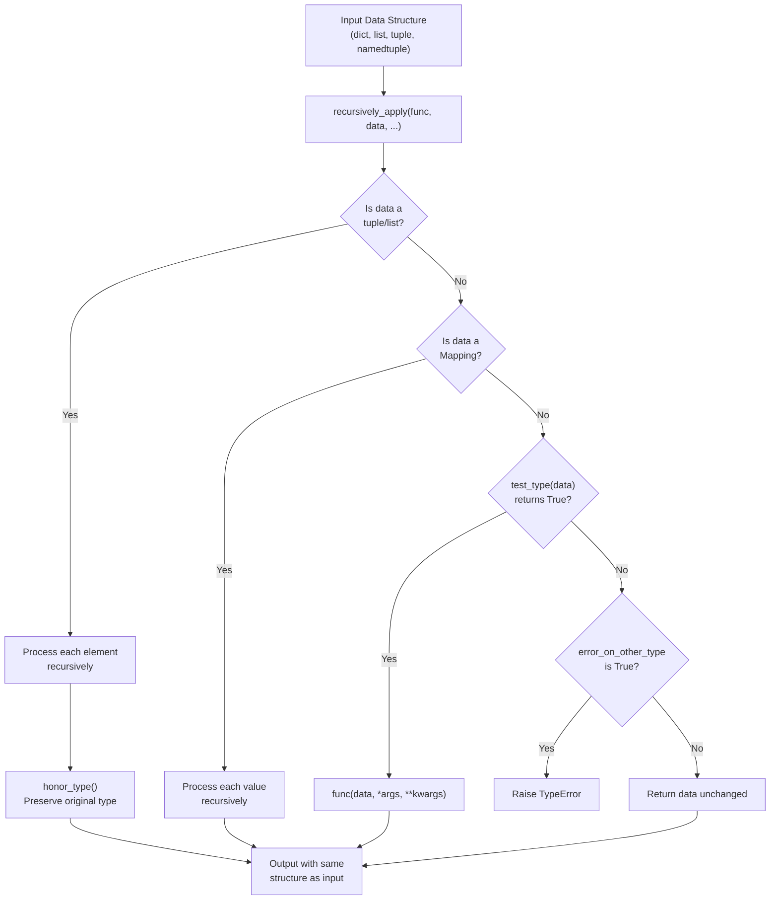
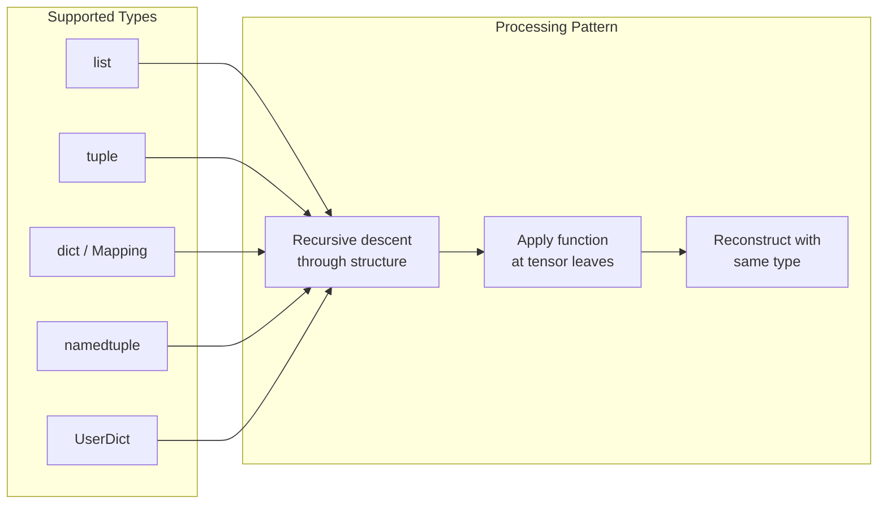
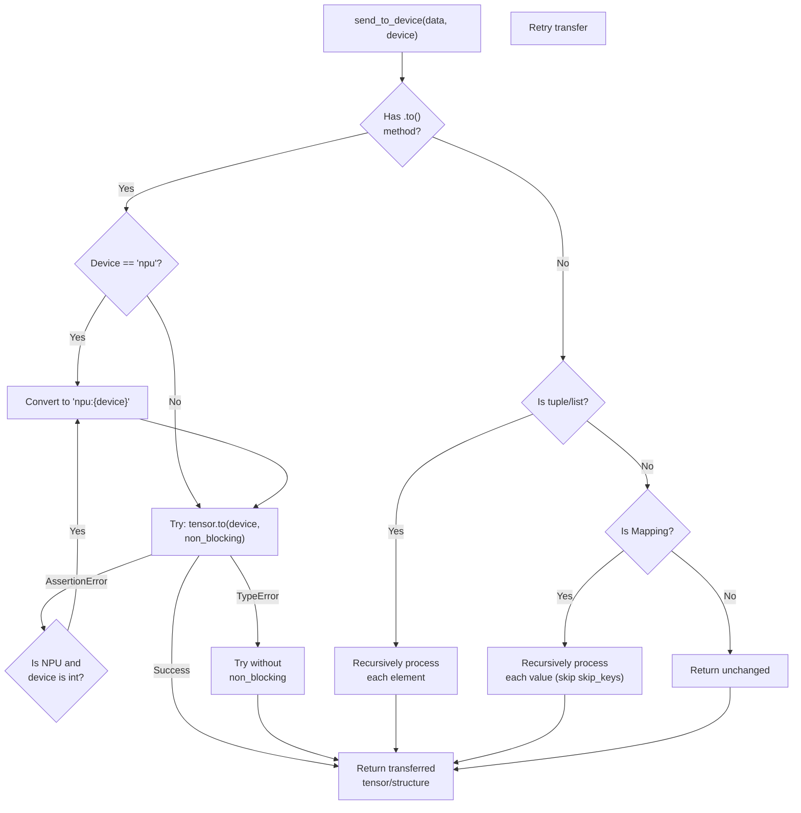
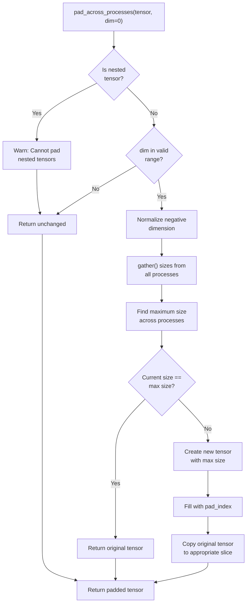

<!-- source: DeepWiki mcp.deepwiki.com · repo huggingface/accelerate · page 9.2 Tensor and Data Operations · fetched 2026-10-21 -->

# Tensor and Data Operations

<details>
<summary>Relevant source files</summary>

The following files were used as context for generating this wiki page:

- [src/accelerate/commands/config/update.py](src/accelerate/commands/config/update.py)
- [src/accelerate/commands/to_fsdp2.py](src/accelerate/commands/to_fsdp2.py)
- [src/accelerate/test_utils/scripts/test_ops.py](src/accelerate/test_utils/scripts/test_ops.py)
- [src/accelerate/utils/__init__.py](src/accelerate/utils/__init__.py)
- [src/accelerate/utils/imports.py](src/accelerate/utils/imports.py)
- [src/accelerate/utils/operations.py](src/accelerate/utils/operations.py)
- [src/accelerate/utils/other.py](src/accelerate/utils/other.py)
- [tests/test_utils.py](tests/test_utils.py)

</details>


This page documents utilities for manipulating tensors and nested data structures in Accelerate. These operations handle common tasks such as moving tensors between devices, recursively processing nested collections, extracting structural information, and converting data types. Unlike the collective operations in [Section 9.1](), these operations focus on single-process tensor manipulation and data structure processing that supports distributed workflows.

For distributed collective operations like `gather`, `broadcast`, and `reduce`, see [Section 9.1](). For model-specific utilities, see [Section 9.3]().

## Overview of Capabilities

Accelerate provides a comprehensive set of operations for handling tensors embedded in complex data structures. PyTorch training often involves passing dictionaries, lists, or tuples of tensors (e.g., model inputs), and these utilities ensure such structures can be seamlessly manipulated across devices and processes.

**Key capabilities:**
- Recursive processing of nested lists, tuples, dictionaries, and namedtuples
- Device transfer with automatic structure preservation
- Data structure introspection and metadata extraction
- Tensor slicing, concatenation, and padding
- Mixed precision conversion utilities

## Recursive Data Structure Processing

### The `recursively_apply` Function

The foundation of Accelerate's data processing utilities is `recursively_apply`, which applies a function to all tensors within a nested data structure while preserving the structure's type and shape.

[src/accelerate/utils/operations.py:85-134]()


**Figure 1: Recursive data structure processing flow**

Sources: [src/accelerate/utils/operations.py:85-134]()

### Type Preservation with `honor_type`

The `honor_type` function ensures that after recursive processing, the output maintains the same type as the input (list, tuple, or namedtuple).

[src/accelerate/utils/operations.py:74-83]()

| Input Type | Detection Method | Output Construction |
|------------|------------------|---------------------|
| `list` | `isinstance(obj, list)` | `list(generator)` |
| `tuple` | `isinstance(obj, tuple)` and no `_fields` | `tuple(generator)` |
| `namedtuple` | Has `_asdict` and `_fields` attributes | `type(obj)(*list(generator))` |

**Table 1: Type preservation strategies**

Sources: [src/accelerate/utils/operations.py:66-83]()

### Supported Data Structures


**Figure 2: Supported data structure types and processing pattern**

Sources: [src/accelerate/utils/operations.py:66-134](), [tests/test_utils.py:77-115]()

## Device Operations

### Moving Data to Devices with `send_to_device`

The `send_to_device` function recursively moves all tensors in a nested structure to a specified device, handling special cases for different hardware backends.

[src/accelerate/utils/operations.py:136-186]()

**Function signature:**
```python
send_to_device(tensor, device, non_blocking=False, skip_keys=None)
```

**Special handling:**

| Backend | Issue | Solution |
|---------|-------|----------|
| NPU | `.to("npu")` context error on first call | Convert device string to `"npu:0"` |
| NPU | `.to(int)` not supported | Convert integer device IDs to `"npu:{device}"` format |
| General | Objects without `.to()` | Silently skip, only process tensors and objects with `.to()` method |

**Table 2: Device-specific handling in `send_to_device`**

Sources: [src/accelerate/utils/operations.py:136-186]()

**Key behaviors:**
- Supports `non_blocking=True` for asynchronous transfers when supported by the backend [src/accelerate/utils/operations.py:160-162]()
- Allows `skip_keys` parameter to skip specific dictionary keys during device transfer [src/accelerate/utils/operations.py:179-182]()
- Recursively processes nested lists, tuples, and dictionaries [src/accelerate/utils/operations.py:175-179]()
- Handles objects with custom `.to()` methods (e.g., custom tensor-like classes) [src/accelerate/utils/operations.py:155-156]()


**Figure 3: `send_to_device` processing flow with error handling**

Sources: [src/accelerate/utils/operations.py:136-186](), [tests/test_utils.py:77-115]()

### Finding Device Location with `find_device`

The `find_device` function locates the device on which tensors in a nested structure reside, assuming all tensors are on the same device.

[src/accelerate/utils/operations.py:831-850]()

**Algorithm:**
1. Recursively traverse mappings and sequences [src/accelerate/utils/operations.py:835-843]()
2. Return the device of the first tensor encountered [src/accelerate/utils/operations.py:844-845]()
3. Return `None` if no tensors are found [src/accelerate/utils/operations.py:850]()

Sources: [src/accelerate/utils/operations.py:831-850](), [tests/test_utils.py:263-266]()

## Data Structure Introspection

### Extracting Structure Information

Accelerate provides utilities to extract metadata about tensor structures without materializing actual data.

#### `TensorInformation` Dataclass

[src/accelerate/utils/dataclasses.py:63]() (referenced in operations.py)

The `TensorInformation` dataclass stores minimal metadata about tensors:
- `shape`: Tensor dimensions
- `dtype`: Data type

#### `get_data_structure` Function

[src/accelerate/utils/operations.py:188-204]()

Converts a nested structure of tensors into the same structure but with `TensorInformation` objects replacing tensors. Useful for communicating tensor metadata across processes without sending actual tensor data.

#### `initialize_tensors` Function

[src/accelerate/utils/operations.py:224-236]()

Recreates empty tensors from a structure of `TensorInformation` objects. Used to allocate memory with the correct shape and dtype before receiving actual data.

#### `get_shape` Function

[src/accelerate/utils/operations.py:206-222]()

Extracts only the shapes of tensors in a nested structure, returning lists of dimensions instead of `TensorInformation` objects.

Sources: [src/accelerate/utils/operations.py:188-236]()

### Finding Batch Size

#### `find_batch_size` Function

[src/accelerate/utils/operations.py:238-259]()

Recursively finds the batch size (first dimension) in nested data structures. Commonly used to determine the effective batch size when processing model inputs.

#### `ignorant_find_batch_size` Function

[src/accelerate/utils/operations.py:261-276]()

Wrapper around `find_batch_size` that suppresses errors and returns `None` if batch size cannot be determined. Useful for optional batch size detection.

Sources: [src/accelerate/utils/operations.py:238-276]()

## Tensor Transformation Operations

### Slicing Tensors

#### `slice_tensors` Function

[src/accelerate/utils/operations.py:581-599]()

Recursively applies a slice operation to all tensors in a nested structure. Useful for splitting batches across processes.

Sources: [src/accelerate/utils/operations.py:581-599]()

### Concatenating Tensors

#### `concatenate` Function

[src/accelerate/utils/operations.py:601-625]()

Recursively concatenates lists of tensors in nested structures along a specified dimension.

Sources: [src/accelerate/utils/operations.py:601-625]()

### Converting to Python Lists

#### `listify` Function

[src/accelerate/utils/operations.py:278-299]()

Converts tensors to nested Python lists, detaching from computational graph and moving to CPU.

**Special handling:**
- BF16 tensors: Converted to FP32 before conversion (NumPy compatibility) [src/accelerate/utils/operations.py:284-285]()
- Automatically detaches tensors from gradient computation [src/accelerate/utils/operations.py:288]()
- Moves tensors to CPU before conversion [src/accelerate/utils/operations.py:288]()

Sources: [src/accelerate/utils/operations.py:278-299](), [tests/test_utils.py:124-133]()

## Padding Operations

### Padding Across Processes

#### `pad_across_processes` Function

[src/accelerate/utils/operations.py:631-685]()

Ensures tensors have uniform dimensions across all processes by padding to the maximum size found in any process. Critical for gather operations where tensors must have compatible shapes.

**Function signature:**
```python
pad_across_processes(tensor, dim=0, pad_index=0, pad_first=False)
```

**Parameters:**

| Parameter | Type | Description |
|-----------|------|-------------|
| `tensor` | nested structure | Data to pad |
| `dim` | `int` | Dimension along which to pad (default: 0) |
| `pad_index` | `int` | Value to use for padding (default: 0) |
| `pad_first` | `bool` | Whether to pad at start or end (default: False = end) |

**Table 3: `pad_across_processes` parameters**

**Algorithm:**
1. Gather sizes of the specified dimension from all processes using `gather()` [src/accelerate/utils/operations.py:660]()
2. Find maximum size across all processes [src/accelerate/utils/operations.py:661]()
3. Create new tensor with maximum size, filled with `pad_index` [src/accelerate/utils/operations.py:672]()
4. Copy original tensor into appropriate slice of new tensor [src/accelerate/utils/operations.py:674-678]()


**Figure 4: `pad_across_processes` execution flow**

Sources: [src/accelerate/utils/operations.py:631-685](), [src/accelerate/test_utils/scripts/test_ops.py:72-83](), [tests/test_utils.py:312-328]()

### Padding for Distributed Processing

#### `pad_input_tensors` Function

[src/accelerate/utils/operations.py:687-725]()

Pads tensors to ensure even distribution across processes when batch size is not evenly divisible by the number of processes.

Sources: [src/accelerate/utils/operations.py:687-725](), [tests/test_utils.py:329-393]()

## Precision Conversion

### Converting to FP32

#### `convert_to_fp32` Function

[src/accelerate/utils/operations.py:769-791]()

Recursively converts FP16 and BF16 tensors to FP32 precision. Used when full precision is needed for certain operations (e.g., loss computation).

#### `ConvertOutputsToFp32` Decorator Class

[src/accelerate/utils/operations.py:793-817]()

Decorator class that wraps a function (typically `model.forward`) to automatically convert outputs to FP32.

**Pickling protection:** Raises `PicklingError` to prevent serialization issues with wrapped models. Users must unwrap with `Accelerator.unwrap_model()` before pickling [src/accelerate/utils/operations.py:814-817]().

#### `convert_outputs_to_fp32` Function

[src/accelerate/utils/operations.py:819-829]()

Functional wrapper that creates a `ConvertOutputsToFp32` decorator and preserves the wrapper chain for proper unwrapping via `extract_model_from_parallel`.

```mermaid
graph LR
    ModelForward["model.forward"]
    Wrapped["convert_outputs_to_fp32(model.forward)"]
    ConvertClass["ConvertOutputsToFp32 instance"]
    ForwardFunc["Forward wrapper function"]
    
    ModelForward -->|"wrap"| Wrapped
    Wrapped -->|"creates"| ConvertClass
    ConvertClass -->|"wrapped in"| ForwardFunc
    ForwardFunc -."|__wrapped__ attribute"| ConvertClass
    
    ConvertClass -->|"Automatically converts<br/>FP16/BF16 outputs to FP32"| Output["FP32 Outputs"]
```
**Figure 5: FP32 conversion wrapper architecture**

Sources: [src/accelerate/utils/operations.py:769-829](), [tests/test_utils.py:180-206](), [tests/test_utils.py:398-401]()

## Helper Utilities

### Type Checking Functions

[src/accelerate/utils/operations.py:45-72]()

| Function | Purpose | Returns |
|----------|---------|---------|
| `is_torch_tensor(tensor)` | Check if object is `torch.Tensor` | `bool` |
| `is_torch_xpu_tensor(tensor)` | Check if object is XPU tensor (Intel GPU) | `bool` |
| `is_tensor_information(tensor_info)` | Check if object is `TensorInformation` | `bool` |
| `is_namedtuple(data)` | Check if object is a namedtuple | `bool` |

**Table 4: Type checking utilities**

Sources: [src/accelerate/utils/operations.py:45-72](), [tests/test_utils.py:402-423]()

## Integration with Distributed Operations

While this page focuses on single-process operations, many of these utilities support distributed workflows:

1. **`pad_across_processes`** uses `gather()` to coordinate padding across processes [src/accelerate/utils/operations.py:660]().
2. **`send_to_device`** prepares data for device-specific collective operations.
3. **`get_data_structure`** and `initialize_tensors` support efficient metadata exchange without transferring full tensors.

```mermaid
graph TB
    subgraph "Section 9.2: Tensor Operations"
        SendDevice["send_to_device"]
        PadAcross["pad_across_processes"]
        RecursiveApply["recursively_apply"]
        ConvertFP32["convert_to_fp32"]
    end
    
    subgraph "Section 9.1: Collective Operations"
        Gather["gather()"]
        Broadcast["broadcast()"]
        Reduce["reduce()"]
    end
    
    subgraph "Section 9.4: Verification"
        VerifyOp["@verify_operation"]
        ChainedOp["@chained_operation"]
    end
    
    PadAcross -->|"uses"| Gather
    RecursiveApply -."|supports"| SendDevice
    RecursiveApply -."|supports"| PadAcross
    RecursiveApply -."|supports"| ConvertFP32
    
    VerifyOp -->|"validates"| PadAcross
    ChainedOp -->|"wraps"| PadAcross
```
**Figure 6: Integration between tensor operations and distributed utilities**

Sources: [src/accelerate/utils/operations.py:1-868]()

---

