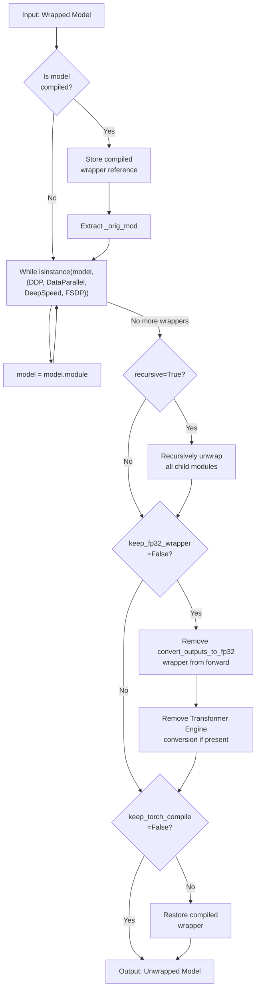
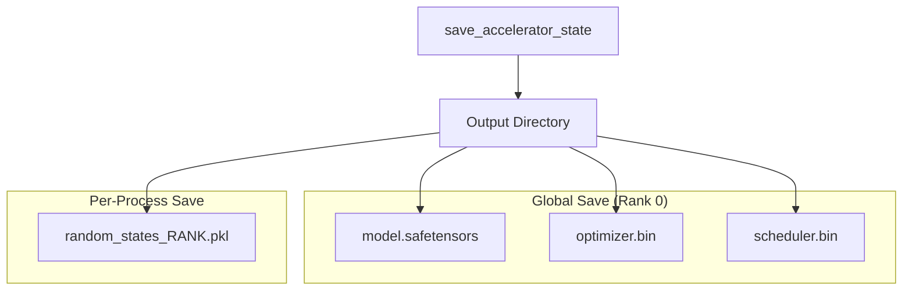

<!-- source: DeepWiki mcp.deepwiki.com · repo huggingface/accelerate · page 9.3 Model and State Utilities · fetched 2026-10-21 -->

# Model and State Utilities

<details>
<summary>Relevant source files</summary>

The following files were used as context for generating this wiki page:

- [src/accelerate/checkpointing.py](src/accelerate/checkpointing.py)
- [src/accelerate/commands/config/update.py](src/accelerate/commands/config/update.py)
- [src/accelerate/commands/env.py](src/accelerate/commands/env.py)
- [src/accelerate/commands/to_fsdp2.py](src/accelerate/commands/to_fsdp2.py)
- [src/accelerate/test_utils/scripts/test_ops.py](src/accelerate/test_utils/scripts/test_ops.py)
- [src/accelerate/utils/memory.py](src/accelerate/utils/memory.py)
- [src/accelerate/utils/operations.py](src/accelerate/utils/operations.py)
- [src/accelerate/utils/other.py](src/accelerate/utils/other.py)
- [src/accelerate/utils/random.py](src/accelerate/utils/random.py)
- [tests/test_state_checkpointing.py](tests/test_state_checkpointing.py)
- [tests/test_utils.py](tests/test_utils.py)

</details>


This page documents utilities for model manipulation, state management, and environment inspection that support distributed training operations. These utilities handle tasks such as extracting models from distributed wrappers, synchronizing processes, saving/loading state with proper safeguards, and synchronizing RNG states for reproducibility.

For operations on tensors and data structures, see [Tensor and Data Operations](#9.2). For collective communication primitives, see [Collective Operations](#9.1).

## Overview

The model and state utilities provide three main categories of functionality:

1. **Model Extraction**: Unwrapping models from distributed training wrappers (DDP, FSDP, DeepSpeed).
2. **State Management**: Saving and loading model state and training progress (optimizers, schedulers, RNG) with distributed process coordination.
3. **Reproducibility**: Synchronizing Random Number Generator (RNG) states across distributed processes.

These utilities are primarily located in [src/accelerate/utils/other.py](), [src/accelerate/utils/operations.py](), [src/accelerate/checkpointing.py](), and [src/accelerate/utils/random.py]().

Sources: [src/accelerate/utils/other.py:1-561](), [src/accelerate/utils/operations.py:1-867](), [src/accelerate/checkpointing.py:1-290](), [src/accelerate/utils/random.py:1-165]()

## Model Extraction Utilities

### extract_model_from_parallel

The `extract_model_from_parallel` function removes distributed training wrappers from a model to access the underlying base model. This is essential for operations like checkpointing, model inspection, or converting models for deployment.

```python
extract_model_from_parallel(
    model,
    keep_fp32_wrapper: bool = True,
    keep_torch_compile: bool = True,
    recursive: bool = False
)
```

**Supported Wrappers**: The function handles the following distributed wrappers:
- `torch.nn.parallel.DistributedDataParallel`
- `torch.nn.DataParallel`
- `deepspeed.DeepSpeedEngine` (if DeepSpeed is available)
- `torch.distributed.fsdp.FullyShardedDataParallel` (FSDP v1)
- Compiled modules (`torch.compile` wrappers)

**Parameters**:
- `keep_fp32_wrapper`: When `False`, removes mixed precision conversion hooks from the model's forward method.
- `keep_torch_compile`: When `False`, unwraps compiled models to their original form.
- `recursive`: When `True`, recursively unwraps nested modules (needed for FSDPv2 on XLA).

Sources: [src/accelerate/utils/other.py:218-300]()

#### Unwrapping Process

The extraction follows a specific order to handle nested wrappers correctly:



Sources: [src/accelerate/utils/other.py:240-298]()

#### Handling Compiled Models

Accelerate tracks compiled models through special attributes:

| Detection Method | Code Location | Purpose |
|-----------------|---------------|---------|
| `is_compiled_module()` | [src/accelerate/utils/other.py:54-61]() | Checks if module is a top-level `OptimizedModule` |
| `has_compiled_regions()` | [src/accelerate/utils/other.py:64-76]() | Checks if module has compiled submodules |
| `_orig_mod` attribute | [src/accelerate/utils/other.py:171-173]() | Stores reference to original uncompiled module |

Sources: [src/accelerate/utils/other.py:54-76](), [src/accelerate/utils/other.py:240-298]()

## Synchronization Utilities

### wait_for_everyone

The `wait_for_everyone` function creates a blocking synchronization point across all processes in distributed training:

```python
from accelerate.utils import wait_for_everyone

# All processes will wait here until everyone arrives
wait_for_everyone()
```

This is a convenience wrapper around `PartialState().wait_for_everyone()` that ensures all processes reach the same point in execution before continuing.

Sources: [src/accelerate/utils/other.py:303-313]()

### synchronize_rng_states

For reproducible distributed training, random number generator (RNG) states must be synchronized across processes. The `synchronize_rng_states` function broadcasts the state from the main process (rank 0) to all other processes.

```python
from accelerate.utils import synchronize_rng_states, RNGType

# Synchronize torch and cuda seeds
synchronize_rng_states([RNGType.TORCH, RNGType.CUDA])
```

**Implementation Details**:
- **XLA**: Uses `xm.collective_broadcast` and `xm.mark_step()` [src/accelerate/utils/random.py:117-121]().
- **Multi-GPU/NPU/XPU**: Uses `torch.distributed.broadcast` [src/accelerate/utils/random.py:122-134]().
- **Supported Backends**: CUDA, XLA, NPU, MLU, SDAA, MUSA, XPU, HPU, and Neuron [src/accelerate/utils/random.py:83-113]().

Sources: [src/accelerate/utils/random.py:81-165]()

## State Saving and Loading

### Distributed-Aware save/load

Accelerate provides distributed-aware wrappers for `torch.save` and `torch.load`.

| Function | Source | Description |
|----------|--------|-------------|
| `save` | [src/accelerate/utils/other.py:351-383]() | Saves only on rank 0 (or local main process if `save_on_each_node=True`). Handles `safetensors` and XLA CPU transfers. |
| `load` | [src/accelerate/utils/other.py:401-430]() | Safe replacement for `torch.load` using `weights_only=True` on PyTorch 2.4+ to prevent code execution vulnerabilities. |

### save_accelerator_state

This function persists the entire training state, including models, optimizers, schedulers, dataloaders, and RNG states.

```python
save_accelerator_state(
    output_dir, model_states, optimizers, schedulers, dataloaders, 
    process_index, step, scaler=None, safe_serialization=True
)
```

**Data Flow**:
1. **Models**: Saved as `model.safetensors` (or `.bin`) [src/accelerate/checkpointing.py:109-115]().
2. **Optimizers/Schedulers**: Saved using native pickle [src/accelerate/checkpointing.py:117-129]().
3. **Dataloaders**: Saves sampler states for `SeedableRandomSampler` [src/accelerate/checkpointing.py:131-146]().
4. **RNG States**: Saves `random`, `numpy`, and `torch` states into a file named `random_states_{process_index}.pkl` [src/accelerate/checkpointing.py:155-177]().

Sources: [src/accelerate/checkpointing.py:63-181]()



Sources: [src/accelerate/checkpointing.py:63-181]()

## Model Inspection Utilities

### Compilation Status

Three functions check if a model or its components are compiled with `torch.compile`:

| Function | Purpose | Returns |
|----------|---------|---------|
| `is_compiled_module(module)` | Check if module is directly compiled [src/accelerate/utils/other.py:54-61]() | `bool` |
| `has_compiled_regions(module)` | Check if any submodules are compiled [src/accelerate/utils/other.py:64-76]() | `bool` |
| `is_repeated_blocks(module)` | Check if module is a `ModuleList` with same-class children [src/accelerate/utils/other.py:79-89]() | `bool` |

### Regional Compilation

Regional compilation applies `torch.compile` to specific repeated blocks to optimize compilation time and hit the compiler cache.

- `compile_regions`: Targets repeated blocks (e.g., Transformer layers) for sequential compilation [src/accelerate/utils/other.py:106-175]().
- `compile_regions_deepspeed`: Special version for DeepSpeed models using `module.compile()` to avoid hook interference [src/accelerate/utils/other.py:178-195]().

Sources: [src/accelerate/utils/other.py:102-195]()

### Memory Utilities

| Function | Source | Description |
|----------|--------|-------------|
| `clear_device_cache` | [src/accelerate/utils/memory.py:40-68]() | Clears cache for CUDA, XPU, MLU, NPU, MPS, etc. |
| `release_memory` | [src/accelerate/utils/memory.py:70-97]() | Sets objects to `None` and calls garbage collection/cache clearing. |
| `find_executable_batch_size` | [src/accelerate/utils/memory.py:119-188]() | Decorator that catches OOM errors and retries with a smaller batch size (default reduction factor 0.9). |

Sources: [src/accelerate/utils/memory.py:40-188]()

---

