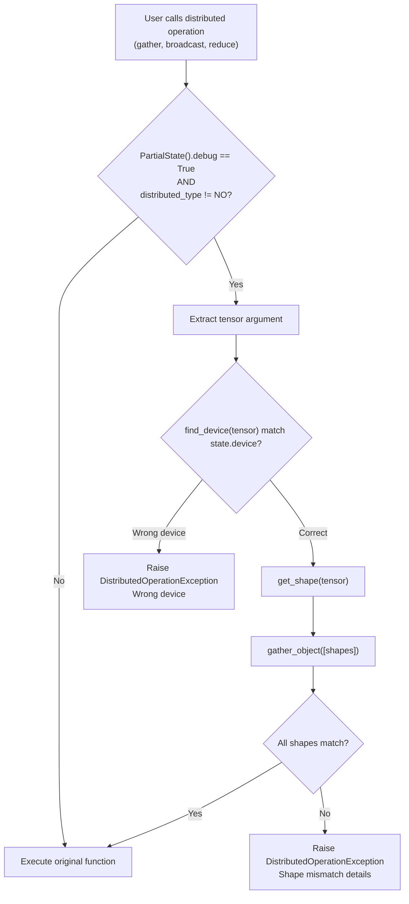
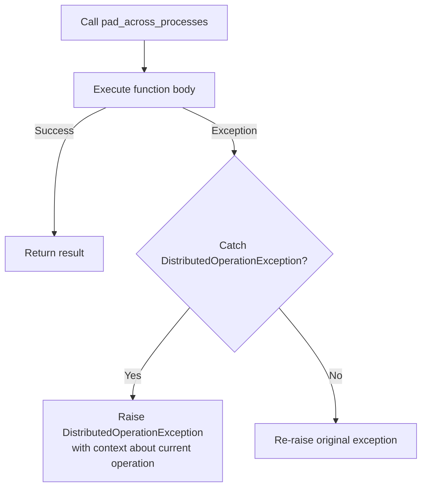

<!-- source: DeepWiki mcp.deepwiki.com · repo huggingface/accelerate · page 9.4 Verification and Debugging · fetched 2026-10-21 -->

# Verification and Debugging

<details>
<summary>Relevant source files</summary>

The following files were used as context for generating this wiki page:

- [README.md](README.md)
- [docs/source/basic_tutorials/troubleshooting.md](docs/source/basic_tutorials/troubleshooting.md)
- [docs/source/concept_guides/fsdp_and_deepspeed.md](docs/source/concept_guides/fsdp_and_deepspeed.md)
- [examples/README.md](examples/README.md)
- [src/accelerate/commands/config/update.py](src/accelerate/commands/config/update.py)
- [src/accelerate/commands/to_fsdp2.py](src/accelerate/commands/to_fsdp2.py)
- [src/accelerate/test_utils/scripts/test_ops.py](src/accelerate/test_utils/scripts/test_ops.py)
- [src/accelerate/utils/operations.py](src/accelerate/utils/operations.py)
- [src/accelerate/utils/other.py](src/accelerate/utils/other.py)
- [tests/test_utils.py](tests/test_utils.py)

</details>


## Purpose and Scope

This document details the verification and debugging utilities provided by Accelerate for distributed operations. These tools help identify and diagnose issues when tensors across multiple processes have incompatible shapes or configurations that would cause distributed operations to fail or produce incorrect results.

Key components covered include:
- The `verify_operation` and `chained_operation` decorators.
- The `DistributedOperationException` for detailed error reporting.
- Accelerate's debug mode for operational validation.

## Overview

Accelerate provides a verification system that validates tensor compatibility across processes before executing distributed operations. This system is controlled by the `PartialState().debug` flag and helps catch shape mismatches early with clear error messages rather than allowing cryptic failures deep in distributed communication primitives.

**Sources:** [src/accelerate/utils/operations.py:364-416](), [docs/source/basic_tutorials/troubleshooting.md:54-60]()

## Debug Mode

### Enabling Debug Mode

Debug mode is controlled through the `PartialState` singleton or via environment variables and CLI flags.

```python
from accelerate import PartialState

state = PartialState()
state.debug = True  # Enable verification
```

Alternatively, it can be enabled via the CLI:
```bash
accelerate launch --debug {my_script.py}
```
Or as an environment variable:
```bash
ACCELERATE_DEBUG_MODE="1" torchrun {my_script.py}
```

When `debug=True`, Accelerate performs additional validation checks before distributed operations. When `debug=False` (the default), these checks are skipped for performance.

**Key Characteristics:**
- Only active when `PartialState().distributed_type != DistributedType.NO` [src/accelerate/utils/operations.py:371-372]().
- Adds overhead by gathering tensor shapes from all processes via `gather_object` [src/accelerate/utils/operations.py:384-386]().
- Provides detailed error messages about shape mismatches across processes.
- Can be toggled at runtime [src/accelerate/test_utils/scripts/test_ops.py:105-137]().

**Sources:** [src/accelerate/utils/operations.py:371-372](), [docs/source/basic_tutorials/troubleshooting.md:62-89](), [src/accelerate/test_utils/scripts/test_ops.py:105-137]()

## Verification System Architecture

### The verify_operation Decorator

The `verify_operation` decorator wraps distributed operations to validate tensor shapes across all processes before execution.

**Natural Language to Code Entity Space: Verification Flow**



**Verification Process:**

1. **Debug Check**: Only runs if `PartialState().debug=True` and is in a distributed environment [src/accelerate/utils/operations.py:371-372]().
2. **Tensor Extraction**: Gets the tensor from function arguments (first arg or `tensor` kwarg) [src/accelerate/utils/operations.py:374-377]().
3. **Device Validation**: Ensures tensor is on the expected device type using `find_device` [src/accelerate/utils/operations.py:378-382]().
4. **Shape Collection**: Uses `get_shape()` to extract shape information [src/accelerate/utils/operations.py:383]().
5. **Cross-Process Comparison**: Gathers shapes from all processes via `gather_object()` [src/accelerate/utils/operations.py:384-386]().
6. **Match Verification**: Checks if all processes have the same shape [src/accelerate/utils/operations.py:387-391]().
7. **Error Reporting**: Provides detailed per-process shape information on mismatch via `DistributedOperationException` [src/accelerate/utils/operations.py:392-393]().

**Sources:** [src/accelerate/utils/operations.py:364-396]()

### Operations Protected by Verification

The following distributed operations are decorated with `@verify_operation`:

| Operation | Function | Purpose | Line Reference |
|-----------|----------|---------|----------------|
| `gather` | Collect tensors from all processes | All-gather operation | [operations.py:418]() |
| `broadcast` | Send tensor from one process to all | Broadcast operation | [operations.py:538]() |
| `reduce` | Combine tensors across processes | All-reduce operation | [operations.py:723]() |

The `pad_across_processes` operation uses `@chained_operation` instead to provide better error context.

**Sources:** [src/accelerate/utils/operations.py:418-762]()

## Exception Types

### DistributedOperationException

This custom exception is raised when verification detects incompatible tensor configurations.

```python
class DistributedOperationException(Exception):
    """
    An exception class for distributed operations. Raised if the operation 
    cannot be performed due to the shape of the tensors.
    """
    pass
```

**Error Messages Include:**
- Operation name (module and function).
- Shape of tensor on each process.
- Whether tensor is on the wrong device.

**Example Error Message:**

```
DistributedOperationException: Cannot apply desired operation due to shape 
mismatches. All shapes across devices must be valid.

Operation: `accelerate.utils.operations.broadcast`
Input shapes:
  - Process 0: [1, 5]
  - Process 1: [1, 2, 5]
```

**Sources:** [src/accelerate/utils/operations.py:355-361](), [docs/source/basic_tutorials/troubleshooting.md:100-108]()

### The chained_operation Decorator

The `chained_operation` decorator wraps functions that call other verified operations to provide better error chaining.

**Code Entity Space: Exception Chaining**



This is useful for operations like `pad_across_processes` which internally call `gather()`. If `gather()` fails verification, `chained_operation` adds context about the higher-level operation.

**Sources:** [src/accelerate/utils/operations.py:399-415](), [src/accelerate/utils/operations.py:627]()

## Practical Usage Examples

### Example 1: Detecting Shape Mismatches

From the test suite, verifying that incompatible shapes trigger the exception:

```python
from accelerate import PartialState
from accelerate.utils.operations import pad_across_processes, DistributedOperationException

state = PartialState()
state.debug = True

# Process 0 has shape [1, 5]
if state.process_index == 0:
    data = {"tensor": torch.tensor([[0.0, 1, 2, 3, 4]]).to(state.device)}
# Process 1 has shape [1, 1, 6]  <- Incompatible!
else:
    data = {"tensor": torch.tensor([[[0.0, 1, 2, 3, 4, 5]]]).to(state.device)}

with assert_exception(DistributedOperationException):
    pad_across_processes(data, dim=0)
```

**Sources:** [src/accelerate/test_utils/scripts/test_ops.py:115-128]()

### Example 2: Device Mismatch Detection

```python
from accelerate import PartialState
from accelerate.utils.operations import gather, DistributedOperationException

state = PartialState()
state.debug = True

# Tensor on wrong device
tensor = torch.randn(4, 4).to("cpu")  # Should be on state.device

try:
    gathered = gather(tensor)
except DistributedOperationException as e:
    # Error: "One or more tensors were not on the cuda device 
    # while Accelerator is configured for cuda"
    print(e)
```

**Sources:** [src/accelerate/utils/operations.py:378-382]()

## Helper Utilities

### find_device Function

The `find_device()` utility recursively finds the device of tensors in nested data structures.

```python
from accelerate.utils.operations import find_device

device = find_device([1, "a", torch.tensor([1, 2, 3])])
# Returns: torch.device("cpu")
```

This is used internally by `verify_operation` to check device compatibility against `PartialState().device`.

**Sources:** [src/accelerate/utils/operations.py:827-845](), [tests/test_utils.py:50]()

### get_shape Function

Extracts shapes from nested data structures containing tensors.

```python
from accelerate.utils.operations import get_shape

shapes = get_shape(torch.randn(3, 4))
# Returns: [3, 4]
```

**Sources:** [src/accelerate/utils/operations.py:206-221](), [src/accelerate/utils/operations.py:383]()

## Best Practices

### When to Enable Debug Mode

**Enable debug mode during:**
- Initial development and testing.
- Troubleshooting distributed synchronization issues (hanging code).
- Validating new data processing pipelines.

**Disable debug mode for:**
- Production training runs (due to the communication overhead of `gather_object`).
- Performance benchmarking.

**Sources:** [docs/source/basic_tutorials/troubleshooting.md:60-61](), [src/accelerate/utils/operations.py:384-386]()

### Relationship to Other Components

The verification system integrates with:

- **PartialState**: Provides the `debug` flag and distributed type information [src/accelerate/utils/operations.py:27]().
- **Collective Operations**: All collective operations (gather, broadcast, reduce) use verification [src/accelerate/utils/operations.py:418-762]().
- **Troubleshooting**: Serves as the primary tool for diagnosing `torch.distributed` timeouts caused by shape mismatches [docs/source/basic_tutorials/troubleshooting.md:54-60]().

**Sources:** [src/accelerate/utils/operations.py:27](), [docs/source/basic_tutorials/troubleshooting.md:54-60]()

---

