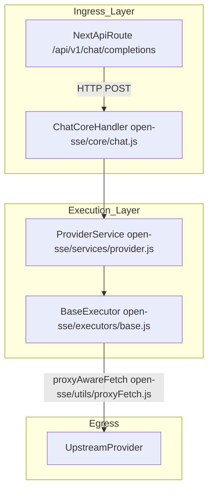
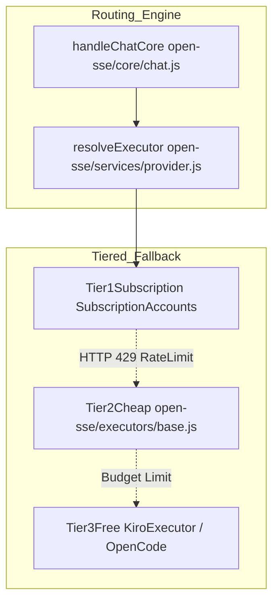

<!-- source: DeepWiki mcp.deepwiki.com · repo decolua/9router · page 1 Overview · fetched 2026-10-30 -->

# Overview

Relevant source files

The following files were used as context for generating this wiki page:

- [.github/dependabot.yml](.github/dependabot.yml)
- [.github/workflows/docker-publish.yml](.github/workflows/docker-publish.yml)
- [.gitignore](.gitignore)
- [.npmignore](.npmignore)
- [CHANGELOG.md](CHANGELOG.md)
- [DOCKER.md](DOCKER.md)
- [Dockerfile](Dockerfile)
- [README.md](README.md)
- [cli/package.json](cli/package.json)
- [cli/scripts/build-cli.js](cli/scripts/build-cli.js)
- [cli/scripts/buildMitm.js](cli/scripts/buildMitm.js)
- [cli/src/cli/terminalUI.js](cli/src/cli/terminalUI.js)
- [cli/src/cli/utils/input.js](cli/src/cli/utils/input.js)
- [next.config.mjs](next.config.mjs)
- [open-sse/config/runtimeConfig.js](open-sse/config/runtimeConfig.js)
- [open-sse/executors/base.js](open-sse/executors/base.js)
- [package.json](package.json)
- [src/app/api/usage/stream/route.js](src/app/api/usage/stream/route.js)
- [tests/unit/cli-build-artifacts.test.js](tests/unit/cli-build-artifacts.test.js)
- [tests/unit/open-package-external.test.js](tests/unit/open-package-external.test.js)

## Purpose and Scope

9Router (`9router-app`) is a smart AI request router and token optimization engine designed to maximize developer subscription efficiency, reduce operational costs, and maintain zero-downtime availability across 40+ AI providers [README.md:4-9](), [package.json:2-4](). It provides OpenAI-compatible API endpoints (`/v1/chat/completions`, `/v1/messages`), Man-in-the-Middle (MITM) proxy capabilities, and a 3-tier automatic fallback mechanism.

The system allows AI coding assistants (such as Claude Code, Cursor, Cline, and Codex) to transparently route requests through paid subscriptions, cheap pay-as-you-go providers, and free tiers without manual intervention [README.md:6-8](), [README.md:39-42](). 

For detailed system component mapping, see [System Architecture](#1.1). For an inventory of support directories and assets, see [Repository Layout & Assets](#1.2).

Sources: [README.md:4-9](), [package.json:2-4]()

---

## System Architecture & Layout

9Router is structured as a modular Next.js application accompanied by an underlying execution engine (`open-sse`), a MITM proxy subsystem (`src/mitm`), and a companion CLI package (`cli/`) [package.json:31-37](), [next.config.mjs:12-15](), [cli/package.json:5-10](). 

### Diagram: System Architecture and Code Entity Mapping

Sources: [next.config.mjs:60-102](), [open-sse/executors/base.js:11-16](), [cli/package.json:5-10]()

For high-level module boundaries, Next.js app routes, and request flows, see [System Architecture](#1.1). For non-code and support directories (`public/`, `skills/`, `docs/`, `scripts/`), see [Repository Layout & Assets](#1.2).

---

## Getting Started & Core Concepts

Users can deploy 9Router via npm globally, Docker, or directly from source code [README.md:79-115](). Core configuration revolves around providers, models, authentication methods, and fusion/combo configurations [README.md:85-96]().

### Diagram: 3-Tier Fallback and Executor Routing

Sources: [README.md:62-69](), [open-sse/executors/base.js:100-125]()

For setup procedures, quick starts, configuration basics, and the terminal CLI application (`cli/`), see Getting Started (Section 2). For deep dives into routing strategies, provider authentication types, format translation, and account fallback mechanisms, see Core Concepts (Section 3).

---

## Request Processing, Providers, & MITM Proxy

Requests flow through an ingestion pipeline that executes token optimization (RTK Token Saver), format translation (OpenAI, Claude, Gemini, Codex, etc.), and upstream dispatch via provider executors [README.md:38](), [CHANGELOG.md:70-73]().

- **Request Processing**: Traces chat flows, streaming Server-Sent Events (SSE), format translation pipelines, usage tracking, and token savers (`RTK`, `Caveman`, `Ponytail`, `PXPipe`) [README.md:38](), [CHANGELOG.md:105-106](). For details, see Request Processing (Section 4).
- **Provider System**: Manages provider registry mappings, pricing structures, token refresh lifecycles, account selection strategies, and per-provider quota fetchers [CHANGELOG.md:31-32](), [open-sse/executors/base.js:88-94](). For details, see Provider System (Section 5).
- **MITM Proxy System**: Intercepts AI tool traffic requiring TLS interception, local Root CA generation, and custom DNS bypass [cli/package.json:32](). For details, see MITM Proxy System (Section 6).

Sources: [README.md:38](), [open-sse/executors/base.js:88-94](), [cli/package.json:32]()

---

## Data Storage, Dashboard, API, & Deployment

9Router persists operational data, usage metrics, and settings in a SQLite database layer (`better-sqlite3` with `sql.js` fallback) [package.json:49-57](). 

- **Data & Storage**: Covers schema migrations, repositories (`settingsRepo`, `usageRepo`), and the `~/.9router` backup directory [package.json:49-57](). For details, see Data & Storage (Section 7).
- **Web Dashboard**: Documents management interfaces for connections, token savers, proxy pools, and agent skills [package.json:20-23](). For details, see Web Dashboard (Section 8).
- **API Reference**: Details endpoints for chat completions, embeddings, media, provider management, and OAuth flows [next.config.mjs:60-95](). For details, see API Reference (Section 9).
- **Network & Proxy**: Explains proxy configurations, remote access tunnels (Cloudflare Tunnel, Tailscale Funnel), and MITM DNS bypass [open-sse/config/runtimeConfig.js:31-32](). For details, see Network & Proxy (Section 10).
- **Security & Access Control**: Covers dashboard password authentication, OIDC/SAML enterprise SSO, and request guarding (`dashboardGuard.js`) [package.json:26-28](). For details, see Security & Access Control (Section 11).
- **Deployment & Development**: Guides running 9Router locally, via Docker, environment variables setup, extension guides, testing suites, and localization [Dockerfile:1-59](), [package.json:6-18](). For details, see Deployment (Section 12) and Development (Section 13).
- **Troubleshooting & Glossary**: Addresses common authentication, provider connection, and MITM proxy errors alongside a complete codebase-specific glossary [CHANGELOG.md:25-26](). For details, see Troubleshooting (Section 14) and Glossary (Section 15).

Sources: [package.json:6-57](), [Dockerfile:1-59]()

---

