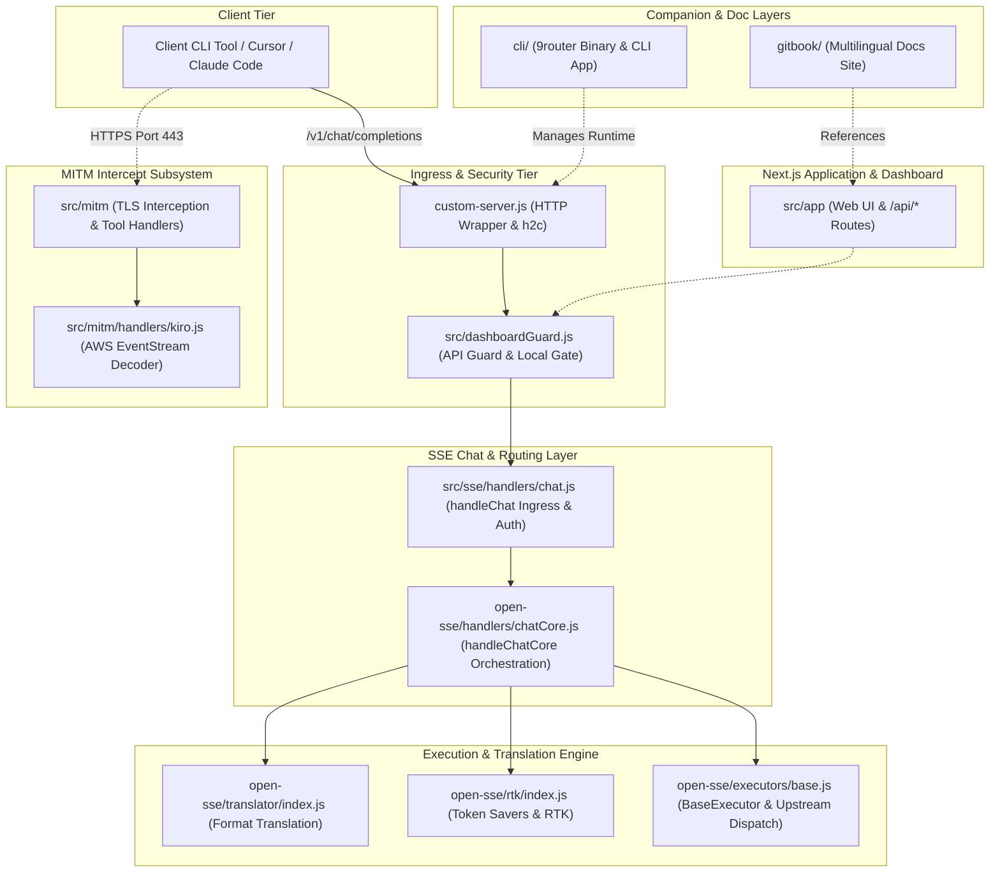
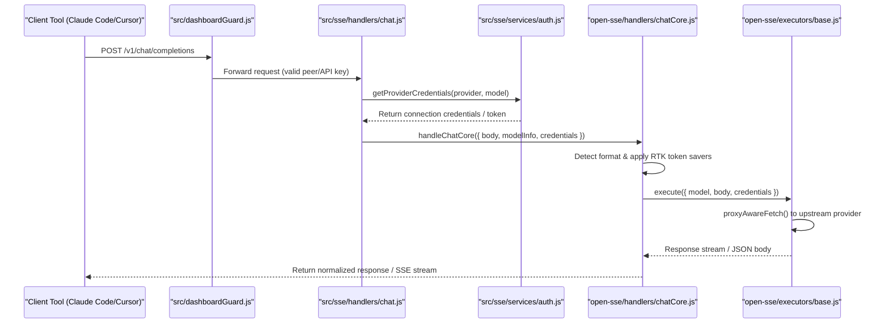

<!-- source: DeepWiki mcp.deepwiki.com · repo decolua/9router · page 1.1 System Architecture · fetched 2026-10-30 -->

# System Architecture

Relevant source files

The following files were used as context for generating this wiki page:

- [.github/dependabot.yml](.github/dependabot.yml)
- [.github/workflows/docker-publish.yml](.github/workflows/docker-publish.yml)
- [.gitignore](.gitignore)
- [.npmignore](.npmignore)
- [DOCKER.md](DOCKER.md)
- [Dockerfile](Dockerfile)
- [README.md](README.md)
- [images/fusion-combo-ui.png](images/fusion-combo-ui.png)
- [open-sse/config/runtimeConfig.js](open-sse/config/runtimeConfig.js)
- [open-sse/executors/base.js](open-sse/executors/base.js)
- [open-sse/handlers/chatCore.js](open-sse/handlers/chatCore.js)
- [open-sse/services/combo.js](open-sse/services/combo.js)
- [open-sse/translator/concerns/modality.js](open-sse/translator/concerns/modality.js)
- [src/app/api/usage/stream/route.js](src/app/api/usage/stream/route.js)
- [src/sse/handlers/chat.js](src/sse/handlers/chat.js)
- [src/sse/services/auth.js](src/sse/services/auth.js)
- [tests/unit/combo-fusion.test.js](tests/unit/combo-fusion.test.js)
- [tests/unit/fetch-success-clears-account.test.js](tests/unit/fetch-success-clears-account.test.js)
- [tests/unit/hermes-vision-detection.test.js](tests/unit/hermes-vision-detection.test.js)

## Purpose and Scope
This page maps the major structural layers of 9Router, detailing module boundaries, inter-module communication, security boundaries, and high-level request flows. It bridges natural language concepts to precise codebase implementations across `src/app`, `open-sse`, `src/sse`, `src/mitm`, `cli/`, and gitbook documentation.

Sources: [README.md:46-70](), [src/sse/handlers/chat.js:33-161](), [custom-server.js:52-126]()

---

## 1. Major System Layers & Code Entity Mapping

9Router combines a Next.js web dashboard (`src/app`), a decoupled routing and translation engine (`open-sse`), specialized SSE/chat handlers (`src/sse`), a Man-in-the-Middle (MITM) proxy subsystem (`src/mitm`), a CLI companion package (`cli/`), and documentation assets.

*Diagram 1: High-level System Architecture mapping layers to codebase entities.*

Sources: [src/sse/handlers/chat.js:33-161](), [open-sse/handlers/chatCore.js:61-112](), [src/dashboardGuard.js:202-279](), [custom-server.js:52-126](), [Dockerfile:30-46]()

---

## 2. Ingress & Request Guarding Layer

All network requests enter through a custom Node.js HTTP server wrapper (`custom-server.js`), decoupling underlying transport sockets from Next.js middleware.

### Ingress Sanitization & `h2c` Downgrading
* **HTTP Wrapper (`custom-server.js`)**: Intercepts `http.createServer`, extracts remote socket address (`req.socket.remoteAddress`), evaluates loopback proxy status (`isLoopbackProxy`), and injects unspoofable headers (`x-9r-real-ip`, `x-9r-peer-token`) [custom-server.js:9-14]().
* **HTTP/2 Cleartext (`h2c`) Support**: Intercepts `upgrade` events for `h2c` streams, buffers payloads, and replays them into standard `IncomingMessage` streams [custom-server.js:80-124]().

### Request Guarding (`src/dashboardGuard.js`)
* **Route Classification**: Distinguishes between public LLM endpoints (`PUBLIC_PREFIXES`: `/v1`, `/v1beta`, `/codex`, `/responses`) [src/dashboardGuard.js:38](), protected dashboard routes (`PROTECTED_API_PATHS`) [src/dashboardGuard.js:51-69](), and local-only routes (`LOCAL_ONLY_PATHS`) [src/dashboardGuard.js:72-88]().
* **Local Peer Trust**: Validates local loopback requests using `isLocalRequest(request)`, protecting administrative operations [src/dashboardGuard.js:121-133]().

Sources: [custom-server.js:1-126](), [src/dashboardGuard.js:1-279]()

---

## 3. Request Processing & Core Routing Flow

When an AI coding tool issues a chat request (`/v1/chat/completions`), it traverses `src/sse/handlers/chat.js`, resolves credentials, applies optimization, translates formats, and executes upstream calls via `open-sse`.

*Diagram 2: Request Processing Sequence from Ingress to Upstream Execution linking exact file functions.*

### Execution Pipeline Breakdown
1. **Chat Ingress (`src/sse/handlers/chat.js`)**: Parses JSON payloads, strips model context markers (`<model>[1m]`), enforces API key checks if `requireApiKey` is active, and detects required capabilities [src/sse/handlers/chat.js:33-93]().
2. **Combo & Fusion Resolution**: If requested model is a combo alias, `handleComboChat` or `handleFusionChat` orchestrates fallback chains and round-robin logic [src/sse/handlers/chat.js:95-139]().
3. **Core Orchestration (`open-sse/handlers/chatCore.js`)**: Determines format via `detectFormat` and `getTargetFormat`, applies RTK token compression (`compressMessages`, `injectCaveman`), and routes response [open-sse/handlers/chatCore.js:61-112]().
4. **Executor Dispatch (`open-sse/executors/base.js`)**: `BaseExecutor` builds headers, constructs upstream URL, and executes requests via `proxyAwareFetch` with automated retry management for rate limits (`429`) and gateway errors (`502`, `503`, `504`) [open-sse/executors/base.js:100-164]().

Sources: [src/sse/handlers/chat.js:33-161](), [open-sse/handlers/chatCore.js:61-112](), [open-sse/executors/base.js:100-164](), [src/sse/services/auth.js:28-140]()

---

## 4. Account Fallback, Rate Limiting, & Credentials

Account management and resilience are handled by `src/sse/services/auth.js` in conjunction with `open-sse/services/accountFallback.js`.

* **Credential Selection & Concurrency**: `getProviderCredentials` uses a selection mutex to prevent race conditions during account rotation [src/sse/services/auth.js:9-41](). It filters out unavailable, excluded, or model-locked connections using flat fields like `modelLock_${model}` [src/sse/services/auth.js:85-112](), [open-sse/services/accountFallback.js:121-140]().
* **Error Classification & Fallback**: `checkFallbackError` inspects error text and status codes against `ERROR_RULES` to determine whether an error should trigger an immediate fallback or backoff cooldown [open-sse/services/accountFallback.js:16-65]().

Sources: [src/sse/services/auth.js:28-140](), [open-sse/services/accountFallback.js:1-174]()

---

## 5. Specialized Subsystems: MITM Proxy, CLI, & Standalone Packaging

### Man-in-the-Middle (MITM) Intercept Subsystem (`src/mitm`)
* **Purpose**: Intercepts hardcoded or native TLS traffic from desktop coding tools (Antigravity, Kiro, GitHub Copilot) and redirects them through the local 9Router proxy.
* **Implementation**: Operates an HTTPS intercept server using dynamically generated Root CA and leaf certificates. Specialized handlers (e.g., `src/mitm/handlers/kiro.js`) decode binary AWS EventStream frames and parse nested thinking blocks [src/mitm/handlers/kiro.js:27-179]().

### CLI Package (`cli/`)
* **Purpose**: Provides the companion command-line interface (`9router` binary) wrapping local daemon startup, tray integration, SQLite runtime hooks, and terminal UI menus.

### Documentation Site (`gitbook/`)
* **Purpose**: Houses the multilingual GitBook documentation site containing navigation structures, content pages, and translation assets.

### Standalone Packaging (`Dockerfile`)
* **Container Build**: Multi-stage Docker build (`Dockerfile`) that compiles Next.js standalone output, copies sibling runtime scripts (`custom-server.js`), prunes unnecessary modules while preserving vital runtimes like `node-forge`, `sql.js`, and `node-machine-id`, and configures root-to-non-root execution via `su-exec` [Dockerfile:1-84]().

Sources: [src/mitm/handlers/kiro.js:1-179](), [Dockerfile:1-84]()

---

