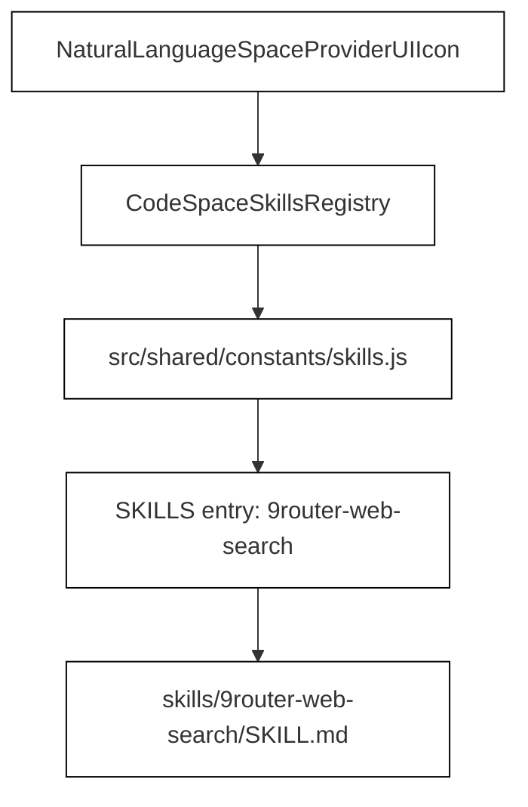
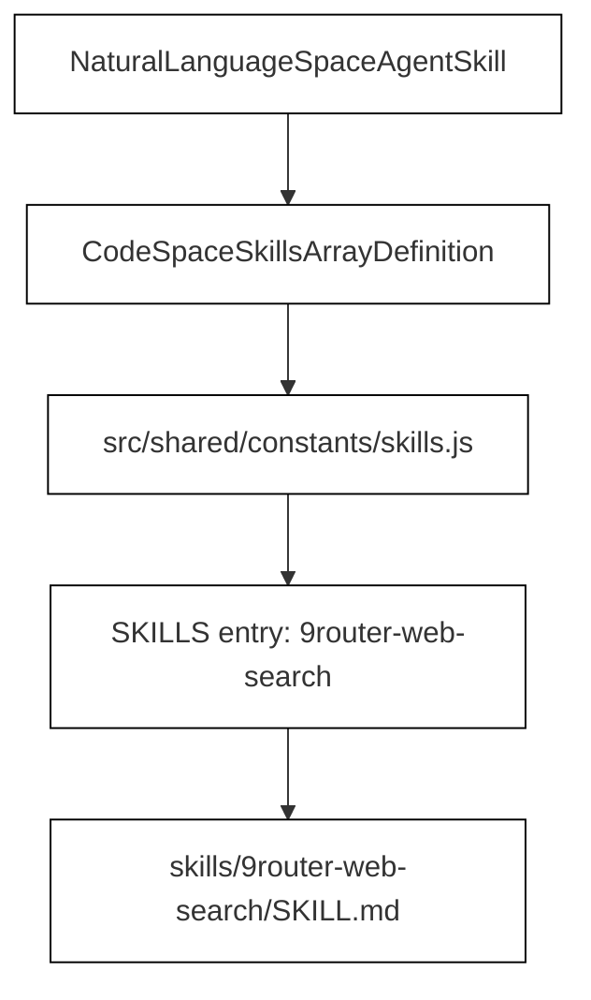

<!-- source: DeepWiki mcp.deepwiki.com · repo decolua/9router · page 1.2 Repository Layout & Assets · fetched 2026-10-30 -->

# Repository Layout & Assets

Relevant source files

The following files were used as context for generating this wiki page:

- [README.zh-CN.md](README.zh-CN.md)
- [i18n/README.ja-JP.md](i18n/README.ja-JP.md)
- [i18n/README.vi.md](i18n/README.vi.md)
- [i18n/README.zh-CN.md](i18n/README.zh-CN.md)
- [skills/9router-chat/SKILL.md](skills/9router-chat/SKILL.md)
- [skills/9router-embeddings/SKILL.md](skills/9router-embeddings/SKILL.md)
- [skills/9router-image/SKILL.md](skills/9router-image/SKILL.md)
- [skills/9router-tts/SKILL.md](skills/9router-tts/SKILL.md)
- [skills/9router-web-fetch/SKILL.md](skills/9router-web-fetch/SKILL.md)
- [skills/9router-web-search/SKILL.md](skills/9router-web-search/SKILL.md)
- [skills/9router/SKILL.md](skills/9router/SKILL.md)
- [skills/README.md](skills/README.md)
- [src/app/(dashboard)/dashboard/skills/page.js](src/app/(dashboard)/dashboard/skills/page.js)
- [src/app/api/v1/embeddings/route.js](src/app/api/v1/embeddings/route.js)
- [src/lib/auth/dashboardSession.js](src/lib/auth/dashboardSession.js)
- [src/shared/constants/skills.js](src/shared/constants/skills.js)
- [tests/.gitignore](tests/.gitignore)
- [tests/README.md](tests/README.md)
- [tests/package.json](tests/package.json)
- [tests/unit/embeddings.cloud.test.js](tests/unit/embeddings.cloud.test.js)

## Purpose and Scope
This page documents the non-code and support directories of the 9Router repository. It covers the organization and runtime role of static assets (`public/`, `images/`), drop-in AI agent instructions (`skills/`), multilingual documentation and localized READMEs (`docs/`, `gitbook/`, `i18n/`), utility scripts (`scripts/`), and CI/CD automation workflows (`.github/`).

---

## 1. Public Assets & Provider Branding (`public/` & `images/`)

The `public/` directory stores static assets served directly by Next.js, including brand icons for over 40 supported AI providers and media kinds. Provider icon mapping is defined in registry modules such as `[src/shared/constants/skills.js:1-11]()`, where icon definitions and display metadata bind runtime capabilities to UI badges stored under `[skills/9router-web-search/SKILL.md:1-4]()`.

Similarly, core branding and dashboard preview images (such as `9router.png`) reside in the root `images/` directory, referenced by both localized READMEs (`[i18n/README.zh-CN.md:1-20]()`, `[i18n/README.vi.md:1-15]()`) and the web application interface.

*Sources: `src/shared/constants/skills.js:1-11`, `skills/9router-web-search/SKILL.md:1-4`, `i18n/README.zh-CN.md:1-20`*

---

## 2. Drop-in AI Agent Skills (`skills/`)

The `skills/` directory houses self-contained `SKILL.md` instruction files designed to be ingested directly by autonomous AI agents (e.g., Claude Code, Cline, OpenCode). Each subdirectory represents a discrete capability domain (such as web search, image generation, text-to-speech, or embeddings). 

Metadata for these skills is centralized in `[src/shared/constants/skills.js:1-11]`, which exports the `SKILLS` registry array, endpoint mappings, and raw GitHub content URLs (`[src/shared/constants/skills.js:72-78]()`). Individual skill files like `[skills/9router-web-search/SKILL.md:1-4]()` describe how agents should query 9Router endpoints (`/v1/search`, `/v1/chat/completions`) and handle pagination or provider-specific transport requirements.

*Sources: `src/shared/constants/skills.js:1-11`, `src/shared/constants/skills.js:72-78`, `skills/9router-web-search/SKILL.md:1-4`*

---

## 3. Documentation & Internationalization (`docs/`, `gitbook/`, `i18n/`)

9Router maintains extensive multi-language documentation to support global developers:
- **Root & i18n READMEs**: Multilingual entries such as `[README.zh-CN.md:1-20]()`, `[i18n/README.zh-CN.md:1-20]()`, and `[i18n/README.vi.md:1-15]()` provide quick start guides, architecture overviews, and installation instructions in Chinese, Vietnamese, Japanese, and English.
- **GitBook Site (`gitbook/`)**: Houses the structured Next.js-based documentation portal covering navigation trees, multilingual content pages, and deployment configs.
- **Support Documentation (`docs/`)**: Supplementary technical notes and architecture diagrams.

*Sources: `README.zh-CN.md:1-20`, `i18n/README.zh-CN.md:1-20`, `i18n/README.vi.md:1-15`*

---

## 4. Scripts & CI/CD Automation (`scripts/`, `.github/`)

Operational tasks, packaging, and integration tests are organized outside the core application runtime:
- **Scripts (`scripts/`)**: Shell and Node.js utilities that handle build-time asset copying, database seeding, native module pruning, and CLI binary compilation.
- **GitHub Workflows (`.github/workflows/`)**: Continuous integration pipelines governing automated testing, container image publishing (`docker-publish`), and release staging.

*Sources: `tests/package.json:1-17`, `tests/README.md:1-20`*

---

