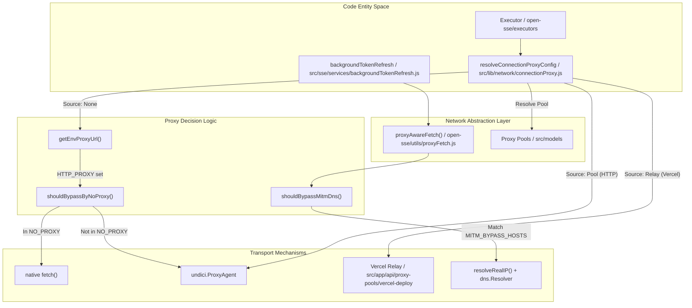

<!-- source: DeepWiki mcp.deepwiki.com · repo decolua/9router · page 10 Network & Proxy · fetched 2026-10-30 -->

# Network & Proxy

Relevant source files

The following files were used as context for generating this wiki page:

- [open-sse/services/projectId.js](open-sse/services/projectId.js)
- [open-sse/services/tokenRefresh.js](open-sse/services/tokenRefresh.js)
- [open-sse/services/tokenRefresh/providers.js](open-sse/services/tokenRefresh/providers.js)
- [open-sse/utils/proxyFetch.js](open-sse/utils/proxyFetch.js)
- [src/app/api/proxy-pools/vercel-deploy/route.js](src/app/api/proxy-pools/vercel-deploy/route.js)
- [src/app/api/usage/[connectionId]/route.js](src/app/api/usage/[connectionId]/route.js)
- [src/lib/oauth/providers/antigravity.js](src/lib/oauth/providers/antigravity.js)
- [src/lib/oauth/services/antigravity.js](src/lib/oauth/services/antigravity.js)
- [src/sse/services/backgroundTokenRefresh.js](src/sse/services/backgroundTokenRefresh.js)
- [src/sse/services/tokenRefresh.js](src/sse/services/tokenRefresh.js)
- [tests/unit/background-token-refresh.test.js](tests/unit/background-token-refresh.test.js)
- [tests/unit/strict-proxy-enforcement.test.js](tests/unit/strict-proxy-enforcement.test.js)
- [tests/unit/token-refresh-generic.test.js](tests/unit/token-refresh-generic.test.js)

This page documents 9Router's network layer capabilities, including outbound proxy support for upstream provider connections, remote access tunneling (Cloudflare & Tailscale), and DNS bypass mechanisms for MITM proxy scenarios. The system provides multiple network routing and proxy configuration mechanisms: connection-specific proxies, Proxy Pools with strict proxy enforcement, environment variable proxy routing, and direct Google DNS resolution for MITM host bypass [open-sse/utils/proxyFetch.js:101-198](), [tests/unit/strict-proxy-enforcement.test.js:1-55]().

For details on the MITM proxy server that intercepts client developer tool traffic, see [MITM Proxy System](#6).

---

## Network Layer Architecture

9Router's network layer operates at the fetch API level via `proxyAwareFetch`, intercepting all outbound HTTP requests before they reach external AI providers [open-sse/utils/proxyFetch.js:1-208](). The system uses centralized initialization sequences to manage network-dependent services like tunnels, token refreshes, and MITM DNS restoration [src/app/api/usage/[connectionId]/route.js:1-174]().

The following diagram bridges natural language system concepts to code entities in `open-sse` and `src/lib`, illustrating how an outbound request flows through the network abstraction layer to select transport mechanisms and enforce proxy constraints.

**Network Routing Logic**

Sources: [open-sse/utils/proxyFetch.js:101-198](), [src/app/api/proxy-pools/vercel-deploy/route.js:1-143](), [tests/unit/strict-proxy-enforcement.test.js:1-55]()

---

## Proxy Configuration & Pools

9Router supports granular proxy settings at both the system and connection levels using **Proxy Pools**, allowing users to group proxies, apply rotation strategies, and enforce strict connectivity constraints [tests/unit/strict-proxy-enforcement.test.js:26-87]().

- **Proxy Pools & Relays:** Managed via `src/lib/network/connectionProxy.js`. Supports standard HTTP/HTTPS proxies as well as serverless Relay Workers deployed on platforms such as Vercel [src/app/api/proxy-pools/vercel-deploy/route.js:1-143]().
- **Strict Proxy Enforcement:** Enforced by `proxyAwareFetch` to guarantee that if a strict proxy pool is assigned and fails or carries an empty URL, requests will refuse to connect directly rather than leaking traffic to the open internet [tests/unit/strict-proxy-enforcement.test.js:57-87]().
- **Environment Fallbacks:** Supports standard environment variables such as `HTTP_PROXY`, `HTTPS_PROXY`, `ALL_PROXY`, and `NO_PROXY` [open-sse/utils/proxyFetch.js:166-198]().

For details, see [Proxy Configuration](#10.1).

Sources: [open-sse/utils/proxyFetch.js:166-198](), [src/app/api/proxy-pools/vercel-deploy/route.js:128-138](), [tests/unit/strict-proxy-enforcement.test.js:1-87]()

---

## Remote Access & Tunneling

9Router integrates multiple tunneling solutions to provide secure remote access to the local instance, enabling external API clients and webhooks to reach the server.

- **Cloudflare Tunnel:** Integrates `cloudflared` binaries to expose quick public tunnels.
- **Tailscale Funnel:** Provides an alternative remote access method supporting userspace networking via custom Tailscale sockets.
- **Watchdog Integration:** Monitors connectivity and network state changes to perform safe automatic lifecycle restarts when necessary.

For details, see [Remote Access Tunnels](#10.2).

Sources: [src/app/api/usage/[connectionId]/route.js:1-174]()

---

## MITM DNS Bypass

When 9Router acts as a MITM proxy for developer tools (such as Antigravity, Copilot, or Cursor), it must prevent infinite loops where its own outbound requests to external Google or provider APIs get intercepted by its local server instance.

- **MITM Bypass Hosts:** A predefined list of target hosts (`MITM_BYPASS_HOSTS`) that bypass local DNS redirection [open-sse/utils/proxyFetch.js:116-123]().
- **Real IP Resolution:** The `resolveRealIP` function queries Google DNS servers (`8.8.8.8` / `8.8.4.4`) directly to obtain valid destination IP addresses while bypassing local host overrides [open-sse/utils/proxyFetch.js:137-154]().

For details, see [MITM DNS Bypass](#10.3).

Sources: [open-sse/utils/proxyFetch.js:116-154]()

---

## Sub-pages

- [Proxy Configuration](#10.1) — Detailed explanation of `proxyAwareFetch`, connection proxies, environment proxy variables, `NO_PROXY` rules, and SSRF/strict-proxy guarding.
- [Remote Access Tunnels](#10.2) — Technical guide on Cloudflare Tunnel and Tailscale Funnel integration, watchdogs, PID ownership, and endpoint management.
- [MITM DNS Bypass](#10.3) — Deep dive into the custom DNS resolver (`8.8.8.8`) for Google APIs, real IP resolution, and request source headers.

---

