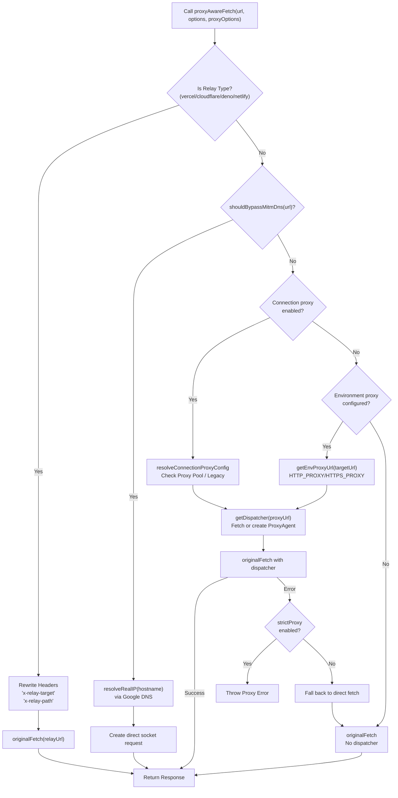
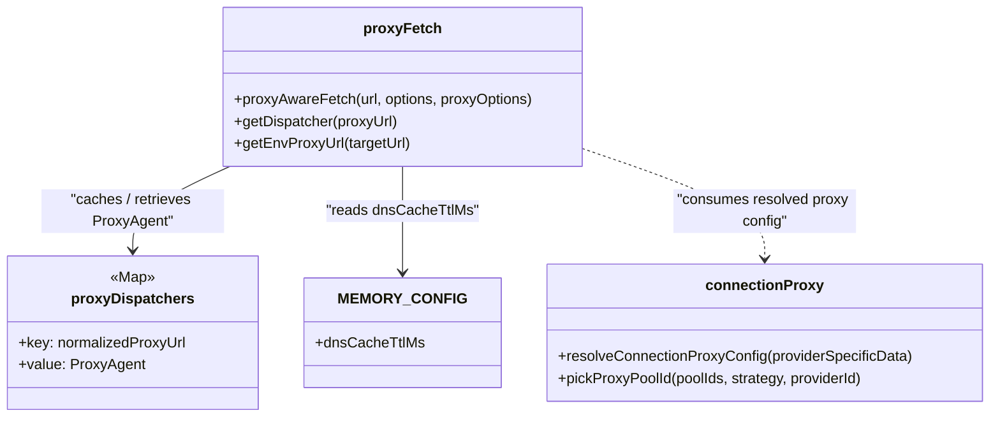

<!-- source: DeepWiki mcp.deepwiki.com · repo decolua/9router · page 10.1 Proxy Configuration · fetched 2026-10-30 -->

# Proxy Configuration

Relevant source files

The following files were used as context for generating this wiki page:

- [open-sse/services/projectId.js](open-sse/services/projectId.js)
- [open-sse/services/tokenRefresh.js](open-sse/services/tokenRefresh.js)
- [open-sse/services/tokenRefresh/providers.js](open-sse/services/tokenRefresh/providers.js)
- [open-sse/utils/proxyFetch.js](open-sse/utils/proxyFetch.js)
- [src/app/(dashboard)/dashboard/proxy-pools/page.js](src/app/(dashboard)/dashboard/proxy-pools/page.js)
- [src/app/api/proxy-pools/[id]/route.js](src/app/api/proxy-pools/[id]/route.js)
- [src/app/api/proxy-pools/[id]/test/route.js](src/app/api/proxy-pools/[id]/test/route.js)
- [src/app/api/proxy-pools/netlify-deploy/route.js](src/app/api/proxy-pools/netlify-deploy/route.js)
- [src/app/api/proxy-pools/route.js](src/app/api/proxy-pools/route.js)
- [src/app/api/proxy-pools/vercel-deploy/route.js](src/app/api/proxy-pools/vercel-deploy/route.js)
- [src/app/api/settings/database/route.js](src/app/api/settings/database/route.js)
- [src/app/api/settings/proxy-test/route.js](src/app/api/settings/proxy-test/route.js)
- [src/app/api/usage/[connectionId]/route.js](src/app/api/usage/[connectionId]/route.js)
- [src/lib/network/connectionProxy.js](src/lib/network/connectionProxy.js)
- [src/lib/network/initOutboundProxy.js](src/lib/network/initOutboundProxy.js)
- [src/lib/network/netlifyRelay.js](src/lib/network/netlifyRelay.js)
- [src/lib/network/outboundProxy.js](src/lib/network/outboundProxy.js)
- [src/lib/oauth/providers/antigravity.js](src/lib/oauth/providers/antigravity.js)
- [src/lib/oauth/services/antigravity.js](src/lib/oauth/services/antigravity.js)
- [src/shared/utils/ssrfGuard.js](src/shared/utils/ssrfGuard.js)
- [src/sse/services/backgroundTokenRefresh.js](src/sse/services/backgroundTokenRefresh.js)
- [src/sse/services/tokenRefresh.js](src/sse/services/tokenRefresh.js)
- [tests/unit/background-token-refresh.test.js](tests/unit/background-token-refresh.test.js)
- [tests/unit/netlify-relay.test.js](tests/unit/netlify-relay.test.js)
- [tests/unit/security-audit.test.js](tests/unit/security-audit.test.js)
- [tests/unit/ssrf-guard-hardening.test.js](tests/unit/ssrf-guard-hardening.test.js)
- [tests/unit/strict-proxy-enforcement.test.js](tests/unit/strict-proxy-enforcement.test.js)
- [tests/unit/token-refresh-generic.test.js](tests/unit/token-refresh-generic.test.js)

This page documents 9Router's network and proxy layer capabilities, covering `proxyAwareFetch`, connection-specific and pooled proxy resolution, environment-based proxy routing, `NO_PROXY` bypass patterns, MITM DNS routing, and Server-Side Request Forgery (SSRF) guarding.

---

## Overview & Scope

The network and proxy subsystem in 9Router handles outbound requests from both the core SSE routing engine (`open-sse`) and the Next.js application layer (`src/app`). It ensures that requests to AI providers, web fetch targets, and OAuth token endpoints can be correctly tunneled through HTTP/HTTPS proxies, serverless relay functions, or direct connections while preventing internal network leaks.

The primary modules implementing these capabilities are:
* `open-sse/utils/proxyFetch.js`: Implements `proxyAwareFetch`, environment proxy resolution, and MITM DNS overrides [open-sse/utils/proxyFetch.js:1-214]().
* `src/lib/network/connectionProxy.js`: Manages proxy pool resolution, fallback logic, and rotation strategies [src/lib/network/connectionProxy.js:1-199]().
* `src/shared/utils/ssrfGuard.js`: Provides multi-layer SSRF guarding with DNS resolution and IP range validation [src/shared/utils/ssrfGuard.js:1-162]().

Sources: [open-sse/utils/proxyFetch.js:1-214](), [src/lib/network/connectionProxy.js:1-199](), [src/shared/utils/ssrfGuard.js:1-162]()

---

## Proxy Request Flow

Outbound HTTP/HTTPS calls throughout the system are routed through `proxyAwareFetch`, which evaluates configuration precedence, handles serverless relay rewrites, manages dispatcher pools, and enforces strict proxy policies.

### Diagram: proxyAwareFetch Execution Flow

Sources: [open-sse/utils/proxyFetch.js:101-208](), [src/lib/network/connectionProxy.js:66-199]()

---

## Proxy Pools and Relay Support

9Router manages proxies centrally via "Proxy Pools" that can be attached to individual provider connections or rotation strategies [src/lib/network/connectionProxy.js:66-142]().

### Configuration Priority Resolution
When a provider connection executes a request or fetches quota, `resolveConnectionProxyConfig` determines the active proxy configuration [src/lib/network/connectionProxy.js:66-179]() based on the following priority:
1. **Proxy Pool (`proxyPoolId`)**: Centrally managed proxy entry. If the pool type is `vercel`, `cloudflare`, `deno`, or `netlify`, base-url rewriting is applied via serverless relay headers (`x-relay-target`, `x-relay-path`) [src/lib/network/connectionProxy.js:91-124]().
2. **Legacy Proxy**: Direct `connectionProxyEnabled` and `connectionProxyUrl` fields saved on the connection `providerSpecificData` [src/lib/network/connectionProxy.js:149-163]().
3. **No Proxy / Environment Fallback**: Falls back to environment variables or direct connection [src/lib/network/connectionProxy.js:170-179]().

### Rotation Strategies for No-Auth Providers
For public or unauthenticated endpoints, `pickProxyPoolId` supports distribution strategies [src/lib/network/connectionProxy.js:18-34]():
* `round-robin`: Sequentially cycles through active proxy pool entries in-memory [src/lib/network/connectionProxy.js:22-27]().
* `random`: Uniformly selects a random pool per request [src/lib/network/connectionProxy.js:29-31]().

Sources: [src/lib/network/connectionProxy.js:1-199](), [src/app/api/proxy-pools/[id]/test/route.js:6-34]()

---

## Environment Variable Proxies

When no connection-specific proxy or pool is bound, `proxyAwareFetch` inspects system environment variables using `getEnvProxyUrl` [open-sse/utils/proxyFetch.js:184-198]().

### Precedence and Pattern Matching
* **Bypass Check (`NO_PROXY`)**: Before evaluating proxy variables, `shouldBypassByNoProxy` checks if the target hostname matches any entry in `NO_PROXY` or `no_proxy` [open-sse/utils/proxyFetch.js:166-179](). Supported formats include wildcard (`*`), exact domain matches, and subdomain suffix matches (e.g. `.example.com`) [open-sse/utils/proxyFetch.js:174-178]().
* **Protocol Variables**:
  * For `https:` requests: `HTTPS_PROXY` > `https_proxy` > `ALL_PROXY` > `all_proxy` [open-sse/utils/proxyFetch.js:191-194]().
  * For other protocols: `HTTP_PROXY` > `http_proxy` > `ALL_PROXY` > `all_proxy` [open-sse/utils/proxyFetch.js:196-198]().

Sources: [open-sse/utils/proxyFetch.js:166-198]()

---

## Proxy Dispatcher Pool

To maintain high throughput and avoid re-instantiating connection agents, 9Router caches `ProxyAgent` instances in a module-scoped map (`proxyDispatchers`) [open-sse/utils/proxyFetch.js:6]().

### Diagram: Dispatcher & Pool Code Entities

Sources: [open-sse/utils/proxyFetch.js:1-6](), [src/lib/network/connectionProxy.js:1-199]()

---

## MITM DNS Bypass

Certain upstream AI tooling endpoints (such as `api2.cursor.sh`, `cloudcode-pa.googleapis.com`, and `api.individual.githubcopilot.com`) require special DNS handling when intercepted or proxied [open-sse/utils/proxyFetch.js:116-123]().

### Implementation (`resolveRealIP`)
1. **Bypass Check**: `shouldBypassMitmDns` identifies matching hosts [open-sse/utils/proxyFetch.js:159-164]().
2. **Google DNS Query**: `resolveRealIP` instantiates a dedicated `dns.Resolver` pinned to Google DNS servers (`8.8.8.8`, `8.8.4.4`) to resolve the true origin IP, bypassing local host file loops [open-sse/utils/proxyFetch.js:137-154]().
3. **Caching**: Resolved IPs are cached in `DNS_CACHE` respecting `MEMORY_CONFIG.dnsCacheTtlMs` [open-sse/utils/proxyFetch.js:101-148]().

Sources: [open-sse/utils/proxyFetch.js:101-164]()

---

## SSRF Guarding

To protect server-side fetch operations (such as web search and document fetching) from Server-Side Request Forgery attacks, 9Router implements a three-layer validation system in `ssrfGuard.js` [src/shared/utils/ssrfGuard.js:1-20]().

### Protection Layers
1. **Synchronous Literal Inspection (`assertPublicUrl`)**: Immediately rejects well-known loopback hostnames (`localhost`), private domain suffixes (`.internal`, `.local`, `.localhost`), and literal private IPv4/IPv6 addresses [src/shared/utils/ssrfGuard.js:23-162]().
2. **DNS Resolution Check (`assertPublicUrlResolved`)**: Performs actual DNS lookups on hostnames to ensure that domain names pointing maliciously to private ranges (e.g. via wildcard DNS or local mapping) are blocked [src/shared/utils/ssrfGuard.js:3-9](). It parses IPv4/IPv6 addresses into numeric integers and compares them against blocked subnets (e.g., `10.0.0.0/8`, `127.0.0.0/8`, `169.254.0.0/16`, CGNAT ranges, and link-local blocks) [src/shared/utils/ssrfGuard.js:41-56]().
3. **Redirect Guarding (`fetchPublic`)**: Wraps native fetch with manual redirect validation so that a safe initial URL cannot redirect to an internal resource without re-validation [src/shared/utils/ssrfGuard.js:10-13]().

The web fetch handler (`handleFetch`) explicitly enforces `assertPublicUrlResolved` before initiating requests [src/sse/handlers/fetch.js:82-90]().

Sources: [src/shared/utils/ssrfGuard.js:1-162](), [src/sse/handlers/fetch.js:82-90]()

---

