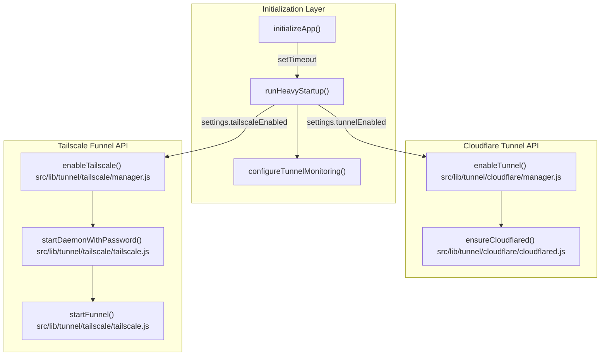
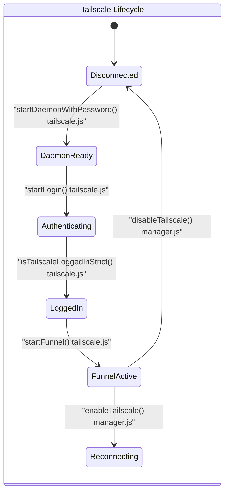

<!-- source: DeepWiki mcp.deepwiki.com · repo decolua/9router · page 10.2 Remote Access Tunnels · fetched 2026-10-30 -->

# Remote Access Tunnels

Relevant source files

The following files were used as context for generating this wiki page:

- [src/app/(dashboard)/dashboard/console-log/page.js](src/app/(dashboard)/dashboard/console-log/page.js)
- [src/app/api/translator/console-logs/route.js](src/app/api/translator/console-logs/route.js)
- [src/app/api/tunnel/disable/route.js](src/app/api/tunnel/disable/route.js)
- [src/app/api/tunnel/enable/route.js](src/app/api/tunnel/enable/route.js)
- [src/app/api/tunnel/status/route.js](src/app/api/tunnel/status/route.js)
- [src/app/api/tunnel/tailscale-check/route.js](src/app/api/tunnel/tailscale-check/route.js)
- [src/app/api/tunnel/tailscale-disable/route.js](src/app/api/tunnel/tailscale-disable/route.js)
- [src/app/api/tunnel/tailscale-enable/route.js](src/app/api/tunnel/tailscale-enable/route.js)
- [src/app/api/version/route.js](src/app/api/version/route.js)
- [src/lib/tunnel/index.js](src/lib/tunnel/index.js)
- [src/lib/tunnel/shared/watchdogConfig.js](src/lib/tunnel/shared/watchdogConfig.js)
- [src/lib/tunnel/tailscale/config.js](src/lib/tunnel/tailscale/config.js)
- [src/lib/tunnel/tailscale/healthCheck.js](src/lib/tunnel/tailscale/healthCheck.js)
- [src/lib/tunnel/tailscale/manager.js](src/lib/tunnel/tailscale/manager.js)
- [src/lib/tunnel/tailscale/tailscale.js](src/lib/tunnel/tailscale/tailscale.js)

## Purpose and Scope

This document covers 9Router's integration with remote access technologies, specifically **Cloudflare Tunnel** (`cloudflared`) and **Tailscale Funnel**. These integrations allow users to securely expose the 9Router API Gateway (port 20128) to the internet without manual port forwarding, enabling remote access for AI tools and clients while maintaining encrypted end-to-end connectivity.

**Sources:** [src/lib/tunnel/tailscale/manager.js:24-33](), [src/lib/tunnel/index.js:1-42]()

## Overview

9Router provides two distinct methods for remote access, managed through the Endpoint dashboard and background services:

1. **Cloudflare Tunnel**: Uses ephemeral quick tunnels or token-based tunnels mapped via `cloudflared`.
2. **Tailscale Funnel**: Leverages the user's Tailnet and Tailscale's Funnel service to provide a stable HTTPS URL associated with the user's Tailscale account.

Both services are monitored by a shared watchdog system that handles network changes, process crashes, and automatic resumption on application startup.

**Sources:** [src/lib/tunnel/index.js:1-53](), [src/lib/tunnel/tailscale/manager.js:89-97](), [src/lib/tunnel/shared/watchdogConfig.js:1-5]()

## System Architecture

The following diagram maps the runtime initialization flow to the underlying tunnel management code entities, bridging natural language concepts to specific code files and functions.

**Sources:** [src/lib/tunnel/tailscale/manager.js:24-66](), [src/lib/tunnel/tailscale/tailscale.js:33-35]()

## Cloudflare Tunnel Implementation

### Binary Management & Validation
The system automatically fetches and manages the `cloudflared` binary for the host OS. The function `ensureCloudflared()` checks for the presence of the binary in the local data directory `BIN_DIR` and initiates a download if missing or outdated. It validates binary integrity using magic numbers (`4d5a` for Windows PE executables, `7f454c46` for Linux ELF binaries).

**Sources:** [src/lib/tunnel/cloudflare/cloudflared.js:9-13](), [src/lib/tunnel/cloudflare/cloudflared.js:120-135]()

### Lifecycle, Watchdog & PID Ownership
- **Auto-Resume**: On startup, if `settings.tunnelEnabled` is true, the system invokes safe tunnel restart logic via `runHeavyStartup()`. [src/app/api/tunnel/enable/route.js:8-12]()
- **Unexpected Exit Handling**: A callback is registered via `setTunnelUnexpectedExitCallback()`. If `cloudflared` exits unexpectedly, it triggers automatic recovery. [src/lib/tunnel/index.js:9-10]()
- **PID Tracking**: The function `spawnCloudflared()` tracks child process IDs to ensure proper cleanup during application shutdown signals. [src/lib/tunnel/index.js:12-16]()

**Sources:** [src/lib/tunnel/index.js:9-16](), [src/app/api/tunnel/enable/route.js:8-12]()

## Tailscale Funnel Integration

Tailscale provides an alternative tunneling mechanism utilizing the user's existing Tailnet and Tailscale daemon.

### Implementation Details
- **Socket Management**: 9Router uses a custom userspace socket path `TAILSCALE_SOCKET` located inside the data directory to prevent root permission bottlenecks, while keeping `SYSTEM_TAILSCALE_SOCKET` as a read-only fallback. [src/lib/tunnel/tailscale/tailscale.js:18-25]()
- **Daemon Control**: `enableTailscale()` invokes `startDaemonWithPassword()` using cached credentials via `getCachedPassword()` and `loadEncryptedPassword()` to ensure the `tailscaled` daemon is running. [src/lib/tunnel/tailscale/manager.js:32-33](), [src/app/api/tunnel/tailscale-check/route.js:6-6]()
- **Login Verification**: The function `isTailscaleLoggedInStrict()` queries the daemon status via `status --json` to verify `BackendState === "Running"` and `Self.Online === true`. [src/lib/tunnel/tailscale/tailscale.js:96-114]()
- **Funnel Activation**: `startFunnel(localPort)` provisions the funnel routing and `provisionCert()` generates the TLS certificate for the `ts.net` hostname. [src/lib/tunnel/tailscale/manager.js:56-88]()

### Tailscale Lifecycle State Machine

**Sources:** [src/lib/tunnel/tailscale/manager.js:24-114](), [src/lib/tunnel/tailscale/tailscale.js:18-35](), [src/lib/tunnel/tailscale/tailscale.js:96-114]()

## Shared Watchdog & Reconnect Logic

Both tunnel services share unified background monitoring constants and logic implemented in `watchdogConfig.js` and health check utilities.

| Constant | Value | Description | Source |
|----------|-------|-------------|--------|
| `WATCHDOG_INTERVAL_MS` | 60,000 | Frequency of tunnel health checks. | [src/lib/tunnel/shared/watchdogConfig.js:4-4]() |
| `RESTART_COOLDOWN_MS` | 120,000 | Minimum duration between restart attempts to prevent hammer-looping. | [src/lib/tunnel/shared/watchdogConfig.js:2-2]() |
| `NETWORK_SETTLE_MS` | 2,500 | Delay after network changes before attempting reconnection. | [src/lib/tunnel/shared/watchdogConfig.js:3-3]() |
| `HEALTH_CHECK.intervalMs` | 2,000 | Polling interval during health checks. | [src/lib/tunnel/tailscale/config.js:3-3]() |
| `HEALTH_CHECK.timeoutMs` | 180,000 | Max duration to wait for Funnel provisioning and DNS. | [src/lib/tunnel/tailscale/config.js:4-4]() |

**Sources:** [src/lib/tunnel/shared/watchdogConfig.js:1-5](), [src/lib/tunnel/tailscale/config.js:1-8]()

## Remote Access Management UI

The endpoint configuration and status are queried via API routes and managed in the dashboard:
- **Tailscale Checks**: `GET /api/tunnel/tailscale-check` executes parallel non-blocking probes (`isTailscaleInstalled()`, `isTailscaleLoggedIn()`, `isSystemDaemonRunning()`) to return daemon and login states. [src/app/api/tunnel/tailscale-check/route.js:37-54]()
- **Status Endpoint**: `GET /api/tunnel/status` caches and aggregates tunnel and tailscale statuses with a short TTL. [src/app/api/tunnel/status/route.js:10-25]()
- **Enable/Disable Routes**: POST handlers such as `/api/tunnel/enable`, `/api/tunnel/disable`, `/api/tunnel/tailscale-enable`, and `/api/tunnel/tailscale-disable` control gateway exposure. [src/app/api/tunnel/enable/route.js:8-16](), [src/app/api/tunnel/disable/route.js:1-17](), [src/app/api/tunnel/tailscale-enable/route.js:6-12](), [src/app/api/tunnel/tailscale-disable/route.js:6-12]()

**Sources:** [src/app/api/tunnel/tailscale-check/route.js:37-54](), [src/app/api/tunnel/status/route.js:1-25](), [src/app/api/tunnel/enable/route.js:8-16]()

---

