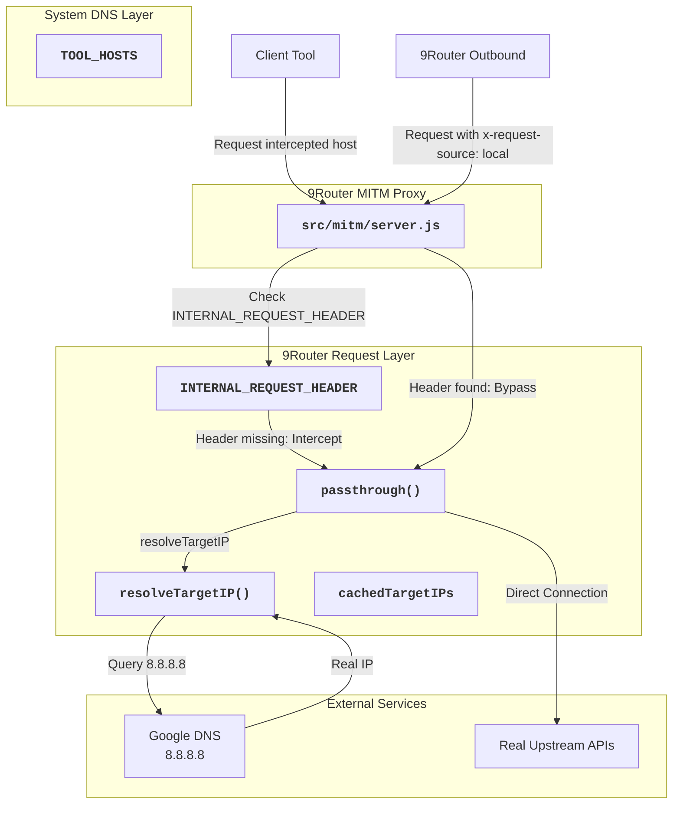
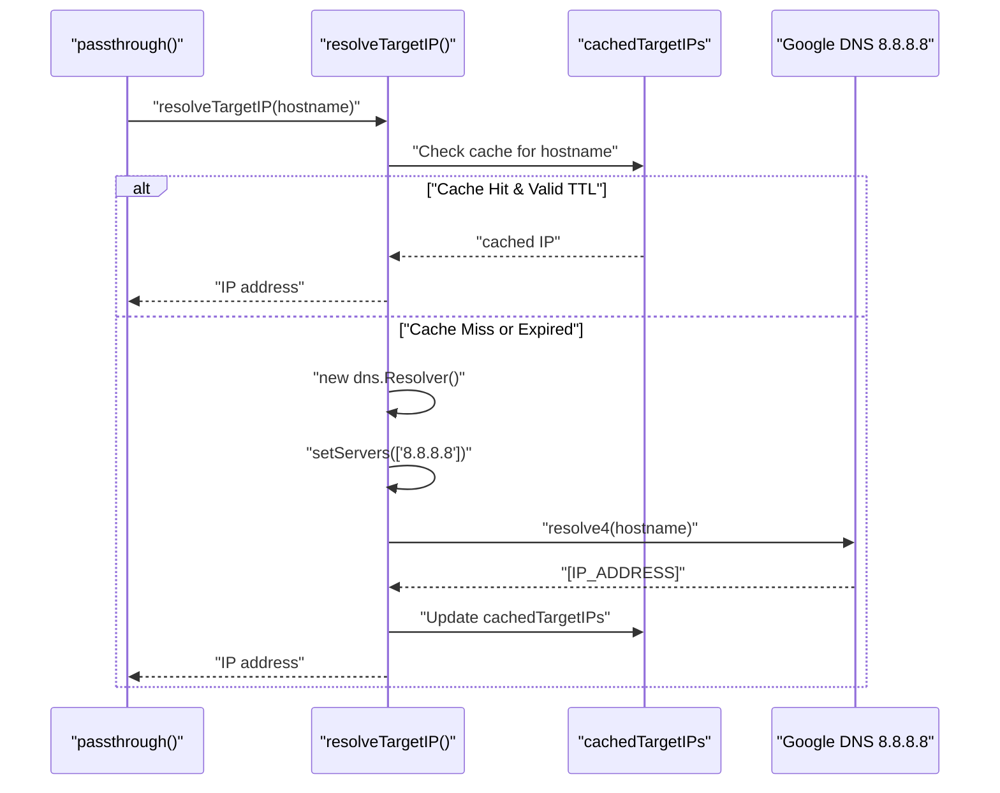

<!-- source: DeepWiki mcp.deepwiki.com · repo decolua/9router · page 10.3 MITM DNS Bypass · fetched 2026-10-30 -->

# MITM DNS Bypass

Relevant source files

The following files were used as context for generating this wiki page:

- [cli/src/cli/menus/providers.js](cli/src/cli/menus/providers.js)
- [open-sse/providers/registry/antigravity.js](open-sse/providers/registry/antigravity.js)
- [open-sse/services/usage/google.js](open-sse/services/usage/google.js)
- [src/app/(dashboard)/dashboard/cli-tools/components/MitmServerCard.js](src/app/(dashboard)/dashboard/cli-tools/components/MitmServerCard.js)
- [src/app/(dashboard)/dashboard/cli-tools/components/MitmToolCard.js](src/app/(dashboard)/dashboard/cli-tools/components/MitmToolCard.js)
- [src/app/(dashboard)/dashboard/mitm/MitmPageClient.js](src/app/(dashboard)/dashboard/mitm/MitmPageClient.js)
- [src/app/api/cli-tools/antigravity-mitm/route.js](src/app/api/cli-tools/antigravity-mitm/route.js)
- [src/mitm/cert/install.js](src/mitm/cert/install.js)
- [src/mitm/config.js](src/mitm/config.js)
- [src/mitm/dns/dnsConfig.js](src/mitm/dns/dnsConfig.js)
- [src/mitm/manager.js](src/mitm/manager.js)
- [src/mitm/server.js](src/mitm/server.js)
- [src/shared/constants/cliTools.js](src/shared/constants/cliTools.js)

The MITM DNS Bypass is a specialized networking mechanism that allows 9Router to make direct requests to provider API endpoints (particularly Google, GitHub, and Amazon APIs) while the MITM proxy is active and has redirected those domains to `127.0.0.1` via the system hosts file. This prevents request loops where 9Router's own outbound requests would be intercepted by its own MITM proxy.

For information about the MITM proxy system itself, see [6.1 MITM Architecture & Use Cases](). For general proxy configuration including environment variables and `NO_PROXY` patterns, see [10.1 Proxy Configuration]().

Sources: [src/mitm/server.js:79-88](), [src/mitm/dns/dnsConfig.js:144-180]()

---

## Problem Statement

When the MITM proxy is enabled for intercepting tools like Antigravity, GitHub Copilot, Kiro, or Cursor, the system modifies the system `hosts` file to redirect specific domains to `127.0.0.1`. This creates a conflict:

| Scenario | Without Bypass | With Bypass |
|----------|---------------|-------------|
| Client tool (e.g. Cursor) requests `api2.cursor.sh` | Redirected to `127.0.0.1` → MITM proxy → 9Router API | ✓ Works as intended |
| 9Router makes request to `googleapis.com` for a provider | Redirected to `127.0.0.1` → Loops back to itself → Fails | Resolves real IP → Direct connection → ✓ Works |

The DNS bypass solves this by identifying requests that should not be intercepted and using public DNS servers to resolve the real IP address, then establishing a direct socket connection that bypasses the system DNS entirely [src/mitm/server.js:79-88]().

Sources: [src/mitm/server.js:79-88](), [src/mitm/config.js:16-24]()

---

## Architecture Overview

9Router identifies its own traffic through a specific header marker and a custom resolution logic in the `passthrough` function [src/mitm/server.js:21-21](), [src/mitm/server.js:126-154]().

### Code-to-System Mapping
The following diagram bridges the logical bypass flow to specific code entities within the MITM server and resolution routines.

Title: MITM DNS Bypass Request Flow and Code Entities

Sources: [src/mitm/server.js:21-88](), [src/mitm/server.js:126-154]()

**Key Mechanisms**:
- **Header Marker**: `INTERNAL_REQUEST_HEADER` defines `x-request-source: local` to signal requests originating from 9Router [src/mitm/server.js:21-21]().
- **Anti-Loop**: The MITM server checks for this header immediately upon receiving a request to avoid recursive interception.
- **DNS Resolution**: `resolveTargetIP` uses a dedicated `dns.Resolver` pointed at `8.8.8.8` to find the actual destination IP, ensuring it ignores the local hosts file [src/mitm/server.js:79-88]().
- **Direct Connection**: `passthrough` forwards the request to the real upstream, applying host rewrites for specific endpoints [src/mitm/server.js:126-154]().

Sources: [src/mitm/server.js:21-88](), [src/mitm/server.js:126-154]()

---

## DNS Resolution Process

The resolution mechanism queries Google's public DNS servers directly to escape local host file pollution.

Title: DNS Resolution Sequence Diagram

Sources: [src/mitm/server.js:76-88]()

**Implementation Details**:
- **Resolver**: Utilizes the Node.js `dns` module's `Resolver` class [src/mitm/server.js:82-82]().
- **Servers**: Hardcoded to Google's `8.8.8.8` to ensure it bypasses local configuration [src/mitm/server.js:83-83]().
- **Cache Strategy**: The MITM server uses `cachedTargetIPs` with a TTL of 5 minutes (`CACHE_TTL_MS = 5 * 60 * 1000`) [src/mitm/server.js:76-77]().

Sources: [src/mitm/server.js:76-88]()

---

## Bypass Logic and Upstream Passthrough

The `passthrough()` function establishes the actual connection to the resolved real IP while maintaining the correct SNI and Host headers to satisfy the upstream provider's security checks [src/mitm/server.js:126-154]().

### Connection Configuration and Rewriting

| Parameter | Logic | Purpose |
|-----------|-------|---------|
| **Host Rewrite** | `HOST_REWRITE` | Maps `cloudcode-pa.googleapis.com` to `daily-cloudcode-pa.googleapis.com` to avoid rate limits on production endpoints [src/mitm/server.js:25-27]() |
| **IDE Version Override** | `applyAntigravityIdeVersionOverride` | Rewrites `User-Agent` and `metadata.ideVersion` for Antigravity requests to ensure compatibility [src/mitm/server.js:134-136]() |
| **Chat Endpoint Detection** | `isChatEndpoint` | Identifies `:generateContent` or `:streamGenerateContent` for specific host rewriting logic [src/mitm/server.js:129-130]() |
| **ALPN Negotiation** | `negotiateAlpn` | Attempts HTTP/2 (`h2`) first, falling back to HTTP/1.1 [src/mitm/server.js:145-153]() |

### Response Teeing & Logging
The `passthrough` function supports an optional `onResponse` callback. If `ENABLE_FILE_LOG` is active in development, it creates a dumper via `createResponseDumper` to save responses to disk [src/mitm/server.js:9-10](), [src/mitm/server.js:124-126]().

### Anti-Loop Execution in MITM Server
The server checks for the internal header before attempting any tool-specific interception logic. If the header `x-request-source: local` is present, it implies the request was generated by 9Router's own provider logic and should be forwarded to the real upstream via `passthrough()` to avoid an infinite loop [src/mitm/server.js:21-21]().

Sources: [src/mitm/server.js:9-27](), [src/mitm/server.js:126-154]()

---

