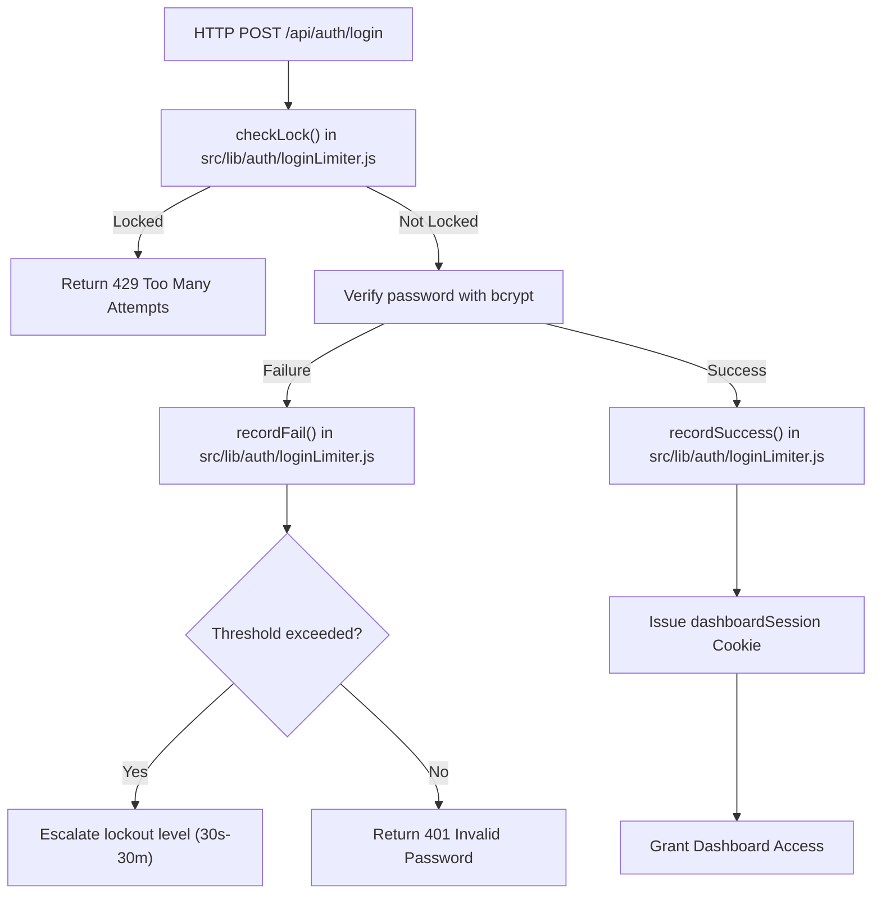
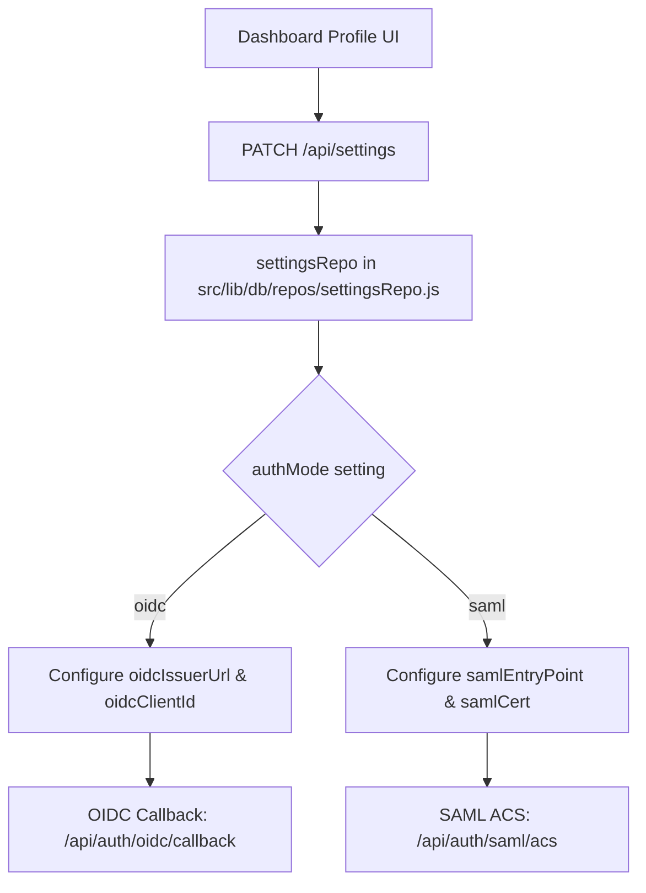
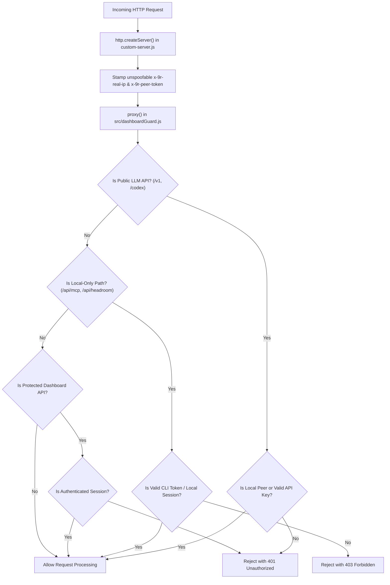

<!-- source: DeepWiki mcp.deepwiki.com · repo decolua/9router · page 11 Security & Access Control · fetched 2026-10-30 -->

# Security & Access Control

Relevant source files

The following files were used as context for generating this wiki page:

- [custom-server.js](custom-server.js)
- [scripts/copy-standalone-assets.mjs](scripts/copy-standalone-assets.mjs)
- [src/app/api/tunnel/tailscale-install/route.js](src/app/api/tunnel/tailscale-install/route.js)
- [src/dashboardGuard.js](src/dashboardGuard.js)
- [src/lib/auth/loginLimiter.js](src/lib/auth/loginLimiter.js)
- [src/lib/auth/trustedPeer.js](src/lib/auth/trustedPeer.js)
- [src/proxy.js](src/proxy.js)
- [tests/unit/custom-server-h2c.test.cjs](tests/unit/custom-server-h2c.test.cjs)
- [tests/unit/custom-server-peer-headers.test.js](tests/unit/custom-server-peer-headers.test.js)
- [tests/unit/dashboard-guard.test.js](tests/unit/dashboard-guard.test.js)
- [tests/unit/local-request-peer-trust-3294.test.js](tests/unit/local-request-peer-trust-3294.test.js)
- [tests/unit/standalone-assets.test.js](tests/unit/standalone-assets.test.js)

9Router protects its management dashboard, backend state mutations, and LLM API surface using a multi-layered security model. This encompasses password-based authentication, enterprise Single Sign-On (SSO), progressive brute-force rate limiting, and robust request guarding implemented across `src/dashboardGuard.js` [src/dashboardGuard.js:1-207]() and `custom-server.js` [custom-server.js:1-126]().

For detailed information on specific components, refer to the following child pages:
- [Dashboard Authentication & Sessions](#11.1)
- [Enterprise SSO (OIDC & SAML)](#11.2)
- [Request Guarding & Trusted Peers](#11.3)

---

## Dashboard Authentication & Sessions

The management dashboard relies on password authentication secured via `bcrypt` hashing, with session state maintained through secure cookies. To mitigate credential-stuffing and brute-force attacks, `src/lib/auth/loginLimiter.js` [src/lib/auth/loginLimiter.js:1-64]() implements an in-memory progressive lockout mechanism that tracks failed attempts per client IP and escalates lockout durations.

For details, see [Dashboard Authentication & Sessions](#11.1).

### Authentication and Login Limiter Flow

Sources:
- [src/lib/auth/loginLimiter.js:1-64]()
- [src/dashboardGuard.js:170-189]()

---

## Enterprise SSO (OIDC & SAML)

Organizations requiring centralized identity management can configure 9Router to authenticate via OpenID Connect (OIDC) or SAML 2.0 protocols. The authentication mode is governed by the `authMode` property stored via settings repositories [src/lib/db/repos/settingsRepo.js:29-41](). Administrators can configure identity providers directly from the dashboard profile interface [src/app/(dashboard)/dashboard/profile/page.js:38]().

For details, see [Enterprise SSO (OIDC & SAML)](#11.2).

### SSO Configuration Architecture

Sources:
- [src/app/api/auth/status/route.js:10-16]()
- [src/lib/db/repos/settingsRepo.js:29-41]()

---

## Request Guarding & Trusted Peers

Request routing and access control are centrally enforced by `src/dashboardGuard.js` [src/dashboardGuard.js:207](), which acts as the Next.js middleware interceptor. To prevent client-side header spoofing of peer addresses (such as `x-9r-real-ip`), `custom-server.js` [custom-server.js:52-126]() wraps the standalone server process, injecting a per-process cryptographic secret (`PEER_TOKEN`) [custom-server.js:13-14]() and validating trusted peers through `src/lib/auth/trustedPeer.js` [src/lib/auth/trustedPeer.js:4-7]().

For details, see [Request Guarding & Trusted Peers](#11.3).

### Request Guarding & Trust Validation Pipeline

Sources:
- [src/dashboardGuard.js:1-207]()
- [custom-server.js:52-126]()
- [src/lib/auth/trustedPeer.js:1-7]()

---

