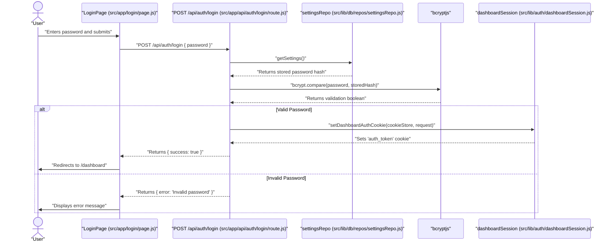
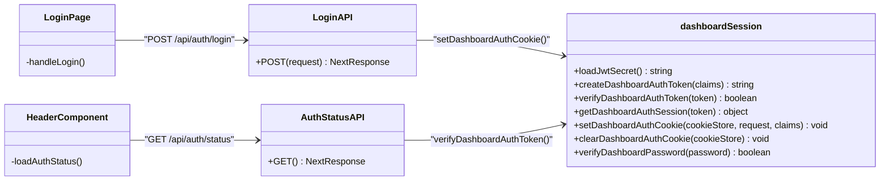

<!-- source: DeepWiki mcp.deepwiki.com · repo decolua/9router · page 11.1 Dashboard Authentication & Sessions · fetched 2026-10-30 -->

# Dashboard Authentication & Sessions

Relevant source files

The following files were used as context for generating this wiki page:

- [README.zh-CN.md](README.zh-CN.md)
- [i18n/README.ja-JP.md](i18n/README.ja-JP.md)
- [i18n/README.vi.md](i18n/README.vi.md)
- [i18n/README.zh-CN.md](i18n/README.zh-CN.md)
- [src/app/api/auth/login/route.js](src/app/api/auth/login/route.js)
- [src/app/api/auth/logout/route.js](src/app/api/auth/logout/route.js)
- [src/app/api/auth/oidc/callback/route.js](src/app/api/auth/oidc/callback/route.js)
- [src/app/api/auth/oidc/start/route.js](src/app/api/auth/oidc/start/route.js)
- [src/app/api/auth/oidc/test/route.js](src/app/api/auth/oidc/test/route.js)
- [src/app/api/auth/status/route.js](src/app/api/auth/status/route.js)
- [src/app/api/v1/embeddings/route.js](src/app/api/v1/embeddings/route.js)
- [src/app/login/page.js](src/app/login/page.js)
- [src/lib/auth/dashboardSession.js](src/lib/auth/dashboardSession.js)
- [tests/.gitignore](tests/.gitignore)
- [tests/README.md](tests/README.md)
- [tests/package.json](tests/package.json)
- [tests/unit/auth-status.test.js](tests/unit/auth-status.test.js)
- [tests/unit/embeddings.cloud.test.js](tests/unit/embeddings.cloud.test.js)

This page details the authentication mechanisms for the 9Router dashboard, covering password-based login, bcrypt hashing for secure credential storage, session management using `dashboardSession` cookies, login rate limiting per IP address, forced password changes for fresh remote installs, and API key gating for programmatic access.

---

## Password Login and Bcrypt Hashing

The 9Router dashboard supports password-based authentication. When a user submits credentials via `LoginPage` (`[src/app/login/page.js:66-97]()`), the request is handled by `POST /api/auth/login` (`[src/app/api/auth/login/route.js:21-111]()`).

### Implementation Details

1. **IP Rate Limit Check**: The request IP address is extracted via `getClientIp(request)` and checked using `checkLock(ip)` `[src/app/api/auth/login/route.js:23-24]()`. If locked, a `429` response is returned `[src/app/api/auth/login/route.js:25-29]()`.
2. **SSO Interception**: The system inspects `settings.authMode` to determine if SSO is enforced and password login should be disabled `[src/app/api/auth/login/route.js:43-51]()`.
3. **Bcrypt Comparison**: `bcrypt.compare(password, storedHash)` verifies the submitted password against the hash stored in `settings.password` `[src/app/api/auth/login/route.js:55]()`. If no custom password hash exists, it falls back to `process.env.INITIAL_PASSWORD` or the default value `"123456"` `[src/app/api/auth/login/route.js:58-60]()`.
4. **Session Issuance**: Upon successful validation, `recordSuccess(ip)` is called `[src/app/api/auth/login/route.js:63]`, and `setDashboardAuthCookie()` provisions a signed JWT session cookie `[src/app/api/auth/login/route.js:90-91]()`.

**Diagram: Password Login Data Flow**  
Sources:
- `[src/app/api/auth/login/route.js:21-111]()`
- `[src/app/login/page.js:66-97]()`
- `[src/lib/auth/dashboardSession.js:61-70]()`

---

## Session Cookies (`dashboardSession`)

Dashboard sessions are maintained using signed JSON Web Tokens (JWT) stored in HTTP-only cookies (`auth_token`), managed by `[src/lib/auth/dashboardSession.js:1-84]()`.

### Implementation Details

* **Secret Management**: `loadJwtSecret()` checks `process.env.JWT_SECRET` or reads/generates a secure 32-byte hex string stored in `jwt-secret` within `DATA_DIR` with `0o600` file permissions `[src/lib/auth/dashboardSession.js:12-22]()`.
* **Token Operations**:
  - `createDashboardAuthToken(claims)` signs a 24-hour HS256 JWT `[src/lib/auth/dashboardSession.js:33-39]()`.
  - `verifyDashboardAuthToken(token)` validates token integrity `[src/lib/auth/dashboardSession.js:41-48]()`.
  - `getDashboardAuthSession(token)` decodes and returns the payload claims `[src/lib/auth/dashboardSession.js:51-58]()`.
* **Cookie Attributes**: `setDashboardAuthCookie(cookieStore, request, claims)` sets `httpOnly: true`, `sameSite: "lax"`, `path: "/"`, `maxAge: 86400`, and dynamic `secure` flags governed by `shouldUseSecureCookie(request)` `[src/lib/auth/dashboardSession.js:61-70]()`.

**Diagram: Session Management Code Architecture**  
Sources:
- `[src/lib/auth/dashboardSession.js:1-84]()`
- `[src/app/api/auth/login/route.js:90-91]()`
- `[src/app/api/auth/status/route.js:1-70]()`
- `[src/app/login/page.js:30-64]()`

---

## Login Rate Limiter

To mitigate brute-force attacks against the dashboard login endpoint, failed attempts are tracked per client IP address via `[src/app/api/auth/login/route.js:8-8]` and associated limiter utilities.

### Implementation Details

* **`checkLock(ip)`**: Evaluates whether the client IP is currently locked out and computes remaining lockout duration `[src/app/api/auth/login/route.js:24-30]()`.
* **`recordFail(ip)`**: Increments failure counters and triggers IP lockout upon reaching threshold limits `[src/app/api/auth/login/route.js:96]()`.
* **`recordSuccess(ip)`**: Clears recorded failure state upon successful credential validation `[src/app/api/auth/login/route.js:63]()`.
* **HTTP Response**: Exceeding rate limits returns status `429 Too Many Requests` along with a standard `Retry-After` header `[src/app/api/auth/login/route.js:27-29]()`.

Sources:
- `[src/app/api/auth/login/route.js:23-30]()`
- `[src/app/api/auth/login/route.js:63]()`
- `[src/app/api/auth/login/route.js:96-103]()`

---

## Forced Password Change

When initializing a fresh installation using default credentials (`123456`), remote access without password rotation is strictly prohibited `[src/app/api/auth/login/route.js:65-88]()`.

### Implementation Details

1. **Detection**: If `storedHash` is absent, `INITIAL_PASSWORD` is unset, and the request comes from a non-local peer (`!isLocalRequest(request)`), `mustChangePassword` is asserted `[src/app/api/auth/login/route.js:67-68]()`.
2. **Session Withholding**: No session token is issued in this state to prevent remote attackers from leveraging known default credentials `[src/app/api/auth/login/route.js:70-83]()`.
3. **Client Workflow**: The API returns `{ mustChangePassword: true }` (`[src/app/api/auth/login/route.js:84-86]()`), prompting `LoginPage` (`[src/app/login/page.js:169-184]()`) to require a password update via `PATCH /api/settings` `[src/app/login/page.js:100-121]()`.

Sources:
- `[src/app/api/auth/login/route.js:65-88]()`
- `[src/app/login/page.js:100-121]()`

---

## API Key Gating

API routes and model inference endpoints can be configured to enforce valid API key authentication.

### Implementation Details

* **Settings Control**: Gating behavior is governed by `requireApiKey` stored within the settings database repository `[src/lib/db/repos/settingsRepo.js:27]()`.
* **Validation Helpers**: Key validation and lookup functions are exposed through the runtime database abstraction layer `[src/lib/localDb.js:13]()`.

Sources:
- `[src/lib/db/repos/settingsRepo.js:27]()`
- `[src/lib/localDb.js:13]()`

---

