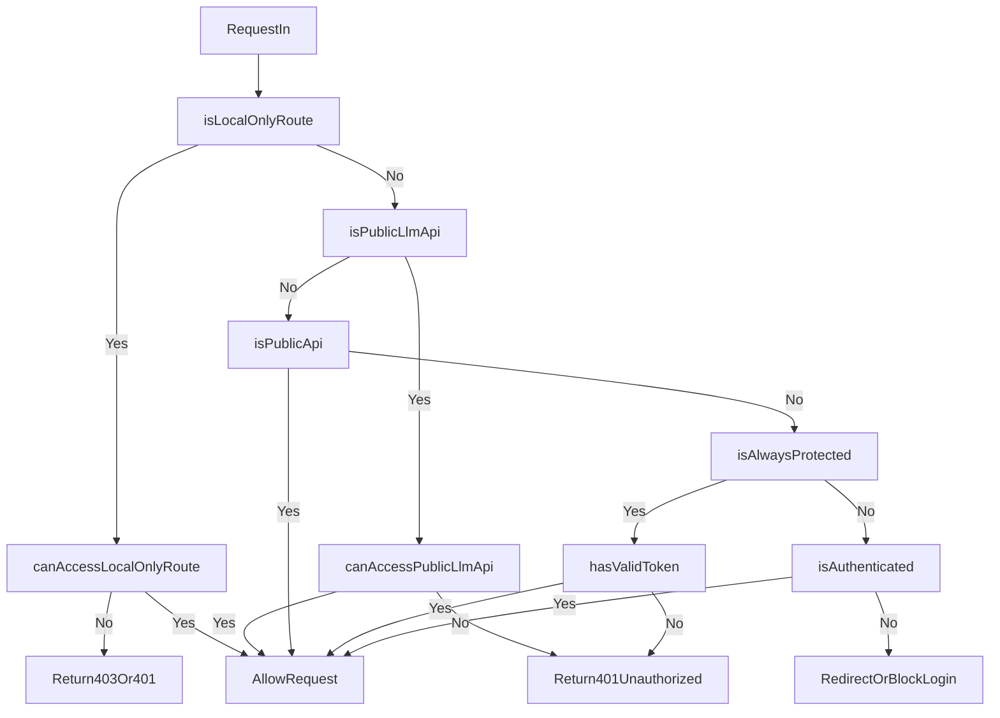
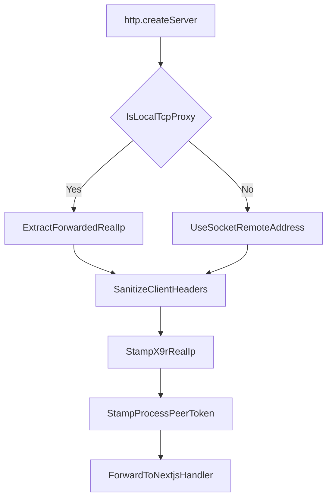

<!-- source: DeepWiki mcp.deepwiki.com · repo decolua/9router · page 11.3 Request Guarding & Trusted Peers · fetched 2026-10-30 -->

# Request Guarding & Trusted Peers

Relevant source files

The following files were used as context for generating this wiki page:

- [custom-server.js](custom-server.js)
- [scripts/copy-standalone-assets.mjs](scripts/copy-standalone-assets.mjs)
- [src/app/api/tunnel/tailscale-install/route.js](src/app/api/tunnel/tailscale-install/route.js)
- [src/dashboardGuard.js](src/dashboardGuard.js)
- [src/lib/auth/loginLimiter.js](src/lib/auth/loginLimiter.js)
- [src/lib/auth/trustedPeer.js](src/lib/auth/trustedPeer.js)
- [src/proxy.js](src/proxy.js)
- [tests/unit/custom-server-h2c.test.cjs](tests/unit/custom-server-h2c.test.cjs)
- [tests/unit/custom-server-peer-headers.test.js](tests/unit/custom-server-peer-headers.test.js)
- [tests/unit/dashboard-guard.test.js](tests/unit/dashboard-guard.test.js)
- [tests/unit/local-request-peer-trust-3294.test.js](tests/unit/local-request-peer-trust-3294.test.js)
- [tests/unit/standalone-assets.test.js](tests/unit/standalone-assets.test.js)

This page details the security mechanisms implemented in 9Router to protect its API endpoints and dashboard, focusing on request guarding, trusted peer identification, access restrictions, and proxy/protocol handling. It covers the role of `src/dashboardGuard.js` [src/dashboardGuard.js:1-207]() in enforcing access policies, how `custom-server.js` handles incoming requests (including H2C upgrades and peer header stamping) [custom-server.js:1-139](), the concept of `trustedPeer` for local requests [src/lib/auth/trustedPeer.js:1-7](), and how tunnel-based access is restricted [src/dashboardGuard.js:73-90]().

## Request Guarding with `src/dashboardGuard.js`

The `src/dashboardGuard.js` module acts as the primary gatekeeper for all incoming requests to the 9Router dashboard and API. It intercepts requests and applies authentication and authorization checks based on request paths, headers, and origins [src/dashboardGuard.js:1-207]().

### Request Classification

Requests are categorized into distinct groups, each with specific access rules:

*   **Public API Paths**: Endpoints requiring no authentication, such as health checks (`/api/health`), initialization (`/api/init`), locale settings, and login/logout routes [src/dashboardGuard.js:23-34]().
*   **Public LLM API Prefixes**: Routes for AI model interactions (`/v1`, `/v1beta`, `/api/v1`, `/api/v1beta`, `/codex`, `/responses`) that use their own API key authentication [src/dashboardGuard.js:38-38]().
*   **Always Protected Paths**: Sensitive operations like shutdown (`/api/shutdown`), database management, and OAuth auto-imports (`/api/oauth/cursor/auto-import`) that always require a valid JWT token, ignoring the `requireLogin` toggle [src/dashboardGuard.js:41-49]().
*   **Protected API Paths**: Standard dashboard API routes (`/api/settings`, `/api/providers`, `/api/usage`, etc.) that require authentication, but can be bypassed if `requireLogin` is explicitly disabled in settings [src/dashboardGuard.js:52-70]().
*   **Local-Only Paths**: Routes that spawn child processes, manage terminal tunnels, or read host secrets (e.g., `/api/cli-tools/cowork-settings`, `/api/mcp/`, `/api/tunnel/enable`) [src/dashboardGuard.js:73-90]().

### Access Control Logic & Routing Flow

The `proxy(request)` function in `src/dashboardGuard.js` coordinates route authorization [src/dashboardGuard.js:207-207]() and integrates with `src/proxy.js` [src/proxy.js:1-73]().

**Diagram: Request Guarding Routing Flow** (Code Entity Space)

Sources: `src/dashboardGuard.js`, `src/proxy.js`

Key helper functions governing access checks:

*   `isPublicLlmApi(pathname)`: Matches public LLM route prefixes [src/dashboardGuard.js:137-139]().
*   `isPublicApi(pathname)`: Combines LLM prefix check and general public API paths [src/dashboardGuard.js:191-194]().
*   `canAccessPublicLlmApi(request)`: Evaluates local request status, CLI tokens (`x-9r-cli-token`), or API keys [src/dashboardGuard.js:157-161]().
*   `canAccessLocalOnlyRoute(request)`: Demands either a valid CLI token or a verified local request coupled with valid dashboard authentication [src/dashboardGuard.js:163-168]().
*   `isAuthenticated(request)`: Verifies dashboard sessions via `auth_token` cookies or fallback to `requireLogin === false` [src/dashboardGuard.js:184-189]().
*   `hasValidCliToken(request)`: Validates the `x-9r-cli-token` header against a machine-id-derived secret [src/dashboardGuard.js:16-20]().
*   `extractApiKey(request)`: Parses API keys from `Authorization: Bearer`, `x-api-key`, `x-goog-api-key`, or query parameters [src/dashboardGroup.js:141-149]().
*   `validateApiKey(apiKey)`: Delegates key validation to local database functions [src/dashboardGuard.js:151-155]().

Sources: `src/dashboardGuard.js`, `src/lib/localDb.js`, `src/shared/utils/machineId.js`, `src/lib/auth/dashboardSession.js`

## `custom-server.js` Request Handling & Peer Stamping

The `custom-server.js` file pre-processes incoming HTTP requests in standalone deployments before they hit Next.js [custom-server.js:1-139](). It wraps Node.js `http.createServer` to enforce secure socket mappings and protocol handling.

### Peer Header Stamping & Sanitization

1.  **Socket IP Resolution**: Extracts the unspoofable socket address via `req.socket.remoteAddress` [custom-server.js:57]().
2.  **Proxy Header Handling**: If the TCP peer is a trusted local reverse proxy, forwarded headers like `x-real-ip` or `x-forwarded-for` are respected [custom-server.js:61-65](). Otherwise, direct client addresses are enforced.
3.  **Scrubbing Spoofed Headers**: Strips incoming client-supplied `x-9r-real-ip`, `x-forwarded-for`, `x-9r-via-proxy`, and `x-9r-peer-token` headers to thwart spoofing attacks [custom-server.js:66-69]().
4.  **Stamping Trusted Metadata**: Appends verified headers:
    *   `x-9r-real-ip`: The resolved real client IP [custom-server.js:70]().
    *   `x-9r-peer-token`: A cryptographically random per-process secret (`PEER_TOKEN`) generated at boot [custom-server.js:13-14, 71]().
    *   `x-9r-via-proxy`: Marker indicating whether the request traversed an intermediate proxy [custom-server.js:72]().

**Diagram: Custom Server Request Sanitization Pipeline** (Code Entity Space)

Sources: `custom-server.js`, `src/lib/auth/trustedPeer.js`

### H2C Upgrade Interception

Java Buildpack Runtime (JBR) environments and specialized clients frequently send HTTP/2 Cleartext (`h2c`) upgrade requests. `custom-server.js` overrides `server.emit` to intercept `upgrade` events, buffer payloads, and seamlessly downgrade/replay requests as HTTP/1.1 into the Next.js handler [custom-server.js:79-124]().

Sources: `custom-server.js`, `tests/unit/custom-server-h2c.test.cjs`, `tests/unit/custom-server-peer-headers.test.js`, `scripts/copy-standalone-assets.mjs`

## Trusted Peer & Local Request Trust

The definition of a trusted peer ensures that administrative actions are strictly isolated to the host running 9Router.

### `isLocalRequest` & `hasTrustedPeerHeaders`

The `isLocalRequest(request)` check validates that a request originates from the local machine through strict criteria [src/dashboardGuard.js:123-135]().

*   **Proxy Check**: Rejects requests stamped with `x-9r-via-proxy` if originating from non-local upstream hops [src/dashboardGuard.js:126]().
*   **Peer Token Proof**: Relies on `hasTrustedPeerHeaders(request)`, which verifies that `x-9r-peer-token` matches `process.env.NINEROUTER_PEER_TOKEN` [src/lib/auth/trustedPeer.js:4-7](). This guarantees that `x-9r-real-ip` was stamped by `custom-server.js` rather than injected by an external caller [src/lib/auth/trustedPeer.js:1-3]().
*   **Loopback Verification**: Validates loopback targets (`127.0.0.1`, `::1`, `::ffff:127.0.0.1`) [src/dashboardGuard.js:92-109, 111-121]().
*   **Origin Header Guard**: Ensures any browser `Origin` header matches loopback hosts, mitigating DNS rebinding and tunnel CSRF attacks [src/dashboardGuard.js:128-133]().

Additionally, `src/lib/auth/loginLimiter.js` utilizes `getClientIp(request)` to retrieve client IPs only when trusted peer headers are present, preventing attacker IP rotation from bypassing progressive login lockouts [src/lib/auth/loginLimiter.js:49-64]().

Sources: `src/dashboardGuard.js`, `src/lib/auth/trustedPeer.js`, `src/lib/auth/loginLimiter.js`, `tests/unit/local-request-peer-trust-3294.test.js`

## Tunnel-Based Access Restrictions

9Router supports remote tunnel connectors (such as Cloudflare Tunnel or Tailscale Funnel) to expose endpoints externally. However, safety boundaries prevent tunnels from accessing local system-controlling paths.

### Protecting `LOCAL_ONLY_PATHS`

Routes categorized under `LOCAL_ONLY_PATHS` (such as headless process launchers, Tailscale installers, and token reset tools) enforce local checks [src/dashboardGuard.js:73-90](). Even if an authenticated user logs in via an active public Cloudflare tunnel, `isLocalRequest(request)` evaluates to `false`, causing `canAccessLocalOnlyRoute` to deny access [src/dashboardGuard.js:123-135, 163-168]().

This prevents remote attackers from executing arbitrary local shell commands, managing node processes, or inspecting system environments via public tunnel mappings.

Sources: `src/dashboardGuard.js`, `src/app/api/tunnel/tailscale-install/route.js`, `src/lib/auth/loginLimiter.js`

---

