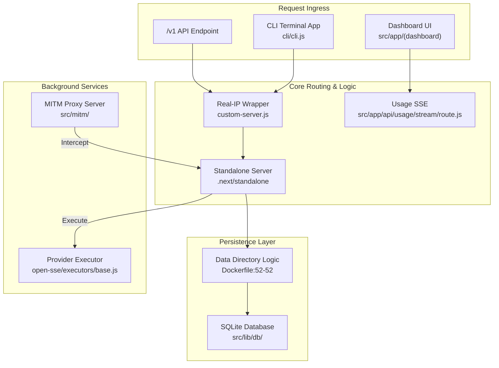
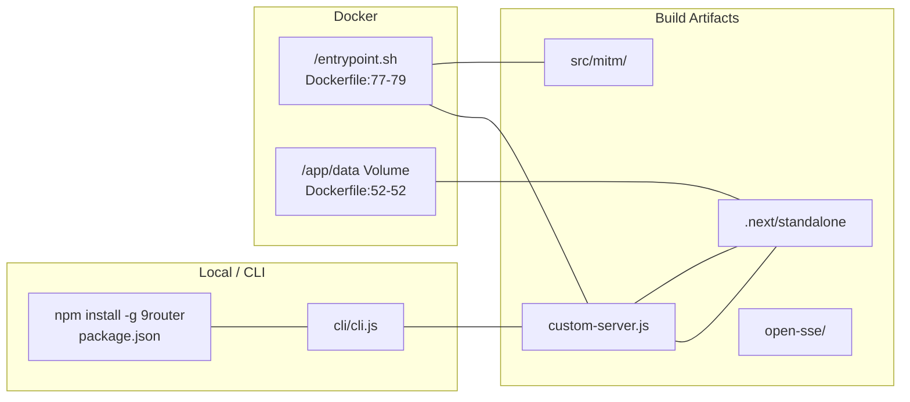

<!-- source: DeepWiki mcp.deepwiki.com · repo decolua/9router · page 12 Deployment · fetched 2026-10-30 -->

# Deployment

Relevant source files

The following files were used as context for generating this wiki page:

- [.github/dependabot.yml](.github/dependabot.yml)
- [.github/workflows/docker-publish.yml](.github/workflows/docker-publish.yml)
- [.gitignore](.gitignore)
- [.npmignore](.npmignore)
- [DOCKER.md](DOCKER.md)
- [Dockerfile](Dockerfile)
- [README.md](README.md)
- [open-sse/config/runtimeConfig.js](open-sse/config/runtimeConfig.js)
- [open-sse/executors/base.js](open-sse/executors/base.js)
- [src/app/api/usage/stream/route.js](src/app/api/usage/stream/route.js)

## Purpose and Scope

This document provides a high-level overview of deployment strategies and considerations for the 9Router system. It covers the deployment architecture, environment configuration, and available deployment targets. 9Router is designed to be flexible, supporting local execution via Node.js, containerized environments, and serverless edge deployments.

For detailed instructions on specific deployment scenarios, refer to the child pages:
- [Local Deployment](#12.1) — Instructions for running 9Router locally via npm, the CLI, or from source; `custom-server.js` and app initialization.
- [Docker Deployment](#12.2) — Docker setup, volume management, container configuration, and the `docker-publish` GitHub Actions workflow.
- [Environment Variables](#12.3) — Complete reference of environment variables and their effects (ports, `INITIAL_PASSWORD`, data dir, tracing mode, proxies).

---

## Deployment Architecture

9Router is a Next.js application that functions as a smart proxy and management dashboard. It bridges local tools to a variety of AI providers through a unified OpenAI-compatible interface. The system uses a standalone build mode for efficient production distribution, where `custom-server.js` acts as the entry point to handle real-IP preservation and request forwarding [Dockerfile:32-34](), [Dockerfile:56-57]().

### Logic to Code Mapping

The following diagram associates system components with their corresponding code entities to assist in navigation.

**Sources:** [Dockerfile:56-57](), [Dockerfile:52-52](), [open-sse/executors/base.js:11-16](), [src/app/api/usage/stream/route.js:1-5]()

---

## Deployment Targets

9Router supports multiple environments depending on the user's needs for persistence, portability, and accessibility.

### Code Entity to Deployment Environment

This diagram shows how specific code artifacts are utilized across different deployment targets.

**Sources:** [Dockerfile:56-60](), [Dockerfile:52-52](), [Dockerfile:77-79](), [README.md:76-81]()

---

## Deployment Options Overview

### 1. Local Deployment (npm/Source)
The recommended way for desktop users is via the `9router` CLI package. It provides a Terminal UI (TUI) for managing the server and configurations directly from the command line [README.md:76-81]().
- **Quick Start:** `npm install -g 9router` followed by `9router` [README.md:76-80]().
- **Interactive Setup:** The CLI uses an arrow-key menu system for initial configuration.
- **From Source:** For development or custom setups, 9Router can be run directly from the source code using `npm run dev` or `npm run start` after building [README.md:106-130]().
- For details, see [Local Deployment](#12.1).

### 2. Docker Deployment
Ideal for servers, NAS devices, or isolated environments. The official image `decolua/9router` supports `amd64` and `arm64` architectures [DOCKER.md:3-3]().
- **Base Image:** `node:22-alpine` [Dockerfile:2-2]().
- **Volume Management:** Mount host directory to `/app/data` to persist settings and the SQLite database [DOCKER.md:13-15]().
- **Runtime Security:** Includes an `entrypoint.sh` to fix permissions on mounted volumes and execute as the `node` user [Dockerfile:77-79]().
- For details, see [Docker Deployment](#12.2).

### 3. Cloudflare Worker Deployment
A serverless option for high availability and edge execution. This deployment utilizes `wrangler` for setup and leverages Cloudflare's KV and D1 for storage.
- For details, see [Environment Variables](#12.3).

**Sources:** [README.md:76-130](), [DOCKER.md:3-15](), [Dockerfile:2-79]()

---

## Runtime Configuration

9Router is configured primarily through environment variables. These control networking, security, and data persistence.

| Variable | Purpose | Default |
|----------|---------|---------|
| `PORT` | Server listening port | `20128` [Dockerfile:49-49]() |
| `HOSTNAME` | Bind address (0.0.0.0 for all interfaces) | `0.0.0.0` [Dockerfile:50-50]() |
| `DATA_DIR` | Location for database and config files | `/app/data` (Docker) [Dockerfile:52-52]() |
| `NEXT_TELEMETRY_DISABLED` | Disable Next.js telemetry collection | `1` [Dockerfile:51-51]() |
| `NODE_ENV` | Runtime environment mode | `production` [Dockerfile:48-48]() |
| `STREAM_STALL_TIMEOUT_MS` | Inter-chunk stall timeout for streaming | `360000` [open-sse/config/runtimeConfig.js:53-53]() |
| `FETCH_CONNECT_TIMEOUT_MS` | Timeout for upstream response headers | `60000` [open-sse/config/runtimeConfig.js:59-59]() |

**Sources:** [Dockerfile:48-52](), [open-sse/config/runtimeConfig.js:53-59]()

For a full reference of all supported variables, see [Environment Variables](#12.3).

---

## Data Persistence Strategy

9Router uses a centralized data directory for all stateful information, primarily centered around a SQLite database [DOCKER.md:43-48]().

### Data Layout
- **`db/data.sqlite`**: The primary database for provider connections, model aliases, and system settings [DOCKER.md:43-48]().
- **`db/backups/`**: Automated database backups to prevent data loss [DOCKER.md:43-48]().
- **`certs/`**: Root CA and leaf certificates for the MITM proxy system [DOCKER.md:43-48]().
- **`logs/`**: Runtime logs and request details [DOCKER.md:43-48]().

In Docker, ensure the `/app/data` path is mounted to a persistent host volume to avoid losing configuration when the container is recreated [DOCKER.md:13-15](). The `chown -R node:node /app/data` command in the entrypoint ensures correct permissions for the `node` user [Dockerfile:77-79]().

**Sources:** [DOCKER.md:13-48](), [Dockerfile:77-79]()

For details on the internal file structure, see [Environment Variables](#12.3).

---

