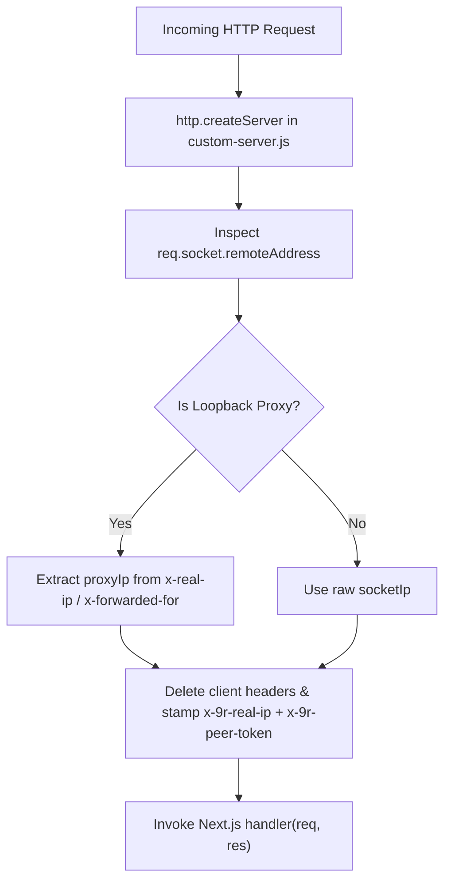
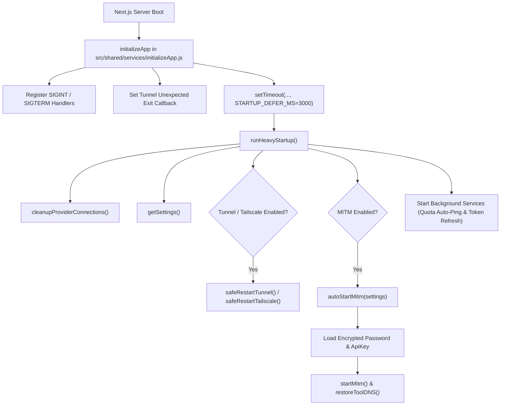

<!-- source: DeepWiki mcp.deepwiki.com · repo decolua/9router · page 12.1 Local Deployment · fetched 2026-10-30 -->

# Local Deployment

Relevant source files

The following files were used as context for generating this wiki page:

- [custom-server.js](custom-server.js)
- [scripts/copy-standalone-assets.mjs](scripts/copy-standalone-assets.mjs)
- [src/app/(dashboard)/dashboard/providers/[id]/AutoPingScheduleModal.js](src/app/(dashboard)/dashboard/providers/[id]/AutoPingScheduleModal.js)
- [src/app/(dashboard)/dashboard/providers/[id]/ConnectionRow.js](src/app/(dashboard)/dashboard/providers/[id]/ConnectionRow.js)
- [src/app/api/tunnel/tailscale-install/route.js](src/app/api/tunnel/tailscale-install/route.js)
- [src/dashboardGuard.js](src/dashboardGuard.js)
- [src/lib/auth/loginLimiter.js](src/lib/auth/loginLimiter.js)
- [src/lib/auth/trustedPeer.js](src/lib/auth/trustedPeer.js)
- [src/proxy.js](src/proxy.js)
- [src/shared/components/Tooltip.js](src/shared/components/Tooltip.js)
- [src/shared/services/initializeApp.js](src/shared/services/initializeApp.js)
- [src/shared/services/quotaAutoPing.js](src/shared/services/quotaAutoPing.js)
- [src/shared/services/quotaPingSchedule.js](src/shared/services/quotaPingSchedule.js)
- [tests/unit/custom-server-h2c.test.cjs](tests/unit/custom-server-h2c.test.cjs)
- [tests/unit/custom-server-peer-headers.test.js](tests/unit/custom-server-peer-headers.test.js)
- [tests/unit/dashboard-guard.test.js](tests/unit/dashboard-guard.test.js)
- [tests/unit/local-request-peer-trust-3294.test.js](tests/unit/local-request-peer-trust-3294.test.js)
- [tests/unit/quota-auto-ping.test.js](tests/unit/quota-auto-ping.test.js)
- [tests/unit/quota-ping-schedule.test.js](tests/unit/quota-ping-schedule.test.js)
- [tests/unit/standalone-assets.test.js](tests/unit/standalone-assets.test.js)

This page covers running 9Router locally using npm, CLI, or source checkouts, with deep technical focus on `custom-server.js` execution wrapping, HTTP request peer-token sanitization, h2c upgrade handling, and the deferred application initialization lifecycle implemented in `src/shared/services/initializeApp.js`. For Docker-based deployments, see [12.2 Docker Deployment]().

Sources: [custom-server.js:1-139](), [src/shared/services/initializeApp.js:1-121]()

---

## 1. Overview & Execution Entry Points

9Router operates as a Next.js application providing both a web management interface (`/dashboard`) and an OpenAI-compatible API gateway (`/v1/*`) [src/dashboardGuard.js:38](). Depending on the installation method, the server boots via different entry points:

1. **Global/Local npm CLI (`cli.js`)**: Manages isolated runtimes and invokes standalone server scripts.
2. **Production Standalone (`custom-server.js`)**: Wraps the Node.js `http` server to enforce socket-level peer authentication and h2c upgrades [custom-server.js:49-125]().
3. **Development (`npm run dev`)**: Executes `next dev` with hot-reloading on port `20127` [package.json:7-7]().

Sources: [custom-server.js:49-125](), [src/dashboardGuard.js:38]()

---

## 2. Custom Server & Request Sanitization (`custom-server.js`)

In production standalone builds, 9Router runs via `custom-server.js`, which intercepts `http.createServer` to secure incoming socket connections before they reach Next.js request handlers [custom-server.js:49-55]().

### Peer IP Derivation & Spoofing Protection

Attackers often spoof `X-Forwarded-For` or `X-Real-Ip` headers to bypass rate limits or local access gates. `custom-server.js` enforces that forwarding headers are trusted *only* when the underlying TCP socket (`req.socket.remoteAddress`) originates from a loopback proxy [custom-server.js:61-65](). It stamps an unspoofable per-process secret (`PEER_TOKEN`) into `x-9r-peer-token` [custom-server.js:12-14]().

Title: "CustomServerRequestWrapping"

Sources: [custom-server.js:1-74]()

### HTTP/2 Cleartext (h2c) Upgrades

Modern clients or Java-based runtimes (such as JBR 25) may attempt `h2c` upgrades. `custom-server.js` overrides `server.emit` to capture `upgrade` events with `upgrade: h2c`, buffers body chunks, replays them into an internal `http.IncomingMessage`, and executes the standard request handler [custom-server.js:80-124]().

Sources: [custom-server.js:80-124]()

---

## 3. Application Initialization Pipeline (`initializeApp.js`)

To prevent heavy startup routines (database cleanups, cloudflared checks, MITM status probes, and background credential refreshes) from starving incoming HTTP requests, 9Router defers non-critical boot tasks via `initializeApp()` [src/shared/services/initializeApp.js:35-76]().

### Initialization Sequence & Deferred Execution

Title: "AppInitializationLifecycle"

Sources: [src/shared/services/initializeApp.js:52-121]()

---

## 4. Data Directory & Environment Configuration

9Router resolves its persistent storage directory (`DATA_DIR`) using operating-system specific defaults unless overridden by environment variables.

### Directory Resolution
- **Windows**: `%APPDATA%/.9router`
- **macOS / Linux**: `~/.9router`
- **Custom Override**: Setting the `DATA_DIR` environment variable explicitly redirects sqlite databases and runtime binaries.

### Configuration Environment Variables

| Variable | Default | Description |
|---|---|---|
| `PORT` | `20127` | The HTTP port the server binds to [package.json:7-7](). |
| `HOSTNAME` | `0.0.0.0` | Bind interface address. |
| `DATA_DIR` | `~/.9router` | Root folder for SQLite database (`db/data.sqlite`), certs, and binaries. |
| `NINEROUTER_PROXY_CLIENT_MAX_BODY_SIZE` | `128mb` | Maximum body size allowed for LLM request payloads [next.config.mjs:10-10](). |
| `NINEROUTER_PEER_TOKEN` | *(auto-generated)* | Per-process cryptographic token validating local socket peer requests [custom-server.js:13-14](). |

Sources: [package.json:7-7](), [custom-server.js:13-14]()

---

## 5. Local System Integration & CLI Build

The CLI package leverages esbuild and custom build scripts (`cli/scripts/build-cli.js`) to bundle Next.js standalone outputs while excluding native modules (`better-sqlite3`, `sql.js`) from strict webpack bundling, loading them dynamically at runtime.

Sources: [cli/scripts/build-cli.js:113-116]()

---

## 6. Troubleshooting Local Deployments

1. **SQLite Native Build Failures**: If native compilation fails during global installation, 9Router falls back to pure-JS database drivers.
2. **Port Occupied**: Change the listening port via the `PORT` environment variable if port `20127` is already bound [package.json:7-7]().
3. **Tailscale & MITM Permission Errors**: Userspace networking modes and DNS modifications require valid credentials or cached secrets (`loadEncryptedPassword()`) [src/lib/tunnel/tailscale/tailscale.js:18-21]().

Sources: [package.json:7-7](), [src/lib/tunnel/tailscale/tailscale.js:18-21]()

---

