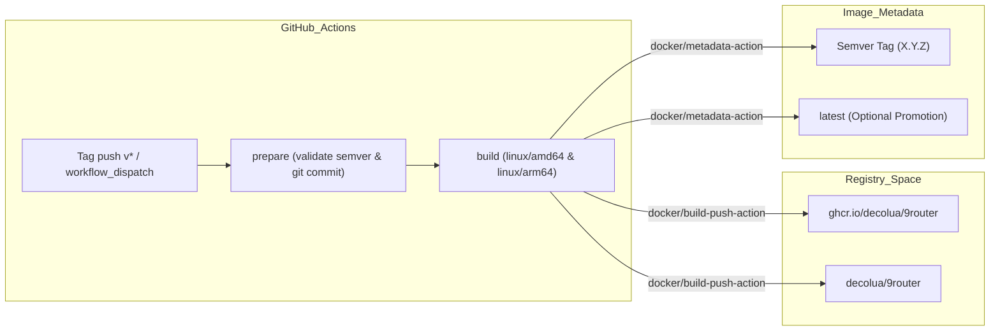

<!-- source: DeepWiki mcp.deepwiki.com · repo decolua/9router · page 12.2 Docker Deployment · fetched 2026-10-30 -->

# Docker Deployment

<details>
<summary>Relevant source files</summary>

The following files were used as context for generating this wiki page:

- [.github/dependabot.yml](.github/dependabot.yml)
- [.github/workflows/docker-publish.yml](.github/workflows/docker-publish.yml)
- [.gitignore](.gitignore)
- [.npmignore](.npmignore)
- [DOCKER.md](DOCKER.md)
- [Dockerfile](Dockerfile)
- [README.md](README.md)
- [open-sse/config/runtimeConfig.js](open-sse/config/runtimeConfig.js)
- [open-sse/executors/base.js](open-sse/executors/base.js)
- [src/app/api/usage/stream/route.js](src/app/api/usage/stream/route.js)

</details>


## Purpose and Scope

This document details the Docker-based deployment strategy for 9Router. It covers the multi-stage build process defined in the `Dockerfile`, container lifecycle management, volume persistence for databases, environment configuration, and the automated CI/CD publication pipeline defined in `.github/workflows/docker-publish.yml` [Dockerfile:1-84](), [.github/workflows/docker-publish.yml:1-188](). Docker deployment is recommended for production environments to ensure process isolation and consistent dependency resolution using the Node.js 22 runtime [Dockerfile:2-7]().

---

## Docker Architecture

9Router uses a containerized architecture that separates the build environment from the runtime environment. The container encapsulates the Next.js standalone server, the MITM proxy engine (`src/mitm`), and the Open-SSE core (`open-sse`), all running on a Node.js-optimized Alpine image [Dockerfile:36-60]().

### Code-to-Container Mapping

The following diagram illustrates how source entities and dependency modules are mapped into the Docker container structure during the multi-stage build process.

```mermaid
graph TD
    subgraph "Source_Code_Space"
        S1["package.json"]
        S2["src/mitm/"]
        S3["open-sse/"]
        S4[".next/standalone/"]
        S5["custom-server.js"]
        S6["node_modules/node-forge"]
        S7["node_modules/sql.js"]
        S8["node_modules/node-machine-id"]
        S9["node_modules/next"]
    end

    subgraph "Docker_Entity_Space"
        D1["node:22-alpine (Base)"]
        D2["/app/custom-server.js (Entrypoint)"]
        D3["/app/data (Volume Mount)"]
        D4["/entrypoint.sh (Runtime Permission Fixer)"]
        D5["/app/data-home (Linked to /root/.9router)"]
        D6["/app/node_modules/node-forge"]
        D7["/app/node_modules/sql.js"]
        D8["/app/node_modules/node-machine-id"]
        D9["/app/node_modules/next"]
    end

    S1 -->|"npm install"| D1
    S5 -->|"COPY"| D2
    S4 -->|"COPY --from=builder"| D2
    S2 -->|"COPY --from=builder"| D2
    S3 -->|"COPY --from=builder"| D2
    S6 -->|"COPY --from=builder"| D6
    S7 -->|"COPY --from=builder"| D7
    S8 -->|"COPY --from=builder"| D8
    S9 -->|"COPY --from=builder"| D9
    D4 -->|"chown -R node:node"| D3
    D5 -.->|"ln -sf"| D3
```


Sources: [Dockerfile:1-84](), [DOCKER.md:1-20]()

---

## The Build Process

The project utilizes a multi-stage `Dockerfile` to produce a lean production image based on `node:22-alpine` [Dockerfile:2-7]().

### 1. Builder Stage (`builder`)
The builder stage performs the following actions:
- Installs system dependencies including `python3`, `make`, `g++`, and `linux-headers` required for compiling native modules [Dockerfile:20]().
- Copies `package.json` and installs Node dependencies using `npm install` with cache mounts and configurable registries [Dockerfile:22-30]().
- Disables Next.js telemetry via `NEXT_TELEMETRY_DISABLED=1` [Dockerfile:33]().
- Executes `npm run build` [Dockerfile:34](), which generates the `.next/standalone` production output.

### 2. Runner Stage (`runner`)
The runner stage prepares the final production image:
- Sets `NODE_ENV=production`, `PORT=20128`, `HOSTNAME=0.0.0.0`, and `DATA_DIR=/app/data` [Dockerfile:48-52]().
- Copies standalone build assets, static files, and public directories from the builder [Dockerfile:54-56]().
- Copies `custom-server.js` [Dockerfile:57](), which acts as the application entrypoint via `CMD ["node", "custom-server.js"]` [Dockerfile:84]().
- **Critical Dependency Injection**: Manually copies `open-sse`, `src/mitm`, `node_modules/node-forge`, `node_modules/next`, `node_modules/sql.js`, and `node_modules/node-machine-id` [Dockerfile:58-69](). This is required because the Next.js standalone tracer often omits sibling directories, runtime-required binary files (like `sql-wasm.wasm`), or packages loaded dynamically via `createRequire` (like `node-machine-id`) [Dockerfile:59-69]().
- Sets up `/app/data` and `/app/data-home` linked to `/root/.9router` [Dockerfile:71-73]().
- Installs `su-exec` and provisions `/entrypoint.sh` to enforce proper file ownership (`node:node`) at runtime prior to dropping root privileges [Dockerfile:77-83]().

Sources: [Dockerfile:1-84](), [DOCKER.md:113-132]()

---

## Volume Management and Data Persistence

9Router relies on persistent storage for its SQLite database and session files under `DATA_DIR`.

### Volume Configuration

The standard deployment uses a host path mapped to the container's `/app/data` path [DOCKER.md:14]().

| Container Path | Purpose | Key Files |
| :--- | :--- | :--- |
| `/app/data` | Persistent Storage | `db/data.sqlite`, `backups/` |
| `/app/data-home` | Home Dir Persistence | Linked to `/root/.9router` |

### Permission Handling
Because Docker host volumes are frequently mounted with root permissions, the entrypoint script `/entrypoint.sh` executes the following steps at startup [Dockerfile:77-83]():
1. Recursively updates permissions via `chown -R node:node /app/data /app/data-home` [Dockerfile:78]().
2. Uses `su-exec` to launch the node application under the unprivileged `node` user account [Dockerfile:78]().

Sources: [Dockerfile:71-84](), [DOCKER.md:31-52]()

---

## Container Configuration

### Environment Variables
Container behavior is tuned via environment variables passed at runtime:

- `DATA_DIR`: Internal path pointing to the mounted volume (`/app/data`) [Dockerfile:52](), [DOCKER.md:15]().
- `PORT`: TCP port the HTTP server listens on (Default: `20128`) [Dockerfile:49]().
- `HOSTNAME`: Interface address bind (Default: `0.0.0.0`) [Dockerfile:50]().
- `NEXT_TELEMETRY_DISABLED`: Disables Next.js telemetry (`1`) [Dockerfile:51]().
- `DEBUG`: Enables verbose debug logging when set to `true` [DOCKER.md:62]().
- `HEADROOM_URL`: Points to an external Headroom proxy sidecar for RTK token saving [DOCKER.md:81]().

### Deployment Command
Standard execution via Docker CLI:

```bash
docker run -d \
  -p 20128:20128 \
  -v "$HOME/.9router:/app/data" \
  -e DATA_DIR=/app/data \
  --name 9router \
  decolua/9router:latest
```
Sources: [DOCKER.md:11-18](), [Dockerfile:48-52]()

---

## Automated Image Publishing (`docker-publish.yml`)

The repository includes a GitHub Actions workflow `.github/workflows/docker-publish.yml` that handles multi-platform image compilation and publishing to both Docker Hub and GitHub Container Registry (GHCR).

### CI/CD Workflow Entity Map


Sources: [.github/workflows/docker-publish.yml:1-188]()

### Build Specifications & Workflow Rules
- **Triggers**: Executed on semver tags matching `v*` or via manual `workflow_dispatch` inputs (`release_tag`, `promote_latest`) [.github/workflows/docker-publish.yml:3-17]().
- **Validation**: The `prepare` job validates tag structures against strict semver criteria and confirms that root `package.json` and `cli/package.json` versions match the git reference [.github/workflows/docker-publish.yml:60-123]().
- **Platforms**: Built natively for `linux/amd64` (on `ubuntu-24.04`) and `linux/arm64` (on `ubuntu-24.04-arm`) [.github/workflows/docker-publish.yml:136-141]().
- **Promotion Control**: Stable pushes automatically promote the image to `latest`, while prereleases require explicit `promote_latest` validation [.github/workflows/docker-publish.yml:110-111]().

Sources: [.github/workflows/docker-publish.yml:1-188](), [DOCKER.md:133-187]()

---

## Sidecar Integration (Headroom)

For advanced token savings using Headroom in Dockerized setups, Headroom can be run as an independent companion container orchestrated via Docker Compose [DOCKER.md:69-89]().

```yaml
services:
  9router:
    image: decolua/9router:latest
    ports:
      - "20128:20128"
    volumes:
      - "$HOME/.9router:/app/data"
    environment:
      DATA_DIR: /app/data
      HEADROOM_URL: http://headroom:8787
    depends_on:
      - headroom

  headroom:
    image: ghcr.io/chopratejas/headroom:latest
    ports:
      - "8787:8787"
```
Sources: [DOCKER.md:69-90]()

Sources:
- `Dockerfile` [Dockerfile:1-84]()
- `DOCKER.md` [DOCKER.md:1-187]()
- `.github/workflows/docker-publish.yml` [.github/workflows/docker-publish.yml:1-188]()
- `open-sse/config/runtimeConfig.js` [open-sse/config/runtimeConfig.js:1-98]()

---

