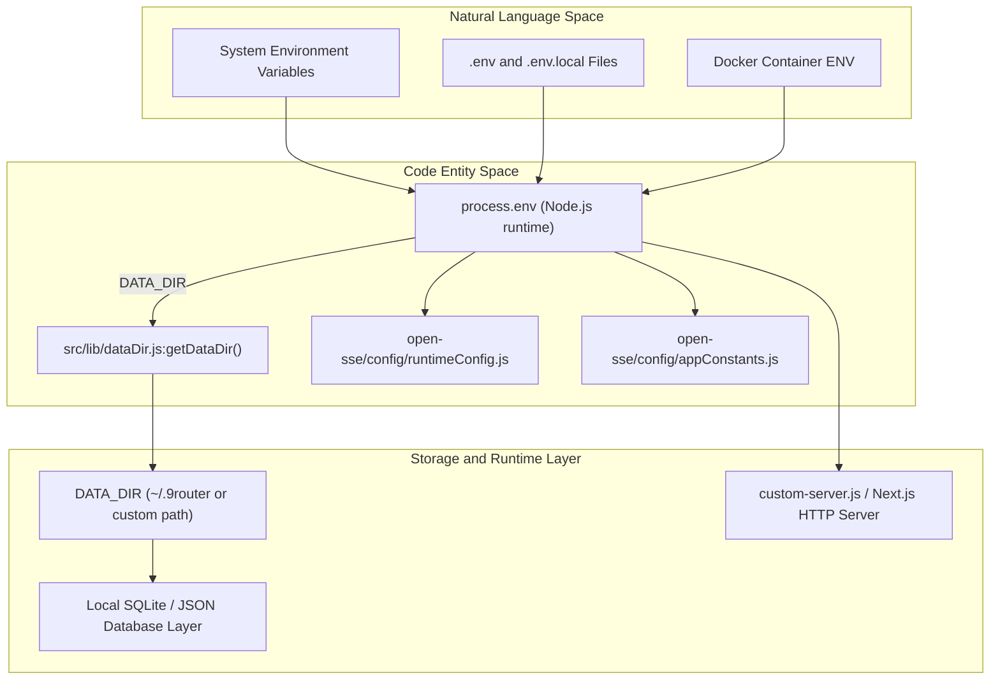
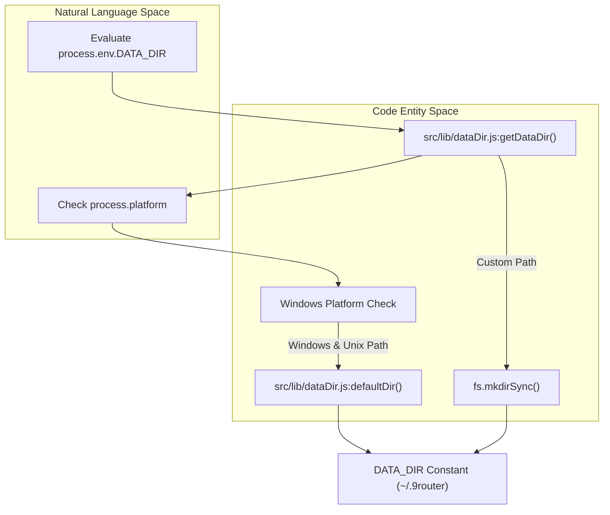

<!-- source: DeepWiki mcp.deepwiki.com · repo decolua/9router · page 12.3 Environment Variables · fetched 2026-10-30 -->

# Environment Variables

Relevant source files

The following files were used as context for generating this wiki page:

- [open-sse/config/appConstants.js](open-sse/config/appConstants.js)
- [src/lib/dataDir.js](src/lib/dataDir.js)
- [src/mitm/paths.js](src/mitm/paths.js)
- [src/shared/constants/mitmToolHosts.js](src/shared/constants/mitmToolHosts.js)
- [tests/__baseline__/current.json](tests/__baseline__/current.json)
- [tests/__baseline__/oauth-urls-baseline.json](tests/__baseline__/oauth-urls-baseline.json)
- [tests/__baseline__/verify-oauth-urls.mjs](tests/__baseline__/verify-oauth-urls.mjs)
- [tests/unit/nous-attribution.test.js](tests/unit/nous-attribution.test.js)

## Purpose and Scope

This page provides a comprehensive technical reference for all environment variables parsed and utilized by 9Router across its Next.js core application (`src/`), server runtime extensions (`custom-server.js`), and underlying routing engine (`open-sse/`). Environment variables govern server binding, data directory resolution (`src/lib/dataDir.js`, `src/mitm/paths.js`), background OAuth token rotation (`src/sse/services/backgroundTokenRefresh.js`), request timeouts, and MITM proxy behavior (`src/shared/constants/mitmToolHosts.js`).

For related deployment architectures, see [12.1. Local Deployment]() and [12.2. Docker Deployment](). For persistent application settings stored in the database layer rather than environment variables, see [7.2. Repositories & Collections]().

Sources: [src/lib/dataDir.js:1-35](), [src/mitm/paths.js:1-32](), [src/shared/constants/mitmToolHosts.js:1-12]()

---

## Configuration Hierarchy and Resolution

9Router resolves runtime parameters through a layered hierarchy, prioritizing immediate environment overrides, falling back to local database settings, and finally defaulting to hard-coded runtime constants.

### Configuration Resolution Architecture

Sources: [src/lib/dataDir.js:14-35](), [open-sse/config/appConstants.js:1-188]()

---

## Data Directory Resolution

The location where 9Router persists its SQLite database, logs, and configuration records is governed by the `DATA_DIR` environment variable. If unspecified, it evaluates the platform-specific user home directory (`src/lib/dataDir.js:7-12`, `src/mitm/paths.js:7-12`).

### Data Directory Logic

The function `getDataDir()` inspects `process.env.DATA_DIR` [src/lib/dataDir.js:14-16]. On Windows platforms, if a Unix-absolute path (starting with `/`) is supplied via misconfigured environment files, it logs a warning and falls back to `%APPDATA%\9router` (or `os.homedir()`) [src/lib/dataDir.js:20-23]. Both `src/lib/dataDir.js` and `src/mitm/paths.js` implement this resolution pattern to guarantee consistent file layout for database and MITM sub-directories.

Sources: [src/lib/dataDir.js:7-37](), [src/mitm/paths.js:7-32]()

---

## Server and Application Environment Variables

The following table documents environment variables affecting server binding, network transports, security, and administrative bootstrapping.

| Variable | Default | Type | Description |
|----------|---------|------|-------------|
| `PORT` | `20127` | Number | HTTP server listening port for the Next.js dashboard and API endpoints. |
| `HOSTNAME` | `0.0.0.0` | String | Network interface hostname bound by the HTTP server. |
| `DATA_DIR` | `~/.9router` (Unix) / `%APPDATA%\9router` (Win) | Path | Root directory for SQLite databases and persistent state [src/lib/dataDir.js:7-12](). |
| `INITIAL_PASSWORD` | (none) | String | Sets the initial dashboard administrator password on first boot if no user credentials exist in the database. |
| `NEXT_PUBLIC_BASE_URL` | `http://localhost:20127` | URL | Public-facing base URL utilized by client-side components for API routing. |
| `NINEROUTER_PROXY_CLIENT_MAX_BODY_SIZE` | `128mb` | String | Maximum allowable request body size for proxy clients configured in Next.js transport layers. |
| `NEXT_TRACING_ROOT_MODE` | (none) | String | Sets output file tracing root mode (e.g., `workspace` for CLI standalone compilation). |

Sources: [src/lib/dataDir.js:7-37](), [src/mitm/paths.js:7-32]()

---

## Background Token Refresh and OAuth Variables

9Router features an active background synchronization scheduler (`src/sse/services/backgroundTokenRefresh.js`) that periodically evaluates OAuth connection expiration and performs token rotation.

| Variable | Default | Type | Description |
|----------|---------|------|-------------|
| `DISABLE_BACKGROUND_TOKEN_REFRESH` | `false` | Boolean | When set to a truthy value (`1`, `true`, `yes`, `on`), completely disables the background token refresh interval loop. |
| `BG_REFRESH_DELAY_MS` | `1500` | Number | Milliseconds of sleep delay between refreshing normal provider accounts sequentially to prevent upstream API throttling. |
| `BG_REFRESH_GOOGLE_DELAY_MS` | `12000` | Number | Milliseconds of sleep delay between refreshing sensitive provider accounts (such as `antigravity` and `gemini-cli`). |
| `EAGER_PROJECT_ID_REFRESH` | `false` | Boolean | When enabled, eagerly triggers project ID discovery via Google Cloud Code APIs immediately following background token refreshes. |

Sources: [src/sse/services/backgroundTokenRefresh.js:1-170]()

---

## Request Performance, Timeouts, and Networking

Execution pipelines and upstream fetch executors rely on timeout boundaries defined in runtime constants.

| Variable | Default | Type | Description |
|----------|---------|------|-------------|
| `STREAM_STALL_TIMEOUT_MS` | `360000` | Number | Maximum allowed idle time between chunks during active Server-Sent Events (SSE) streaming. |
| `STREAM_FIRST_CHUNK_TIMEOUT_MS` | `200000` | Number | Time-to-first-token (TTFT) timeout waiting for upstream initial response headers and data chunks. |
| `FETCH_CONNECT_TIMEOUT_MS` | `60000` | Number | General connection timeout for proxy-aware fetch operations. |

Sources: [open-sse/config/appConstants.js:1-193]()

---

## MITM Proxy Subsystem and Tool Host Constants

When the MITM proxy interceptor is active, traffic destined for specific client application hostnames is redirected to `127.0.0.1` and handled by 9Router's intercept handlers. These targets are defined in `TOOL_HOSTS` [src/shared/constants/mitmToolHosts.js:5-10]().

| Tool / Provider | Intercepted Domains (`TOOL_HOSTS`) |
|-----------------|-----------------------------------|
| `antigravity` | `daily-cloudcode-pa.googleapis.com`, `cloudcode-pa.googleapis.com` [src/shared/constants/mitmToolHosts.js:6]() |
| `copilot` | `api.individual.githubcopilot.com` [src/shared/constants/mitmToolHosts.js:7]() |
| `kiro` | `runtime.us-east-1.kiro.dev`, `q.us-east-1.amazonaws.com`, `codewhisperer.us-east-1.amazonaws.com` [src/shared/constants/mitmToolHosts.js:8]() |
| `cursor` | `api2.cursor.sh` [src/shared/constants/mitmToolHosts.js:9]() |

Sources: [src/shared/constants/mitmToolHosts.js:1-12]()

---

