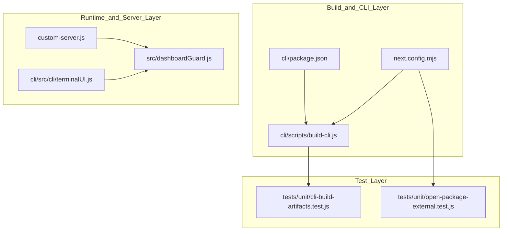
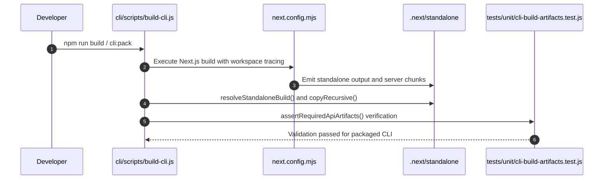

<!-- source: DeepWiki mcp.deepwiki.com · repo decolua/9router · page 13 Development · fetched 2026-10-30 -->

# Development

Relevant source files

The following files were used as context for generating this wiki page:

- [CHANGELOG.md](CHANGELOG.md)
- [cli/package.json](cli/package.json)
- [cli/scripts/build-cli.js](cli/scripts/build-cli.js)
- [cli/scripts/buildMitm.js](cli/scripts/buildMitm.js)
- [cli/src/cli/terminalUI.js](cli/src/cli/terminalUI.js)
- [cli/src/cli/utils/input.js](cli/src/cli/utils/input.js)
- [next.config.mjs](next.config.mjs)
- [package.json](package.json)
- [tests/unit/cli-build-artifacts.test.js](tests/unit/cli-build-artifacts.test.js)
- [tests/unit/open-package-external.test.js](tests/unit/open-package-external.test.js)

This section provides high-level technical guidance for developers extending, modifying, or contributing to 9Router. It outlines the codebase architecture, environment setup, build pipelines, and implementation patterns.

**Scope**: This page is a high-level parent guide. For deep technical details, refer to the child pages:
- [Project Structure](#13.1) — Detailed directory organization, module boundaries between `src/` and `open-sse/`.
- [Development Setup](#13.2) — Local development environment setup, hot reload, instrumentation, and debugging.
- [Adding New Providers](#13.3) — Step-by-step guide for provider registry entries, pricing, capabilities, executors, icons, and format support.
- [Adding Format Translators](#13.4) — Guide for implementing new translation pairs, concerns, and stream state management.
- [Testing](#13.5) — Document the `tests/` suite: unit tests, golden/snapshot tests, and `__baseline__` verification scripts.
- [Building and Packaging](#13.6) — Build process, standalone output tracing, asset copying, native module pruning, and npm CLI packaging.
- [Internationalization](#13.7) — Document the i18n runtime provider, locale constants, public/i18n literals, `LanguageSwitcher`, and translated READMEs.
- [GitBook Documentation Site](#13.8) — Documentation for the `gitbook/` multilingual docs site: `NAV_STRUCTURE`, content pages, language switcher, and deployment.

For deployment configuration (environment variables, Docker), see [Deployment](#12).

---

## Technology Stack

9Router is a full-stack Next.js application designed to run as a local gateway or a containerized service. It uses a standalone build output to minimize production image size and relies on externalized native modules to ensure cross-platform compatibility.

| Component | Technology | Purpose |
|-----------|-----------|---------|
| **Framework** | Next.js 16.1.6 | Full-stack framework using App Router [package.json:37]() |
| **Runtime** | Node.js / Bun | Support for standard Node and Bun runtimes [package.json:6-15](), [cli/package.json:36-38]() |
| **Database** | SQLite (Modular) | 3-tier driver fallback (`better-sqlite3`, `sql.js`) [package.json:54-57](), [next.config.mjs:26]() |
| **Routing** | Next Rewrites | Maps `/v1/*`, `/v1beta/*`, and `/codex/*` to internal API routes [next.config.mjs:63-102]() |
| **Dashboard** | React 19 | Management UI with `zustand` state management and `recharts` [package.json:44-53]() |

**Key Internal Modules**:
- `src/dashboardGuard.js`: Implements security gates for local-only routes and API key validation.
- `custom-server.js`: A request-sanitizing wrapper that proves peer IP authenticity using `x-9r-peer-token`.
- `src/lib/db/repos/requestDetailsRepo.js`: Manages request observability, sanitization, and batching.

Sources: [package.json:1-68](), [next.config.mjs:1-105]()

---

## Architecture & Code Mapping

The following diagram bridges the natural language space of system features to the code entity space of files and functions across the repository.

### System Components to Code Mapping

Sources: [next.config.mjs:1-105](), [cli/scripts/build-cli.js:1-189](), [cli/package.json:1-38](), [tests/unit/cli-build-artifacts.test.js:1-53](), [tests/unit/open-package-external.test.js:1-38]()

---

## Build & Packaging Pipeline

9Router uses a custom build script to package the Next.js standalone output into a CLI-ready format. This process handles workspace tracing and verifies that required API artifacts and external packages are correctly preserved.

### Build & Packaging Flow

Sources: [cli/scripts/build-cli.js:84-149](), [next.config.mjs:7-30](), [tests/unit/cli-build-artifacts.test.js:53-97]()

- **Standalone Output & Externalization**: `next.config.mjs` configures output tracing and flags packages like `open`, `better-sqlite3`, `sql.js`, and `@aws-sdk/credential-providers` as `serverExternalPackages` [next.config.mjs:15-26](). This prevents issues with dynamic imports and absolute path string literals (such as `import.meta.url` resolution on Windows during xAI/Grok token refresh) [tests/unit/open-package-external.test.js:6-37]().
- **CLI Packager**: `cli/scripts/build-cli.js` synchronizes versions, executes the Next.js build with `NEXT_TRACING_ROOT_MODE=workspace`, and merges server build artifacts into the CLI bundle directory [cli/scripts/build-cli.js:151-189]().
- **Artifact Verification**: Unit tests such as `tests/unit/cli-build-artifacts.test.js` ensure that chat and message routes, as well as provider chunks, are correctly packaged regardless of whether the build uses a legacy nested layout or Next.js 16 workspace tracing [tests/unit/cli-build-artifacts.test.js:54-97]().

Sources: [next.config.mjs:1-105](), [cli/scripts/build-cli.js:1-189](), [tests/unit/cli-build-artifacts.test.js:1-141](), [tests/unit/open-package-external.test.js:1-38]()

---

## Development Guide Sub-Topics

Refer to the child pages for detailed guidance on each sub-topic:

- **Project Structure**: For details on directory organization and module boundaries between `src/` and `open-sse/`, see [Project Structure](#13.1).
- **Development Setup**: For local environment setup, hot reload configuration, and debugging, see [Development Setup](#13.2).
- **Adding New Providers**: For registry entries, pricing schemas, model capabilities, and executors, see [Adding New Providers](#13.3).
- **Adding Format Translators**: For implementation details on translation pairs, concerns, and stream state management, see [Adding Format Translators](#13.4).
- **Testing**: For running unit tests, golden snapshots, and baseline verification scripts, see [Testing](#13.5).
- **Building and Packaging**: For standalone output tracing, asset copying, native module pruning, and npm CLI packaging, see [Building and Packaging](#13.6).
- **Internationalization**: For the i18n runtime provider, locale constants, literals, and the `LanguageSwitcher`, see [Internationalization](#13.7).
- **GitBook Documentation Site**: For multilingual docs site configuration and deployment, see [GitBook Documentation Site](#13.8).

Sources: [package.json:1-68](), [cli/package.json:1-51]()

---

