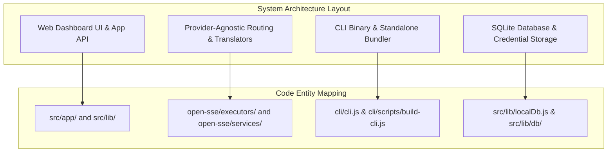

<!-- source: DeepWiki mcp.deepwiki.com · repo decolua/9router · page 13.1 Project Structure · fetched 2026-10-30 -->

# Project Structure

<details>
<summary>Relevant source files</summary>

The following files were used as context for generating this wiki page:

- [CHANGELOG.md](CHANGELOG.md)
- [cli/package.json](cli/package.json)
- [cli/scripts/build-cli.js](cli/scripts/build-cli.js)
- [cli/scripts/buildMitm.js](cli/scripts/buildMitm.js)
- [cli/src/cli/terminalUI.js](cli/src/cli/terminalUI.js)
- [cli/src/cli/utils/input.js](cli/src/cli/utils/input.js)
- [next.config.mjs](next.config.mjs)
- [package.json](package.json)
- [src/shared/components/index.js](src/shared/components/index.js)
- [tests/unit/cli-build-artifacts.test.js](tests/unit/cli-build-artifacts.test.js)
- [tests/unit/open-package-external.test.js](tests/unit/open-package-external.test.js)

</details>


## Purpose and Scope

This document specifies the directory organization, module boundaries, and architectural layers of the 9Router codebase (`https://github.com/decolua/9router`). It provides a detailed technical mapping between high-level system components and their physical file locations, distinguishing between the Next.js web dashboard (`src/`) and the provider-agnostic routing and translation core (`open-sse/`).

Sources: [package.json:1-60](), [next.config.mjs:1-105]()

---

## Top-Level Directory Organization

9Router organizes its source code into separate top-level packages and directories, separating the Next.js frontend/API gateway (`src/`), the standalone protocol core (`open-sse/`), the CLI tooling package (`cli/`), and runtime configuration.


*Diagram 1: Bridging architectural components to physical code paths.*

Sources: [package.json:1-60](), [cli/package.json:1-48]()

---

## Module Boundaries: `src/` vs `open-sse/`

The codebase enforces strict module boundaries between application-specific UI/Next.js glue and the core routing protocol engine:

| Module Boundary | Path | Responsibility & Key Artifacts |
|-----------------|------|--------------------------------|
| **Next.js Application** | `src/` | Dashboard React UI components [src/shared/components/index.js:1-44](), API route handlers under `src/app/api/`, local SQLite persistence wrappers (`src/lib/localDb.js`), and background lifecycle services (`src/sse/services/backgroundTokenRefresh.js`). |
| **Routing Protocol Core** | `open-sse/` | Provider-agnostic execution logic, base request executors (`open-sse/executors/base.js`), OAuth credential management, provider registries (`open-sse/config/providers.js`), and protocol format translation layers. |
| **CLI & Packaging** | `cli/` | Global binary distribution wrapper (`cli/cli.js`), packaging scripts (`cli/scripts/build-cli.js`) [cli/scripts/build-cli.js:151-189](), and post-installation runtime binary hooks (`cli/hooks/postinstall.js`). |
| **Container & Deployment** | `custom-server.js` & `next.config.mjs` | Standalone output tracing, webpack watch configurations, and explicit inclusion of native runtimes (`sql.js`, `node-forge`, `node-machine-id`) [next.config.mjs:15-26](). |

Sources: [src/shared/components/index.js:1-44](), [cli/scripts/build-cli.js:151-189](), [next.config.mjs:15-26]()

---

## Core Subsystems and Request Execution Flow

The core execution path relies on base classes and shared request modules to construct outgoing upstream requests, manage connection fallback indices, and handle dynamic retry intervals.

```mermaid
graph TD
    subgraph CodeSpace["Code Entity Execution Path"]
        ChatCore["open-sse/handlers/chatCore.js"]
        BaseExec["open-sse/executors/base.js (class BaseExecutor)"]
        BuildUrl["BaseExecutor.buildUrl()"]
        BuildHeaders["BaseExecutor.buildHeaders()"]
        ProxyFetch["proxyAwareFetch()"]
        TryRetry["BaseExecutor.tryRetry()"]
    end

    ChatCore -->|calls execute()| BaseExec
    BaseExec --> BuildUrl
    BaseExec --> BuildHeaders
    BaseExec --> ProxyFetch
    ProxyFetch -->|HTTP 429 / 502| TryRetry
    TryRetry -->|decrement urlIndex / retry| ProxyFetch
```
*Diagram 2: Request execution pipeline within the `open-sse` core.*

Sources: [next.config.mjs:63-102](), [cli/scripts/build-cli.js:84-111]()

---

## Background Token Management and Persistence

Background tasks, such as proactive OAuth token refreshes and project ID resolution, operate independently from inbound HTTP requests while sharing persistence layers.

- **Background Token Scheduler**: Implemented via background services that evaluate active OAuth credentials via connection status checkers and trigger safe background refreshes with per-provider jitter.
- **Project ID Resolution**: Managed by project service components which query Google Cloud Code endpoints (`loadCodeAssist` / `onboardUser`) to fetch real account-bound project IDs with caching and deduplication.
- **Credential Storage**: Updates are committed back to local persistence tables through local database wrappers and token refresh utilities.

Sources: [package.json:19-54](), [cli/package.json:25-32]()

---

