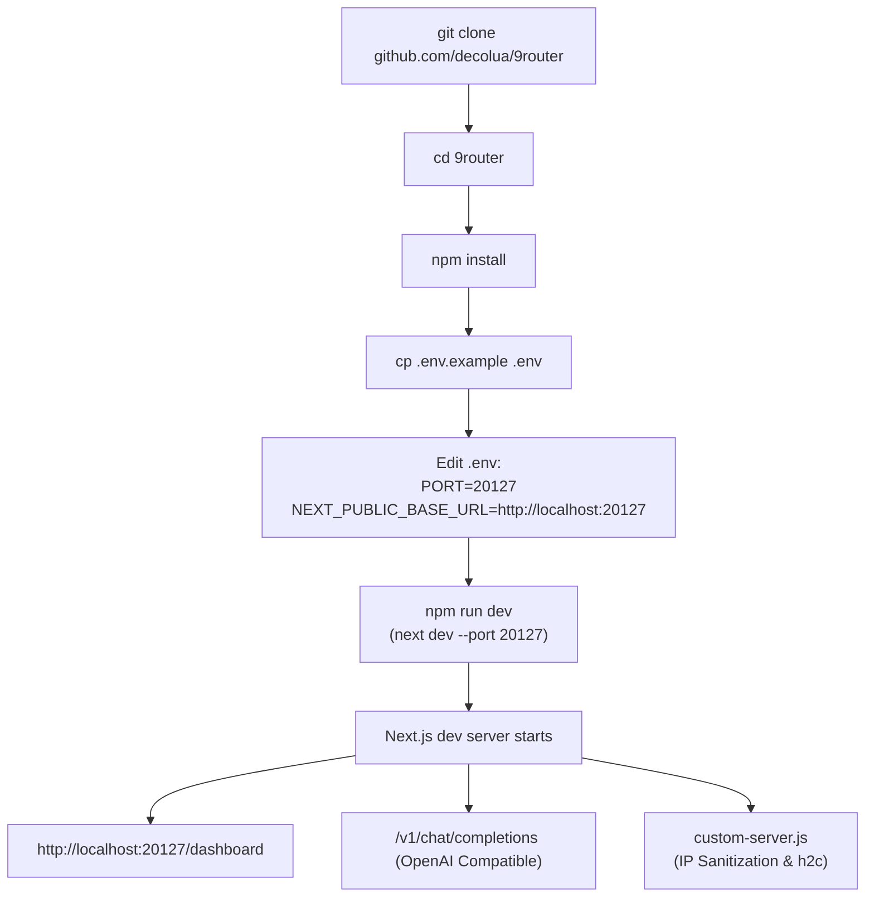
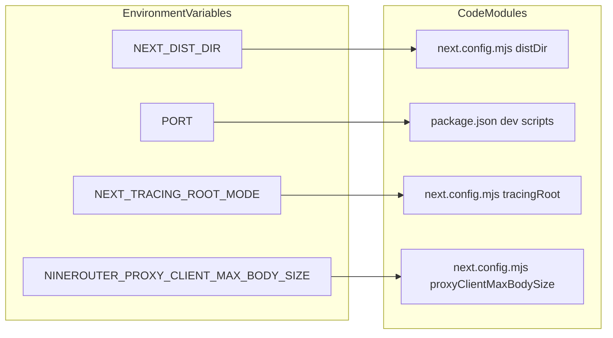
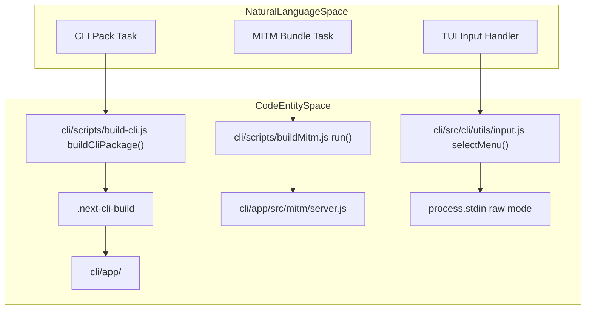
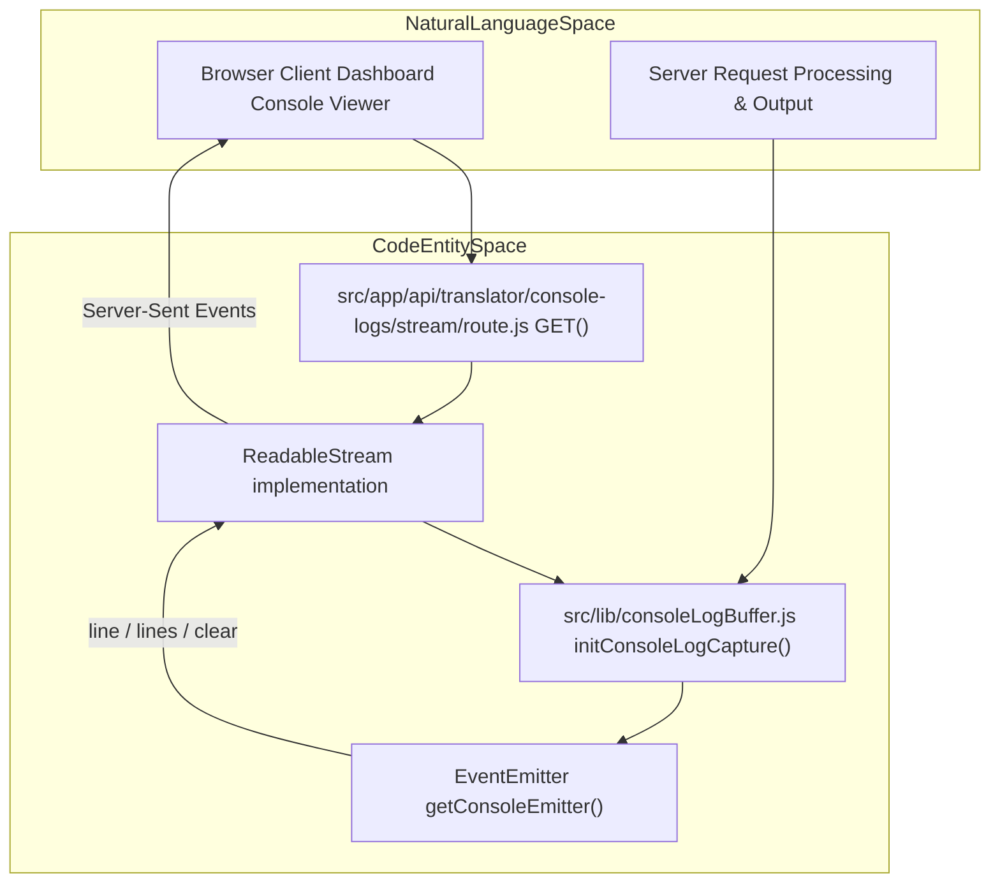

<!-- source: DeepWiki mcp.deepwiki.com · repo decolua/9router · page 13.2 Development Setup · fetched 2026-10-30 -->

# Development Setup

<details>
<summary>Relevant source files</summary>

The following files were used as context for generating this wiki page:

- [CHANGELOG.md](CHANGELOG.md)
- [cli/package.json](cli/package.json)
- [cli/scripts/build-cli.js](cli/scripts/build-cli.js)
- [cli/scripts/buildMitm.js](cli/scripts/buildMitm.js)
- [cli/src/cli/terminalUI.js](cli/src/cli/terminalUI.js)
- [cli/src/cli/utils/input.js](cli/src/cli/utils/input.js)
- [next.config.mjs](next.config.mjs)
- [open-sse/providers/catalogOverride.js](open-sse/providers/catalogOverride.js)
- [open-sse/providers/visionPatterns.js](open-sse/providers/visionPatterns.js)
- [package.json](package.json)
- [src/app/(dashboard)/dashboard/console-log/ConsoleLogClient.js](src/app/(dashboard)/dashboard/console-log/ConsoleLogClient.js)
- [src/app/api/models/catalog-sync/route.js](src/app/api/models/catalog-sync/route.js)
- [src/app/api/translator/console-logs/stream/route.js](src/app/api/translator/console-logs/stream/route.js)
- [src/instrumentation.js](src/instrumentation.js)
- [src/lib/consoleLogBuffer.js](src/lib/consoleLogBuffer.js)
- [src/lib/modelCatalog/sync.js](src/lib/modelCatalog/sync.js)
- [tests/unit/cli-build-artifacts.test.js](tests/unit/cli-build-artifacts.test.js)
- [tests/unit/gpt-6-context-window.test.js](tests/unit/gpt-6-context-window.test.js)
- [tests/unit/model-catalog-scope.test.js](tests/unit/model-catalog-scope.test.js)
- [tests/unit/open-package-external.test.js](tests/unit/open-package-external.test.js)
- [tests/unit/v1-models-combo-context.test.js](tests/unit/v1-models-combo-context.test.js)

</details>


This page documents the local development environment setup for 9Router from source, including dependency installation, environment configuration, hot reload behavior, instrumentation, debugging, and CLI package compilation. The package name `9router-app` [package.json:2-3]() is private and not published to npm, making source execution and local script invocation the standard development path.

---

## Prerequisites and Build Configuration

| Requirement | Minimum Version | Notes |
|-------------|----------------|-------|
| Node.js | 18.0.0+ | Required for the CLI and server runtime [cli/package.json:36-38]() |
| npm | bundled with Node.js | Package management and script execution |
| Git | any recent | Repository cloning |
| Bun | latest stable | Optional; alternative runtime for `*:bun` scripts [package.json:13-15]() |
| C++ toolchain | platform-specific | Required if building `better-sqlite3` native bindings [package.json:57]() |

The `--webpack` flag in all `dev` and `build` scripts [package.json:7-14]() forces Next.js to use webpack instead of Turbopack. This is necessary for native addon compatibility and specialized proxy middleware. Note that `next.config.mjs` explicitly ignores certain modules in the browser bundle and excludes specific directories like `logs`, `.next`, `gitbook`, and `cli` from the watcher [next.config.mjs:48-60]().

Sources: [package.json:7-15, 57](), [cli/package.json:36-38](), [next.config.mjs:48-60]()

---

## Quick Start Workflow



**Repository clone and initial setup**

```bash
git clone https://github.com/decolua/9router.git
cd 9router
npm install
cp .env.example .env
```

**Start development server:**

```bash
PORT=20127 NEXT_PUBLIC_BASE_URL=http://localhost:20127 npm run dev
```

Sources: [package.json:7](), [next.config.mjs:7-10]()

---

## Installing Dependencies

```bash
npm install
```

This installs all runtime and development dependencies defined in [package.json:19-67]().

**Critical dependencies with setup requirements**

| Package | Version | Role | Setup Notes |
|---------|---------|------|-------------|
| `next` | ^16.1.6 | Framework runtime | Provides `next dev` and `next build` [package.json:38]() |
| `better-sqlite3` | ^12.6.2 | Native SQLite bindings | Optional; 9Router falls back to `sql.js` if missing [package.json:50, 57]() |
| `sql.js` | ^1.14.1 | WASM SQLite | Used as runtime fallback for systems without build tools [package.json:50, 57]() |
| `react` | 19.2.4 | UI runtime | Core UI library [package.json:44]() |
| `tailwindcss` | ^4 | CSS framework | Dev dependency; uses `@tailwindcss/postcss` [package.json:62, 66]() |
| `zustand` | ^5.0.10 | State Management | Used for global stores across the dashboard [package.json:53]() |

Sources: [package.json:19-67](), [cli/package.json:33-35]()

---

## Environment Configuration

The repository provides environment variable configuration through standard `.env` files.



**Key environment variables**

| Variable | Default | Description |
|----------|---------|-------------|
| `PORT` | `20127` | HTTP listen port for the dashboard and API [package.json:7]() |
| `NEXT_DIST_DIR` | `.next` | Custom build output directory [next.config.mjs:14]() |
| `NEXT_TRACING_ROOT_MODE` | `undefined` | Set to `workspace` to include hoisted node_modules in CLI builds [next.config.mjs:7-9]() |
| `NINEROUTER_PROXY_CLIENT_MAX_BODY_SIZE` | `128mb` | Maximum body size for proxy rewrites, supporting large context [next.config.mjs:10, 39-40]() |

Sources: [package.json:7](), [next.config.mjs:7-14, 39-40]()

---

## Running the Development Server & Hot Reload

### npm (Standard)

```bash
npm run dev
```

This executes [package.json:7](): `"dev": "next dev --port 20127"`. For webpack mode, use `npm run dev:webpack` [package.json:8]().

### Hot Reload & Watcher Optimization

To reduce inotify load and speed up hot module replacement (HMR), `next.config.mjs` configures `watchOptions` to ignore non-source directories such as `node_modules`, `.git`, `logs`, `.next`, `gitbook`, `cli`, and `tests` [next.config.mjs:55-60](). Additionally, `serverComponentsHmrCache: true` caches fetch responses across HMR refreshes [next.config.mjs:41-42]().

Sources: [package.json:7-8](), [next.config.mjs:41-42, 55-60]()

---

## CLI Development and Build Scripts

The `cli/` package provides the terminal binary and wrapper logic [cli/package.json:1-7](). Developers can test and package the CLI using scripts defined in `cli/package.json` [cli/package.json:16-24]().



The script `cli/scripts/build-cli.js` synchronizes versions, executes Next.js standalone builds with `NEXT_TRACING_ROOT_MODE=workspace`, and copies assets into `cli/app/` [cli/scripts/build-cli.js:152-189](). Meanwhile, `cli/scripts/buildMitm.js` uses `esbuild` to bundle self-contained MITM server scripts into `cli/app/src/mitm/` [cli/scripts/buildMitm.js:38-54](). Terminal menus in `cli/src/cli/utils/input.js` maintain raw mode and keypress listeners via `selectMenu()` [cli/src/cli/utils/input.js:92-147]().

Sources: [cli/package.json:16-24](), [cli/scripts/build-cli.js:152-189](), [cli/scripts/buildMitm.js:38-54](), [cli/src/cli/utils/input.js:92-147]()

---

## Observability, Instrumentation & Logging

For tracking request flows and debugging, 9Router initializes console capture during application startup [src/instrumentation.js:4-5]().



The `initConsoleLogCapture()` function [src/lib/consoleLogBuffer.js:1-3]() intercepts global `console` calls. The `GET` handler at `src/app/api/translator/console-logs/stream/route.js` [src/app/api/translator/console-logs/stream/route.js:7]() establishes an SSE connection, streaming buffered logs immediately and pushing new events as they occur with a 25-second keepalive interval [src/app/api/translator/console-logs/stream/route.js:28-75]().

Sources: [src/app/api/translator/console-logs/stream/route.js:7-75](), [src/lib/consoleLogBuffer.js:1-3](), [src/instrumentation.js:4-5]()

---

## Runtime Data Storage & Catalog Synchronization

9Router manages persistence through SQLite drivers and synchronizes model capabilities from remote definitions during application startup [src/instrumentation.js:10-12]().

The synchronization module updates model limits daily using `src/lib/modelCatalog/sync.js` [src/lib/modelCatalog/sync.js:1-14](). Unit tests in `tests/unit/model-catalog-scope.test.js` verify scoping rules for model modalities and vendor overrides against temporary data directories [tests/unit/model-catalog-scope.test.js:32-41]().

Sources: [src/lib/modelCatalog/sync.js:1-14](), [src/instrumentation.js:10-12](), [tests/unit/model-catalog-scope.test.js:32-41]()

---

