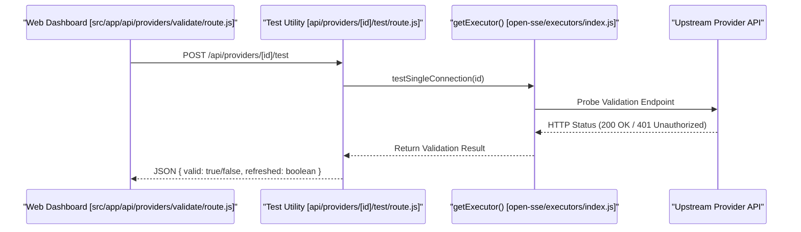

<!-- source: DeepWiki mcp.deepwiki.com · repo decolua/9router · page 13.3 Adding New Providers · fetched 2026-10-30 -->

# Adding New Providers

<details>
<summary>Relevant source files</summary>

The following files were used as context for generating this wiki page:

- [CLAUDE.md](CLAUDE.md)
- [cli/src/cli/utils/modelSelector.js](cli/src/cli/utils/modelSelector.js)
- [open-sse/handlers/imageProviders/huggingface.js](open-sse/handlers/imageProviders/huggingface.js)
- [open-sse/providers/models/schema.js](open-sse/providers/models/schema.js)
- [open-sse/providers/registry/agnes.js](open-sse/providers/registry/agnes.js)
- [open-sse/providers/registry/atria.js](open-sse/providers/registry/atria.js)
- [open-sse/providers/registry/bai.js](open-sse/providers/registry/bai.js)
- [open-sse/providers/registry/black-forest-labs.js](open-sse/providers/registry/black-forest-labs.js)
- [open-sse/providers/registry/comfyui.js](open-sse/providers/registry/comfyui.js)
- [open-sse/providers/registry/dahl.js](open-sse/providers/registry/dahl.js)
- [open-sse/providers/registry/deepseek.js](open-sse/providers/registry/deepseek.js)
- [open-sse/providers/registry/fal-ai.js](open-sse/providers/registry/fal-ai.js)
- [open-sse/providers/registry/glm-cn.js](open-sse/providers/registry/glm-cn.js)
- [open-sse/providers/registry/glm.js](open-sse/providers/registry/glm.js)
- [open-sse/providers/registry/huggingface.js](open-sse/providers/registry/huggingface.js)
- [open-sse/providers/registry/perplexity.js](open-sse/providers/registry/perplexity.js)
- [open-sse/providers/registry/tokenrouter.js](open-sse/providers/registry/tokenrouter.js)
- [open-sse/providers/registry/xai.js](open-sse/providers/registry/xai.js)
- [open-sse/providers/schema.js](open-sse/providers/schema.js)
- [open-sse/services/usage/glm.js](open-sse/services/usage/glm.js)
- [public/providers/agnes.png](public/providers/agnes.png)
- [public/providers/alims-intl.png](public/providers/alims-intl.png)
- [public/providers/alitp-intl.png](public/providers/alitp-intl.png)
- [public/providers/atria.png](public/providers/atria.png)
- [public/providers/bai.png](public/providers/bai.png)
- [public/providers/dahl.png](public/providers/dahl.png)
- [public/providers/fish-audio.png](public/providers/fish-audio.png)
- [public/providers/selfhosted-embedding.png](public/providers/selfhosted-embedding.png)
- [public/providers/selfhosted-stt.png](public/providers/selfhosted-stt.png)
- [public/providers/selfhosted-tts.png](public/providers/selfhosted-tts.png)
- [public/providers/tokenrouter.png](public/providers/tokenrouter.png)
- [src/lib/oauth/providers/glm.js](src/lib/oauth/providers/glm.js)
- [tests/unit/agnes-model-seeds.test.js](tests/unit/agnes-model-seeds.test.js)
- [tests/unit/deepseek-claude-tools.test.js](tests/unit/deepseek-claude-tools.test.js)
- [tests/unit/glm-oauth.test.js](tests/unit/glm-oauth.test.js)
- [tests/unit/huggingface-image-end-to-end.test.js](tests/unit/huggingface-image-end-to-end.test.js)
- [tests/unit/huggingface-router-migration.test.js](tests/unit/huggingface-router-migration.test.js)

</details>


## Purpose and Scope

This guide explains how to integrate a new AI provider into the 9Router proxy system. It covers metadata configuration in the registry, schema normalization, multi-transport setups, authentication modes (OAuth, API Key, Web-cookie, Free), specialized executors, pricing structures, format support, and custom usage fetchers. 9Router uses an abstraction layer to handle diverse upstream APIs and translates incoming OpenAI-formatted requests into provider-specific schemas.

---

## Provider Integration Architecture

9Router uses a multi-layer provider system separating metadata, configuration, and execution logic. The system uses a registry-based approach where transport settings, pricing, capabilities, and models are co-located in modular registry files (`open-sse/providers/registry/`).

Title: Provider Layering and Code Entities Bridge
```mermaid
graph TB
    subgraph "NaturalLanguageSpace"
        UserMetadata[""New AI Provider Definition""]
        ModelCatalog[""Model Pricing and Capabilities""]
    end

    subgraph "CodeEntitySpace"
        RegistryEntry[""open-sse/providers/registry/{id}.js""]
        ProviderSchema[""resolveProvider() [open-sse/providers/schema.js:73-83]""]
        ModelSchema[""normalizeModel() [open-sse/providers/models/schema.js:22-26]""]
        ProviderDefaults[""PROVIDER_DEFAULTS [open-sse/providers/schema.js:51-63]""]
    end

    UserMetadata --> RegistryEntry
    ModelCatalog --> RegistryEntry
    RegistryEntry --> ProviderSchema
    RegistryEntry --> ModelSchema
    ProviderSchema --> ProviderDefaults
```

Sources: [open-sse/providers/registry/index.js:1-249](), [open-sse/providers/schema.js:51-83](), [open-sse/providers/models/schema.js:22-26]()

---

## Step 1: Register Provider Metadata

New providers must be added as a new file in `open-sse/providers/registry/` and then imported or auto-discovered into the main index.

| Registry Category | Description | Example File |
| :--- | :--- | :--- |
| `apikey` | Standard commercial providers using API Keys. | [open-sse/providers/registry/deepseek.js:21]() |
| `oauth` | Services requiring OAuth 2.0 (access/refresh tokens) or CLI polling flows. | [open-sse/providers/registry/glm.js:18]() |
| `freeTier` | Free-tier or hybrid services with free credits. | [open-sse/providers/registry/agnes.js:20]() |
| `webCookie` | Providers using browser session cookies instead of API keys. | [open-sse/providers/registry/index.js:1-10]() |

**Key Metadata Fields (from Registry Entry):**
- `id`: Internal unique identifier (e.g., `"glm"` or `"deepseek"`). [open-sse/providers/registry/glm.js:4]()
- `alias`: Short code used in model aliases and UI routing. [open-sse/providers/registry/glm.js:6]()
- `serviceKinds`: Defines capabilities like `llm`, `tts`, `embedding`, `image`, `stt`, `webSearch`. [open-sse/providers/registry/glm.js:75]()
- `transport`: Defines `baseUrl`, `validateUrl`, and auth requirements. [open-sse/providers/registry/glm.js:36-49]()
- `models`: Initial model seed catalog or explicit definitions. [open-sse/providers/registry/glm.js:65-74]()
- `passthroughModels`: Boolean flag allowing arbitrary dynamic model IDs if supported by upstream. [open-sse/providers/registry/agnes.js:37]()

**Example Registry Entry with Dual Auth and Multi-Transport (`glm.js`):**
```javascript
export default {
  id: "glm",
  priority: 140,
  alias: "glm",
  display: {
    name: "Zai GLM Coding",
    icon: "code",
    color: "#2563EB",
    textIcon: "GL",
    website: "https://open.bigmodel.cn",
  },
  category: "oauth",
  authModes: ["oauth", "apikey"],
  hasOAuth: true,
  oauth: {
    providerId: "zai",
    cliInitUrl: "https://zcode.z.ai/api/v1/oauth/cli/init",
    cliPollUrl: "https://zcode.z.ai/api/v1/oauth/cli/poll",
    businessLoginUrl: "https://api.z.ai/api/auth/z/login",
    apiBaseUrl: "https://api.z.ai",
    planApiKeyName: "zcode-api-key",
  },
  transport: {
    baseUrl: "https://api.z.ai/api/anthropic/v1/messages",
    format: "claude",
    urlSuffix: "?beta=true",
  },
  transports: [
    {
      format: "openai",
      baseUrl: "https://api.z.ai/api/coding/paas/v4/chat/completions",
      auth: { combined: true, header: "Authorization", scheme: "bearer" },
    },
    {
      format: "claude",
      baseUrl: "https://api.z.ai/api/anthropic/v1/messages",
      urlSuffix: "?beta=true",
    },
  ],
  models: [
    { id: "glm-5.3", name: "GLM 5.3" },
    { id: "glm-5.3-flash", name: "GLM 5.3 Flash (Vision)" },
  ],
  serviceKinds: ["llm", "webSearch"],
};
```
Sources: [open-sse/providers/registry/glm.js:1-93]()

### Provider Icons

Provider icons are stored in `public/providers/` and named after the provider's `id` (e.g., `agnes.png`, `tokenrouter.png`). The icon resolution logic maps provider IDs to asset paths.

Title: Provider Icon Resolution Flow
```mermaid
graph TD
    ProviderID[""ProviderID""] --> NormalizeMethod[""normalizeProviderId()""]
    NormalizeMethod --> CheckCache[""Check failedIds Cache""]
    CheckCache -->|Hit| ReturnEmpty[""Return Empty String""]
    CheckCache -->|Miss| ResolveAlias[""Resolve Aliased ID""]
    ResolveAlias --> ConstructPath[""Construct Path: /providers/{id}.png""]
    ConstructPath --> RenderElement[""Render Icon Element""]
    RenderElement -->|Load Error 404| MarkMissing[""markProviderIconMissing()""]
    MarkMissing --> CheckCache
```

Sources: [src/shared/constants/providers.js:1-41](), [public/providers/agnes.png:1-1]()

---

## Step 2: Define Multi-Transport Configuration and Quirks

9Router allows providers to define multiple transport endpoints (`transports` array) matching different client source formats (e.g., OpenAI vs Claude format) to avoid lossy double translations. Additionally, upstream API quirks can be mitigated using the `quirks` configuration block.

### Handling Quirks and Format Restrictions
When an upstream provider's Anthropic-compatible or OpenAI-compatible endpoint enforces strict tool whitelists or parameter formatting, declare them in `transport.quirks`:
- `claudeSupportedToolTypes`: Restricts or whitelists specific tool types (e.g., `web_search_20250305`) before dispatching to prevent HTTP 400 validation failures from unrecognized custom tools [open-sse/providers/registry/deepseek.js:28-42]().
- `reasoningInject`: Configures automatic reasoning block injection scopes [open-sse/providers/registry/deepseek.js:25-27]().

Sources: [open-sse/providers/registry/deepseek.js:28-42](), [open-sse/providers/registry/glm.js:50-64]()

---

## Step 3: Implement Custom Usage Fetchers and Quotas

Providers with specialized quota tracking (such as regional APIs or OAuth coding plans) require custom usage fetching functions. For example, GLM defines region-aware quota endpoints [open-sse/services/usage/glm.js:9-12]() and response parsers [open-sse/services/usage/glm.js:19-59]().

Title: Usage Quota Fetching Pipeline
```mermaid
graph TD
    ClientRequest[""Dashboard Quota Refresh""] --> UsageHandler[""getGlmUsage() [open-sse/services/usage/glm.js:64-97]""]
    UsageHandler --> RegionCheck[""Resolve Regional Endpoint [open-sse/services/usage/glm.js:69-70]""]
    RegionCheck --> FetchCall[""proxyAwareFetch() [open-sse/services/usage/glm.js:73-82]""]
    FetchCall --> ResponseParser[""parseGlmQuotaResponse() [open-sse/services/usage/glm.js:19-59]""]
    ResponseParser --> ReturnMetrics[""Return Normalized Quota Metrics""]
```

Sources: [open-sse/services/usage/glm.js:1-97]()

---

## Step 4: Define Supported Models and Pricing

Model metadata, pricing tiers, and capabilities are defined within the registry entry's `models` array or synchronized via catalog fetchers (`modelsFetcher`).

### Model Metadata Schema
Each model object is processed through normalization functions defined in `open-sse/providers/models/schema.js`:
- `normalizeModelId(modelId)`: Normalizes version separators (e.g., converts hyphens between digits to dots like `claude-sonnet-4-5` to `claude-sonnet-4.5`) [open-sse/providers/models/schema.js:7-10]().
- `normalizeModel(raw)`: Accepts terse string IDs and derives human-readable names via regex patterns [open-sse/providers/models/schema.js:22-26]().
- `modelKind(model)`: Resolves capabilities (`llm`, `embedding`, `image`, `video`, etc.) [open-sse/providers/models/schema.js:29-31]().
- `modelQuotaFamily(model)`: Returns rate-limit bucket groupings [open-sse/providers/models/schema.js:32-34]().
- `modelSupportedFormats(model)`: Guards source format-matched transports for multi-endpoint providers [open-sse/providers/models/schema.js:46-48]().

Sources: [open-sse/config/providerModels.js:1-41](), [open-sse/providers/models/schema.js:1-48]()

---

## Step 5: Executors and Execution Flow

Executors manage the HTTP request lifecycle, authentication header injection, URL resolution, and response transformations. Most providers leverage `DefaultExecutor`, but specialized providers require custom executor classes under `open-sse/executors/`.

Title: Provider Execution and Routing Flow
```mermaid
graph TD
    UserRequest[""Incoming Client Request""] --> ChatHandler[""src/sse/handlers/chat.js""]
    ChatHandler --> ChatCore[""open-sse/handlers/chatCore.js""]
    ChatCore --> ExecutorIndex[""getExecutor() [open-sse/executors/index.js:28-67]""]
    ExecutorIndex -->|Specialized| CustomExecutor[""Custom Executor Class""]
    ExecutorIndex -->|Default| DefaultExecutor[""DefaultExecutor [open-sse/executors/default.js]""]
    CustomExecutor --> UpstreamAPI[""Upstream Provider API""]
    DefaultExecutor --> UpstreamAPI
```

Sources: [open-sse/executors/index.js:28-89](), [open-sse/handlers/chatCore.js:1-60]()

### Specialized vs. Default Executors
- **DefaultExecutor**: Handles standard API key injection, base URL routing, and automatic format fallback [open-sse/executors/index.js:81-85]().
- **Specialized Executors**: Implement complex multi-step pipelines (e.g., AWS EventStreams for Kiro, Protobuf serialization for Cursor, or multi-modal endpoints for xAI / TokenRouter).

Sources: [open-sse/executors/index.js:33-89](), [open-sse/providers/registry/tokenrouter.js:1-64]()

---

## Step 6: Testing New Provider Integration

Integration verification involves unit tests and connection probes. For registry entries with static seeds or custom logic, tests should be added under `tests/unit/` (e.g., `tests/unit/agnes-model-seeds.test.js`).

Title: Provider Validation and Testing Pipeline


Sources: [src/app/api/providers/validate/route.js:85-120](), [src/app/api/providers/[id]/test/route.js:1-24](), [open-sse/executors/index.js:81-89]()

---

