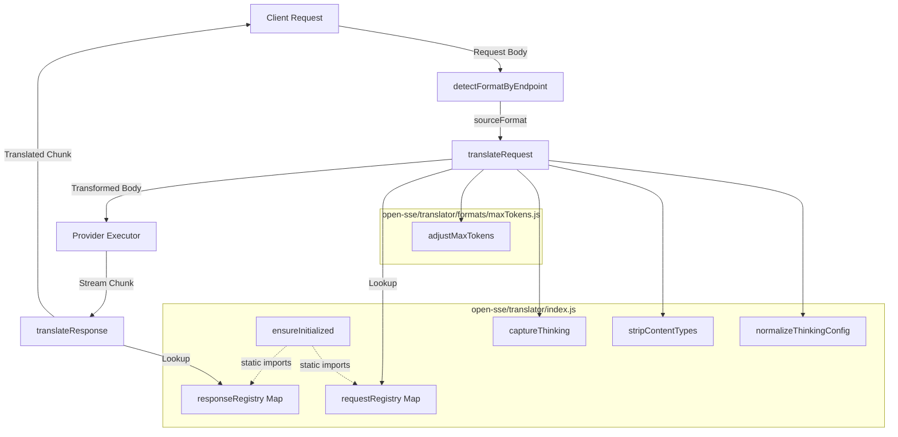
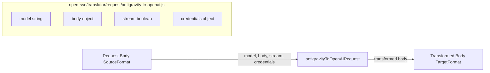
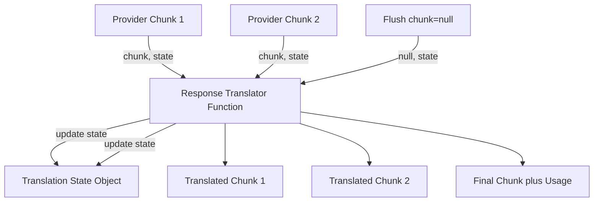
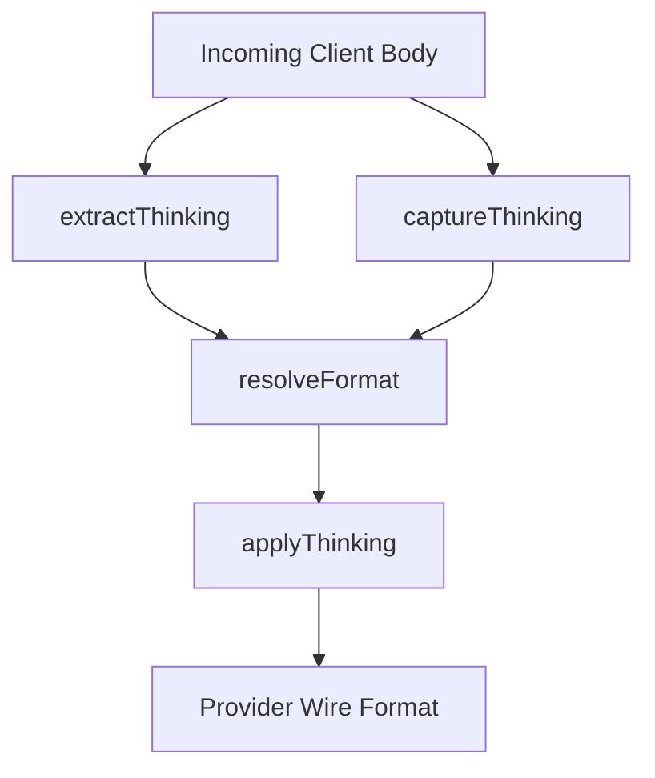

<!-- source: DeepWiki mcp.deepwiki.com · repo decolua/9router · page 13.4 Adding Format Translators · fetched 2026-10-30 -->

# Adding Format Translators

<details>
<summary>Relevant source files</summary>

The following files were used as context for generating this wiki page:

- [open-sse/translator/formats/claude.js](open-sse/translator/formats/claude.js)
- [open-sse/translator/formats/gemini.js](open-sse/translator/formats/gemini.js)
- [open-sse/translator/request/antigravity-to-openai.js](open-sse/translator/request/antigravity-to-openai.js)
- [open-sse/translator/schema/blocks.js](open-sse/translator/schema/blocks.js)
- [open-sse/utils/reasoningContentInjector.js](open-sse/utils/reasoningContentInjector.js)
- [src/app/api/models/route.js](src/app/api/models/route.js)
- [src/shared/hooks/useModelCaps.js](src/shared/hooks/useModelCaps.js)
- [tests/translator/bugs-antigravity.test.js](tests/translator/bugs-antigravity.test.js)
- [tests/unit/capabilities.test.js](tests/unit/capabilities.test.js)
- [tests/unit/claude-container-upload.test.js](tests/unit/claude-container-upload.test.js)
- [tests/unit/claude-context-management-field.test.js](tests/unit/claude-context-management-field.test.js)
- [tests/unit/claude-empty-thinking-block.test.js](tests/unit/claude-empty-thinking-block.test.js)
- [tests/unit/claude-foreign-server-tool-use.test.js](tests/unit/claude-foreign-server-tool-use.test.js)
- [tests/unit/combo-caps-resolver.test.js](tests/unit/combo-caps-resolver.test.js)
- [tests/unit/gemini-contents-normalization.test.js](tests/unit/gemini-contents-normalization.test.js)
- [tests/unit/gemini-unknown-schema-fields.test.js](tests/unit/gemini-unknown-schema-fields.test.js)
- [tests/unit/models-route-shadow-dedupe.test.js](tests/unit/models-route-shadow-dedupe.test.js)
- [tests/unit/opencode-go-claude-haiku-55-thinking.test.js](tests/unit/opencode-go-claude-haiku-55-thinking.test.js)
- [tests/unit/reasoningContentInjector.test.js](tests/unit/reasoningContentInjector.test.js)

</details>


This guide explains how to implement format translators to support new AI provider API formats in 9Router. Format translators enable bidirectional conversion between client request formats and provider response formats, allowing any client tool to work with any AI provider.

9Router uses a multi-stage translation pipeline:
1.  **Request Ingress**: Detects source format (e.g., OpenAI, Claude, or Responses API) via `detectFormatByEndpoint` [open-sse/translator/formats.js:22-35]() or body-based detection in `detectFormat` [open-sse/services/provider.js:28-105]().
2.  **Normalization**: Translates source format to an intermediate OpenAI-compatible format using `translateRequest` [open-sse/translator/index.js:75-147]().
3.  **Target Translation**: Translates the intermediate format to the provider's specific format (e.g., Gemini, Kiro, or Vertex).
4.  **Response Streaming**: Translates provider chunks back through the intermediate format to the client's source format in real-time via `translateResponse` [open-sse/translator/index.js:150-194]().

---

## Translation System Architecture

The translator system operates as a registry-based bidirectional converter. It is initialized via lazy-init guards in the main entry point to populate the request and response registries.

### Format Translation Flow

The diagram below maps natural translation concepts to exact code entities across the translation lifecycle, tracing `translateRequest` and `translateResponse`.

**Diagram: Request and Response Translation Pipeline (Code Entity Mapping)**



**Sources**: [open-sse/translator/index.js:12-194](), [open-sse/translator/formats.js:22-35](), [open-sse/translator/formats/maxTokens.js:12-33]()

---

## Core Translation Components

The translation system consists of four main components that work together to enable format conversion:

| Component | File Location | Purpose | Key Functions |
|-----------|--------------|---------|---------------|
| **Format Registry** | `open-sse/translator/formats.js` | Define format constants | `FORMATS` object |
| **Translator Index** | `open-sse/translator/index.js` | Registration and dispatch | `register()`, `translateRequest()`, `translateResponse()` |
| **Request Translators** | `open-sse/translator/request/*.js` | Client → Provider conversion | Format-specific transform functions |
| **Response Translators** | `open-sse/translator/response/*.js` | Provider → Client conversion | Streaming state-based transforms |

**Sources**: [open-sse/translator/index.js:18-29](), [open-sse/translator/formats.js:1-16]()

---

## Step 1: Define Format Constant

First, add a new format constant to the `FORMATS` object in `open-sse/translator/formats.js`. This constant will be used throughout the codebase to identify your format.

**File: `open-sse/translator/formats.js`**

```javascript
export const FORMATS = {
  OPENAI: "openai",
  CLAUDE: "claude",
  GEMINI: "gemini",
  KIRO: "kiro",
  COMMANDCODE: "commandcode",
  // Add your new format:
  YOUR_FORMAT: "your-format"
};
```

**Sources**: [open-sse/translator/formats.js:1-16]()

---

## Step 2: Implement Request Translation

Request translators convert client request bodies into provider-specific formats. They are pure functions that take a request body and return a transformed body.

### Request Translation Function Signature

**Diagram: Request Transformation Logic (Code Entity Mapping)**



**Example: Antigravity to OpenAI Request Translation**

The `antigravityToOpenAIRequest` function [open-sse/translator/request/antigravity-to-openai.js:11-85]() converts Antigravity/Gemini request bodies into OpenAI-compatible format, handling parameters, system instructions, tools, and content block transformations.

**Key Considerations for Request Translation:**

| Aspect | Details |
|--------|---------|
| **Message Roles** | Map between different role systems (e.g., OpenAI `assistant` to Gemini `model` [open-sse/translator/request/openai-to-gemini.js:112]()). |
| **Tool Calls** | Transform tool definitions. Gemini requires schema constraints cleanup via `UNSUPPORTED_SCHEMA_CONSTRAINTS` [open-sse/translator/formats.js:8-36](). |
| **Content Blocks** | Use discriminators from `OPENAI_BLOCK`, `CLAUDE_BLOCK`, and `RESPONSES_ITEM` [open-sse/translator/schema/blocks.js:1-41](). |
| **Content Filtering** | Strip unsupported content types via `stripContentTypes` [open-sse/translator/index.js:35-49](). |
| **Thinking Intent** | `captureThinking` [open-sse/translator/concerns/thinkingUnified.js:109-114]() extracts thinking intent before conversion. |
| **Max Tokens Adjustment** | `adjustMaxTokens` [open-sse/translator/formats/maxTokens.js:12-33]() enforces ceilings and ensures `max_tokens > thinking.budget_tokens`. |

**Sources**: [open-sse/translator/schema/blocks.js:1-49](), [open-sse/translator/formats/maxTokens.js:12-33](), [open-sse/translator/concerns/thinkingUnified.js:109-114](), [open-sse/translator/index.js:35-144](), [open-sse/translator/formats/gemini.js:8-44]()

---

## Step 3: Implement Response Translation

Response translators convert provider responses back to the client's expected format. For streaming responses, they operate on individual chunks and maintain state across the stream.

### Response Translation with State Management

**Diagram: Stateful Streaming Response Conversion**



**Sources**: [open-sse/translator/index.js:147-194](), [open-sse/translator/response/gemini-to-openai.js:36-140]()

---

## Unified Thinking Normalization

9Router provides a unified interface for "Thinking" (Reasoning) capabilities across different providers via `thinkingUnified.js`.

### Thinking Intent Extraction and Mapping

**Diagram: Unified Thinking Flow**



The system extracts client thinking intent regardless of source format using `extractThinking` [open-sse/translator/concerns/thinkingUnified.js:50-103]() and `captureThinking` [open-sse/translator/concerns/thinkingUnified.js:109-114](). Suffixes like model overrides (`model(high)` or `model(8192)`) are parsed via `parseSuffix` [open-sse/translator/concerns/thinkingUnified.js:34-46](). 

When translating to a target provider, `applyThinking` maps the unified intent to provider-native fields (e.g., Anthropic `output_config.effort`, Gemini `thinkingConfig`, or Qwen `enable_thinking`). Furthermore, reasoning content injection is managed by `injectReasoningContent` [open-sse/utils/reasoningContentInjector.js:70-76]() to satisfy upstream requirements.

**Sources**: [open-sse/translator/concerns/thinkingUnified.js:1-154](), [open-sse/utils/reasoningContentInjector.js:1-76]()

---

## Special Provider Handling & Edge Cases

### Claude Code & Caching Anchors
Anthropic imposes strict limits on prompt caching markers (`cache_control` ephemeral blocks, max 4 per request). The translator uses `lastCacheableToolIndex` [open-sse/translator/formats/claude.js:20-26](), `countCacheControlBlocks` [open-sse/translator/formats/claude.js:73-85](), and `capCacheControlBlocks` [open-sse/translator/formats/claude.js:91-111]() to manage breakpoints across system prompts, tools, and message contents.

### Claude Message Ordering & Valid Content
Claude requires strict message ordering and valid content blocks:
- Assistant messages with `tool_use` strip any text blocks appearing *after* the tool use via `fixToolUseOrdering` [open-sse/translator/formats/claude.js:116-144]().
- Consecutive same-role messages are merged [open-sse/translator/formats/claude.js:146-157]().
- `hasValidContent` ensures non-empty message bodies, specifically recognizing block types such as `container_upload` for Anthropic Files API integration [open-sse/translator/formats/claude.js:34-57]().

### Gemini & Antigravity Schema Constraints
When translating schemas for Gemini or Antigravity targets, unsupported JSON schema constraints (such as `minLength`, `maxLength`, `$ref`, `enumDescriptions`, etc.) are stripped recursively via `removeUnsupportedKeywords` and `sanitizeFunctionResponsePayload` [open-sse/translator/formats/gemini.js:146-161]() to prevent upstream rejection errors.

**Sources**: [open-sse/translator/formats/claude.js:1-157](), [open-sse/translator/formats/gemini.js:8-44](), [tests/unit/claude-container-upload.test.js:1-55](), [tests/unit/gemini-contents-normalization.test.js:144-162]()

---

## Step 4: Register Translators

Use the `register()` function to register both request and response translators. Registration connects format pairs to their translation functions.

**Registration Syntax:**

```javascript
import { register } from "../index.js";
import { FORMATS } from "../formats.js";

// Register request and response translators
register(
  FORMATS.GEMINI,
  FORMATS.OPENAI,
  null, // No request translator needed if pivoting through OpenAI
  geminiToOpenAIResponse // Response translator
);
```

Registration happens at module load time via side effects [open-sse/translator/response/gemini-to-openai.js:143-146]().

**Sources**: [open-sse/translator/index.js:1-30](), [open-sse/translator/response/gemini-to-openai.js:140-146]()

---

## Integration Checklist

Before considering your translator complete, verify:

- [ ] Format constant added to `FORMATS` object in `open-sse/translator/formats.js` [open-sse/translator/formats.js:1-16]().
- [ ] Request translator implemented and registered in `open-sse/translator/request/`.
- [ ] Response translator implemented and registered in `open-sse/translator/response/`.
- [ ] Message ordering constraints (especially for Claude) are handled [open-sse/translator/formats/claude.js:111-154]().
- [ ] Tool name sanitization is applied if required by the provider (e.g., Gemini's regex) [open-sse/translator/request/openai-to-gemini.js:25-35]().
- [ ] Unsupported schema keywords are cleaned up via `UNSUPPORTED_SCHEMA_CONSTRAINTS` [open-sse/translator/formats.js:8-36]().
- [ ] Usage metadata is correctly extracted and passed in the final chunk [open-sse/translator/response/claude-to-openai.js:128-148]().

**Sources**: [open-sse/translator/index.js:62-70](), [open-sse/translator/formats.js:1-16](), [open-sse/translator/formats/claude.js:111-154](), [open-sse/translator/request/openai-to-gemini.js:25-35](), [open-sse/translator/formats/gemini.js:8-44]()

---

