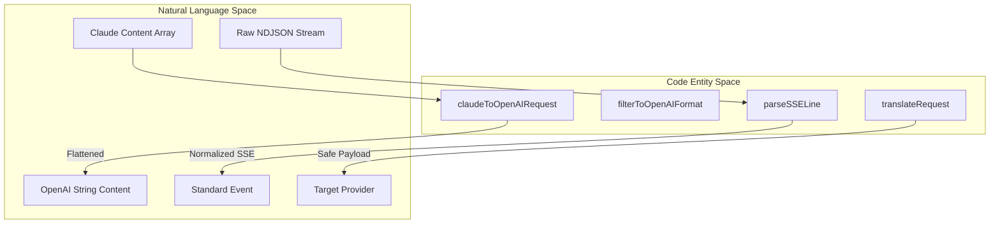
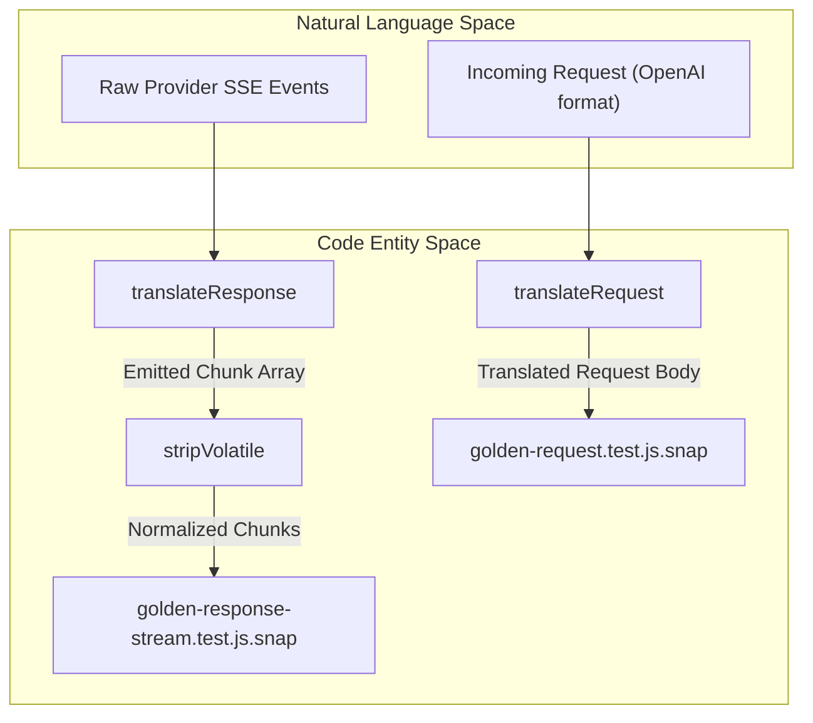
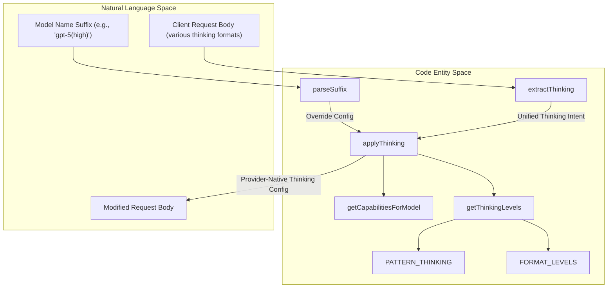
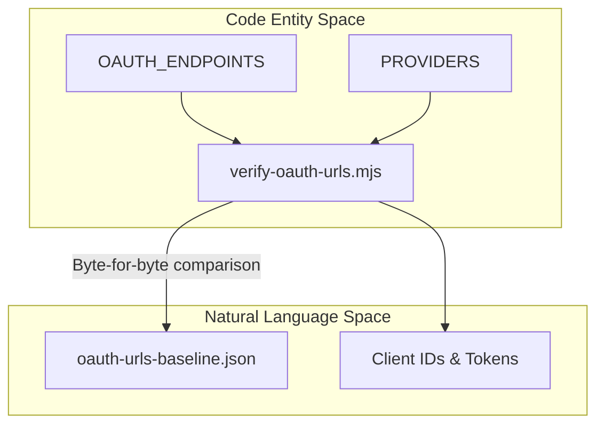

<!-- source: DeepWiki mcp.deepwiki.com · repo decolua/9router · page 13.5 Testing · fetched 2026-10-30 -->

# Testing

Relevant source files

The following files were used as context for generating this wiki page:

- [open-sse/config/appConstants.js](open-sse/config/appConstants.js)
- [open-sse/providers/capabilities.js](open-sse/providers/capabilities.js)
- [open-sse/providers/registry/codebuddy-cn.js](open-sse/providers/registry/codebuddy-cn.js)
- [open-sse/providers/thinkingLevels.js](open-sse/providers/thinkingLevels.js)
- [open-sse/translator/concerns/thinkingUnified.js](open-sse/translator/concerns/thinkingUnified.js)
- [open-sse/translator/formats/maxTokens.js](open-sse/translator/formats/maxTokens.js)
- [tests/__baseline__/current.json](tests/__baseline__/current.json)
- [tests/__baseline__/oauth-urls-baseline.json](tests/__baseline__/oauth-urls-baseline.json)
- [tests/__baseline__/verify-oauth-urls.mjs](tests/__baseline__/verify-oauth-urls.mjs)
- [tests/translator/AGENTS.md](tests/translator/AGENTS.md)
- [tests/translator/__snapshots__/golden-request.test.js.snap](tests/translator/__snapshots__/golden-request.test.js.snap)
- [tests/translator/bugs-claudeCode-context.test.js](tests/translator/bugs-claudeCode-context.test.js)
- [tests/translator/bugs-kiro.test.js](tests/translator/bugs-kiro.test.js)
- [tests/translator/bugs-openai-bridge.test.js](tests/translator/bugs-openai-bridge.test.js)
- [tests/translator/bugs-toClaude-context.test.js](tests/translator/bugs-toClaude-context.test.js)
- [tests/translator/coverage-all-models.test.js](tests/translator/coverage-all-models.test.js)
- [tests/translator/format-roundtrip.test.js](tests/translator/format-roundtrip.test.js)
- [tests/translator/golden-request.test.js](tests/translator/golden-request.test.js)
- [tests/translator/golden-url-header.test.js](tests/translator/golden-url-header.test.js)
- [tests/translator/matrix.js](tests/translator/matrix.js)
- [tests/translator/openai-thinking-display.test.js](tests/translator/openai-thinking-display.test.js)
- [tests/translator/thinking-unified.test.js](tests/translator/thinking-unified.test.js)
- [tests/unit/claude-cache-final-tool-results.test.js](tests/unit/claude-cache-final-tool-results.test.js)
- [tests/unit/nous-attribution.test.js](tests/unit/nous-attribution.test.js)

The 9Router test suite provides comprehensive test coverage for the core proxy logic, format translation pipeline, provider connectivity validation, OAuth credential management, and token/thinking normalization. The test framework relies on **Vitest** configured via `tests/package.json` [tests/package.json:1-17](), executing unit, integration, golden, and baseline regression tests.

## Test Suite Structure

The testing infrastructure mirrors the modular architecture of the backend proxy and translation modules. Test execution results and suite telemetry are tracked across components, reporting test suite health, failures, and snapshot states [tests/__baseline__/current.json:1-1]().

| Test Category | Location | Coverage Scope |
| :--- | :--- | :--- |
| **Translator & Golden Tests** | `tests/translator/` | Covers bug regression (`bugs-antigravity.test.js`, `bugs-claudeCode-context.test.js`, `bugs-codexCli-responses.test.js`) and golden request/response stream snapshots [tests/__baseline__/current.json:1-1](), [tests/translator/golden-request.test.js:1-103](). |
| **Embeddings Endpoint** | `tests/unit/embeddingsCore.test.js`, `tests/unit/embeddings.cloud.test.js` | Unit tests for `/v1/embeddings` core body builder, routing, headers, and cloud worker behaviors [tests/README.md:27-51](). |
| **Baseline Verification Scripts** | `tests/__baseline__/verify-oauth-urls.mjs` | Byte-for-byte snapshot verification scripts for OAuth endpoints, token URLs, and client IDs [tests/__baseline__/verify-oauth-urls.mjs:1-67](). |
| **RTK & Thinking Normalization** | `tests/unit/rtk.test.js`, `tests/translator/thinking-unified.test.js` | Validates `tool_result` compression and complex reasoning/thinking effort parameter parsing and mapping [tests/__baseline__/current.json:1-1](). |

Sources: [tests/package.json:1-17](), [tests/__baseline__/current.json:1](), [tests/README.md:1-51](), [tests/translator/golden-request.test.js:1-103]()

---

## Translator & Format Normalization

The format translation suite ensures bidirectional compatibility between different LLM provider APIs (OpenAI, Anthropic Claude, Gemini, Kiro, Codex, Ollama).

### Request Normalization and Bug Regressions
Tests verify that payloads remain safe across schema boundaries. Historical data loss and edge-case regressions are guarded by dedicated test suites:
- **Claude → OpenAI Bridge:** Ensures images with `source.type=url` are preserved rather than silently dropped [tests/__baseline__/current.json:1-1]().
- **Thinking Blocks:** Verifies survival of reasoning blocks across round-trips [tests/__baseline__/current.json:1-1]().
- **Tool Results:** Confirms `is_error` flags and image blocks inside `tool_result` are correctly maintained [tests/__baseline__/current.json:1-1]().

Title: Translator Request Normalization Flow

Sources: [tests/__baseline__/current.json:1-1]()

### Golden Request/Response Snapshots
The `golden-request.test.js` suite verifies the transformation of incoming requests from one format to another, ensuring that the translated request body matches a predefined snapshot [tests/translator/golden-request.test.js:1-103](). This includes complex scenarios involving system messages, images, tool calls, and tool results. The `golden-response-stream.test.js` suite feeds raw streaming chunks from various providers (Claude, Gemini, Kiro, Ollama, Codex Responses) into `translateResponse()` and compares emitted OpenAI chunk arrays against Vitest snapshot files [tests/translator/golden-request.test.js:1-103]() via `tests/translator/__snapshots__/golden-request.test.js.snap` [tests/translator/__snapshots__/golden-request.test.js.snap:1-239](). Volatile fields like timestamps and request IDs are stripped or normalized via `stripVolatile()` [tests/translator/golden-request.test.js:10-21]().

Title: Request and Response Stream Translation Data Flow

Sources: [tests/translator/golden-request.test.js:1-103](), [tests/translator/__snapshots__/golden-request.test.js.snap:1-239]()

### Thinking Normalization
The `thinking-unified.test.js` suite specifically tests the unified thinking normalization logic, which extracts client intent regarding thinking levels and budgets, and applies the appropriate provider-native format [tests/translator/thinking-unified.test.js:1-8](). This involves parsing model suffixes like `model(high)` or `model(8192)` [tests/translator/thinking-unified.test.js:17-37]() and translating various provider-specific thinking configurations (Claude's `thinking` object, OpenAI's `reasoning_effort`, Gemini's `thinkingConfig`, Qwen's `enable_thinking`) into a unified internal representation [tests/translator/thinking-unified.test.js:39-103](). It also verifies how these unified intents are then applied to the target provider's request format, considering model capabilities and thinking level constraints [tests/translator/thinking-unified.test.js:75-140]().

Title: Thinking Normalization Data Flow

Sources: [tests/translator/thinking-unified.test.js:1-140](), [open-sse/translator/concerns/thinkingUnified.js:1-154](), [open-sse/providers/capabilities.js:1-103](), [open-sse/providers/thinkingLevels.js:1-105](), [open-sse/config/appConstants.js:1-193](), [open-sse/providers/registry/codebuddy-cn.js:1-86]()

---

## OAuth & Provider Baseline Verification

To prevent unintended drift in hardcoded OAuth endpoints, grant URLs, and client identifiers across upstream provider integrations, 9Router relies on verification scripts.

### OAuth URL Stability Script
The script `verify-oauth-urls.mjs` inspects constants imported from `open-sse/config/appConstants.js` and `open-sse/config/providers.js` [tests/__baseline__/verify-oauth-urls.mjs:1-7](). It aggregates endpoint declarations into a structured JSON snapshot (`oauth-urls-baseline.json`) [tests/__baseline__/oauth-urls-baseline.json:1-51]().

Title: OAuth Credential and URL Verification Mapping

Sources: [tests/__baseline__/verify-oauth-urls.mjs:1-67](), [tests/__baseline__/oauth-urls-baseline.json:1-51]()

---

## Running Tests

Test execution is managed via `npm` scripts defined within package scopes [tests/package.json:7-10]().

### Execution Commands
- **Run all test suites:** `npm run test` (invokes `vitest run --reporter=verbose`) [tests/package.json:8-8]().
- **Interactive watch mode:** `npm run test:watch` (invokes `vitest --reporter=verbose`) [tests/package.json:9-9]().
- **Baseline snapshot updates:** Run verification scripts with the `--snapshot` argument (e.g., `node tests/__baseline__/verify-oauth-urls.mjs --snapshot`) to overwrite baseline files [tests/__baseline__/verify-oauth-urls.mjs:46-51]().

Sources: [tests/package.json:1-17](), [tests/__baseline__/verify-oauth-urls.mjs:46-51]()

---

