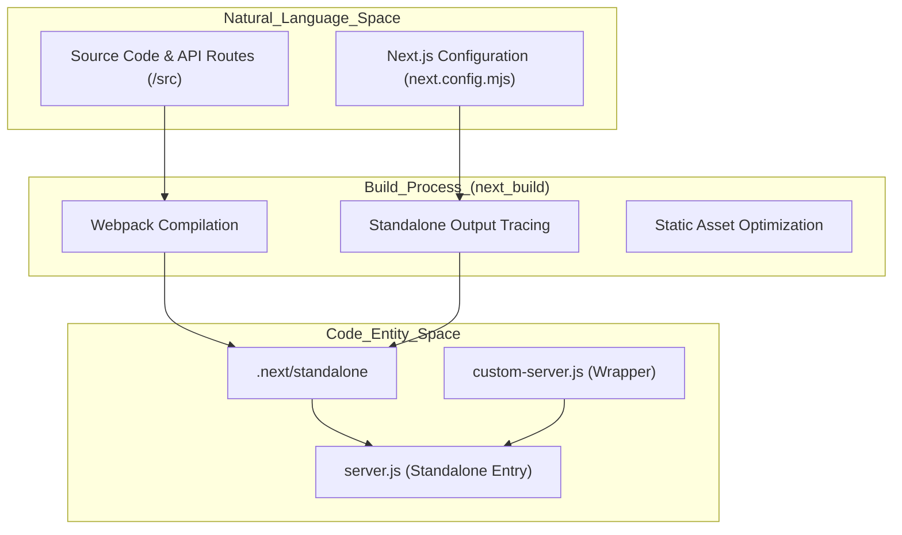
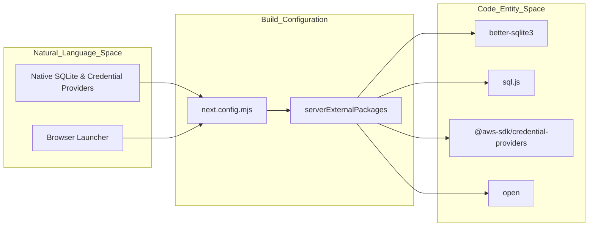

<!-- source: DeepWiki mcp.deepwiki.com · repo decolua/9router · page 13.6 Building and Packaging · fetched 2026-10-30 -->

# Building and Packaging

Relevant source files

The following files were used as context for generating this wiki page:

- [.github/workflows/tray-binaries.yml](.github/workflows/tray-binaries.yml)
- [CHANGELOG.md](CHANGELOG.md)
- [cli/.gitignore](cli/.gitignore)
- [cli/.npmignore](cli/.npmignore)
- [cli/LICENSE](cli/LICENSE)
- [cli/hooks/sqliteRuntime.js](cli/hooks/sqliteRuntime.js)
- [cli/hooks/trayRuntime.js](cli/hooks/trayRuntime.js)
- [cli/package.json](cli/package.json)
- [cli/scripts/build-cli.js](cli/scripts/build-cli.js)
- [cli/scripts/buildMitm.js](cli/scripts/buildMitm.js)
- [cli/scripts/buildTrayArm64.js](cli/scripts/buildTrayArm64.js)
- [cli/src/cli/terminalUI.js](cli/src/cli/terminalUI.js)
- [cli/src/cli/tray/tray.js](cli/src/cli/tray/tray.js)
- [cli/src/cli/utils/input.js](cli/src/cli/utils/input.js)
- [next.config.mjs](next.config.mjs)
- [open-sse/utils/claudeSignature.js](open-sse/utils/claudeSignature.js)
- [package.json](package.json)
- [tests/unit/cli-build-artifacts.test.js](tests/unit/cli-build-artifacts.test.js)
- [tests/unit/open-package-external.test.js](tests/unit/open-package-external.test.js)

This document covers the build and packaging processes for 9Router. It details how the Next.js application is built for production, optimized with standalone output tracing, pruned of heavy native modules for cross-platform safety, and packaged into both a standalone Docker container and a specialized npm CLI distribution.

---

## Purpose and Scope

The build and packaging architecture of 9Router addresses two divergent distribution requirements: running as a containerized server deployment (Docker) and running as a globally installed terminal tool (`9router` npm CLI package). This page outlines the build pipeline, standalone output resolution, asset copying, native module decoupling (`better-sqlite3`, `sql.js`, and tray runtimes), and runtime environment variable handling.

Sources: [package.json:6-18](), [cli/package.json:33-35](), [next.config.mjs:13-33]()

---

## Build Overview & Dual-Distribution Model

9Router employs a dual-distribution model driven by Next.js App Router and specialized compilation scripts.

| Component | Type | Build Target | Primary Use Case |
|-----------|------|--------------|------------------|
| **Main Application** | Next.js (App Router) | Production server | Self-hosted proxy with web dashboard |
| **CLI Bundle** | Standalone Node.js | npm package (`9router`) | Local desktop usage with automatic config |
| **MITM Proxy** | Node.js Worker | Child Process | Intercepting AI tool traffic |

Sources: [package.json:2-10](), [cli/package.json:2-6](), [cli/scripts/build-cli.js:151-155]()

---

## Building the Next.js Application & Standalone Tracing

The core application is built using Next.js configured for standalone output (`output: "standalone"`). This bundles the application code along with its traced dependency graph into `.next/standalone`.

### Build Pipeline

**Diagram: Build Pipeline and Artifact Flow**

Sources: [next.config.mjs:13-33](), [cli/scripts/build-cli.js:171-187](), [package.json:12]()

### Build Commands and Configuration

Production builds and CLI packaging are triggered via script definitions in `package.json` and `cli/package.json`.

| Target | Command | Result |
|--------|---------|--------|
| **Standard Build** | `npm run build` | Generates `.next` production folder using Webpack [package.json:9]() |
| **CLI Pack** | `npm run cli:pack` | Runs `cli/scripts/build-cli.js` and `npm pack` [package.json:16]() |
| **Development** | `npm run dev` | Starts Next.js dev server on port 20127 [package.json:7]() |

Sources: [package.json:6-18](), [cli/package.json:16-24](), [next.config.mjs:13-33]()

---

## CLI Packaging & Runtime Pruning

The CLI build process (`cli/scripts/build-cli.js`) handles workspace tracing, version synchronization, and native module decoupling.

### CLI Build Steps
1.  **Version Sync**: Synchronizes version numbers between `cli/package.json` and root `package.json` [cli/scripts/build-cli.js:158-169]().
2.  **Standalone Build**: Executes `npm run build` with `NEXT_TRACING_ROOT_MODE=workspace` to ensure hoisted monorepo or workspace dependencies are fully traced [cli/scripts/build-cli.js:171-186]().
3.  **Artifact Verification**: Asserts the existence of essential API route handlers (e.g., `app/api/v1/chat/completions/route.js`) in the built server output [cli/scripts/build-cli.js:133-149]().
4.  **MITM Proxy Build**: Compiles the MITM proxy server using `esbuild` into a self-contained bundle [cli/scripts/buildMitm.js:1-71](). This ensures the MITM runtime is self-contained and can be copied to the `DATA_DIR/runtime/` to avoid file locks during updates [cli/scripts/buildMitm.js:17-20]().

### Native Module and Asset Pruning
To prevent Windows `EBUSY` file locking errors on `.node` binaries during global npm package updates and to eliminate antivirus false positives on bundled Go binaries, heavy native dependencies (`better-sqlite3`, `sql.js`, `systray2`) are intentionally **omitted** from the static build bundle [cli/package.json:33-35]().

Instead:
*   SQLite native engines and wasm modules are lazily verified and installed into user-writable directories (`~/.9router/runtime/node_modules`) via runtime hooks (`cli/hooks/sqliteRuntime.js`) [cli/hooks/sqliteRuntime.js:1-52]().
*   System tray binaries (`systray2`) are conditionally fetched or overlaid with native architecture builds (`tray_darwin_arm64`) via `cli/hooks/trayRuntime.js` [cli/hooks/trayRuntime.js:1-36](). The `tray_darwin_arm64` binary is built from `felixhao28/systray-portable` by `cli/scripts/buildTrayArm64.js` and uploaded to a pinned GitHub release [cli/package.json:35](). Its SHA256 is verified after download [cli/hooks/trayRuntime.js:36]().

Sources: [cli/package.json:33-35](), [cli/scripts/build-cli.js:1-205](), [cli/hooks/sqliteRuntime.js:1-162](), [cli/hooks/trayRuntime.js:1-157](), [cli/scripts/buildMitm.js:1-71](), [cli/scripts/buildTrayArm64.js:1-10]()

---

## Docker Packaging

9Router provides multi-platform container images (`linux/amd64`, `linux/arm64`) optimized for production server deployments.

In Docker environments, container initialization falls back gracefully to `sql.js` if native compiler tools or platform bindings for `better-sqlite3` are absent, guaranteeing that the pure-JS database initializes successfully without compilation requirements.

Sources: [CHANGELOG.md:25-29](), [package.json:6-18]()

---

## Production Optimizations & Runtime External Packages

**Diagram: Runtime Driver and External Package Resolution**

Sources: [next.config.mjs:23-27](), [package.json:12](), [cli/scripts/build-cli.js:91-111]()

### Optimization Features
*   **External Packages Configuration**: Heavy native and state-sensitive modules (`better-sqlite3`, `sql.js`, `node:sqlite`, `bun:sqlite`, `open`, `@aws-sdk/credential-providers`) are defined in `serverExternalPackages` within `next.config.mjs` [next.config.mjs:23-27](). This prevents Webpack from bundling modules that depend on runtime disk access (such as AWS SSO token caches or dynamic `import.meta.url` file path resolutions).
*   **Tracing Exclusions**: Documentation sub-apps (`gitbook/**/*`) are explicitly excluded from `outputFileTracing` to reduce container and package footprint [next.config.mjs:31-33]().
*   **Unoptimized Images**: `images.unoptimized: true` is configured to bypass `sharp` dependency compilation, ensuring high portability across constrained hardware architectures [next.config.mjs:34-36]().
*   **Custom HTTP Server Wrapper**: `custom-server.js` wraps the Next.js standalone HTTP server to enforce unspoofable socket IP derivation (`x-9r-real-ip`), per-process peer token verification, and `h2c` upgrade fallback handling [package.json:12]().

Sources: [next.config.mjs:13-105](), [package.json:12](), [cli/scripts/build-cli.js:84-111]()

---

