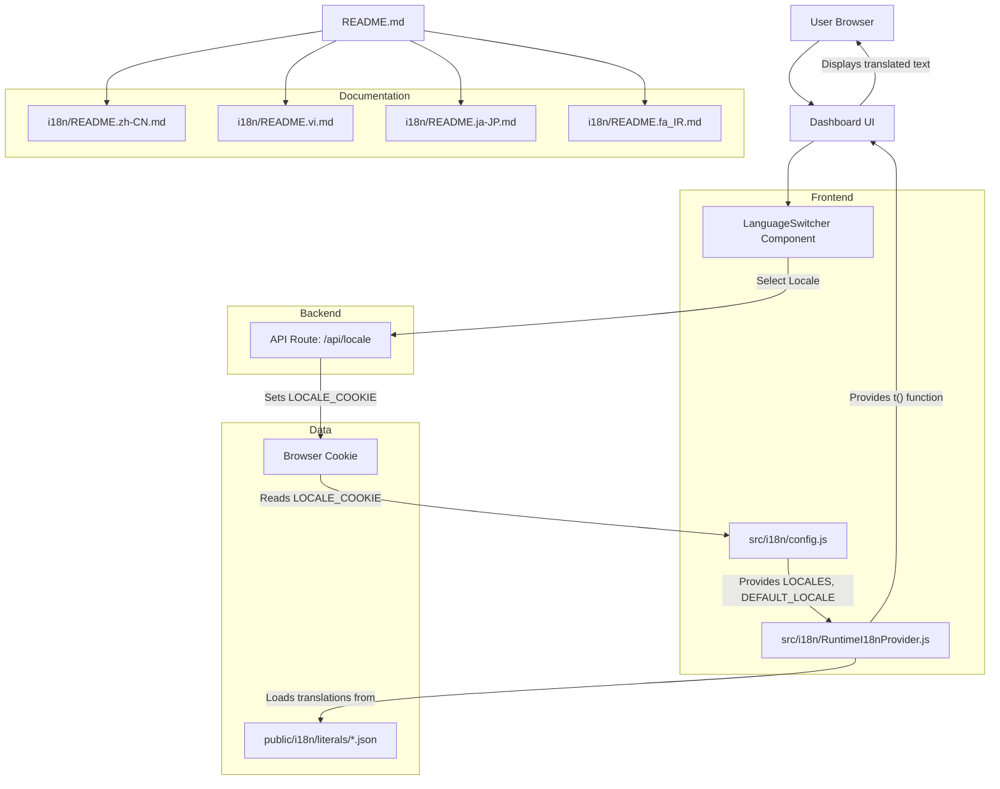

<!-- source: DeepWiki mcp.deepwiki.com · repo decolua/9router · page 13.7 Internationalization · fetched 2026-10-30 -->

# Internationalization

<details>
<summary>Relevant source files</summary>

The following files were used as context for generating this wiki page:

- [README.zh-CN.md](README.zh-CN.md)
- [i18n/README.fa_IR.md](i18n/README.fa_IR.md)
- [i18n/README.ja-JP.md](i18n/README.ja-JP.md)
- [i18n/README.vi.md](i18n/README.vi.md)
- [i18n/README.zh-CN.md](i18n/README.zh-CN.md)
- [open-sse/executors/xiaomi-mimo.js](open-sse/executors/xiaomi-mimo.js)
- [open-sse/providers/registry/xiaomi-mimo.js](open-sse/providers/registry/xiaomi-mimo.js)
- [open-sse/shared/mimoAccount.js](open-sse/shared/mimoAccount.js)
- [open-sse/translator/concerns/paramSupport.js](open-sse/translator/concerns/paramSupport.js)
- [open-sse/utils/error.js](open-sse/utils/error.js)
- [public/i18n/literals/fa.json](public/i18n/literals/fa.json)
- [public/i18n/literals/km.json](public/i18n/literals/km.json)
- [public/i18n/literals/vi.json](public/i18n/literals/vi.json)
- [public/i18n/literals/zh-CN.json](public/i18n/literals/zh-CN.json)
- [src/app/api/locale/route.js](src/app/api/locale/route.js)
- [src/app/api/oauth/xiaomi-mimo/api-key/route.js](src/app/api/oauth/xiaomi-mimo/api-key/route.js)
- [src/app/api/oauth/xiaomi-mimo/login/start/route.js](src/app/api/oauth/xiaomi-mimo/login/start/route.js)
- [src/app/api/oauth/xiaomi-mimo/login/status/route.js](src/app/api/oauth/xiaomi-mimo/login/status/route.js)
- [src/app/api/v1/embeddings/route.js](src/app/api/v1/embeddings/route.js)
- [src/i18n/RuntimeI18nProvider.js](src/i18n/RuntimeI18nProvider.js)
- [src/i18n/config.js](src/i18n/config.js)
- [src/i18n/runtime.js](src/i18n/runtime.js)
- [src/lib/auth/dashboardSession.js](src/lib/auth/dashboardSession.js)
- [src/shared/components/HeaderLanguage.js](src/shared/components/HeaderLanguage.js)
- [src/shared/components/HeaderMenu.js](src/shared/components/HeaderMenu.js)
- [src/shared/components/LanguageSwitcher.js](src/shared/components/LanguageSwitcher.js)
- [src/shared/components/XiaomiMimoAuthModal.js](src/shared/components/XiaomiMimoAuthModal.js)
- [src/shared/constants/locales.js](src/shared/constants/locales.js)
- [tests/.gitignore](tests/.gitignore)
- [tests/README.md](tests/README.md)
- [tests/package.json](tests/package.json)
- [tests/unit/embeddings.cloud.test.js](tests/unit/embeddings.cloud.test.js)
- [tests/unit/param-support.test.js](tests/unit/param-support.test.js)
- [tests/unit/xiaomi-mimo-executor.test.js](tests/unit/xiaomi-mimo-executor.test.js)

</details>


This page documents the internationalization (i18n) system within 9Router, covering its runtime provider, locale constants, translation files, language switching components, API routes for locale management, and translated READMEs. The system enables the application to support multiple languages for its user interface and documentation.

## I18n System Overview

The i18n system in 9Router is designed to provide a localized experience for users. It involves:
1.  **Locale Constants**: Defining supported locales and their properties.
2.  **Translation Files**: Storing key-value pairs for UI text in different languages.
3.  **Runtime Provider**: A React context provider that makes translations available to components.
4.  **Language Switcher Component**: A UI component allowing users to change the active locale.
5.  **Locale API Route**: An endpoint to persist user-selected locale preferences.
6.  **Translated READMEs**: Providing core documentation in multiple languages.

### I18n System Architecture

Sources: [src/shared/components/LanguageSwitcher.js:5-6](), [src/i18n/config.js:1-37](), [src/i18n/RuntimeI18nProvider.js](), [src/app/api/locale/route.js](), [public/i18n/literals/fa.json:1-115](), [i18n/README.zh-CN.md:1-244](), [i18n/README.vi.md:1-199]()

## Locale Constants

The `src/i18n/config.js` file defines the core constants for internationalization.
-   `LOCALES`: An array of supported locale codes, such as `"en"`, `"vi"`, `"zh-CN"`, etc. [src/i18n/config.js:1-37]()
-   `DEFAULT_LOCALE`: The fallback locale, set to `"en"`. [src/i18n/config.js:38]()
-   `LOCALE_COOKIE`: The name of the cookie used to store the user's preferred locale, which is `"locale"`. [src/i18n/config.js:39]()
-   `LOCALE_NAMES`: An object mapping locale codes to their human-readable names. [src/i18n/config.js:41-77]()
-   `normalizeLocale(locale)`: A function that takes a locale string and returns a standardized locale code, handling variations like `"zh"` mapping to `"zh-CN"`. [src/i18n/config.js:79-186]()
-   `isSupportedLocale(locale)`: Checks if a given locale is among the supported ones. [src/i18n/config.js:188-190]()

Additionally, `src/shared/constants/locales.js` provides `LOCALE_FLAGS`, an object mapping locale codes to their corresponding emoji flags for display purposes. [src/shared/constants/locales.js:2-38]()

Sources: [src/i18n/config.js:1-190](), [src/shared/constants/locales.js:2-38]()

## Translation Files

Translation files are JSON objects located in `public/i18n/literals/`. Each file is named after its locale code (e.g., `zh-CN.json`, `fa.json`). These files contain key-value pairs where the key is the original English string and the value is its translation in the respective language.

Example from `public/i18n/literals/fa.json`:
```json
{
  "API Key": "کلید API",
  "Add New Provider": "افزودن ارائه‌دهنده جدید"
}
```
The `RuntimeI18nProvider` loads these JSON files dynamically based on the active locale.

Sources: [public/i18n/literals/fa.json:1-115]()

## Runtime I18n Provider

The `src/i18n/RuntimeI18nProvider.js` component is a React context provider that makes the translation function `t()` available throughout the application.

It performs the following steps:
1.  **Determines initial locale**: It attempts to read the locale from the `LOCALE_COOKIE`. If not found, it defaults to `"en"`.
2.  **Loads translations**: It dynamically imports the corresponding JSON file from `public/i18n/literals/` for the active locale.
3.  **Provides `t()` function**: The `t()` function is a simple lookup: if a translation exists for the given key in the current locale, it returns the translated string; otherwise, it returns the original English string.
4.  **`reloadTranslations()`**: This function, exposed by `src/i18n/runtime.js`, allows components to trigger a reload of translations without a full page refresh, typically after a locale change. [src/i18n/runtime.js]()

Sources: [src/i18n/RuntimeI18nProvider.js](), [src/i18n/runtime.js]()

## LanguageSwitcher Components

The `src/shared/components/LanguageSwitcher.js` component provides the user interface for selecting a language.

Key functionalities:
-   **Locale Detection**: On mount, it reads the current locale from the browser cookie using `getLocaleFromCookie()`. [src/shared/components/LanguageSwitcher.js:8-15]()
-   **Locale Information**: It uses `getLocaleInfo()` to retrieve the display name and flag emoji for each locale. [src/shared/components/LanguageSwitcher.js:18-57]()
-   **UI Trigger**: A button displays the current language and opens a modal for selection. [src/shared/components/LanguageSwitcher.js:117-129]()
-   **Modal Selection**: A `createPortal` renders a modal with a grid of supported languages, each with its name and flag. [src/shared/components/LanguageSwitcher.js:132-171]()
-   **`handleSetLocale`**: When a new locale is selected, this function:
    1.  Sends a `POST` request to the `/api/locale` endpoint to update the locale cookie. [src/shared/components/LanguageSwitcher.js:97-101]()
    2.  Calls `reloadTranslations()` to update the UI with the new language without a full page reload. [src/shared/components/LanguageSwitcher.js:104]()
    3.  Updates the component's internal state. [src/shared/components/LanguageSwitcher.js:105]()

The `src/shared/components/HeaderLanguage.js` component is a wrapper that uses `LanguageSwitcher` to display the language selection in the header.

Sources: [src/shared/components/LanguageSwitcher.js:1-192](), [src/shared/components/HeaderLanguage.js]()

## Locale API Route

The `/api/locale` API route (defined in `src/app/api/locale/route.js`) is a Next.js API endpoint responsible for setting the user's preferred locale in a cookie.

-   **Method**: It accepts `POST` requests. [src/app/api/locale/route.js:10]()
-   **Request Body**: Expects a JSON body with a `locale` property. [src/app/api/locale/route.js:11]()
-   **Cookie Management**: It uses `cookies().set()` to store the `locale` in a cookie named `LOCALE_COOKIE` (which is "locale"). [src/app/api/locale/route.js:14-19]()
-   **Response**: Returns a JSON response indicating success or failure. [src/app/api/locale/route.js:21-23]()

This route is called by the `LanguageSwitcher` component when a user selects a new language.

Sources: [src/app/api/locale/route.js:1-23]()

## Translated READMEs

The project includes translated versions of the main `README.md` file in the `i18n/` directory. These provide essential information about 9Router in different languages.

Examples include:
-   `i18n/README.zh-CN.md`: Simplified Chinese [i18n/README.zh-CN.md:1-244]()
-   `i18n/README.vi.md`: Vietnamese [i18n/README.vi.md:1-199]()
-   `i18n/README.ja-JP.md`: Japanese
-   `i18n/README.fa_IR.md`: Farsi [i18n/README.fa_IR.md]()

These READMEs are linked from the main `README.md` to allow users to easily access documentation in their preferred language. [i18n/README.zh-CN.md:19]()

Sources: [i18n/README.zh-CN.md:1-244](), [i18n/README.vi.md:1-199](), [i18n/README.fa_IR.md](), [i18n/README.zh-CN.md:19]()

---

