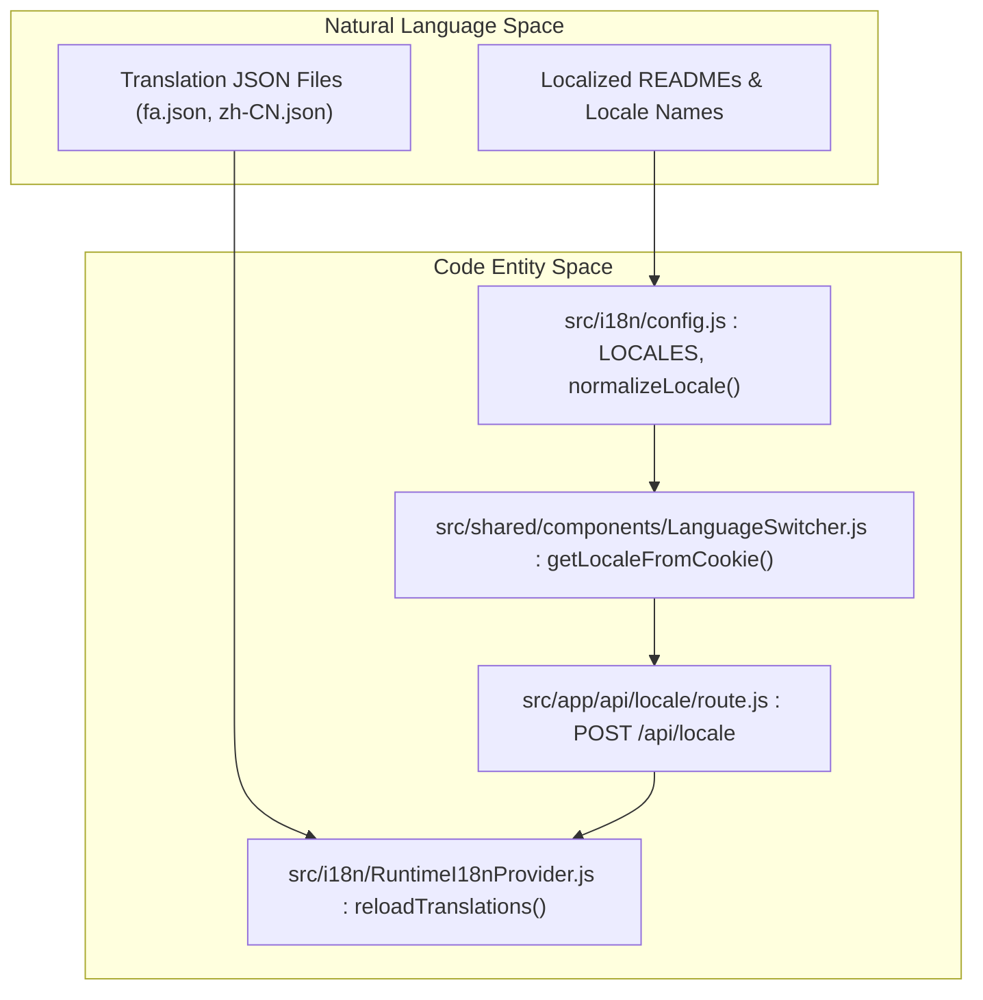
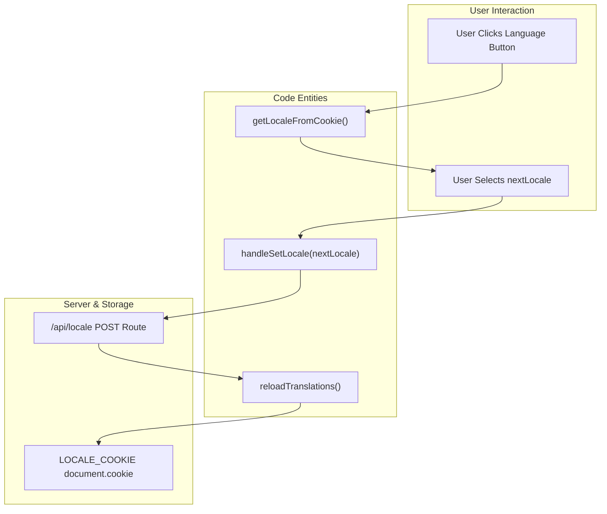

<!-- source: DeepWiki mcp.deepwiki.com · repo decolua/9router · page 13.8 GitBook Documentation Site · fetched 2026-10-30 -->

# GitBook Documentation Site

Relevant source files

The following files were used as context for generating this wiki page:

- [.github/dependabot.yml](.github/dependabot.yml)
- [.github/workflows/docker-publish.yml](.github/workflows/docker-publish.yml)
- [.gitignore](.gitignore)
- [.npmignore](.npmignore)
- [DOCKER.md](DOCKER.md)
- [Dockerfile](Dockerfile)
- [README.md](README.md)
- [gitbook/content/en/providers/subscription.md](gitbook/content/en/providers/subscription.md)
- [open-sse/config/runtimeConfig.js](open-sse/config/runtimeConfig.js)
- [open-sse/executors/base.js](open-sse/executors/base.js)
- [open-sse/executors/codex.js](open-sse/executors/codex.js)
- [open-sse/handlers/imageProviders/codex.js](open-sse/handlers/imageProviders/codex.js)
- [open-sse/providers/pricing.js](open-sse/providers/pricing.js)
- [open-sse/providers/registry/codex.js](open-sse/providers/registry/codex.js)
- [src/app/api/usage/stream/route.js](src/app/api/usage/stream/route.js)
- [tests/unit/codex-fast-capacity.test.js](tests/unit/codex-fast-capacity.test.js)
- [tests/unit/codex-gpt6-lite.test.js](tests/unit/codex-gpt6-lite.test.js)
- [tests/unit/codex-image-models.test.js](tests/unit/codex-image-models.test.js)
- [tests/unit/codex-registry-model-routing.test.js](tests/unit/codex-registry-model-routing.test.js)
- [tests/unit/codex-tool-normalization.test.js](tests/unit/codex-tool-normalization.test.js)
- [tests/unit/image-generation.test.js](tests/unit/image-generation.test.js)
- [tests/unit/thinking-levels-gpt56-sol.test.js](tests/unit/thinking-levels-gpt56-sol.test.js)

The `gitbook/` directory and localized translation files power the multilingual documentation and runtime interface of 9Router. This section details the site architecture, content authoring, navigation configuration (`NAV_STRUCTURE`), language switching mechanism, and static/dynamic deployment pipelines.

## Purpose and Scope

The documentation and UI internationalization infrastructure provides:
* Multilingual support across dozens of locales (`LOCALES`) [src/i18n/config.js:1-37]().
* Runtime translation reloading without full page reloads via `reloadTranslations()` [src/shared/components/LanguageSwitcher.js:92-112]().
* Portal-based locale selection modals (`LanguageSwitcher`) [src/shared/components/LanguageSwitcher.js:132-158]().
* Centralized locale normalization (`normalizeLocale`) and cookie management (`LOCALE_COOKIE`) [src/i18n/config.js:39-186]().

The `gitbook/` directory itself contains the source for the GitBook documentation. The `README.md` file in the root of the repository also links to various localized `README` files in the `i18n/` directory [README.md:20](). These localized `README` files serve as entry points for users in different languages.

Sources: [src/i18n/config.js:1-186](), [src/shared/components/LanguageSwitcher.js:92-158](), [README.md:20]()

---

## System Architecture & Multilingual Flow

The documentation site and dashboard UI utilize a shared internationalization layer and rendering pipeline. Translation assets reside in JSON literal files (`public/i18n/literals/*.json`), while configuration parameters are defined in `src/i18n/config.js` [src/i18n/config.js:1-40]().

### Diagram: Natural Language Space to Code Entity Space (Localization Pipeline)

This diagram bridges natural language configuration and UI literals to the concrete code entities handling locale state and translation loading.

Sources: [src/i18n/config.js:1-186](), [src/shared/components/LanguageSwitcher.js:1-112](), [src/app/api/locale/route.js:1-10]()

---

## Language Switcher and Locale Management

The `LanguageSwitcher` component provides the interface for toggling languages [src/shared/components/LanguageSwitcher.js:59-112](). It reads the active locale from document cookies via `getLocaleFromCookie()` [src/shared/components/LanguageSwitcher.js:8-15]() and maps locale codes to flags using centralized constants [src/shared/constants/locales.js:1-38]().

### Diagram: Language Switcher Data Flow

Sources: [src/shared/components/LanguageSwitcher.js:8-112](), [src/i18n/config.js:39-40]()

---

## Content Authoring and Navigation Structure

Documentation pages and site content are structured around the `NAV_STRUCTURE` paradigm, grouping guides into logical categories:
1. Overview & System Architecture
2. Getting Started & Installation
3. Core Concepts & Smart Routing
4. Request Processing & Token Savers
5. Provider System & Executors
6. MITM Proxy & Security
7. Deployment & Development

Localized literals ensure that UI components adapt seamlessly across supported languages such as English, Vietnamese, Simplified Chinese, Japanese, and Persian [public/i18n/literals/fa.json:1-100](). The `gitbook/` directory contains the actual content pages, typically in Markdown format, organized by language and topic. For example, `gitbook/content/en/providers/subscription.md` would be a page about subscription providers in English.

### Component Interaction Table

| Component File | Key Function / Class | Role |
| :--- | :--- | :--- |
| `src/shared/components/LanguageSwitcher.js` | `LanguageSwitcher` | Renders locale selector modal via React portals [src/shared/components/LanguageSwitcher.js:59-158]() |
| `src/i18n/config.js` | `normalizeLocale` | Maps raw browser strings or cookie values to supported standard keys [src/i18n/config.js:79-186]() |
| `src/shared/components/HeaderMenu.js` | `HeaderMenu` | Provides auxiliary controls including version checks, theme toggles, and shutdown hooks [src/shared/components/HeaderMenu.js:36-122]() |
| `src/app/api/locale/route.js` | `POST` handler | Persists chosen locale settings to backend cookies/session |

Sources: [src/shared/components/LanguageSwitcher.js:59-158](), [src/i18n/config.js:79-186](), [src/shared/components/HeaderMenu.js:36-122](), [src/app/api/locale/route.js:1-10](), [gitbook/content/en/providers/subscription.md]()

---

## Deployment & CI/CD Pipeline

The documentation site and its static assets are packaged alongside the main application. 
* **Static Exporting**: GitBook sources are compiled into static HTML/Markdown bundles for hosting.
* **Asset Packaging**: Literal translation dictionaries (`public/i18n/literals/*.json`) are bundled into the Next.js standalone output tracing pipeline, ensuring runtime availability across international deployments.
* **Server Control**: The documentation/dashboard header integrates with lifecycle management endpoints (e.g., `/api/version/shutdown`) to manage local proxy instances [src/shared/components/HeaderMenu.js:44-53]().
* **Docker Deployment**: The `Dockerfile` includes steps to copy static assets (`public/`) and the `.next/static` directory, which would contain compiled documentation assets if they are part of the Next.js build output [Dockerfile:54-55](). The `docker-publish.yml` workflow handles building and pushing Docker images, ensuring that the documentation site is part of the deployed application [.github/workflows/docker-publish.yml:1-437]().

Sources: [src/shared/components/HeaderMenu.js:44-53](), [public/i18n/literals/fa.json:1-100](), [Dockerfile:54-55](), [.github/workflows/docker-publish.yml:1-437]()

---

