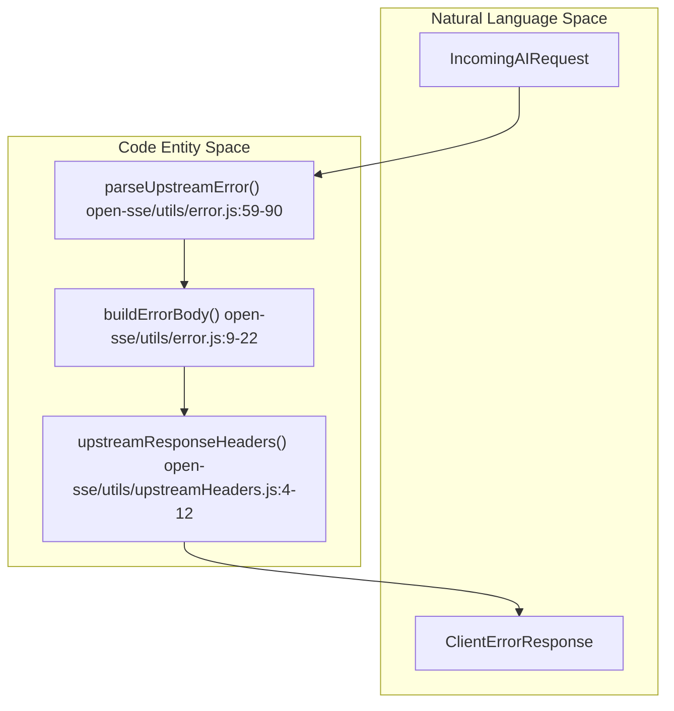
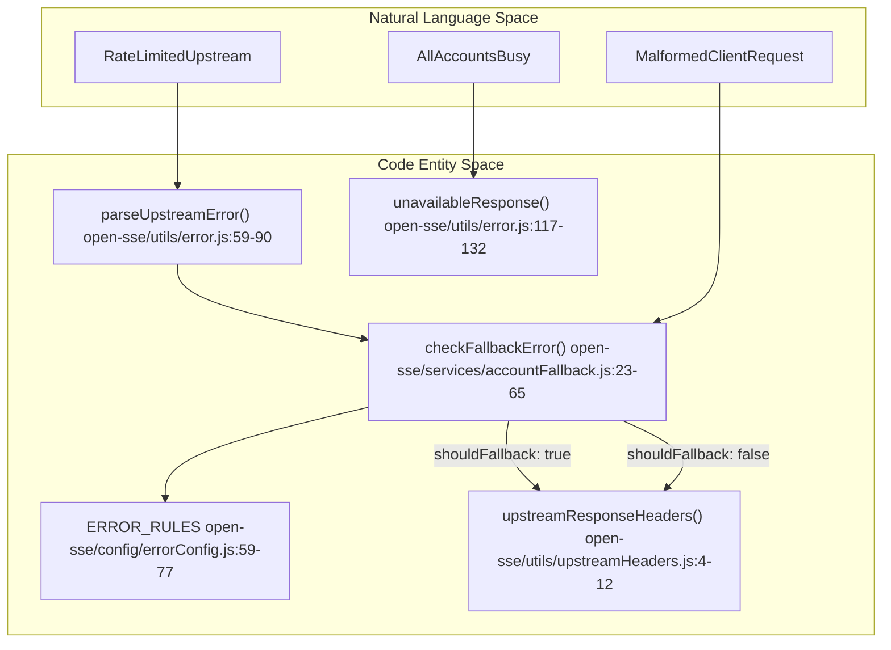

<!-- source: DeepWiki mcp.deepwiki.com · repo decolua/9router · page 14 Troubleshooting · fetched 2026-10-30 -->

# Troubleshooting

Relevant source files

The following files were used as context for generating this wiki page:

- [open-sse/config/errorConfig.js](open-sse/config/errorConfig.js)
- [open-sse/services/accountFallback.js](open-sse/services/accountFallback.js)
- [tests/unit/account-fallback-4xx.test.js](tests/unit/account-fallback-4xx.test.js)
- [tests/unit/codex-extended-context.mjs](tests/unit/codex-extended-context.mjs)

This page provides a high-level overview of common issues encountered when operating 9Router, covering authentication, provider connections, MITM proxying, and format translation. It serves as a parent reference directing you to detailed child pages for in-depth debugging procedures.

For configuration-related troubleshooting, see [Configuration Basics](#2.3). For provider-specific setups, see [Provider Configuration](#5.1).

---

## Diagnostic Overview

When errors occur during request processing, 9Router classifies them using standardized error-building and response utilities [open-sse/utils/error.js:9-107](). Upstream headers such as retry intervals and rate limit statuses are preserved and forwarded via dedicated header utilities [open-sse/utils/upstreamHeaders.js:4-12]().

Title: Diagnostic Error Flow

**Sources:** [open-sse/utils/error.js:9-90](), [open-sse/utils/upstreamHeaders.js:4-12]()

---

## Authentication & Token Issues

Authentication failures arise from invalid API keys, expired OAuth tokens, or credential refresh errors, yielding `401 Unauthorized` or `403 Forbidden` statuses. The error utility layer normalizes these responses into standard OpenAI-compatible formats [open-sse/utils/error.js:9-22]().

For details, see [Authentication & Token Issues](#14.1).

**Sources:** [open-sse/utils/error.js:9-22]()

---

## Provider Connection Errors

Provider connection errors happen when accounts encounter rate limits, model locks, or total exhaustion across available endpoints. The system parses upstream errors and formats diagnostic messages including underlying socket or network causes [open-sse/utils/error.js:59-150](). When all accounts are rate-limited, specialized responses inject retry delays and headers [open-sse/utils/error.js:117-132]().

The `checkFallbackError` function [open-sse/services/accountFallback.js:23-65]() determines if an error should trigger an account fallback (switching to the next available account) and calculates the appropriate cooldown period. This logic is driven by `ERROR_RULES` [open-sse/config/errorConfig.js:59-77](), which prioritize text-based matches in error messages over HTTP status codes. For instance, specific text like "rate limit" or "quota exceeded" will trigger an exponential backoff [open-sse/services/accountFallback.js:9-13](), while certain client-side `4xx` errors (e.g., `400` for context length issues) might not trigger a fallback to avoid unnecessarily locking a healthy account [open-sse/services/accountFallback.js:49-61]().

For details, see [Provider Connection Errors](#14.2).

Title: Provider Error Handling

**Sources:** [open-sse/utils/error.js:59-132](), [open-sse/utils/upstreamHeaders.js:4-12](), [open-sse/services/accountFallback.js:9-65](), [open-sse/config/errorConfig.js:59-77](), [tests/unit/account-fallback-4xx.test.js:10-37](), [tests/unit/codex-extended-context.mjs:16-18]()

---

## MITM Proxy Issues

MITM proxy issues relate to certificate trust stores, DNS modifications, and port 443 conflicts when intercepting client tools like Cursor, Copilot, or Claude Code. Because these tools rely on strict TLS verification and local domain resolution, misconfigurations will disrupt proxy interception.

For details, see [MITM Proxy Issues](#14.3).

**Sources:** [open-sse/utils/error.js:142-150]()

---

## Format Translation Errors

Format translation errors emerge during schema transformation between disparate provider APIs, tool-call mapping, or streaming parsing. When format transformations fail or upstream payloads contain unrecognized fields, the system uses robust error formatting to report the failure context [open-sse/utils/error.js:142-150]().

For details, see [Format Translation Errors](#14.4).

**Sources:** [open-sse/utils/error.js:142-150]()

---

