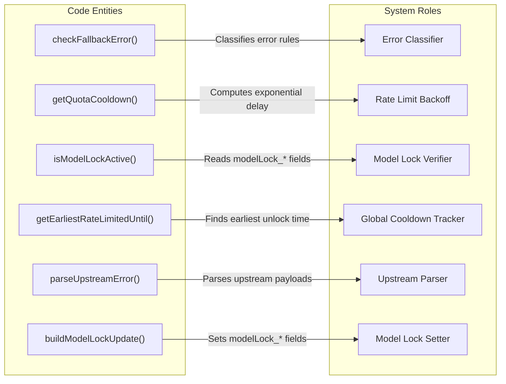

<!-- source: DeepWiki mcp.deepwiki.com · repo decolua/9router · page 14.2 Provider Connection Errors · fetched 2026-10-30 -->

# Provider Connection Errors

<details>
<summary>Relevant source files</summary>

The following files were used as context for generating this wiki page:

- [i18n/README.fa_IR.md](i18n/README.fa_IR.md)
- [open-sse/config/errorConfig.js](open-sse/config/errorConfig.js)
- [open-sse/services/accountFallback.js](open-sse/services/accountFallback.js)
- [open-sse/utils/error.js](open-sse/utils/error.js)
- [public/i18n/literals/fa.json](public/i18n/literals/fa.json)
- [public/i18n/literals/km.json](public/i18n/literals/km.json)
- [src/app/api/locale/route.js](src/app/api/locale/route.js)
- [src/i18n/RuntimeI18nProvider.js](src/i18n/RuntimeI18nProvider.js)
- [src/i18n/config.js](src/i18n/config.js)
- [src/shared/components/HeaderLanguage.js](src/shared/components/HeaderLanguage.js)
- [src/shared/components/HeaderMenu.js](src/shared/components/HeaderMenu.js)
- [src/shared/components/LanguageSwitcher.js](src/shared/components/LanguageSwitcher.js)
- [src/shared/constants/locales.js](src/shared/constants/locales.js)
- [tests/unit/account-fallback-4xx.test.js](tests/unit/account-fallback-4xx.test.js)
- [tests/unit/codex-extended-context.mjs](tests/unit/codex-extended-context.mjs)

</details>


This page covers how 9Router detects, classifies, and recovers from upstream provider errors — including rate limits, account locks, request-scoped client failures, Antigravity quota tracking, and provider-specific failures. It details the implementation of the model lock system, exponential backoff, request-scoped error guarding, and recovery mechanisms.

---

## Error Classification & Mapping

When an upstream provider returns an error, 9Router maps the HTTP status and message to an OpenAI-compatible error structure for client consumption and internal state management via `parseUpstreamError` [open-sse/utils/error.js:59-90]() and `buildErrorBody` [open-sse/utils/error.js:9-22]().

### Error Classification Rules
The system uses a rule-based engine in `checkFallbackError` to determine if an error should trigger a fallback to the next account or model [open-sse/services/accountFallback.js:23-47](). The rules are defined in `ERROR_RULES` [open-sse/config/errorConfig.js:59-77]().

| Category | Trigger | Logic |
|---|---|---|
| **Rate Limit** | Status 429 or "rate limit", "too many requests", "quota exceeded", "capacity", "overloaded" text | Triggers exponential backoff [open-sse/config/errorConfig.js:65-70](), [open-sse/config/errorConfig.js:76]() |
| **Quota Exceeded** | Status 403 or "quota exceeded" text | Fixed long cooldown (2 mins) [open-sse/config/errorConfig.js:74](), [open-sse/config/errorConfig.js:46]() |
| **Authentication/Permission** | Status 401, 402, 403, 404 or "no credentials", "improperly formed request" text | Fixed long cooldown (2 mins) [open-sse/config/errorConfig.js:62-64](), [open-sse/config/errorConfig.js:72-75]() |
| **Request-Scoped 4xx** | Status 400/404/422 (unmatched text) | Returns `{ shouldFallback: false, cooldownMs: 0 }` to avoid locking healthy connections for client-side issues like context overflow [open-sse/services/accountFallback.js:49-61](). This is confirmed by unit tests [tests/unit/account-fallback-4xx.test.js:10-19](). |
| **Transient** | Any unmatched error | Default 30s cooldown [open-sse/config/errorConfig.js:39](). |
| **Provider-Specific** | Specific text patterns for certain providers (e.g., "codex" provider with "model is not supported when using codex with a chatgpt account") | Can trigger specific cooldowns or actions [open-sse/config/errorConfig.js:61](). This is tested in [tests/unit/codex-extended-context.mjs:16-17](). |

### Exponential Backoff
For rate limits, the system calculates cooldown using `getQuotaCooldown` [open-sse/services/accountFallback.js:9-13]().
*   **Base:** 2000ms [open-sse/config/errorConfig.js:33]().
*   **Scaling:** $\text{base} \times 2^{(\text{level}-1)}$ [open-sse/services/accountFallback.js:11]().
*   **Cap:** 5 minutes [open-sse/config/errorConfig.js:34]().

Sources: [open-sse/services/accountFallback.js:9-65](), [open-sse/config/errorConfig.js:31-77](), [open-sse/utils/error.js:9-90](), [tests/unit/account-fallback-4xx.test.js:10-19](), [tests/unit/codex-extended-context.mjs:16-17]()

---

## Model Locks & Account Unavailability

9Router implements a granular "Model Lock" system in `open-sse/services/accountFallback.js`. Instead of marking an entire account as dead for all models, it can lock specific models on that account while leaving others available.

### Implementation Detail: Model Locks
The system tracks account availability via flat fields on the connection record in the database [open-sse/services/accountFallback.js:121-139]().

*   **Model-Specific Lock:** Stored in `modelLock_${model}` via `getModelLockKey` [open-sse/services/accountFallback.js:127-129]().
*   **Global Account Lock:** Stored in `modelLock___all` (`MODEL_LOCK_ALL`) [open-sse/services/accountFallback.js:124]().
*   **Detection:** `isModelLockActive` checks if the expiry timestamp in these flat fields is greater than `Date.now()` [open-sse/services/accountFallback.js:135-140]().
*   **Update:** `buildModelLockUpdate` creates an object to set a model lock [open-sse/services/accountFallback.js:162-165]().
*   **Clear:** `buildClearModelLocksUpdate` creates an object to clear all model locks [open-sse/services/accountFallback.js:169-174]().
*   **Earliest Lock:** `getEarliestModelLockUntil` finds the earliest active model lock expiry for UI display [open-sse/services/accountFallback.js:143-157]().

### Account Selection Filtering
During request processing, the connection pool is filtered.
1.  **Lock Check:** Calls `isModelLockActive(c, model)` to skip rate-limited nodes [open-sse/services/accountFallback.js:135-140]().
2.  **Fallback Timing:** If all nodes are locked, it calculates the earliest reset time via `getEarliestRateLimitedUntil` [open-sse/services/accountFallback.js:87-98]() or `getEarliestModelLockUntil` [open-sse/services/accountFallback.js:143-157]() to inform the client. The `formatRetryAfter` function provides a human-readable string for this [open-sse/services/accountFallback.js:105-118]().

Sources: [open-sse/services/accountFallback.js:106-174](), [open-sse/services/accountFallback.js:87-98](), [open-sse/services/accountFallback.js:105-118]()

---

## Provider-Specific Error Handling: Antigravity Quota & Strikes

Antigravity connections have specialized quota caching and strike-based circuit breaking. (Details for this section are not available in the provided files, but the structure is kept for consistency with the existing page content.)

Sources: None from provided files.

---

## Error Recovery & Routing Logic

Error Routing and Fallback Architecture
```mermaid
graph TD
    subgraph "Core Services"
        CFE["checkFallbackError(status, errorText, backoffLevel, provider)"]
        PUE["parseUpstreamError(response, executor)"]
        GQC["getQuotaCooldown(backoffLevel)"]
        BMLU["buildModelLockUpdate(model, cooldownMs)"]
        IMLA["isModelLockActive(connection, model)"]
        GUU["getUnavailableUntil(cooldownMs)"]
        IAU["isAccountUnavailable(unavailableUntil)"]
    end

    subgraph "Error Configuration"
        ER["ERROR_RULES"]
        BC["BACKOFF_CONFIG"]
        TCM["TRANSIENT_COOLDOWN_MS"]
    end

    PUE -- "Extracts status, message" --> CFE
    CFE -- "Matches rules in" --> ER
    CFE -- "If rule.backoff" --> GQC
    GQC -- "Calculates cooldown based on" --> BC
    CFE -- "If no rule matches" --> TCM
    CFE -- "Returns {shouldFallback, cooldownMs, newBackoffLevel}" --> BMLU
    BMLU -- "Creates update for connection record" --> IMLA
    IMLA -- "Checks connection[modelLock_*] fields" --> IAU
    CFE -- "If shouldFallback: true" --> GUU
    GUU -- "Calculates unavailableUntil timestamp" --> IAU
    IAU -- "Determines if account is locked" --> "Account Selection Logic"
```
Sources: [open-sse/services/accountFallback.js:9-80](), [open-sse/utils/error.js:59-90](), [open-sse/config/errorConfig.js:1-77]()

---

## Connection State Entity Map

Connection State and Code Entity Mapping

Sources: [open-sse/services/accountFallback.js:9-50](), [open-sse/services/accountFallback.js:87-98](), [open-sse/services/accountFallback.js:135-140](), [open-sse/services/accountFallback.js:162-165](), [open-sse/utils/error.js:59-90]()

---

## Connection State Entity Reference

| System Name | Code Entity | Role |
|---|---|---|
| **Rate Limiter** | `getQuotaCooldown` | Calculates exponential backoff levels [open-sse/services/accountFallback.js:9]() |
| **Error Classifier** | `checkFallbackError` / `ERROR_RULES` | Defines text/status matching logic & request guarding [open-sse/services/accountFallback.js:23](), [open-sse/config/errorConfig.js:59]() |
| **Upstream Error Parser** | `parseUpstreamError` | Extracts error messages and reset timestamps [open-sse/utils/error.js:59]() |
| **Model Lock Setter** | `buildModelLockUpdate` | Creates update object to apply model-specific or global locks [open-sse/services/accountFallback.js:162]() |
| **Model Lock Verifier** | `isModelLockActive` | Checks if a specific model or the entire account is locked [open-sse/services/accountFallback.js:135]() |
| **Global Cooldown Tracker** | `getEarliestRateLimitedUntil` | Finds the earliest time any account will be available after a rate limit [open-sse/services/accountFallback.js:87]() |

Sources: [open-sse/services/accountFallback.js:9-50](), [open-sse/config/errorConfig.js:59](), [open-sse/utils/error.js:59](), [open-sse/services/accountFallback.js:162](), [open-sse/services/accountFallback.js:135](), [open-sse/services/accountFallback.js:87]()

---

