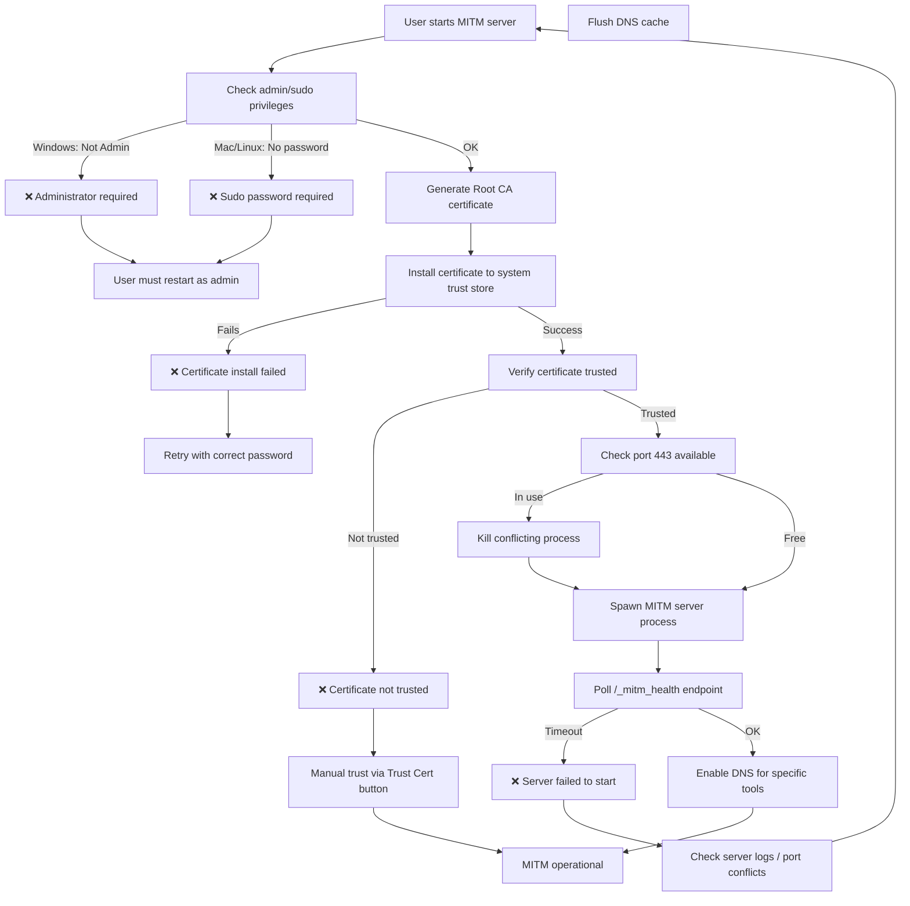
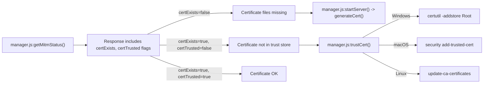
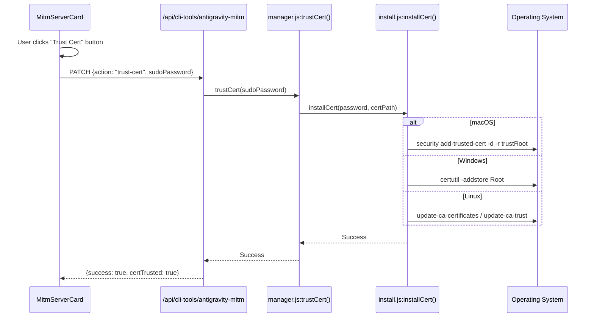
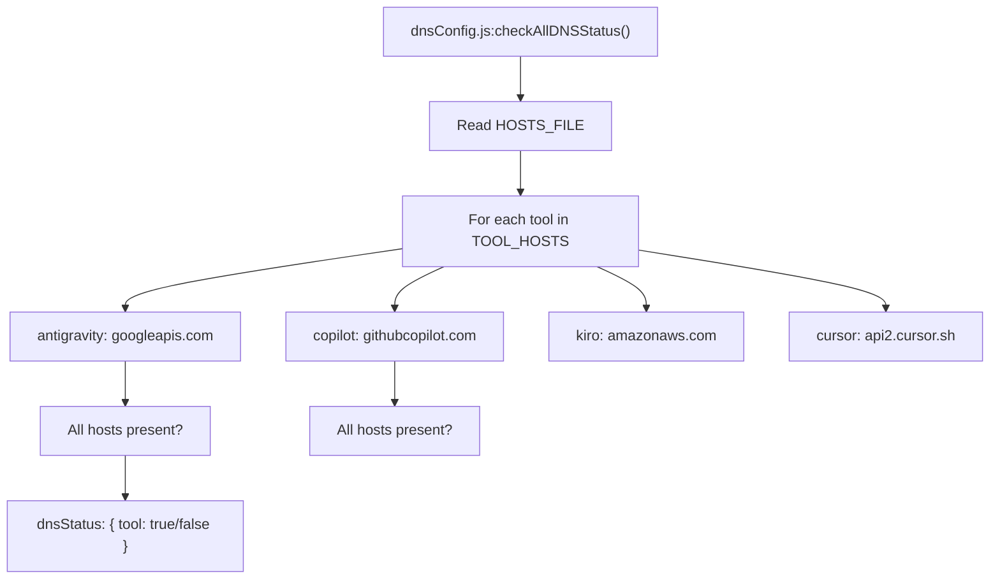
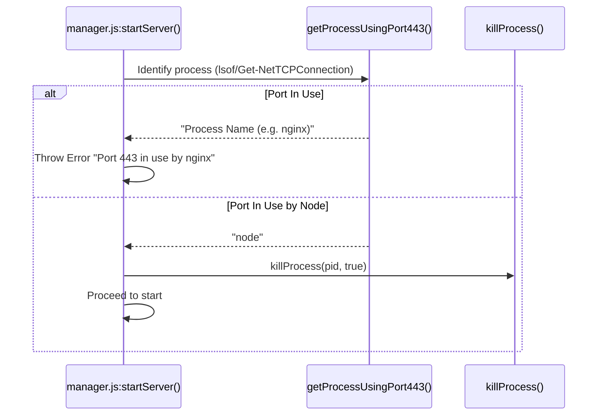
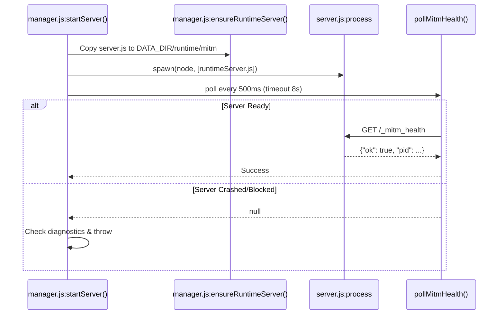

<!-- source: DeepWiki mcp.deepwiki.com · repo decolua/9router · page 14.3 MITM Proxy Issues · fetched 2026-10-30 -->

# MITM Proxy Issues

Relevant source files

The following files were used as context for generating this wiki page:

- [src/app/(dashboard)/dashboard/cli-tools/components/MitmServerCard.js](src/app/(dashboard)/dashboard/cli-tools/components/MitmServerCard.js)
- [src/app/(dashboard)/dashboard/cli-tools/components/MitmToolCard.js](src/app/(dashboard)/dashboard/cli-tools/components/MitmToolCard.js)
- [src/app/(dashboard)/dashboard/mitm/MitmPageClient.js](src/app/(dashboard)/dashboard/mitm/MitmPageClient.js)
- [src/app/api/cli-tools/antigravity-mitm/route.js](src/app/api/cli-tools/antigravity-mitm/route.js)
- [src/mitm/cert/install.js](src/mitm/cert/install.js)
- [src/mitm/dns/dnsConfig.js](src/mitm/dns/dnsConfig.js)
- [src/mitm/handlers/antigravity.js](src/mitm/handlers/antigravity.js)
- [src/mitm/handlers/base.js](src/mitm/handlers/base.js)
- [src/mitm/handlers/copilot.js](src/mitm/handlers/copilot.js)
- [src/mitm/handlers/kiro.js](src/mitm/handlers/kiro.js)
- [src/mitm/logger.js](src/mitm/logger.js)
- [src/mitm/manager.js](src/mitm/manager.js)
- [src/mitm/server.js](src/mitm/server.js)
- [tests/unit/kiro-image-forwarding.test.js](tests/unit/kiro-image-forwarding.test.js)

This page documents technical problems encountered when using the MITM proxy system and provides diagnostic steps and solutions. The MITM proxy is required for intercepting traffic from tools like Antigravity IDE, GitHub Copilot, Kiro, and Cursor that do not natively support custom API endpoints.

---

## Overview of MITM Troubleshooting Flow

The MITM system has multiple components that must work together. Understanding the dependency chain helps diagnose where failures occur.

Title: MITM Initialization and Troubleshooting Flow

Sources: [src/mitm/manager.js:335-501](), [src/app/api/cli-tools/antigravity-mitm/route.js:48-65]()

---

## Certificate Trust Issues

### Symptom: "Certificate not trusted" or SSL errors

The most common MITM issue is the Root CA certificate not being properly installed or trusted by the operating system.

#### Diagnostic Steps

**Check certificate status:**

Title: Certificate Status Verification

Sources: [src/mitm/manager.js:261-286](), [src/mitm/cert/install.js:42-46](), [src/app/api/cli-tools/antigravity-mitm/route.js:68-91]()

#### Platform-Specific Certificate Verification

| Platform | Verification Method | Trust Store Location |
|----------|---------------------|---------------------|
| **macOS** | `security verify-cert -c <cert> -p ssl` | `/Library/Keychains/System.keychain` |
| **Windows** | `certutil -store Root <fingerprint>` | `Cert:\LocalMachine\Root` |
| **Linux** | File exists in configured anchor directory | `/usr/local/share/ca-certificates/` (Debian/Ubuntu) |

Sources: [src/mitm/cert/install.js:48-81](), [src/mitm/cert/install.js:10-29]()

#### Solution: Manual Certificate Trust

If auto-trust fails, use the "Trust Cert" action in the dashboard. On Windows, this triggers a `certutil` command via elevated PowerShell. On macOS/Linux, it uses `execWithPassword` to run elevation commands.

Title: Manual Trust Execution Sequence

Sources: [src/mitm/manager.js:574-582](), [src/mitm/cert/install.js:84-133](), [src/app/api/cli-tools/antigravity-mitm/route.js:163-202]()

---

## DNS Configuration Problems

### Symptom: Tool traffic not intercepted despite server running

DNS configuration modifies the system `hosts` file to redirect provider domains to `127.0.0.1`.

#### DNS Status Check

Title: DNS Integrity Verification

Sources: [src/mitm/dns/dnsConfig.js:36-38](), [src/mitm/dns/dnsConfig.js:130-141](), [src/shared/constants/mitmToolHosts.js:5-10]()

#### Common DNS Issues

| Issue | Symptom | Diagnostic | Solution |
|-------|---------|-----------|----------|
| **Hosts entry missing** | DNS status shows false | Check `hosts` file content | Enable DNS for tool via `addDNSEntry` [src/mitm/dns/dnsConfig.js:146-180]() |
| **DNS cache not flushed** | Entries exist but not working | Tool resolves to real IP | System flushes via `flushDNS` [src/mitm/dns/dnsConfig.js:104-111]() |
| **Sudo Password incorrect** | "Wrong sudo password" error | `execWithPassword` fails | Provide correct password in UI [src/mitm/dns/dnsConfig.js:177-178]() |
| **Windows Atomic Write Failure** | DNS toggle fails | Check permissions on `drivers/etc/hosts` | System uses `atomicWriteHostsWin` with rollback [src/mitm/dns/dnsConfig.js:14-32]() |

---

## Port 443 Conflicts

### Symptom: "Port 443 already in use"

Port 443 (HTTPS) must be available for the MITM server. Conflicts typically occur with local web servers or orphan 9Router processes. The `MitmServerCard` component in the dashboard handles displaying these conflicts and offering to kill the offending process [src/app/(dashboard)/dashboard/cli-tools/components/MitmServerCard.js:99-103]().

Title: Port Conflict Resolution Logic

Sources: [src/mitm/manager.js:99-120](), [src/mitm/manager.js:359-377]()

---

## Server Startup and Health Check Failures

### Symptom: Server starts but health check times out

The MITM server spawns a child process (`server.js`) that must respond to SNI callbacks and handle HTTPS traffic. To prevent locking `node_modules`, the manager copies `server.js` to a runtime directory before execution [src/mitm/manager.js:65-93]().

Title: MITM Server Health Monitoring

Sources: [src/mitm/manager.js:65-93](), [src/mitm/manager.js:231-256](), [src/mitm/server.js:41-56]()

### Auto-Restart Logic
The system handles unexpected crashes with an exponential backoff strategy defined in `MITM_RESTART_DELAYS_MS`.

| Attempt | Delay |
|---------|-------|
| 1 | 5s |
| 2 | 10s |
| 3 | 20s |
| 4 | 30s |
| 5 | 60s |

Sources: [src/mitm/manager.js:44-46](), [src/mitm/manager.js:288-330]()

---

## Platform-Specific Implementation Details

### Windows (Win32)
On Windows, the system checks for Administrator privileges using `net session` [src/app/api/cli-tools/antigravity-mitm/route.js:50-56]().
- **DNS**: Uses `atomicWriteHostsWin` to prevent file corruption and `ipconfig /flushdns` via elevated PowerShell [src/mitm/dns/dnsConfig.js:157-164]().
- **Certificates**: Uses `certutil` for installation and uninstallation [src/mitm/cert/install.js:119-133]().

### macOS (Darwin) & Linux
These platforms rely on `sudo` for elevation. 
- **Sudo Management**: `isSudoPasswordRequired()` checks if `sudo -n true` fails [src/mitm/dns/dnsConfig.js:61-63](). Passwords can be cached in-memory via `setCachedPassword` [src/mitm/manager.js:125-126]() or encrypted on disk using AES-256-GCM [src/mitm/manager.js:163-183]().
- **macOS Certs**: Uses `security` tool targeting `/Library/Keychains/System.keychain` [src/mitm/cert/install.js:106-117]().
- **Linux Certs**: Detects distribution-specific paths for `ca-certificates` or `pki/ca-trust` and runs update commands like `update-ca-certificates` [src/mitm/cert/install.js:10-29]().
- **NSS Support**: On Linux, the system also attempts to update NSS databases (Firefox/Chrome) via `certutil` if available [src/mitm/cert/install.js:182-202]().

### Model Mapping Issues
MITM tools often use internal model IDs that differ from public API names. 
- **Antigravity**: Uses `MODEL_SYNONYMS` and `MODEL_PATTERNS` to map requests to `mitmAlias` entries [src/mitm/server.js:99-118]().
- **GitHub Copilot**: Observed to pick models like `gpt-5-mini` or `claude-haiku-4.5` dynamically. If these are not mapped, requests leak to the real upstream [src/shared/constants/cliTools.js:37-45]().
- **Kiro**: Uses modelId `auto` for the main turn and `simple-task` for sub-tasks. Both require mappable slots in 9Router [src/shared/constants/cliTools.js:62-66]().
- **Latency Criticality**: Models matching `tab[_-]` (Antigravity autocomplete) are explicitly excluded from mapping in `MODEL_NO_MAP` to avoid lag and quota burn [src/mitm/config.js:88-90]().

Sources: [src/mitm/manager.js:11-12](), [src/mitm/cert/install.js:8-9](), [src/mitm/dns/dnsConfig.js:34-35](), [src/mitm/server.js:15-16](), [src/mitm/server.js:99-118](), [src/mitm/config.js:88-90](), [src/shared/constants/cliTools.js:37-45](), [src/shared/constants/cliTools.js:62-66]()

---

