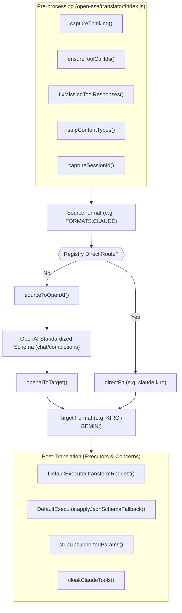
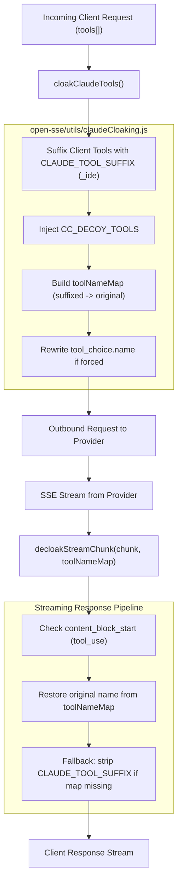
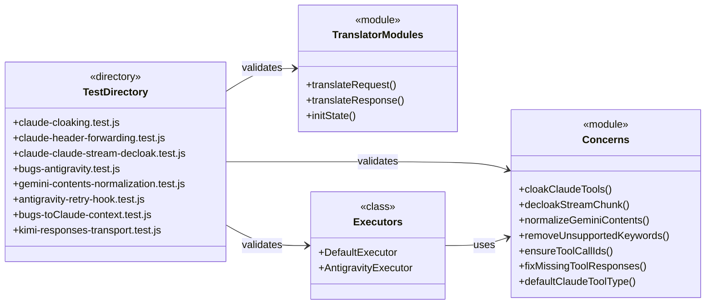

<!-- source: DeepWiki mcp.deepwiki.com · repo decolua/9router · page 14.4 Format Translation Errors · fetched 2026-10-30 -->

# Format Translation Errors

Relevant source files

The following files were used as context for generating this wiki page:

- [open-sse/executors/default.js](open-sse/executors/default.js)
- [open-sse/providers/registry/kimi.js](open-sse/providers/registry/kimi.js)
- [open-sse/providers/registry/minimax-cn.js](open-sse/providers/registry/minimax-cn.js)
- [open-sse/providers/registry/minimax.js](open-sse/providers/registry/minimax.js)
- [open-sse/services/usage/deepseek.js](open-sse/services/usage/deepseek.js)
- [open-sse/translator/concerns/toolCall.js](open-sse/translator/concerns/toolCall.js)
- [open-sse/translator/formats/maxTokens.js](open-sse/translator/formats/maxTokens.js)
- [open-sse/utils/claudeCloaking.js](open-sse/utils/claudeCloaking.js)
- [open-sse/utils/claudeToolTypeSelfCheck.mjs](open-sse/utils/claudeToolTypeSelfCheck.mjs)
- [tests/translator/AGENTS.md](tests/translator/AGENTS.md)
- [tests/translator/bugs-3905-deepseek-tool-type.test.js](tests/translator/bugs-3905-deepseek-tool-type.test.js)
- [tests/translator/bugs-claudeCode-context.test.js](tests/translator/bugs-claudeCode-context.test.js)
- [tests/translator/bugs-kiro.test.js](tests/translator/bugs-kiro.test.js)
- [tests/translator/bugs-openai-bridge.test.js](tests/translator/bugs-openai-bridge.test.js)
- [tests/translator/bugs-toClaude-context.test.js](tests/translator/bugs-toClaude-context.test.js)
- [tests/translator/claude-claude-stream-decloak.test.js](tests/translator/claude-claude-stream-decloak.test.js)
- [tests/translator/coverage-all-models.test.js](tests/translator/coverage-all-models.test.js)
- [tests/translator/format-roundtrip.test.js](tests/translator/format-roundtrip.test.js)
- [tests/translator/matrix.js](tests/translator/matrix.js)
- [tests/unit/claude-cloaking.test.js](tests/unit/claude-cloaking.test.js)
- [tests/unit/claude-header-forwarding.test.js](tests/unit/claude-header-forwarding.test.js)
- [tests/unit/deepseek-usage.test.js](tests/unit/deepseek-usage.test.js)
- [tests/unit/kimi-responses-transport.test.js](tests/unit/kimi-responses-transport.test.js)

This page covers common issues that occur during format translation between provider-specific request/response schemas and how to diagnose them. It focuses on the pre-processing helpers, known edge cases in specific translators (Gemini, Claude, Antigravity, Kiro), and implementation details of the translation pipeline.

---

## The Translation Pipeline & Normalization

All requests flow through a multi-step normalization process in `translateRequest()` before reaching a provider executor [open-sse/translator/index.js:51-109](). The intermediate format is typically OpenAI Chat Completions, though direct "lossless" routes exist for specific pairs [open-sse/translator/index.js:74-75]().

**Natural Language Space to Code Entity Space: Translation Pipeline Architecture**

Sources: [open-sse/translator/index.js:51-147](), [open-sse/executors/default.js:83-95]()

### Core Pre-processing Functions

| Function / Symbol | Code Entity Location | Purpose |
|---|---|---|
| `captureThinking()` | `open-sse/translator/concerns/thinkingUnified.js` | Snapshots thinking intent (budget/level) before translation modifies the body shape. |
| `captureSessionId()` | `open-sse/utils/sessionManager.js` | Captures session ID from the original request body for stateful providers. |
| `ensureToolCallIds()` | `open-sse/translator/concerns/toolCall.js` | Assigns a sanitized ID to any `tool_calls` entry missing an `id` and ensures arguments are strings. |
| `fixMissingToolResponses()` | `open-sse/translator/concerns/toolCall.js` | Scans history for `assistant` tool calls and inserts placeholder `tool` messages if no corresponding `tool_result` is found. |
| `stripUnsupportedParams()` | `open-sse/translator/concerns/paramSupport.js` | Drops unsupported parameters for specific providers (e.g., `client_metadata` on OpenAI-compatible backends) [open-sse/executors/default.js:87-91](). |

Sources: [open-sse/translator/index.js:35-81](), [open-sse/translator/concerns/toolCall.js:27-154](), [open-sse/executors/default.js:83-95]()

---

## Common Translation Issues & Edge Cases

### 1. Tool Call Handling & Schema Constraints

**Symptom:** Tool calls are not recognized by the target provider, or tool results fail due to unknown schema constraints or missing IDs.

**Root cause:** Upstream providers (such as Gemini/Antigravity and Claude) reject requests containing unsupported JSON Schema keywords (e.g., `uniqueItems`, `additionalProperties`, `enumDescriptions`, `$ref`) or unaligned tool call/response identifiers.

**What the code does:**
*   **Schema Constraint Stripping:** `removeUnsupportedKeywords()` in `open-sse/translator/formats/gemini.js` recursively strips unsupported JSON Schema constraints and vendor extensions (`x-` prefixed fields) that would otherwise trigger Gemini protocol rejections (`Unknown name ...: Cannot find field`) [open-sse/translator/formats/gemini.js:6-43](), [open-sse/translator/formats/gemini.js:145-161]().
*   **Schema `$ref` Sanitization:** `sanitizeFunctionResponsePayload()` transforms `$ref` keys into `_ref` recursively to prevent schema validation crashes when parsing tool outputs [tests/unit/gemini-contents-normalization.test.js:144-161]().
*   **Terminal Turn Guards:** `normalizeGeminiContents()` ensures that model turns ending with a `functionCall` or text-only response are correctly balanced with a user `Continue` turn or synthesized `functionResponse` [tests/unit/gemini-contents-normalization.test.js:5-40]().
*   **Claude Tool Type Defaulting:** For providers like MiniMax that explicitly require a `type` field for Claude-format tools, `shouldDefaultClaudeToolType()` and `defaultClaudeToolType()` ensure that tools without a `type` are assigned `"custom"` [open-sse/translator/concerns/toolCall.js:156-168](). This is applied conditionally to avoid breaking other Claude-compatible endpoints that reject the `"custom"` type [open-sse/translator/concerns/toolCall.js:175-177]().

Sources: [open-sse/translator/formats/gemini.js:6-43](), [open-sse/translator/formats/gemini.js:145-161](), [tests/unit/gemini-contents-normalization.test.js:5-161](), [open-sse/translator/concerns/toolCall.js:156-177](), [open-sse/providers/registry/minimax.js:23-26](), [open-sse/providers/registry/minimax-cn.js:23-26]()

### 2. Provider Cloaking & Anti-Ban Mechanisms

**Symptom:** Requests routed via OAuth-enabled Claude or Antigravity connections are blocked or return tool invocation errors.

**Root cause:** Upstream gateways inspect client fingerprints, billing headers, and tool declarations. Uncloaked custom tool names or missing client metadata trigger anti-bot protections.

**Natural Language Space to Code Entity Space: Cloaking & Decloaking Flow**

Sources: [open-sse/utils/claudeCloaking.js:47-105](), [open-sse/utils/claudeCloaking.js:121-149]()

*   **Billing Header Generation:** `generateBillingHeader()` computes SHA-256 content hashes (`cch`) to populate the `x-anthropic-billing-header` matching official Claude Code client fingerprints [open-sse/utils/claudeCloaking.js:9-14]().
*   **Tool Cloaking & Decoy Injection:** `cloakClaudeTools()` appends `CLAUDE_TOOL_SUFFIX` (e.g., `_ide`) to all custom client tools while preserving built-in server tools (`type` property present), and appends `CC_DECOY_TOOLS` [open-sse/utils/claudeCloaking.js:56-78]().
*   **Forced Tool Choice Alignment:** `cloakClaudeTools()` ensures that `tool_choice` targets the suffixed tool name when a specific tool is forced [open-sse/utils/claudeCloaking.js:94-99]().
*   **Claude Session ID Extraction:** `extractClaudeSessionIdFromUserId()` parses the `user_id` metadata field to extract a session ID for the `x-claude-code-session-id` header, used by Claude OAuth connections [open-sse/utils/claudeCloaking.js:33-45](), [open-sse/executors/default.js:11]().

Sources: [open-sse/utils/claudeCloaking.js:9-14](), [open-sse/utils/claudeCloaking.js:56-99](), [tests/unit/claude-cloaking.test.js:18-63](), [open-sse/utils/claudeCloaking.js:33-45](), [open-sse/executors/default.js:11](), [tests/unit/claude-header-forwarding.test.js:99-113]()

### 3. Response Parsing & Streaming State

**Symptom:** Streaming response chunks contain suffixed tool names (e.g., `run_code_ide`), causing client parsers to reject them as unknown tools.

**Root cause:** Translating between identical formats (e.g., Claude-to-Claude streaming passthrough) with enabled OAuth tool cloaking bypasses standard translator mapping steps, leaving suffixed identifiers in SSE event deltas.

**What the code does:**
*   **Stream Decloaking:** `translateResponse()` accepts a persistent `state` object containing `toolNameMap` and passes chunks through `decloakStreamChunk()` to restore original tool names on `content_block_start` events [tests/translator/claude-claude-stream-decloak.test.js:1-49]().
*   **Fallback Suffix Stripping:** If `toolNameMap` is lost across retries or reconnections, `stripCloakSuffix()` strips the trailing `CLAUDE_TOOL_SUFFIX` as a last resort before forwarding to the client [open-sse/utils/claudeCloaking.js:111-116]().

Sources: [open-sse/utils/claudeCloaking.js:111-149](), [tests/translator/claude-claude-stream-decloak.test.js:1-49]()

### 4. `max_tokens` and `thinking.budget_tokens` Reconciliation

**Symptom:** Claude API requests fail with "max_tokens > budget_tokens" errors, or thinking budget is unexpectedly low.

**Root cause:** The Claude API requires `max_tokens` to be strictly greater than `thinking.budget_tokens`. If a client sets a low `max_tokens` or a high `thinking.budget_tokens` (e.g., "max effort" on a model with a large context window), this constraint can be violated.

**What the code does:**
*   **`adjustMaxTokens()`:** This function in `open-sse/translator/formats/maxTokens.js` handles the reconciliation.
    *   It ensures `max_tokens` is at least `DEFAULT_MIN_TOKENS` if tools are present [open-sse/translator/formats/maxTokens.js:15-19]().
    *   If `body.thinking.budget_tokens` is present and `max_tokens` is not strictly greater, it increases `max_tokens` by a buffer (1024 tokens) to satisfy the Claude API requirement [open-sse/translator/formats/maxTokens.js:22-27]().
    *   It also caps `max_tokens` at a `ceiling` value, which can be the model's actual `maxOutput` to prevent premature clamping [open-sse/translator/formats/maxTokens.js:29-30]().
*   **`prepareClaudeRequest()`:** This function in `open-sse/translator/formats/claude.js` (tested in `tests/translator/bugs-toClaude-context.test.js`) calls `adjustMaxTokens()` to perform this reconciliation before sending the request to Claude [tests/translator/bugs-toClaude-context.test.js:98-146]().

Sources: [open-sse/translator/formats/maxTokens.js:1-33](), [tests/translator/bugs-toClaude-context.test.js:91-146]()

### 5. OpenAI `json_schema` Fallback for Incompatible Providers

**Symptom:** OpenAI-compatible providers that do not natively support `response_format: { type: "json_schema" }` fail to return structured JSON output.

**Root cause:** Some OpenAI-compatible endpoints only support `response_format: { type: "json_object" }` and reject requests with the more advanced `json_schema` type.

**What the code does:**
*   **`applyJsonSchemaFallback()`:** In `DefaultExecutor`, this function detects if the provider is `openai-compatible-*` and if the request uses `response_format: { type: "json_schema" }` [open-sse/executors/default.js:121-123]().
*   It then converts the `json_schema` into a system prompt instructing the model to respond with JSON strictly following the schema, and changes the `response_format` to `json_object` [open-sse/executors/default.js:125-137](). This allows providers that only support `json_object` to still attempt structured output based on the provided schema.

Sources: [open-sse/executors/default.js:120-138]()

---

## Debugging and Testing Suite

Format translation logic is guarded by comprehensive unit and golden test suites under `tests/unit/` and `tests/translator/`.

**Natural Language Space to Code Entity Space: Test Suite Architecture**

Sources: [tests/unit/claude-cloaking.test.js:1-123](), [tests/translator/claude-claude-stream-decloak.test.js:1-49](), [tests/translator/bugs-antigravity.test.js:1-139](), [tests/unit/gemini-contents-normalization.test.js:1-180](), [tests/translator/bugs-toClaude-context.test.js:1-203](), [tests/unit/kimi-responses-transport.test.js:1-196]()

### Key Test Files & Assertions
*   `tests/unit/claude-cloaking.test.js`: Validates tool renaming, forced `tool_choice` adjustments, and billing header generation [tests/unit/claude-cloaking.test.js:1-123]().
*   `tests/translator/claude-claude-stream-decloak.test.js`: Verifies stream decloaking during Claude-to-Claude passthrough [tests/translator/claude-claude-stream-decloak.test.js:1-49]().
*   `tests/translator/bugs-antigravity.test.js`: Tests `AntigravityExecutor` request transforms, schema sanitization, and co-located `functionResponse` + `functionCall` handling [tests/translator/bugs-antigravity.test.js:1-139]().
*   `tests/unit/gemini-contents-normalization.test.js`: Guards terminal turn rules and recursive `$ref` sanitization in Gemini payloads [tests/unit/gemini-contents-normalization.test.js:1-180]().
*   `tests/translator/bugs-toClaude-context.test.js`: Contains tests for `max_tokens` and `thinking.budget_tokens` reconciliation, as well as other Claude-specific translation edge cases like `json_schema` fallback and image handling [tests/translator/bugs-toClaude-context.test.js:1-203]().
*   `tests/unit/kimi-responses-transport.test.js`: Verifies correct routing and format translation for Kimi Code's multi-endpoint transport, including the `openai-responses` format [tests/unit/kimi-responses-transport.test.js:1-196]().

Sources: [tests/unit/claude-cloaking.test.js:1-123](), [tests/translator/claude-claude-stream-decloak.test.js:1-49](), [tests/translator/bugs-antigravity.test.js:1-139](), [tests/unit/gemini-contents-normalization.test.js:1-180](), [tests/translator/bugs-toClaude-context.test.js:1-203](), [tests/unit/kimi-responses-transport.test.js:1-196]()

---

