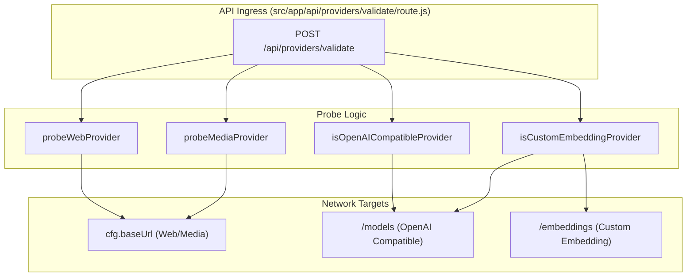
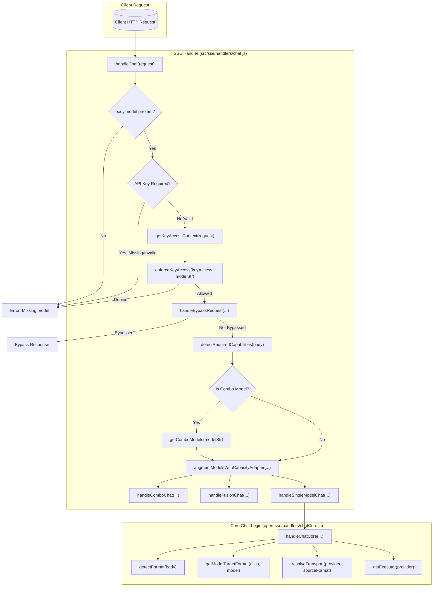
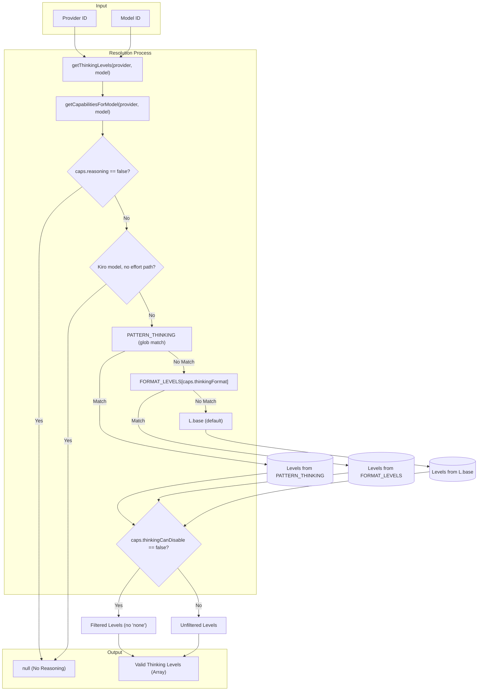

<!-- source: DeepWiki mcp.deepwiki.com · repo decolua/9router · page 15 Glossary · fetched 2026-10-30 -->

# Glossary

Relevant source files

The following files were used as context for generating this wiki page:

- [cli/src/cli/menus/providers.js](cli/src/cli/menus/providers.js)
- [images/fusion-combo-ui.png](images/fusion-combo-ui.png)
- [open-sse/config/constants.js](open-sse/config/constants.js)
- [open-sse/config/providerModels.js](open-sse/config/providerModels.js)
- [open-sse/config/providers.js](open-sse/config/providers.js)
- [open-sse/executors/index.js](open-sse/executors/index.js)
- [open-sse/handlers/chatCore.js](open-sse/handlers/chatCore.js)
- [open-sse/providers/capabilities.js](open-sse/providers/capabilities.js)
- [open-sse/providers/registry/antigravity.js](open-sse/providers/registry/antigravity.js)
- [open-sse/providers/registry/codebuddy-cn.js](open-sse/providers/registry/codebuddy-cn.js)
- [open-sse/providers/thinkingLevels.js](open-sse/providers/thinkingLevels.js)
- [open-sse/services/combo.js](open-sse/services/combo.js)
- [open-sse/services/model.js](open-sse/services/model.js)
- [open-sse/services/usage/google.js](open-sse/services/usage/google.js)
- [open-sse/translator/concerns/modality.js](open-sse/translator/concerns/modality.js)
- [open-sse/translator/concerns/thinkingUnified.js](open-sse/translator/concerns/thinkingUnified.js)
- [src/app/api/providers/[id]/test/route.js](src/app/api/providers/[id]/test/route.js)
- [src/app/api/providers/validate/route.js](src/app/api/providers/validate/route.js)
- [src/mitm/config.js](src/mitm/config.js)
- [src/shared/constants/cliTools.js](src/shared/constants/cliTools.js)
- [src/shared/constants/config.js](src/shared/constants/config.js)
- [src/shared/constants/providers.js](src/shared/constants/providers.js)
- [src/sse/handlers/chat.js](src/sse/handlers/chat.js)
- [src/sse/services/auth.js](src/sse/services/auth.js)
- [tests/translator/__snapshots__/golden-request.test.js.snap](tests/translator/__snapshots__/golden-request.test.js.snap)
- [tests/translator/golden-request.test.js](tests/translator/golden-request.test.js)
- [tests/translator/golden-url-header.test.js](tests/translator/golden-url-header.test.js)
- [tests/translator/openai-thinking-display.test.js](tests/translator/openai-thinking-display.test.js)
- [tests/translator/thinking-unified.test.js](tests/translator/thinking-unified.test.js)
- [tests/unit/claude-cache-final-tool-results.test.js](tests/unit/claude-cache-final-tool-results.test.js)
- [tests/unit/combo-fusion.test.js](tests/unit/combo-fusion.test.js)
- [tests/unit/fetch-success-clears-account.test.js](tests/unit/fetch-success-clears-account.test.js)
- [tests/unit/hermes-vision-detection.test.js](tests/unit/hermes-vision-detection.test.js)

This page defines codebase-specific terms, jargon, and architectural concepts used within the 9Router system.

## Core Entities

### Connection
A `Connection` represents a set of credentials (API Key, OAuth Token, or Session Account) linked to a specific AI Provider. It is the primary unit of authentication and quota management.
*   **Implementation:** Managed via database operations [src/lib/localDb.js]() (see connections repository).
*   **Data Flow:** Connections provide the `accessToken` or `apiKey` used by executors [open-sse/handlers/chatCore.js:37-64]().

### Provider Node
A `Provider Node` is a specific API endpoint configuration. Standard providers have fixed nodes, but "Compatible" providers allow users to add custom base URLs.
*   **Resolution:** Resolved by the system to determine where to route the final HTTP request [src/app/api/providers/validate/route.js:106-120]().

### Proxy Pool
A collection of proxy server configurations that can be assigned to specific connections to bypass regional restrictions or IP-based rate limits.
*   **Usage:** Resolved per-connection using `resolveConnectionProxyConfig` before making outbound fetches [src/sse/services/auth.js:57-69]().
*   **Dashboard:** Managed via the Proxy Pools dashboard page for per-connection egress routing.

### Model Alias
A user-defined string that maps to a specific `provider/model` pair. This allows CLI tools to use a stable name while 9Router routes it to a different backend.
*   **Implementation:** `OAUTH_ALIASES` and `PROVIDER_ID_TO_ALIAS` map internal IDs to these shorthand codes [open-sse/config/providerModels.js:122-135]().

### Combo
A virtual model representing an ordered fallback chain. If the first model in a combo fails (due to rate limits or errors), 9Router automatically tries the next one.
*   **Implementation:** Handled via `handleComboChat` which manages rotation and strategy [src/sse/handlers/chat.js:136-147]().
*   **Strategies:** Includes `fallback`, `round-robin`, `fusion`, and `capacity` [src/sse/handlers/chat.js:108-111]().

### Compatible Node
A user-defined provider entry for APIs that follow standard schemas (OpenAI/Anthropic) but reside at custom URLs (e.g., local Ollama or private vLLM).
*   **Detection:** Identified using `isOpenAICompatibleProvider` and `isAnthropicCompatibleProvider` helpers [src/shared/constants/providers.js:91-97]().

---

## Routing & Fallback Strategies

### Round Robin
A selection strategy where 9Router cycles through all available `Connections` for a provider equally to distribute load.

### Sticky Round Robin
An optimization that attempts to use the same `Connection` for subsequent requests from the same client to maintain session consistency until a specific limit is reached.
*   **Implementation:** Configured via `comboStickyRoundRobinLimit` in settings [src/sse/handlers/chat.js:134-147]().

### Fill First
A strategy that prioritizes the first available `Connection` and only moves to the next one when the current one is rate-limited or errors out.

### Model Lock
A temporary exclusion of a `Connection` from the rotation after it returns a rate limit (429) or fatal error.
*   **Implementation:** Managed via `isModelLockActive` [src/sse/services/auth.js:28-88]().

---

## Technical Architecture Components

### Executor
A module responsible for low-level HTTP communication with a specific provider's API.
*   **Selection:** Resolved via `getExecutor(provider)` [open-sse/handlers/chatCore.js:16-16]().

### Translator
A pipeline that converts requests and responses between different API formats.
*   **Implementation:** Found in `open-sse/translator/`.

### SSE (Server-Sent Events)
The protocol for streaming AI responses. 9Router intercepts SSE streams to perform real-time translation and usage tracking.

### Native Passthrough
A mode triggered when the client tool and provider share the same ecosystem, skipping translation to ensure 100% compatibility.
*   **Detection:** Handled by `isNativePassthrough` [open-sse/handlers/chatCore.js:22-22]().

### Passthrough Models
Models that do not require explicit mapping in 9Router because they are passed directly to an upstream router.
*   **Flag:** `passthroughModels: true` in provider registry entries [src/shared/constants/providers.js:33-33]().

### Source & Target Format
*   **Source Format:** The schema used by the client tool (e.g., `openai`, `claude`), detected via `detectFormat(body)` [open-sse/handlers/chatCore.js:64-76]().
*   **Target Format:** The schema required by the provider, resolved via `getModelTargetFormat` [open-sse/config/providerModels.js:57-68]().

### Thinking Levels
A mechanism to control the "reasoning effort" of a model, often expressed as levels (e.g., "low", "medium", "high") or a token budget.
*   **Configuration:** Defined in `open-sse/providers/thinkingLevels.js` and `open-sse/translator/concerns/thinkingUnified.js`.
*   **Capabilities:** Model capabilities (`thinkingFormat`, `thinkingCanDisable`, `thinkingRange`) determine supported thinking levels [open-sse/providers/capabilities.js:58-63]().
*   **Extraction:** `extractThinking` parses thinking intent from various request body formats [open-sse/translator/concerns/thinkingUnified.js:50-102]().

---

## Code Entity Mapping

### System Flow: Provider Validation
This diagram maps the validation logic for different provider types to their specific code probes.

**Sources:** [src/app/api/providers/validate/route.js:13-83]()

### Chat Ingress & Routing Pipeline
Mapping the flow of a chat request from ingress through authentication and model resolution.

**Sources:** [src/sse/handlers/chat.js:35-153](), [open-sse/handlers/chatCore.js:63-110]()

### Thinking Level Resolution
This diagram illustrates how thinking levels are determined for a given model and provider.

**Sources:** [open-sse/providers/thinkingLevels.js:91-105](), [open-sse/providers/capabilities.js:58-63](), [open-sse/translator/concerns/thinkingUnified.js:11-23]()

---

## RTK & Token Savers

### RTK (Request Token Knife)
A token-saving feature that optimizes chat histories to reduce token consumption.
*   **Implementation:** Includes message compression and tooling [open-sse/handlers/chatCore.js:25-29]().

### Caveman & Ponytail
Specific RTK injection strategies that apply targeted system prompt rules to force concise behavior.
*   **Injection:** Handled via `injectCaveman` and `injectPonytail` [open-sse/handlers/chatCore.js:25-26]().

### PXPIPE & Headroom
Advanced prompt compression and conversation state optimization subsystems.
*   **Implementation:** `compressWithPxpipe` and `compressWithHeadroom` [open-sse/handlers/chatCore.js:28-29]().

---
**Sources:**
* [open-sse/config/providerModels.js:1-145]()
* [open-sse/handlers/chatCore.js:1-110]()
* [src/shared/constants/providers.js:1-163]()
* [src/sse/handlers/chat.js:1-153]()
* [src/app/api/providers/validate/route.js:1-146]()
* [src/sse/services/auth.js:1-134]()
* [open-sse/providers/capabilities.js:1-103]()
* [open-sse/translator/concerns/thinkingUnified.js:1-154]()
* [open-sse/providers/thinkingLevels.js:1-105]()