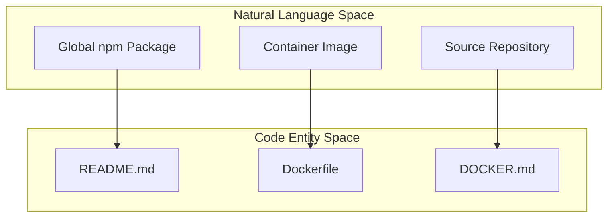
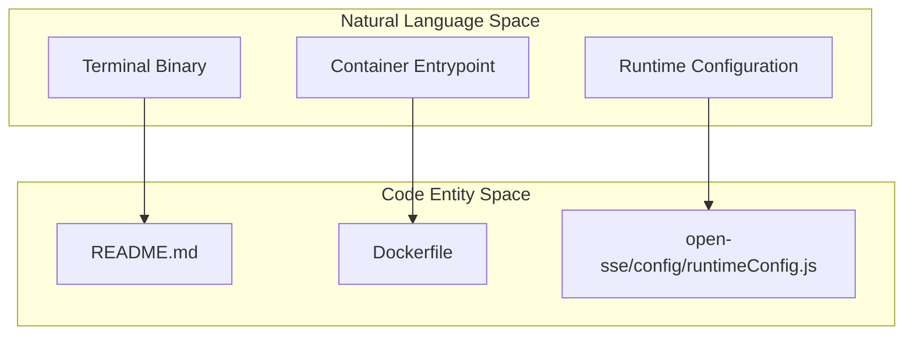

<!-- source: DeepWiki mcp.deepwiki.com · repo decolua/9router · page 2 Getting Started · fetched 2026-10-30 -->

# Getting Started

Relevant source files

The following files were used as context for generating this wiki page:

- [.github/dependabot.yml](.github/dependabot.yml)
- [.github/workflows/docker-publish.yml](.github/workflows/docker-publish.yml)
- [.gitignore](.gitignore)
- [.npmignore](.npmignore)
- [DOCKER.md](DOCKER.md)
- [Dockerfile](Dockerfile)
- [README.md](README.md)
- [open-sse/config/runtimeConfig.js](open-sse/config/runtimeConfig.js)
- [open-sse/executors/base.js](open-sse/executors/base.js)
- [src/app/api/usage/stream/route.js](src/app/api/usage/stream/route.js)

This page serves as a parent guide for initializing, configuring, and deploying **9Router**. It provides a high-level overview of the setup workflow, installation routes, server initialization, core configuration paradigms, and the terminal application.

**Scope:** This page summarizes initial setup. For detailed installation guides, see [Installation](#2.1). For initial configuration and first requests, see [Quick Start](#2.2). For deep dives into system options, see [Configuration Basics](#2.3). For information on the command-line interface and terminal UI menus, see [CLI Terminal App](#2.4).

Sources: `[README.md:74-98]()`, `[Dockerfile:1-56]()`

---

## 1. Installation Overview

9Router can be set up through several deployment vectors depending on the host environment. The primary distribution channels include global Node.js packages via npm, containerized images via Docker `[Dockerfile:1-85]`, `[DOCKER.md:1-50]()`, or directly running from source code for local development `[README.md:100-130]()`.

For server-grade environments or isolated containers, the Docker image handles runtime execution and volume mapping. Contributors typically clone the repository, configure environment variables, and run the development or production build scripts.

For details on installation options, system prerequisites, and platform-specific steps, see [Installation](#2.1).

### Installation Channels to Implementation Mappings

Sources: `[README.md:74-130]()`, `[Dockerfile:1-85]`, `[DOCKER.md:1-50]()`

---

## 2. Quick Start Overview

Once installed, 9Router launches an interactive web dashboard and exposes an OpenAI-compatible API gateway `[README.md:74-98]()`. Users can connect free providers (such as Kiro AI or OpenCode Free) directly through the dashboard interface without complex initial authentication `[README.md:85-88]()`.

CLI coding tools such as Claude Code, Cursor, and Cline can then target the local proxy endpoint `http://localhost:20128/v1` using generated API keys `[README.md:90-96]()`.

For a step-by-step walkthrough of your first provider connection and making initial requests, see [Quick Start](#2.2).

Sources: `[README.md:74-98]()`

---

## 3. Configuration Basics Overview

9Router manages runtime settings, cache TTLs, and retry parameters through centralized configuration modules `[open-sse/config/runtimeConfig.js:1-50]()`. Fundamental configuration concepts include **Providers** (upstream AI services), **Connections** (authenticated instances), **Model Aliases** (mapping short names to downstream models), and **Combos** (fusion chains executing automatic fallback across tiers) `[README.md:38-44]()`.

Settings management covers endpoint security, proxy behaviors, and usage quotas. For an introduction to core configuration entities and settings schemas, see [Configuration Basics](#2.3).

Sources: `[open-sse/config/runtimeConfig.js:1-50]`, `[README.md:38-44]()`

---

## 4. CLI Terminal App & Runtime Architecture

The terminal utility and deployment scripts facilitate local administration and binary distribution `[README.md:74-85]()`. It manages runtime execution hooks, environment bootstrapping, and container entrypoints `[Dockerfile:75-84]()` to ensure clean process separation and reliable daemon execution.

For comprehensive documentation on the terminal binary, interactive menus, system tray support, and sqlite runtime hooks, see [CLI Terminal App](#2.4).

### Terminal and Runtime Entity Mappings

Sources: `[README.md:74-85]`, `[Dockerfile:75-84]`, `[open-sse/config/runtimeConfig.js:1-50]()`

---

## Next Steps

1. **Installation**: Review environment requirements and methods in [Installation](#2.1).
2. **Quick Start**: Complete initial setup and test requests via [Quick Start](#2.2).
3. **Configuration Basics**: Understand providers, aliases, and combos in [Configuration Basics](#2.3).
4. **CLI Terminal App**: Explore terminal administration via [CLI Terminal App](#2.4).

Sources: `[README.md:18-18]`, `[README.md:74-98]()`

---

