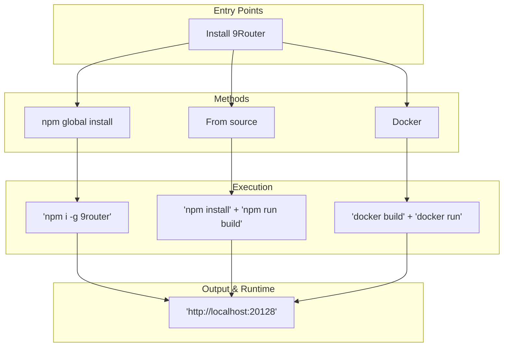
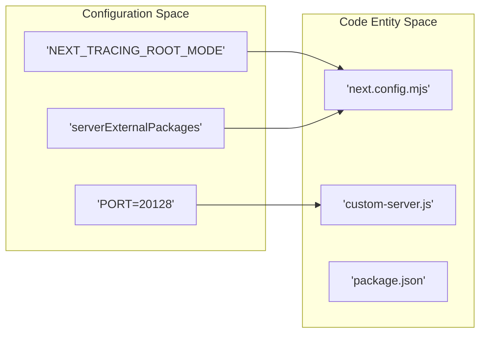
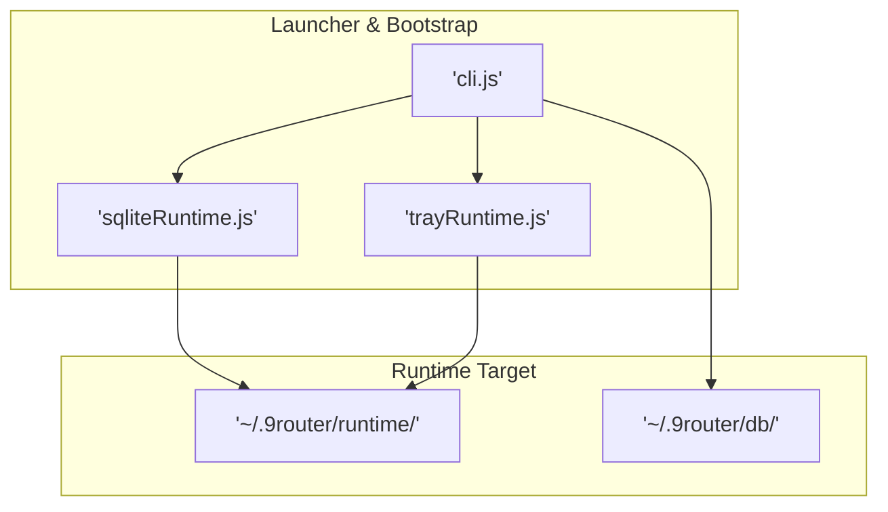

<!-- source: DeepWiki mcp.deepwiki.com · repo decolua/9router · page 2.1 Installation · fetched 2026-10-30 -->

# Installation

<details>
<summary>Relevant source files</summary>

The following files were used as context for generating this wiki page:

- [.github/dependabot.yml](.github/dependabot.yml)
- [.github/workflows/docker-publish.yml](.github/workflows/docker-publish.yml)
- [.gitignore](.gitignore)
- [.npmignore](.npmignore)
- [DOCKER.md](DOCKER.md)
- [Dockerfile](Dockerfile)
- [README.md](README.md)
- [cli/README.md](cli/README.md)
- [cli/cli.js](cli/cli.js)
- [cli/hooks/postinstall.js](cli/hooks/postinstall.js)
- [cli/src/cli/commands/connect.js](cli/src/cli/commands/connect.js)
- [cli/src/cli/commands/connectTools.js](cli/src/cli/commands/connectTools.js)
- [cli/src/cli/commands/show.js](cli/src/cli/commands/show.js)
- [open-sse/config/runtimeConfig.js](open-sse/config/runtimeConfig.js)
- [open-sse/executors/base.js](open-sse/executors/base.js)
- [src/app/api/usage/stream/route.js](src/app/api/usage/stream/route.js)
- [tests/unit/cli-connect.test.js](tests/unit/cli-connect.test.js)
- [tests/unit/cli-show.test.js](tests/unit/cli-show.test.js)

</details>


This page covers how to install and run 9Router using three primary methods: global npm installation, running from source, and Docker. It also documents the containerization strategy, runtime self-healing for native dependencies, and the environment variables required to start the server.

---

## Prerequisites

| Requirement | Minimum Version | Notes |
|---|---|---|
| Node.js | `>=18.0.0` | CLI and server runtime [cli/package.json:36-38]() |
| npm | Bundled with Node.js | Used for global install and source builds |
| Docker | Any recent | Required only for the Docker container deployment [DOCKER.md:1-4]() |

The system requires a persistent data directory for its SQLite databases and configuration files. In Docker, this defaults to `/app/data`, while on local machines it resides in `~/.9router` (or `%APPDATA%\9router` on Windows) managed by the CLI hooks and data directory resolver.

**Installation Method Overview:**


Sources: [cli/package.json:1-48](), [README.md:76-83]()

---

## Method 1: npm Global Install

Global installation via npm provides the `9router` binary CLI tool, which handles process supervision, interactive menus, and automatic runtime self-healing [cli/package.json:5-7]().

### CLI & Runtime Self-Healing Implementation
When installed globally, native modules like `better-sqlite3` and system tray integrations are decoupled from the locked npm global install path to prevent file lock errors (such as `EBUSY` on Windows) [cli/package.json:33-35](). 
1. **SQLite Runtime Bootstrap:** `cli/hooks/sqliteRuntime.js` provisions `sql.js` and `better-sqlite3` inside user-writable `~/.9router/runtime/node_modules` at startup [cli/cli.js:66]().
2. **Tray Runtime Bootstrap:** `cli/hooks/trayRuntime.js` provisions `systray2` on macOS and Linux, while Windows uses PowerShell `NotifyIcon` without external binaries [cli/cli.js:67]().
3. **CLI Launcher:** `cli/cli.js` executes runtime checks before spawning the Next.js server instance [cli/cli.js:66-103]().

Sources: [cli/package.json:31-38](), [cli/cli.js:66-103](), [README.md:76-83]()

---

## Method 2: From Source

Source execution is designed for local development, debugging, and deep customization [package.json:6-18]().

### Development Mode
```bash
cp .env.example .env
npm install
PORT=20127 NEXT_PUBLIC_BASE_URL=http://localhost:20127 npm run dev
```
The development server starts with hot-reloading enabled using Next.js development server bindings [package.json:7]().

### Production Mode
```bash
npm run build
PORT=20128 HOSTNAME=0.0.0.0 NEXT_PUBLIC_BASE_URL=http://localhost:20128 npm run start
```
The production build compiles a standalone Next.js server managed by `custom-server.js` [package.json:9-15](), [Dockerfile:84]().

### Default URLs After Startup
| Path | Description |
|---|---|
| `http://localhost:20128/dashboard` | Web management dashboard [README.md:134]() |
| `http://localhost:20128/v1` | OpenAI-compatible API gateway [README.md:135]() |

Sources: [package.json:6-18](), [Dockerfile:84](), [README.md:132-136]()

---

## Method 3: Docker

The containerized deployment utilizes a multi-stage build pattern defined in `Dockerfile` [Dockerfile:1-84]() and documented in `DOCKER.md` [DOCKER.md:1-187]().

### Quick Start with Persistence
```bash
docker run -d \
  -p 20128:20128 \
  -v "$HOME/.9router:/app/data" \
  -e DATA_DIR=/app/data \
  --name 9router \
  decolua/9router:latest
```

### Docker & Standalone Configuration Mapping



Sources: [package.json:1-68](), [Dockerfile:1-84](), [DOCKER.md:1-52]()

---

## Environment Variables

These variables control server binding, data persistence, and runtime behavior.

| Variable | Default | Description |
|---|---|---|
| `DATA_DIR` | `~/.9router` (Local) / `/app/data` (Docker) | Persistent storage path for SQLite databases and auth tokens [Dockerfile:52](), [DOCKER.md:38]() |
| `PORT` | `20128` | HTTP listen port for web dashboard and API endpoints [Dockerfile:49](), [package.json:7]() |
| `HOSTNAME` | `0.0.0.0` | Network interface binding address [Dockerfile:50]() |
| `NEXT_TELEMETRY_DISABLED` | `1` | Disables Next.js anonymous usage reporting [Dockerfile:51]() |

Sources: [package.json:6-12](), [Dockerfile:48-53]()

---

## Data Flow & Storage Layout

9Router initializes runtime data structures inside the designated data directory.

**Runtime Storage Architecture:**



| Path | Content |
|---|---|
| `${DATA_DIR}/db/data.sqlite` | Main SQLite persistence database [DOCKER.md:45]() |
| `${DATA_DIR}/runtime/node_modules/` | User-writable runtime native binaries (`better-sqlite3`, `systray2`) [cli/package.json:33-34]() |
| `${DATA_DIR}/auth/cli-secret` | Shared cryptographic token secret for CLI-to-server API communication |

Sources: [cli/package.json:33-35](), [cli/cli.js:66-103](), [DOCKER.md:40-51]()

---

