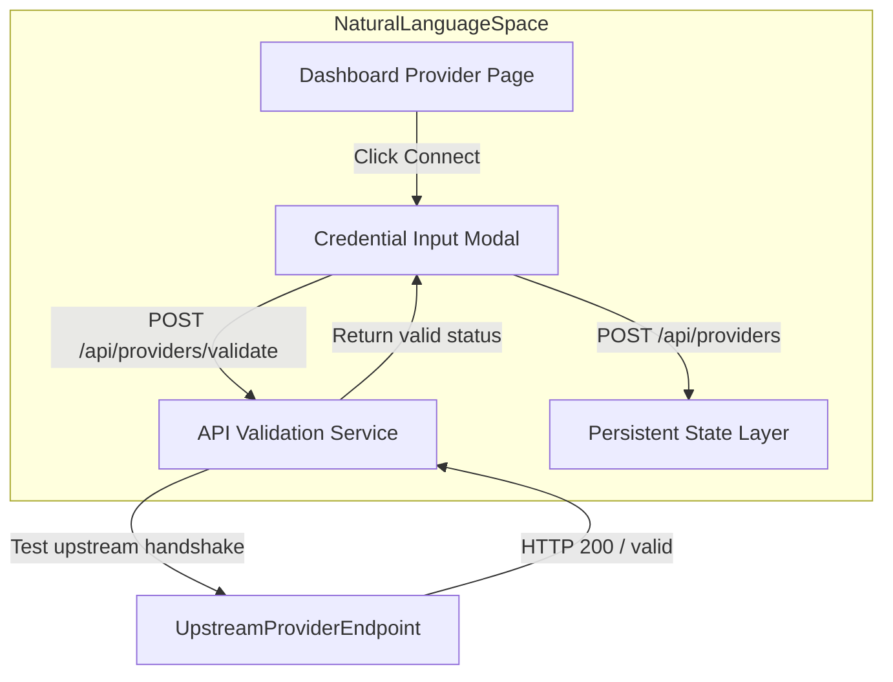
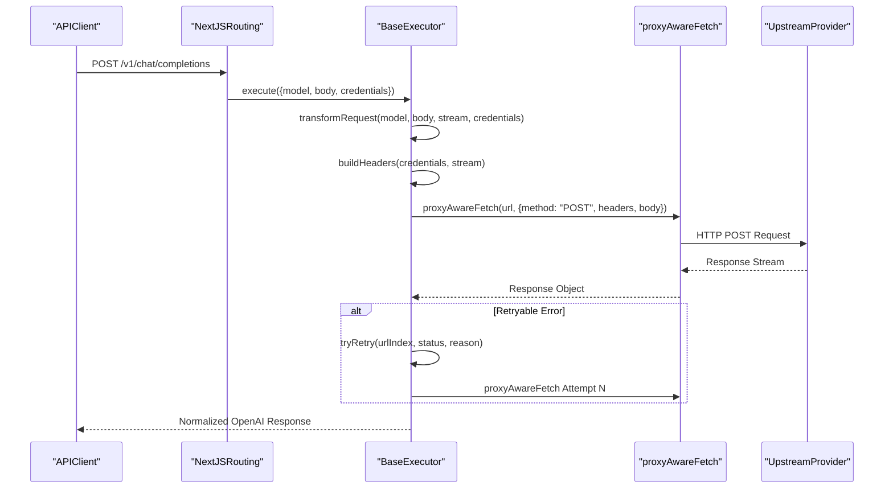

<!-- source: DeepWiki mcp.deepwiki.com · repo decolua/9router · page 2.2 Quick Start · fetched 2026-10-30 -->

# Quick Start

<details>
<summary>Relevant source files</summary>

The following files were used as context for generating this wiki page:

- [.github/dependabot.yml](.github/dependabot.yml)
- [.github/workflows/docker-publish.yml](.github/workflows/docker-publish.yml)
- [.gitignore](.gitignore)
- [.npmignore](.npmignore)
- [DOCKER.md](DOCKER.md)
- [Dockerfile](Dockerfile)
- [README.md](README.md)
- [open-sse/config/runtimeConfig.js](open-sse/config/runtimeConfig.js)
- [open-sse/executors/base.js](open-sse/executors/base.js)
- [src/app/(dashboard)/dashboard/endpoint/EndpointPageClient.js](src/app/(dashboard)/dashboard/endpoint/EndpointPageClient.js)
- [src/app/(dashboard)/dashboard/profile/page.js](src/app/(dashboard)/dashboard/profile/page.js)
- [src/app/(dashboard)/dashboard/providers/[id]/ModelRow.js](src/app/(dashboard)/dashboard/providers/[id]/ModelRow.js)
- [src/app/(dashboard)/dashboard/providers/[id]/page.js](src/app/(dashboard)/dashboard/providers/[id]/page.js)
- [src/app/(dashboard)/dashboard/providers/page.js](src/app/(dashboard)/dashboard/providers/page.js)
- [src/app/api/settings/route.js](src/app/api/settings/route.js)
- [src/app/api/usage/stream/route.js](src/app/api/usage/stream/route.js)
- [src/lib/localDb.js](src/lib/localDb.js)
- [src/shared/components/Header.js](src/shared/components/Header.js)
- [src/shared/components/Sidebar.js](src/shared/components/Sidebar.js)

</details>


## Purpose and Scope
This page walks through the minimum technical steps to initialize a 9Router instance, configure and authenticate an AI provider, understand the model aliasing and prefix convention, and execute a fully resolved API request through the backend routing engine.

---

## Start the Server

9Router can be deployed globally via npm, run directly from source for local development, or containerized using Docker. The application defaults to port `20128` for client ingress and API endpoints [README.md:117-121](), [Dockerfile:48-52]().

### Deployment Methods

* **Global npm Package:**
  ```bash
  npm install -g 9router
  9router
  ```
  [README.md:78-81]()

* **Local Development (Source):**
  9Router utilizes a Next.js framework core [README.md:104-108](). Environment variables such as `PORT` and `NEXT_PUBLIC_BASE_URL` govern local binding.
  ```bash
  cp .env.example .env
  npm install
  PORT=20128 NEXT_PUBLIC_BASE_URL=http://localhost:20128 npm run dev
  ```
  [README.md:104-108]()

* **Docker Container:**
  The container image is multi-platform and executes via a custom entrypoint script to resolve SQLite volume write permissions [Dockerfile:1-84]().
  ```bash
  docker run -d \
    -p 20128:20128 \
    -v "$HOME/.9router:/app/data" \
    -e DATA_DIR=/app/data \
    --name 9router \
    decolua/9router:latest
  ```
  [Dockerfile:48-84]()

Once operational, the dashboard interface is exposed at `http://localhost:20128/dashboard` and the OpenAI-compatible proxy interface at `http://localhost:20128/v1` [README.md:132-136]().

Sources: [README.md:78-136](), [Dockerfile:1-84]()

---

## Add a Provider

Providers encapsulate upstream AI services, managing authentication types (API keys, OAuth tokens, web cookies, and unauthenticated free tiers) [README.md:85-88](), [src/app/(dashboard)/dashboard/providers/[id]/page.js:8-10]().

### Connection Mechanics

When configuring an API key or token via the UI modal, the system initiates a validation probe against validation endpoints prior to persisting the record [src/app/(dashboard)/dashboard/providers/[id]/page.js:114-121]().

**Code Entity Space: Provider Connection & Validation Flow**

Sources: [src/app/(dashboard)/dashboard/providers/[id]/page.js:93-129]()

Sources: [README.md:85-88](), [src/app/(dashboard)/dashboard/providers/[id]/page.js:93-129]()

---

## Model Name Format & Prefixes

To route incoming requests to specific provider connections, 9Router employs a prefix-based model routing syntax. Every target model must be prefixed to declare its routing family [README.md:95-95]().

| Prefix | Provider Family | Example Model Identifier |
| :--- | :--- | :--- |
| `kr` | Kiro AI | `kr/claude-sonnet-4.5` [README.md:95-95]() |
| `oc` | OpenCode Free | `oc/mimo-v2.5-free` |
| `gh` | GitHub Copilot | `gh/gpt-4o` |
| `ag` | Antigravity | `ag/gemini-2.0-flash-exp` |

Sources: [README.md:95-95]()

---

## Make Your First Request

With the server running and a provider connected, you can submit an OpenAI-compatible completion request to `http://localhost:20128/v1/chat/completions` [README.md:135-135]().

**Example cURL Request:**
```bash
curl http://localhost:20128/v1/chat/completions \
  -H "Content-Type: application/json" \
  -H "Authorization: Bearer [Default Key]" \
  -d '{
    "model": "kr/claude-sonnet-4.5",
    "messages": [{"role": "user", "content": "Hello!"}],
    "stream": false
  }'
```
[README.md:91-96]()

### Request Execution Pipeline

When the request reaches the routing engine, it is processed by the `BaseExecutor` class [open-sse/executors/base.js:11-16]():

1. **Request Transformation:** `transformRequest()` modifies the payload to match the target provider's expected schema [open-sse/executors/base.js:78-81]().
2. **Header Construction:** `buildHeaders()` attaches authentication tokens (`Authorization: Bearer ...` or `x-api-key`) and stream declarations [open-sse/executors/base.js:46-76]().
3. **Dispatch & Proxying:** `proxyAwareFetch()` routes the request to the upstream target, respecting proxy configurations [open-sse/executors/base.js:146-151]().
4. **Retry & Backoff Handling:** If upstream returns a retryable status code, `tryRetry()` evaluates parameters and attempts re-transmission before triggering connection fallback [open-sse/executors/base.js:109-125]().

**Code Entity Space: Request Processing Sequence**

Sources: [open-sse/executors/base.js:10-164]()

Sources: [open-sse/executors/base.js:10-164]()

---

