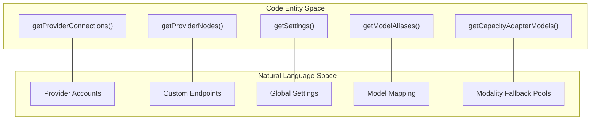
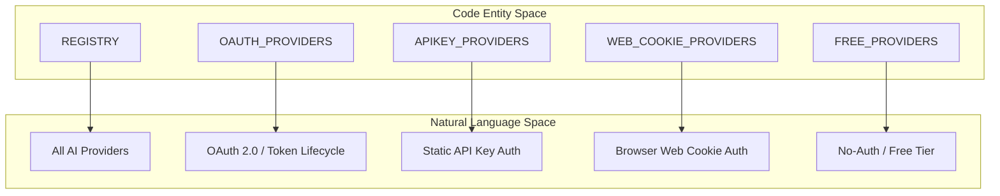
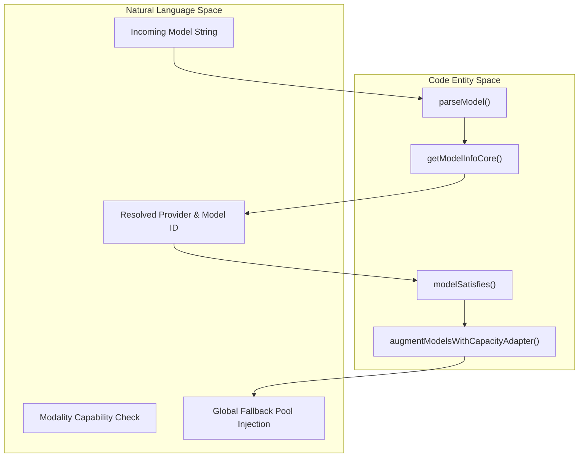

<!-- source: DeepWiki mcp.deepwiki.com · repo decolua/9router · page 2.3 Configuration Basics · fetched 2026-10-30 -->

# Configuration Basics

Relevant source files

The following files were used as context for generating this wiki page:

- [open-sse/config/constants.js](open-sse/config/constants.js)
- [open-sse/config/providerModels.js](open-sse/config/providerModels.js)
- [open-sse/config/providers.js](open-sse/config/providers.js)
- [open-sse/executors/index.js](open-sse/executors/index.js)
- [open-sse/services/capacityAdapter.js](open-sse/services/capacityAdapter.js)
- [open-sse/services/model.js](open-sse/services/model.js)
- [src/app/(dashboard)/dashboard/providers/[id]/CustomConfigCard.js](src/app/(dashboard)/dashboard/providers/[id]/CustomConfigCard.js)
- [src/app/api/providers/[id]/overrides/route.js](src/app/api/providers/[id]/overrides/route.js)
- [src/app/api/providers/[id]/test/route.js](src/app/api/providers/[id]/test/route.js)
- [src/app/api/providers/validate/route.js](src/app/api/providers/validate/route.js)
- [src/lib/db/backup.js](src/lib/db/backup.js)
- [src/lib/db/migrate.js](src/lib/db/migrate.js)
- [src/lib/db/repos/requestDetailsRepo.js](src/lib/db/repos/requestDetailsRepo.js)
- [src/lib/db/repos/settingsRepo.js](src/lib/db/repos/settingsRepo.js)
- [src/shared/constants/config.js](src/shared/constants/config.js)
- [src/shared/constants/providers.js](src/shared/constants/providers.js)

## Purpose and Scope

This page introduces the core configuration architecture in 9Router: provider registries, model resolution, combos, capacity adapters, and global settings. These entities compose the backend configuration plane that enables 9Router to route, translate, and optimize AI traffic across multiple upstream providers with fault tolerance and low latency.

---

## 1. Configuration Entity Architecture & Database Layer

All runtime state, settings, and provider connections are persisted through a SQLite database abstraction layer located in `src/lib/db/` and exposed via `src/lib/localDb.js`. Configuration values are read and updated through dedicated repository modules such as `settingsRepo.js`.

### Configuration to Code Entity Mapping

*Sources: [src/lib/db/repos/settingsRepo.js:7-67](), [src/lib/localDb.js:3-21]()*

---

## 2. Provider Registry & Authentication Categories

Providers are defined in the registry (`open-sse/providers/registry/index.js`) and surfaced via `src/shared/constants/providers.js`. 9Router categorizes providers into distinct operational classes based on their authentication mechanics.

### Provider Classifications

*Sources: [src/shared/constants/providers.js:43-71](), [open-sse/config/providerModels.js:1-7]*

Providers define metadata schemas including service kinds (`serviceKinds`), credential requirements, and fallback options. Custom headers can be injected per provider and are validated against security constraints before being saved to the `providerOverrides` store in `settingsRepo.js` [src/lib/db/repos/settingsRepo.js:65-66]().

*Sources: [src/shared/constants/providers.js:1-41](), [src/lib/db/repos/settingsRepo.js:65-66]*

---

## 3. Models, Aliases, and Capacity Adapters

Models serve as execution units. 9Router parses and resolves model strings (e.g., `provider/model` or alias lookups) via helper functions in `open-sse/services/model.js` [open-sse/services/model.js:27-55]().

### Model Resolution & Capacity Augmentation

*Sources: [open-sse/services/model.js:27-123](), [open-sse/services/capacityAdapter.js:79-101]()*

### Capacity Adapters
When a request requires a specific modality (such as `vision`, `pdf`, `audioInput`, or `videoInput`) and the primary model lacks support, `augmentModelsWithCapacityAdapter()` injects fallback models from global capacity pools [open-sse/services/capacityAdapter.js:69-101]().

*Sources: [open-sse/services/capacityAdapter.js:1-101](), [open-sse/config/providerModels.js:14-48]*

---

## 4. Global Settings and Authentication

Global behavior is managed through `settingsRepo.js`, combining default configurations with persisted database rows [src/lib/db/repos/settingsRepo.js:7-102]().

### Core Settings Structure
* **Authentication Modes:** Configurable via `authMode` (`password`, `oidc`, or `saml`) [src/lib/db/repos/settingsRepo.js:29-41]().
* **Observability & Request Logging:** Controlled via `enableObservability`, `observabilityMaxRecords`, and `observabilityBatchSize` [src/lib/db/repos/settingsRepo.js:42-46]().
* **Outbound Proxies:** Managed through `outboundProxyEnabled`, `outboundProxyUrl`, and `outboundNoProxy` [src/lib/db/repos/settingsRepo.js:47-49]().

Atomic writes are enforced using database transactions to prevent race conditions during concurrent updates [src/lib/db/repos/settingsRepo.js:109-123]().

*Sources: [src/lib/db/repos/settingsRepo.js:7-123]()*

---

## 5. Network Egress and Token Optimization Flags

The configuration layer exposes toggles for network proxying, remote tunnels, and prompt optimization subsystems ("Token Savers").

| Configuration Flag | Default Value | Purpose | Key Code Reference |
| :--- | :--- | :--- | :--- |
| `rtkEnabled` | `true` | Real-time prompt compression pipeline | `src/lib/db/repos/settingsRepo.js:52` |
| `headroomEnabled` | `false` | External headroom compression integration | `src/lib/db/repos/settingsRepo.js:53` |
| `cavemanEnabled` | `false` | Prompt modifier for token reduction | `src/lib/db/repos/settingsRepo.js:57` |
| `ponytailEnabled` | `false` | Structured message trimming | `src/lib/db/repos/settingsRepo.js:59` |
| `pxpipeEnabled` | `false` | Multimodal prompt compression pipe | `src/lib/db/repos/settingsRepo.js:61` |

*Sources: [src/lib/db/repos/settingsRepo.js:50-67]*

---

