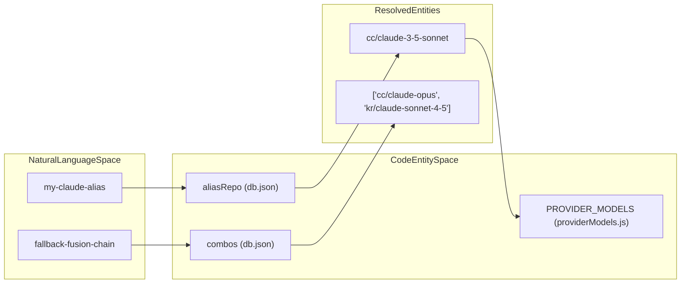
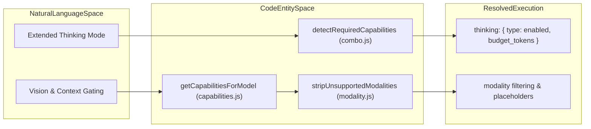

<!-- source: DeepWiki mcp.deepwiki.com · repo decolua/9router · page 3 Core Concepts · fetched 2026-10-30 -->

# Core Concepts

Relevant source files

The following files were used as context for generating this wiki page:

- [images/fusion-combo-ui.png](images/fusion-combo-ui.png)
- [open-sse/handlers/chatCore.js](open-sse/handlers/chatCore.js)
- [open-sse/services/combo.js](open-sse/services/combo.js)
- [open-sse/translator/concerns/modality.js](open-sse/translator/concerns/modality.js)
- [src/sse/handlers/chat.js](src/sse/handlers/chat.js)
- [src/sse/services/auth.js](src/sse/services/auth.js)
- [tests/unit/combo-fusion.test.js](tests/unit/combo-fusion.test.js)
- [tests/unit/fetch-success-clears-account.test.js](tests/unit/fetch-success-clears-account.test.js)
- [tests/unit/hermes-vision-detection.test.js](tests/unit/hermes-vision-detection.test.js)

This page explains the fundamental architectural concepts that underpin 9Router's operation. These principles form the foundation for how 9Router routes requests, manages providers, resolves models, translates API formats, and executes multi-tier fallbacks.

**Scope**: This is a high-level overview page. For deep technical implementation details, refer to the child sections linked below.

---

## 3.1 Smart Router & 3-Tier Fallback

9Router acts as an intelligent smart router that intercepts requests from AI coding tools (such as Claude Code, Cursor, and Cline) and routes them through a tiered fallback strategy: **Subscription → Cheap → Free** [open-sse/handlers/chatCore.js:63-110](). When a primary subscription quota is exhausted or rate-limited, the system automatically degrades execution to affordable models or free endpoints without disrupting the user session.

For details on the tiered fallback strategy and routing logic, see [Smart Router & 3-Tier Fallback](#3.1).

Sources: [open-sse/handlers/chatCore.js:63-110](), [src/sse/handlers/chat.js:35-148]()

---

## 3.2 Provider Types & Authentication

9Router categorizes upstream AI services into distinct provider types based on their authentication models and integration pathways: OAuth, API Key, Web-cookie, and Free providers [src/sse/services/auth.js:47-72](). Authentication is managed via registry-driven credentials, token refresh cycles, and connection testing routines [src/sse/services/auth.js:28-134]().

For details on provider classification and credential handling, see [Provider Types & Authentication](#3.2).

Sources: [src/sse/services/auth.js:28-134]()

---

## 3.3 Model Aliases & Combos

To simplify model management, 9Router provides a mapping layer that translates human-friendly aliases and multi-model fusion/fallback combos into concrete provider endpoints [open-sse/handlers/chatCore.js:82-83](), [src/sse/handlers/chat.js:104-148](). Users can define custom aliases or reference built-in provider prefixes [src/sse/handlers/chat.js:56-57]().

Title: Natural Language Space to Code Entity Space (Models & Aliases)

Sources: [open-sse/handlers/chatCore.js:82-83](), [src/sse/handlers/chat.js:104-148]()

For details on model aliasing and combo chains, see [Model Aliases & Combos](#3.3).

Sources: [open-sse/handlers/chatCore.js:82-83](), [src/sse/handlers/chat.js:104-148]()

---

## 3.4 Format Translation

Because different AI tools and upstream providers utilize incompatible API schemas (OpenAI, Anthropic Claude, Google Gemini, Responses API, Kiro, Ollama), 9Router features a comprehensive format translation pipeline [open-sse/handlers/chatCore.js:76-110](). It dynamically converts request bodies, headers, tool definitions, and streaming Server-Sent Events (SSE) bidirectionally between client tools and providers [open-sse/handlers/chatCore.js:1-35]().

For details on translator modules and format mappings, see [Format Translation](#3.4).

Sources: [open-sse/handlers/chatCore.js:1-110]()

---

## 3.5 Account Fallback & Rate Limiting

When hitting rate limits (`429`) or provider errors, 9Router automatically rotates accounts and applies model locks to isolate failing nodes [src/sse/services/auth.js:86-114](). Selection strategies such as round-robin, fill-first, and sticky round-robin distribute load across active connections while respecting quota boundaries [src/sse/services/auth.js:28-40]().

For details on error classification, rate limiting, and automatic rotation, see [Account Fallback & Rate Limiting](#3.5).

Sources: [src/sse/services/auth.js:28-134]()

---

## 3.6 Model Capabilities & Thinking Levels

9Router tracks individual model capabilities—such as vision support, context window limits, parameter gating, and extended reasoning/thinking configurations [open-sse/services/combo.js:63-82](). Capability adapters and modality filters ensure that unsupported parameters or missing modalities (like vision or document inputs) are stripped or transformed before reaching upstream executors [open-sse/translator/concerns/modality.js:135-168]().

Title: Natural Language Space to Code Entity Space (Capabilities & Thinking)

Sources: [open-sse/services/combo.js:63-149](), [open-sse/translator/concerns/modality.js:135-168]()

For details on capability adapters and thinking configurations, see [Model Capabilities & Thinking Levels](#3.6).

Sources: [open-sse/services/combo.js:63-149](), [open-sse/translator/concerns/modality.js:135-168]()

---

