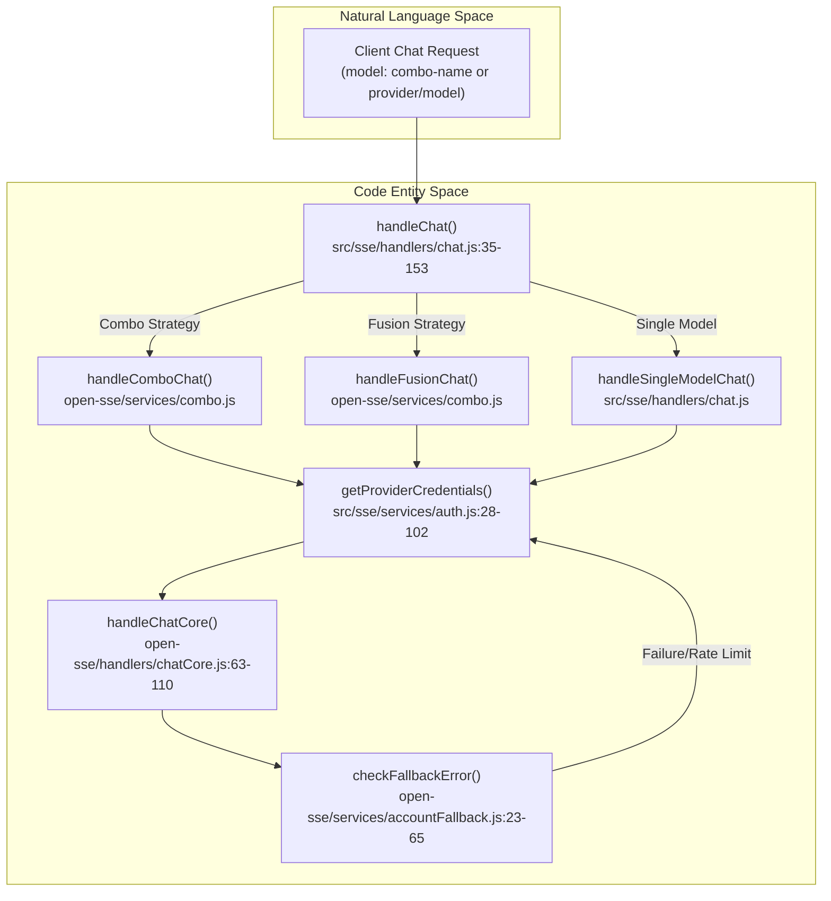
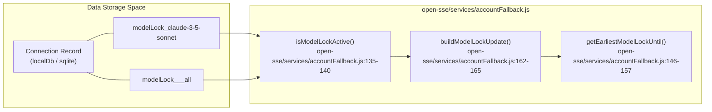
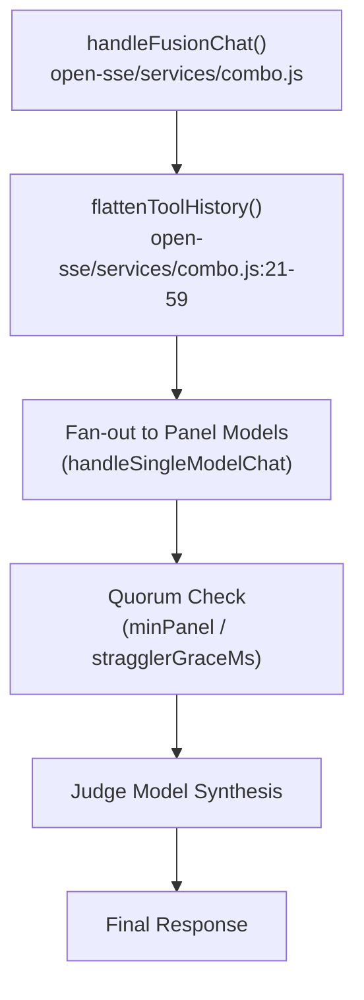

<!-- source: DeepWiki mcp.deepwiki.com · repo decolua/9router · page 3.1 Smart Router & 3-Tier Fallback · fetched 2026-10-30 -->

# Smart Router & 3-Tier Fallback

Relevant source files

The following files were used as context for generating this wiki page:

- [images/fusion-combo-ui.png](images/fusion-combo-ui.png)
- [open-sse/config/errorConfig.js](open-sse/config/errorConfig.js)
- [open-sse/handlers/chatCore.js](open-sse/handlers/chatCore.js)
- [open-sse/services/accountFallback.js](open-sse/services/accountFallback.js)
- [open-sse/services/combo.js](open-sse/services/combo.js)
- [open-sse/translator/concerns/modality.js](open-sse/translator/concerns/modality.js)
- [src/sse/handlers/chat.js](src/sse/handlers/chat.js)
- [src/sse/services/auth.js](src/sse/services/auth.js)
- [tests/unit/account-fallback-4xx.test.js](tests/unit/account-fallback-4xx.test.js)
- [tests/unit/codex-extended-context.mjs](tests/unit/codex-extended-context.mjs)
- [tests/unit/combo-fusion.test.js](tests/unit/combo-fusion.test.js)
- [tests/unit/fetch-success-clears-account.test.js](tests/unit/fetch-success-clears-account.test.js)
- [tests/unit/hermes-vision-detection.test.js](tests/unit/hermes-vision-detection.test.js)

**Purpose and Scope:** This page details 9Router's smart routing engine and tiered fallback architecture. It covers the strategy of moving from subscriptions to cheap providers to free accounts (Subscription → Cheap → Free), request routing flow through `src/sse/handlers/chat.js` and `open-sse/handlers/chatCore.js`, account selection strategies via `src/sse/services/auth.js`, per-model rate limiting via model locks, fusion execution, and error classification.

---

## 1. Overview & Tier Classification

The Smart Router automatically selects the best available AI provider account for each request, maximizing return on investment from paid subscriptions while ensuring zero downtime through intelligent fallback.

The 3-tier fallback strategy organizes providers into three priority levels:
1. **Tier 1: Subscription** — Uses paid subscriptions first (Claude Code, Codex, GitHub Copilot) to maximize monthly quotas before expiration.
2. **Tier 2: Cheap** — Falls back to low-cost pay-per-token providers (GLM, MiniMax) when subscriptions are exhausted or rate-limited.
3. **Tier 3: Free** — Acts as a final resort using unlimited or free-tier providers (`FREE_PROVIDERS` in `src/shared/constants/providers.js`) to maintain continuous execution.

| Tier | Type | Examples | Cost Structure | Key Code Entity |
| :--- | :--- | :--- | :--- | :--- |
| **Tier 1** | Subscription | Claude Code, GitHub Copilot | Fixed monthly fee | `SUBSCRIPTION` [src/sse/services/auth.js:28-74]() |
| **Tier 2** | Pay-per-token | GLM, MiniMax | Usage-based per token | `CHEAP` [src/sse/services/auth.js:28-74]() |
| **Tier 3** | Free unlimited | Kiro, OpenCode Free | Free / No Auth | `FREE_PROVIDERS` [src/sse/services/auth.js:47-72]() |

Sources: [src/sse/services/auth.js:28-74]()

---

## 2. Request Routing Architecture

The routing engine inspects incoming request models (such as combos or explicit provider-model pairs) in `src/sse/handlers/chat.js` and dispatches them through executor pipelines with automatic retry and error escalation in `open-sse/handlers/chatCore.js`.

Title: Request Routing and Fallback Flow bridging Natural Language and Code

Sources: [src/sse/handlers/chat.js:35-153](), [open-sse/handlers/chatCore.js:63-110](), [open-sse/services/accountFallback.js:23-65]()

---

## 3. Account Selection Strategies & Concurrency Control

9Router supports multiple strategies for distributing requests across accounts or models within a combo, protected by a selection mutex to avoid race conditions during account rotation.

* **Selection Mutex:** Account selection uses a promise-based `selectionMutex` in `src/sse/services/auth.js` to ensure thread-safe credential leasing across concurrent requests [src/sse/services/auth.js:9-41]().
* **Fallback Strategy (`fill-first`):** Evaluates accounts in strict priority order via `getProviderCredentials` [src/sse/services/auth.js:28-102](). Requests only move to subsequent accounts if the primary account fails or encounters rate limits.
* **Round-Robin Strategy:** Distributes load across healthy accounts using a sticky rotation mechanism governed by a `comboStickyLimit` or connection-level rotation hooks [src/sse/handlers/chat.js:134-147]().

Sources: [src/sse/services/auth.js:9-102](), [src/sse/handlers/chat.js:134-147]()

---

## 4. Model Lock Mechanism

To prevent cascading failures when a specific model hits rate limits while other models on the same account remain healthy, 9Router implements per-model rate limiting using flat `modelLock_*` fields on connection records [open-sse/services/accountFallback.js:121-140]().

Title: Model Lock Entity Association

| Function | File:Line | Description |
| :--- | :--- | :--- |
| `isModelLockActive` | [open-sse/services/accountFallback.js:135-140]() | Checks if a connection is currently locked for a specific model. |
| `getEarliestModelLockUntil` | [open-sse/services/accountFallback.js:146-157]() | Finds the earliest active lock expiry across all model fields for UI display. |
| `checkFallbackError` | [open-sse/services/accountFallback.js:23-47]() | Determines if an error response should trigger a model lock and computes duration. |
| `getQuotaCooldown` | [open-sse/services/accountFallback.js:9-13]() | Calculates exponential backoff duration for rate-limited accounts. |

Sources: [open-sse/services/accountFallback.js:9-174]()

---

## 5. Fusion Strategy & Tool Flattening

The `fusion` strategy fans out requests simultaneously to multiple panel models via `handleFusionChat` (`open-sse/services/combo.js`), synthesizing their outputs via a designated judge model.

Title: Fusion Combo Execution Flow

* **Tool Flattening:** Tool calls and results are flattened into plain text assistant prose via `flattenToolHistory` to ensure compatibility across panel models [open-sse/services/combo.js:21-59]().
* **Capability Reordering:** Models are dynamically reordered via `reorderByCapabilities` to prioritize models matching the required input modalities (vision, pdf, audio) [open-sse/services/combo.js:63-82]().
* **Quorum & Stragglers:** Proceeds as soon as the minimum quorum (`minPanel`) responds or after a `stragglerGraceMs` window expires.

Sources: [src/sse/handlers/chat.js:114-131](), [open-sse/services/combo.js:21-82]()

---

## 6. Error Classification & Fallback

The `checkFallbackError` function categorizes upstream errors to decide whether to trigger an immediate fallback, apply exponential backoff, or bubble up terminal failures [open-sse/services/accountFallback.js:23-65](). Configuration rules are defined in `open-sse/config/errorConfig.js`.

| Error Category | Indicators | Resulting Behavior |
| :--- | :--- | :--- |
| **Rate Limit** | HTTP 429 / Quota text | Triggers fallback + exponential backoff [open-sse/services/accountFallback.js:31-35]() |
| **Transient Network** | HTTP 502, 503, 504 | Retries, then falls back [open-sse/config/errorConfig.js:10-13]() |
| **Request-Scoped Error** | HTTP 400 (context overflow) | Bypasses account fallback to prevent false lockouts [open-sse/services/accountFallback.js:49-61]() |
| **Generic Error** | Unmatched status | Applies transient cooldown and rotates [open-sse/services/accountFallback.js:63-65]() |

Sources: [open-sse/services/accountFallback.js:23-65](), [open-sse/config/errorConfig.js:1-77]()

---

