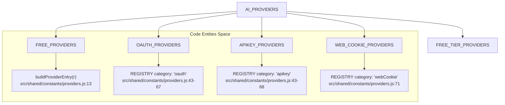
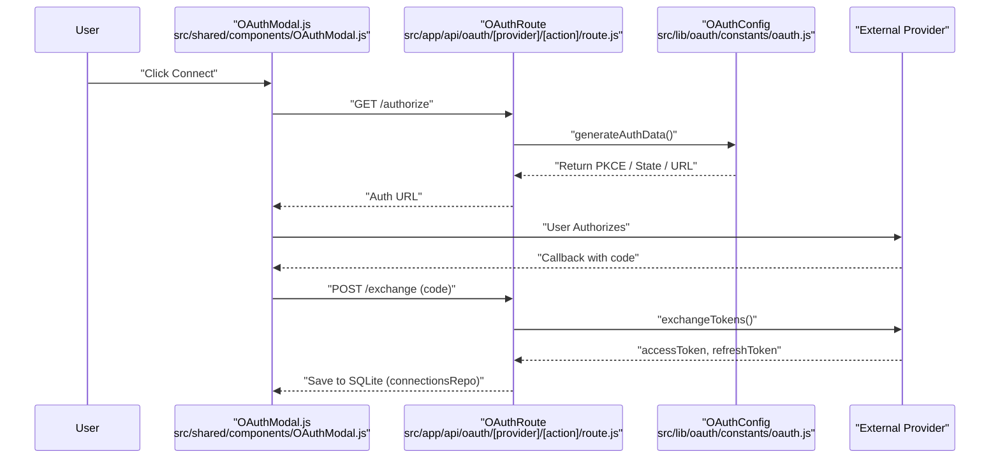
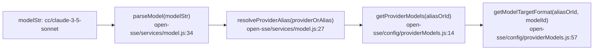

<!-- source: DeepWiki mcp.deepwiki.com · repo decolua/9router · page 3.2 Provider Types & Authentication · fetched 2026-10-30 -->

# Provider Types & Authentication

Relevant source files

The following files were used as context for generating this wiki page:

- [open-sse/config/constants.js](open-sse/config/constants.js)
- [open-sse/config/providerModels.js](open-sse/config/providerModels.js)
- [open-sse/config/providers.js](open-sse/config/providers.js)
- [open-sse/executors/index.js](open-sse/executors/index.js)
- [open-sse/providers/registry/index.js](open-sse/providers/registry/index.js)
- [open-sse/services/model.js](open-sse/services/model.js)
- [src/app/api/oauth/[provider]/[action]/route.js](src/app/api/oauth/[provider]/[action]/route.js)
- [src/app/api/providers/[id]/models/route.js](src/app/api/providers/[id]/models/route.js)
- [src/app/api/providers/[id]/test/route.js](src/app/api/providers/[id]/test/route.js)
- [src/app/api/providers/[id]/test/testUtils.js](src/app/api/providers/[id]/test/testUtils.js)
- [src/app/api/providers/validate/route.js](src/app/api/providers/validate/route.js)
- [src/lib/oauth/constants/oauth.js](src/lib/oauth/constants/oauth.js)
- [src/lib/oauth/providers.js](src/lib/oauth/providers.js)
- [src/lib/oauth/providers/index.js](src/lib/oauth/providers/index.js)
- [src/shared/components/OAuthModal.js](src/shared/components/OAuthModal.js)
- [src/shared/constants/config.js](src/shared/constants/config.js)
- [src/shared/constants/providers.js](src/shared/constants/providers.js)
- [tests/__baseline__/alias-baseline.json](tests/__baseline__/alias-baseline.json)
- [tests/__baseline__/providers-baseline.json](tests/__baseline__/providers-baseline.json)
- [tests/__baseline__/verify-alias.mjs](tests/__baseline__/verify-alias.mjs)

## Purpose and Scope

This document details the primary provider types supported in 9Router—**Free**, **OAuth**, **API Key**, and **Web Cookie**—and their respective authentication and token lifecycle mechanisms. It covers how credentials are exchanged, stored, validated, and mapped to backend executors (`open-sse/executors/index.js`) and registries (`open-sse/providers/registry/`).

For lifecycle management of credentials, see [Token Refresh & Credential Management](5.4). For routing logic, see [Smart Router & 3-Tier Fallback](3.1).

Sources: [src/shared/constants/providers.js:1-105](), [open-sse/config/providerModels.js:1-15]()

---

## Provider Type Taxonomy

9Router categorizes providers into distinct authentication classifications defined in the central provider registry and exported via `AI_PROVIDERS` [src/shared/constants/providers.js:103-104]().

### Provider Type Hierarchy

Sources: [src/shared/constants/providers.js:13-71](), [src/shared/constants/providers.js:103-104]()

### Provider Type Comparison

| Type | Authentication Method | Implementation Variable | Use Case |
|------|-----------------------|-------------------------|----------|
| **Free** | No Auth / Public Handshake | `FREE_PROVIDERS` [src/shared/constants/providers.js:47-47]() | Publicly available free models or limited tiers. |
| **Free Tier** | API Key (Free Quota) | `FREE_TIER_PROVIDERS` [src/shared/constants/providers.js:48-48]() | Commercial providers offering generous free tiers. |
| **OAuth** | OAuth 2.0 (PKCE/Device/Proxy) | `OAUTH_PROVIDERS` [src/shared/constants/providers.js:67-67]() | Subscription-based accounts (Claude Pro, Copilot, Codex, Trae). |
| **API Key** | Standard API Key | `APIKEY_PROVIDERS` [src/shared/constants/providers.js:68-68]() | Commercial paid-as-you-go providers. |
| **Web Cookie**| Browser Session Cookie | `WEB_COOKIE_PROVIDERS` [src/shared/constants/providers.js:71-71]() | Providers requiring browser session cookies (e.g., ChatGPT Web). |

Sources: [src/shared/constants/providers.js:43-71]()

---

## OAuth Providers

OAuth providers represent the subscription tier. They require an exchange handshake to obtain access and refresh tokens. 9Router implements these flows via backend route handlers (`src/app/api/oauth/[provider]/[action]/route.js`), UI modal components (`src/shared/components/OAuthModal.js`), and registry-defined configurations (`src/lib/oauth/constants/oauth.js`).

### OAuth Flow Architecture

Sources: [src/lib/oauth/constants/oauth.js:1-65](), [src/app/api/oauth/[provider]/[action]/route.js:93-137](), [src/shared/components/OAuthModal.js:86-113]()

### Supported OAuth Flavors and Configuration

1. **Authorization Code with PKCE**: Configured for providers like `claude`, `codex`, `openai`, and `xai` [src/app/api/providers/[id]/test/testUtils.js:33-173]().
2. **Standard OAuth2**: Managed via specific config objects like `GEMINI_CONFIG` and `ANTIGRAVITY_CONFIG` [src/app/api/providers/[id]/test/testUtils.js:22-29]().
3. **Device Code Flow**: Utilized by `github` and `grok-cli` [src/app/api/providers/[id]/test/testUtils.js:61-67](), [src/app/api/providers/[id]/test/testUtils.js:127-148]().
4. **Device Token / Poll**: Custom flow used by `qoder` where tokens are long-lived and expiration requires re-login [src/app/api/providers/[id]/test/testUtils.js:75-93]().
5. **Dynamic-Port Local Proxy / Import Token Flows**: Used by IDE-integrated tooling (`trae`, `windsurf`, `zed`, `xiaomi-mimo`) via specialized proxy handlers in `src/app/api/oauth/[provider]/[action]/route.js` and fallback paste-token modes [src/app/api/providers/[id]/models/route.js:1-18]().

Sources: [src/app/api/providers/[id]/test/testUtils.js:33-173](), [src/app/api/providers/[id]/models/route.js:1-18]()

---

## API Key & Free Tier Providers

API Key providers require a static key stored securely in the local connection database. These are defined under `APIKEY_PROVIDERS` and `FREE_TIER_PROVIDERS` [src/shared/constants/providers.js:48](), [src/shared/constants/providers.js:68]().

### Validation and Probing Pipeline

When a connection is created or tested, the system routes requests to `POST /api/providers/validate` [src/app/api/providers/validate/route.js:90-95]() which runs specialized probes:

- **LLM Probing**: Standard providers are validated by fetching model lists or verifying 401/403 status codes [src/app/api/providers/validate/route.js:111-125]().
- **Web Provider Probing**: `probeWebProvider` verifies `searchConfig` or `fetchConfig` for `webSearch`/`webFetch` providers [src/app/api/providers/validate/route.js:18-49]().
- **Media Provider Probing**: `probeMediaProvider` validates `tts`, `embedding`, `stt`, `image`, or `video` providers by sending a ping request to their configured base URL [src/app/api/providers/validate/route.js:53-88]().
- **Compatible Nodes**: For `isOpenAICompatibleProvider` or `isAnthropicCompatibleProvider`, the system validates against the `/models` endpoint of the provided `baseUrl` [src/app/api/providers/validate/route.js:111-125]().

Sources: [src/app/api/providers/validate/route.js:18-125](), [src/shared/constants/providers.js:87-101]()

---

## Web Cookie Providers & Free/No-Auth Providers

### Web Cookie Providers
Web Cookie providers (`WEB_COOKIE_PROVIDERS` [src/shared/constants/providers.js:71-71]()) bypass traditional API keys by injecting session cookies (e.g., browser authentication state) into proxied requests. These are managed via specialized web executors.

### Free and No-Auth Providers
Providers marked with `noAuth: true` or categorized under `FREE_PROVIDERS` [src/shared/constants/providers.js:47-47]() skip API key generation or token exchange entirely. Executors handle execution directly without credential gating [open-sse/config/providers.js:1-10]().

Sources: [src/shared/constants/providers.js:29-71](), [open-sse/config/providers.js:1-10]()

---

## Model & Alias Mapping

Authentication is tightly bound to the `PROVIDER_MODELS` registry, which maps provider aliases to their supported model IDs, target formats, and capability flags [open-sse/config/providerModels.js:1-16]().

### Model Resolution Flow

Sources: [open-sse/services/model.js:27-55](), [open-sse/config/providerModels.js:14-68]()

### Key Resolution Functions

- **`resolveProviderAlias(aliasOrId)`**: Maps short aliases (e.g., `cc` -> `claude`, `cx` -> `codex`) or full provider IDs using `ALIAS_TO_PROVIDER_ID` [open-sse/services/model.js:27-29]().
- **`parseModel(modelStr)`**: Parses strings formatted as `provider/model` or `alias/model` into structured objects containing provider, model name, and alias flags [open-sse/services/model.js:34-55]().
- **`isValidModel(aliasOrId, modelId, passthroughProviders)`**: Checks whether a model belongs to a provider's catalog, handling special version dot/dash normalization for providers like `kiro` [open-sse/config/providerModels.js:43-48]().
- **`getModelTargetFormat(aliasOrId, modelId)`**: Determines the required target translation format (e.g., `FORMATS.OPENAI_RESPONSES`) for model families [open-sse/config/providerModels.js:57-68]().

Sources: [open-sse/services/model.js:13-55](), [open-sse/config/providerModels.js:14-68]()

---

