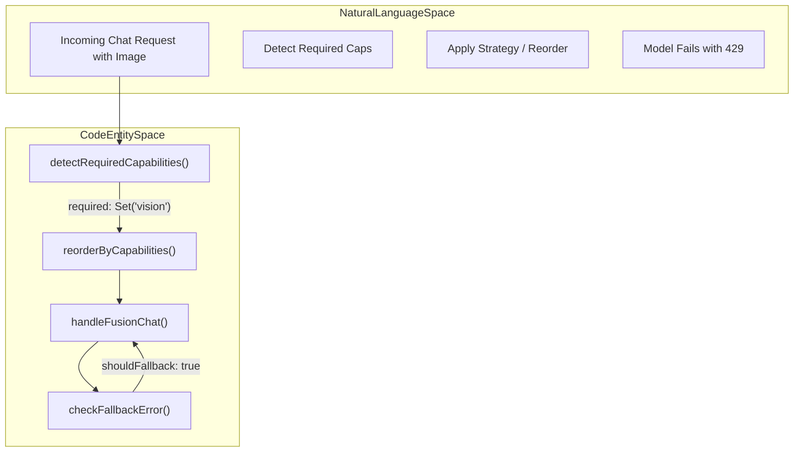
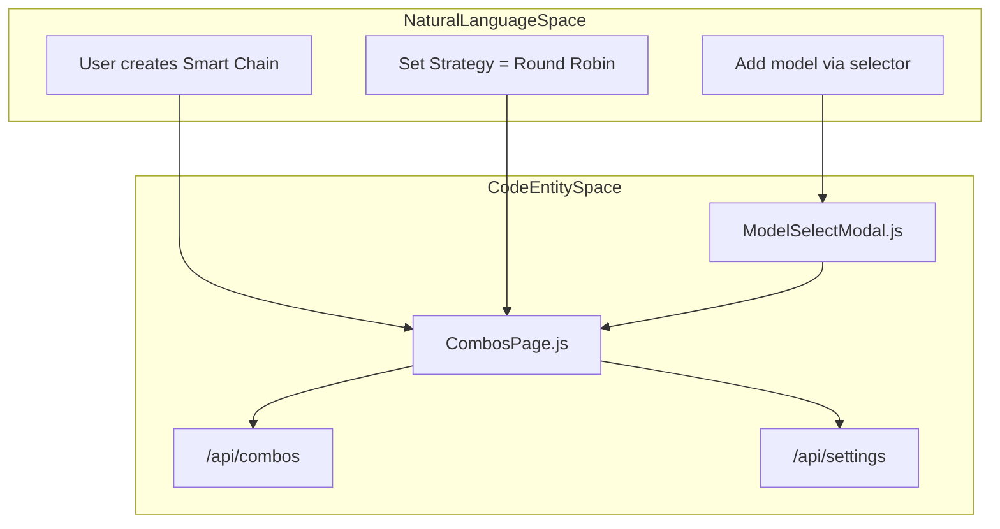

<!-- source: DeepWiki mcp.deepwiki.com · repo decolua/9router · page 3.3 Model Aliases & Combos · fetched 2026-10-30 -->

# Model Aliases & Combos

Relevant source files

The following files were used as context for generating this wiki page:

- [open-sse/handlers/geminiLiveStt.js](open-sse/handlers/geminiLiveStt.js)
- [src/app/(dashboard)/dashboard/combos/page.js](src/app/(dashboard)/dashboard/combos/page.js)
- [src/app/(dashboard)/dashboard/media-providers/combo/[id]/page.js](src/app/(dashboard)/dashboard/media-providers/combo/[id]/page.js)
- [src/app/(dashboard)/dashboard/providers/[id]/AddCustomModelModal.js](src/app/(dashboard)/dashboard/providers/[id]/AddCustomModelModal.js)
- [src/app/api/models/custom/route.js](src/app/api/models/custom/route.js)
- [src/app/api/v1/models/route.js](src/app/api/v1/models/route.js)
- [src/lib/db/repos/aliasRepo.js](src/lib/db/repos/aliasRepo.js)
- [src/lib/db/repos/nodesRepo.js](src/lib/db/repos/nodesRepo.js)
- [src/shared/components/Button.js](src/shared/components/Button.js)
- [src/shared/components/ComboFormModal.js](src/shared/components/ComboFormModal.js)
- [src/shared/components/ModelSelectModal.js](src/shared/components/ModelSelectModal.js)
- [src/shared/constants/models.js](src/shared/constants/models.js)
- [src/shared/utils/connectionStatus.js](src/shared/utils/connectionStatus.js)
- [src/shared/utils/index.js](src/shared/utils/index.js)
- [src/shared/utils/modelSearchFilter.js](src/shared/utils/modelSearchFilter.js)
- [tests/unit/model-search-filter.test.js](tests/unit/model-search-filter.test.js)
- [tests/unit/model-select-deactivated-provider.test.js](tests/unit/model-select-deactivated-provider.test.js)

This page documents 9Router's model aliasing system and combo/fusion models, which allow users to create custom model names and multi-model fallback chains. Model aliases enable simple name mappings, while combos define ordered lists of models to try sequentially with advanced strategies like round-robin rotation, capacity-aware switching, and judge-based fusion.

Sources: [src/app/api/v1/models/route.js:1-20](), [src/shared/components/ModelSelectModal.js:1-45](), [open-sse/services/combo.js:1-10]()

---

## Model Aliases

Model aliases provide custom name mappings that resolve to specific provider/model combinations. This allows users to reference models using memorable names rather than provider-specific identifiers.

**Storage & Resolution**: Model aliases are stored in the local database and accessed via `getModelAliases` [src/app/api/v1/models/route.js:8](). When a request arrives, 9Router checks if the requested model matches a defined alias. If matched, the alias value replaces the requested model name. The resolved value typically follows the `{provider}/{model}` format.

**UI Implementation**: The `ModelSelectModal` component dynamically resolves these aliases for the user interface. It groups models by provider and includes any aliases mapping to that provider's models [src/shared/components/ModelSelectModal.js:10-35](). For custom providers (OpenAI/Anthropic compatible), it specifically filters aliases starting with the provider's alias prefix. Live account catalogs are fetched via `LIVE_CATALOG_PROVIDERS` for providers like `cursor`, `cline`, `clinepass`, and `zed` [src/shared/components/ModelSelectModal.js:27-71]().

Sources: [src/app/api/v1/models/route.js:1-20](), [src/shared/components/ModelSelectModal.js:1-71]()

---

## Combo Models & Strategies

Combo models define multi-model fallback chains. Unlike simple aliases, combos contain ordered lists of models, enabling tier-based fallback strategies (e.g., trying a subscription-based model first, then falling back to a free provider).

**Storage**: Combos are stored in the `combos` collection in the local database. Each combo includes a unique ID, a name, an ordered array of model strings, and an optional `kind` field for specialized models like `webSearch`, `webFetch`, `image`, or `tts` [src/app/(dashboard)/dashboard/combos/page.js:43]() [src/lib/db/repos/settingsRepo.js:17-19]().

**Validation**: Combo names are restricted to alphanumeric characters, hyphens, underscores, and dots via `VALID_NAME_REGEX` [src/app/(dashboard)/dashboard/combos/page.js:14]().

### Combo Strategies
9Router supports several execution strategies for combos, managed through the dashboard and stored in global settings (`settingsRepo.js`) [src/lib/db/repos/settingsRepo.js:17-19]():

| Strategy | Behavior |
| :--- | :--- |
| **Fallback** | Tries models in order; moves to the next only on failure [open-sse/services/combo.js:158](). |
| **Round Robin** | Rotates starting models across requests to spread load using `comboRotationState` [open-sse/services/combo.js:84-88](). |
| **Fusion** | Queries all models in parallel; a "Judge" model synthesizes the final answer [tests/unit/combo-fusion.test.js:33-47](). |
| **Capacity auto-switch** | Reorders models based on request content (e.g., prioritizes vision for images) via `reorderByCapabilities` [open-sse/services/combo.js:63-82](). |

Sources: [src/app/(dashboard)/dashboard/combos/page.js:1-165](), [open-sse/services/combo.js:1-161](), [src/lib/db/repos/settingsRepo.js:1-25](), [tests/unit/combo-fusion.test.js:20-72]()

---

## Execution Logic & Capability-Aware Routing

The execution of a combo is handled by engine services that manage the lifecycle of requests across multiple models.

### Capability-Aware Routing
The system reorders model lists based on the request's needs using `detectRequiredCapabilities` [open-sse/services/combo.js:105-133](). It scans for modalities (`vision`, `pdf`, `audioInput`, `videoInput`) on the current user turn [open-sse/services/combo.js:94-100](). Hard capabilities like `vision` or `pdf` are prioritized via `reorderByCapabilities` to prevent request failure [open-sse/services/combo.js:12-13](), [open-sse/services/combo.js:63-82]().

### Fallback Decision Engine
The system distinguishes between errors that should trigger a fallback (e.g., 429 Rate Limit, 5xx Server Error) and those that should be returned to the client immediately, governed by `checkFallbackError` [open-sse/services/combo.js:5]().

### Natural Language to Code Entity Mapping (Execution)

Title: "Combo Execution & Capability Flow"

Sources: [open-sse/services/combo.js:63-133](), [open-sse/services/combo.js:5](), [tests/unit/combo-fusion.test.js:20-143]()

---

## Fusion Strategy

The Fusion strategy allows for high-quality synthesis by fanning out a request to multiple "Panel" models simultaneously.

**Workflow**:
1. **Parallel Execution**: The system initiates requests to all panel models defined in the combo via `handleFusionChat` [tests/unit/combo-fusion.test.js:33-47]().
2. **History Flattening**: Previous tool history and assistant `tool_calls` are flattened into prose for panel models via `flattenToolHistory` to prevent panel models from attempting tool loops [open-sse/services/combo.js:21-59](), [tests/unit/combo-fusion.test.js:145-170]().
3. **Quorum & Grace Window**: The engine respects quorum rules and a straggler grace window (`stragglerGraceMs`, `minPanel`) to avoid waiting indefinitely for slow providers [tests/unit/combo-fusion.test.js:87-113]().
4. **Synthesis**: Responses are bundled and sent to a designated `judgeModel` (or defaults to the first panel model) to produce the final answer [tests/unit/combo-fusion.test.js:61-70](), [tests/unit/combo-fusion.test.js:74-85]().

Sources: [open-sse/services/combo.js:21-82](), [tests/unit/combo-fusion.test.js:1-170]()

---

## Capacity Adapter Subsystem

The capacity adapter acts as a global fallback pool of models per input-modality capability (`vision`, `pdf`, `audioInput`, `videoInput`) configured in global settings [open-sse/services/capacityAdapter.js:1-174](), [src/lib/db/repos/settingsRepo.js:20-25]().

**Execution Flow**: When a request requires a specific modality that the target model or combo lacks, `augmentModelsWithCapacityAdapter` prepends enabled pool models as high-priority fallback candidates [open-sse/services/capacityAdapter.js:93-101](). History is dynamically trimmed using `stripHistoryForContext` to fit smaller context windows when switching models [open-sse/services/capacityAdapter.js:118-174]().

Sources: [open-sse/services/capacityAdapter.js:1-174](), [src/lib/db/repos/settingsRepo.js:20-25]()

---

## Management Interface

The dashboard provides a dedicated interface for managing aliases and combos, allowing for real-time configuration of fallback chains and strategies.

### Natural Language to Code Entity Mapping (Configuration)

Title: "Combo Management Data Flow"

Sources: [src/app/(dashboard)/dashboard/combos/page.js:1-177](), [src/shared/components/ModelSelectModal.js:71-150]()

### Management Features
The management interface allows users to:
* **Reorder**: Adjust fallback priority using drag-and-drop via `@dnd-kit` [src/app/(dashboard)/dashboard/combos/page.js:4-7]().
* **Specialized Kind Selection**: Create combos specifically for `llm`, `webSearch`, `webFetch`, `image`, or `tts`.
* **Strategy & Capacity Adapters**: Configure combo strategies and global capacity adapter fallback pools (`capacityAdapter`) [src/app/(dashboard)/dashboard/combos/page.js:79-85]().
* **Provider Filtering**: The `ModelSelectModal` filters available models by `kindFilter` and capabilities to prevent invalid configurations [src/shared/components/ModelSelectModal.js:85-93](), [src/shared/components/ModelSelectModal.js:71-84]().

Sources: [src/app/(dashboard)/dashboard/combos/page.js:1-177](), [src/shared/components/ModelSelectModal.js:71-180]()

---

