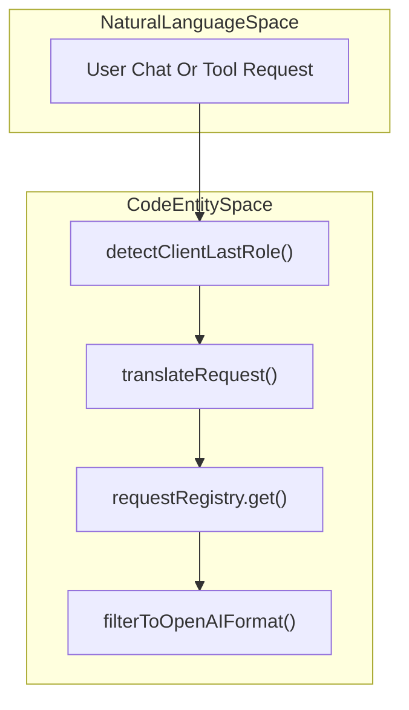
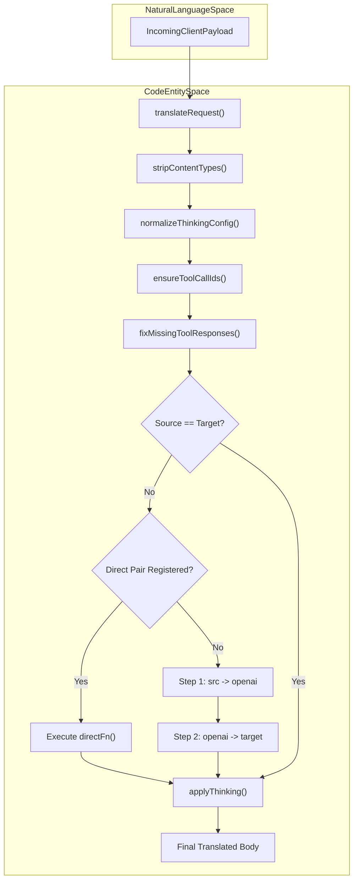
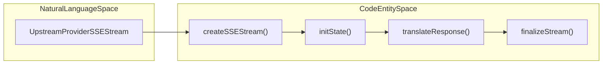

<!-- source: DeepWiki mcp.deepwiki.com · repo decolua/9router · page 3.4 Format Translation · fetched 2026-10-30 -->

# Format Translation

Relevant source files

The following files were used as context for generating this wiki page:

- [open-sse/executors/antigravity.js](open-sse/executors/antigravity.js)
- [open-sse/translator/formats/claude.js](open-sse/translator/formats/claude.js)
- [open-sse/translator/index.js](open-sse/translator/index.js)
- [open-sse/translator/request/openai-to-gemini.js](open-sse/translator/request/openai-to-gemini.js)
- [open-sse/translator/response/claude-to-openai.js](open-sse/translator/response/claude-to-openai.js)
- [open-sse/translator/response/gemini-to-openai.js](open-sse/translator/response/gemini-to-openai.js)
- [open-sse/translator/response/kiro-to-openai.js](open-sse/translator/response/kiro-to-openai.js)
- [open-sse/translator/response/ollama-to-openai.js](open-sse/translator/response/ollama-to-openai.js)
- [open-sse/translator/response/openai-responses.js](open-sse/translator/response/openai-responses.js)
- [open-sse/translator/response/openai-to-claude.js](open-sse/translator/response/openai-to-claude.js)
- [open-sse/translator/schema/blocks.js](open-sse/translator/schema/blocks.js)
- [open-sse/utils/stream.js](open-sse/utils/stream.js)
- [src/app/api/models/route.js](src/app/api/models/route.js)
- [src/shared/hooks/useModelCaps.js](src/shared/hooks/useModelCaps.js)
- [tests/unit/capabilities.test.js](tests/unit/capabilities.test.js)
- [tests/unit/claude-container-upload.test.js](tests/unit/claude-container-upload.test.js)
- [tests/unit/claude-context-management-field.test.js](tests/unit/claude-context-management-field.test.js)
- [tests/unit/claude-empty-thinking-block.test.js](tests/unit/claude-empty-thinking-block.test.js)
- [tests/unit/claude-foreign-server-tool-use.test.js](tests/unit/claude-foreign-server-tool-use.test.js)
- [tests/unit/combo-caps-resolver.test.js](tests/unit/combo-caps-resolver.test.js)
- [tests/unit/gemini-duplicate-tool-call-ids.test.js](tests/unit/gemini-duplicate-tool-call-ids.test.js)
- [tests/unit/models-route-shadow-dedupe.test.js](tests/unit/models-route-shadow-dedupe.test.js)
- [tests/unit/opencode-go-claude-haiku-55-thinking.test.js](tests/unit/opencode-go-claude-haiku-55-thinking.test.js)

## Purpose and Scope

The Format Translation System converts AI request and response payloads between different provider schemas. It enables a client using one format (e.g., OpenAI Chat Completions) to communicate with a backend provider using another (e.g., Anthropic Messages, Google Gemini, or OpenAI Responses API) transparently. The system is implemented as a runtime registry of translator functions keyed by format pairs, using OpenAI format as the universal intermediate hub for cross-format conversions.

Key components include the `FORMATS` enum [open-sse/translator/formats.js:1-16](), the `register()` function [open-sse/translator/index.js:21-31](), `requestRegistry`, `responseRegistry` [open-sse/translator/index.js:17-18](), and the primary orchestrators `translateRequest()` [open-sse/translator/index.js:68-146]() and `translateResponse()` [open-sse/translator/index.js:1-1]().

Sources: [open-sse/translator/index.js:1-31](), [open-sse/translator/formats.js:1-16]()

---

## Translator Registry & Registry Bridge

Translators are stored in two module-level `Map` instances: `requestRegistry` and `responseRegistry`. Each translator module self-registers via the `register()` function during import initialization.

Title: Translator Request Dispatch & Registry Bridge

Sources: [open-sse/translator/index.js:15-31](), [open-sse/translator/index.js:59-65]()

---

## Supported Formats

The `FORMATS` object defines the string identifiers for every supported API schema:

| Constant | String Value | Description |
|---|---|---|
| `FORMATS.OPENAI` | `"openai"` | Standard Chat Completions API. |
| `FORMATS.OPENAI_RESPONSES` | `"openai-responses"` | OpenAI Responses API (used by GitHub Codex and Claude Code). |
| `FORMATS.CLAUDE` | `"claude"` | Anthropic Messages API. |
| `FORMATS.GEMINI` | `"gemini"` | Google Gemini `generateContent` API. |
| `FORMATS.ANTIGRAVITY` | `"antigravity"` | Google-internal agent format used by Cloud Code/Antigravity. |
| `FORMATS.KIRO` | `"kiro"` | AWS EventStream binary format used by Kiro. |
| `FORMATS.COMMANDCODE` | `"commandcode"` | NDJSON-style AI SDK v5 stream events. |
| `FORMATS.CURSOR` | `"cursor"` | Protobuf/ConnectRPC format used by Cursor IDE. |

Sources: [open-sse/translator/formats.js:1-16]()

---

## The Translation Pipeline

The translation engine operates across requests and responses using structured helper transformations.

### Request Transformation (`translateRequest`)
The `translateRequest()` function transforms client payloads. If source and target formats differ, it checks for a direct registered pair or pivots through OpenAI (`sourceFormat -> openai -> targetFormat`).

Title: Request Translation Pipeline & Flow

Sources: [open-sse/translator/index.js:68-146](), [open-sse/translator/request/openai-to-claude.js:16-28]()

### Response Transformation & Stream State Management
Response translation is managed by `createSSEStream()`, which initializes format state via `initState()` and iteratively invokes `translateResponse()` on incoming Server-Sent Event chunks.

Title: Response Stream & Translator Bridge

Sources: [open-sse/utils/stream.js:44-75](), [open-sse/translator/index.js:1-1]()

---

## Format-Specific Implementation Details

### Claude (Anthropic)
- **Tool Ordering**: Ensures assistant messages place tool uses correctly and handles missing tool responses via `fixToolUseOrdering()` [open-sse/translator/formats/claude.js:116-144]().
- **Max Tokens & Caching**: Manages model output ceilings and prompt caching marker limits [open-sse/translator/formats/claude.js:73-111]().

Sources: [open-sse/translator/formats/claude.js:73-144](), [open-sse/translator/response/claude-to-openai.js:19-50]()

### OpenAI Responses API (`openai-responses`)
- **Responses to Chat**: Maps Responses API inputs (`input`, `instructions`) into chat completion message sequences, while `openaiToOpenAIResponsesResponse()` converts standard chat completion chunks into Responses API events [open-sse/translator/response/openai-responses.js:50-103]().

Sources: [open-sse/translator/response/openai-responses.js:50-103]()

### Gemini and Antigravity
- **Content Parts & Function Sanitization**: Converts OpenAI messages into Gemini `contents` arrays with safety settings, sanitizing function names (`sanitizeGeminiFunctionName`) and handling multi-turn tool call ID uniqueness via `createToolCallIdUniquifier()` [open-sse/translator/request/openai-to-gemini.js:28-74]().

Sources: [open-sse/translator/request/openai-to-gemini.js:28-129](), [open-sse/translator/response/gemini-to-openai.js:41-60]()

---

## Token and Usage Translation

Translators normalize provider-specific usage fields into standard token metrics:
- **Claude**: Merges `input_tokens` and cache metadata from `message_start` with `output_tokens` from `message_delta` [open-sse/translator/response/claude-to-openai.js:30-48]().
- **OpenAI Responses**: Extracts integer counts for input, output, cached, and reasoning tokens via `toResponsesUsage()` to ensure downstream context meters update correctly [open-sse/translator/response/openai-responses.js:27-48]().

Sources: [open-sse/translator/response/claude-to-openai.js:30-48](), [open-sse/translator/response/openai-responses.js:27-48]()

---

