<!-- source: DeepWiki mcp.deepwiki.com · repo decolua/9router · page 3.5 Account Fallback & Rate Limiting · fetched 2026-10-30 -->

# Account Fallback & Rate Limiting

<details>
<summary>Relevant source files</summary>

The following files were used as context for generating this wiki page:

- [images/fusion-combo-ui.png](images/fusion-combo-ui.png)
- [open-sse/config/errorConfig.js](open-sse/config/errorConfig.js)
- [open-sse/handlers/chatCore.js](open-sse/handlers/chatCore.js)
- [open-sse/services/accountFallback.js](open-sse/services/accountFallback.js)
- [open-sse/services/combo.js](open-sse/services/combo.js)
- [open-sse/translator/concerns/modality.js](open-sse/translator/concerns/modality.js)
- [src/sse/handlers/chat.js](src/sse/handlers/chat.js)
- [src/sse/services/auth.js](src/sse/services/auth.js)
- [tests/unit/account-fallback-4xx.test.js](tests/unit/account-fallback-4xx.test.js)
- [tests/unit/codex-extended-context.mjs](tests/unit/codex-extended-context.mjs)
- [tests/unit/combo-fusion.test.js](tests/unit/combo-fusion.test.js)
- [tests/unit/fetch-success-clears-account.test.js](tests/unit/fetch-success-clears-account.test.js)
- [tests/unit/hermes-vision-detection.test.js](tests/unit/hermes-vision-detection.test.js)

</details>


## Purpose and Scope
This page details 9Router's account fallback, rate-limiting, and error-handling systems. It covers automatic failover across provider accounts when encountering HTTP 429 rate limits, quota exhaustions, or upstream errors. The core implementation relies on model-specific account locks, exponential backoff, request-scoped versus account-scoped error differentiation, and concurrent account selection safeguarding.

Sources: `[open-sse/services/accountFallback.js:1-175]`, `[src/sse/services/auth.js:1-134]`, `[open-sse/config/errorConfig.js:1-87]`

---

## 1. Architecture Overview
The routing engine isolates failure states per model to prevent cascade failures across healthy models on the same account connection. When an upstream error occurs, `checkFallbackError()` evaluates the status and response text to determine whether an account fallback should be triggered and calculates a corresponding cooldown duration `[open-sse/services/accountFallback.js:23-47]`.

Sources: `[open-sse/services/accountFallback.js:23-47]`

---

## 2. Model Lock & Quota Storage Schema
Provider connection records maintain state flags directly within the SQLite database. Model locks and rate limits are isolated per model to ensure an account locked out of a specific model (e.g., due to a capacity limit) can still serve other models.

| Field Name | Type | Purpose / Code Reference |
| :--- | :--- | :--- |
| `modelLock_${model}` | ISO Date String | Expiry timestamp for a specific model lock on a connection `[open-sse/services/accountFallback.js:127-129]()` |
| `modelLock___all` | ISO Date String | Account-level lock covering all models `[open-sse/services/accountFallback.js:124]()` |
| `backoffLevel` | Number | Current backoff tier index used for exponential cooldown calculation `[open-sse/services/accountFallback.js:33]()` |
| `rateLimitedUntil` | ISO Date String | Legacy global account cooldown timestamp `[open-sse/services/accountFallback.js:91]()` |
| `lastError` | String | Recorded message from the last upstream failure `[src/sse/services/auth.js:134]()` |

Sources: `[open-sse/services/accountFallback.js:121-129]`, `[src/sse/services/auth.js:134]`

---

## 3. Account Selection and Filtering Flow
Account selection is coordinated by `getProviderCredentials()` in `src/sse/services/auth.js`. Concurrency is managed via `selectionMutex` to prevent race conditions when multiple requests select provider credentials simultaneously `[src/sse/services/auth.js:9-41]`.

Title: "Account Selection and Mutex Code Entity Mapping"

```mermaid
flowchart TD
    subgraph "Code Entity Space"
        A["handleChat(request)<br/>src/sse/handlers/chat.js:35"] --> B["getProviderCredentials(provider, excludeSet, model, options)<br/>src/sse/services/auth.js:28"]
        B --> C["selectionMutex<br/>src/sse/services/auth.js:10"]
        C --> D["resolveProviderId(provider)<br/>shared/constants/providers.js:5"]
        D --> E["getProviderConnections({provider, isActive: true})<br/>lib/localDb.js:1"]
        E --> F["isModelLockActive(c, model)<br/>open-sse/services/accountFallback.js:135"]
        F --> G["getAntigravityQuotaCache()<br/>sse/services/antigravityQuota.js:11"]
    end
    
    style A fill:#fff,stroke:#333,stroke-width:2px
    style B fill:#fff,stroke:#333,stroke-width:2px
    style C fill:#fff,stroke:#333,stroke-width:2px
    style D fill:#fff,stroke:#333,stroke-width:2px
    style E fill:#fff,stroke:#333,stroke-width:2px
    style F fill:#fff,stroke:#333,stroke-width:2px
    style G fill:#fff,stroke:#333,stroke-width:2px
```

Sources: `[src/sse/handlers/chat.js:35-153]`, `[src/sse/services/auth.js:9-102]`, `[open-sse/services/accountFallback.js:135-140]`

---

## 4. Error Classification Rules
Upstream errors are classified by `checkFallbackError()` using `ERROR_RULES` defined in `open-sse/config/errorConfig.js`. Rules are evaluated top-to-bottom: text-based substring matches take precedence, followed by HTTP status code matches `[open-sse/config/errorConfig.js:51-77]`.

| Error Condition | Match Type | Action | Cooldown Source |
| :--- | :--- | :--- | :--- |
| `"rate limit"` / `"too many requests"` / `"quota exceeded"` | Text Substring | Fallback | Exponential Backoff `[open-sse/config/errorConfig.js:65-67]()` |
| HTTP 429 | Status Code | Fallback | Exponential Backoff `[open-sse/config/errorConfig.js:76]()` |
| HTTP 401 / 402 / 403 / 404 | Status Code | Fallback | Long Cooldown (`COOLDOWN.long`) `[open-sse/config/errorConfig.js:72-75]()` |
| HTTP 400 (Request-Scoped) | Status Code | No Fallboard | `cooldownMs: 0` `[open-sse/services/accountFallback.js:49-61]()` |
| Unmatched Server Errors (e.g. 503) | Status Code | Fallback | `TRANSIENT_COOLDOWN_MS` (30s) `[open-sse/config/errorConfig.js:39]()` |

Sources: `[open-sse/services/accountFallback.js:23-65]`, `[open-sse/config/errorConfig.js:39-77]`

---

## 5. Exponential Backoff Implementation
When rate limits or capacity faults occur, backoff levels compound cooldown durations via `getQuotaCooldown()` `[open-sse/services/accountFallback.js:9-13]`.

```javascript
export function getQuotaCooldown(backoffLevel = 0) {
  const level = Math.max(0, backoffLevel - 1);
  const cooldown = BACKOFF_CONFIG.base * Math.pow(2, level);
  return Math.min(cooldown, BACKOFF_CONFIG.max);
}
```

Title: "Exponential Backoff State Machine Entity Mapping"
```mermaid
stateDiagram-v2
    subgraph "Code Entity Space"
        State0["checkFallbackError()<br/>open-sse/services/accountFallback.js:23"] --> State1["getQuotaCooldown(backoffLevel = 1)<br/>open-sse/services/accountFallback.js:9"]
        State1 --> State2["BACKOFF_CONFIG.base * Math.pow(2, level)<br/>open-sse/config/errorConfig.js:32"]
        State2 --> State3["buildModelLockUpdate(model, cooldownMs)<br/>open-sse/services/accountFallback.js:161"]
    end

    style State0 fill:#fff,stroke:#333,stroke-width:2px
    style State1 fill:#fff,stroke:#333,stroke-width:2px
    style State2 fill:#fff,stroke:#333,stroke-width:2px
    style State3 fill:#fff,stroke:#333,stroke-width:2px
```
Sources: `[open-sse/services/accountFallback.js:9-13]`, `[open-sse/services/accountFallback.js:161-165]`, `[open-sse/config/errorConfig.js:31-36]`

---

## 6. Request-Scoped vs. Account-Scoped Error Guarding
Client-caused 4xx errors (such as context window length overflows or malformed bodies) do not indicate credential failure. `checkFallbackError()` intercepts these codes (except 401, 402, 403, and 429) to return `shouldFallback: false` and `cooldownMs: 0`, preventing healthy connections from being removed from rotation due to invalid request payloads `[open-sse/services/accountFallback.js:49-61]`.

Sources: `[open-sse/services/accountFallback.js:49-61]`

---

## 7. Lock Management and Recovery
1. **Lock Application**: Upstream failures trigger `checkFallbackError()`, generating model-specific lock structures via `buildModelLockUpdate()` `[open-sse/services/accountFallback.js:161-165]`.
2. **Model Isolation**: Granular keys isolate failures so rate limits on one model do not block other healthy models on the same account `[open-sse/services/accountFallback.js:127-140]`.
3. **Clearing Locks**: Successful requests clear account errors and stale locks via `buildClearModelLocksUpdate()` or `clearAccountError()` `[open-sse/services/accountFallback.js:168-175]`, `[tests/unit/fetch-success-clears-account.test.js:74-96]`.

Sources: `[open-sse/services/accountFallback.js:127-175]`, `[tests/unit/fetch-success-clears-account.test.js:74-96]`

---

