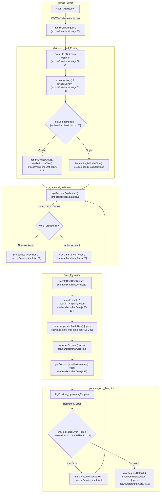
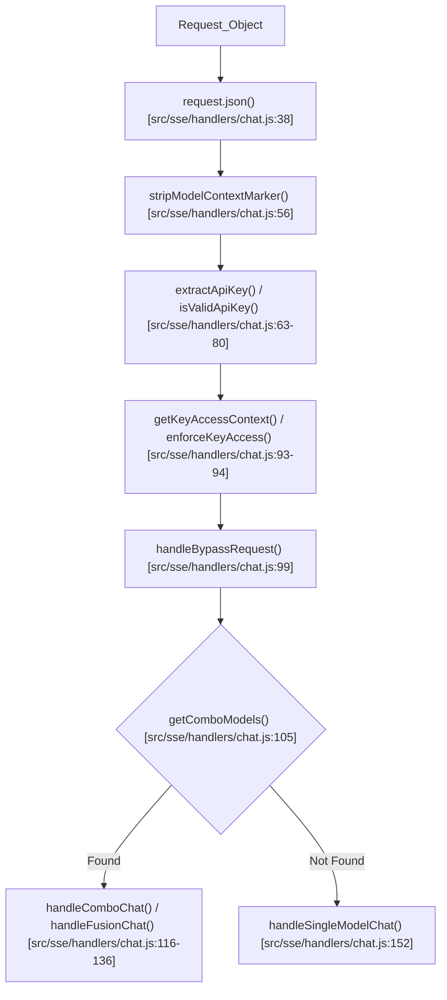
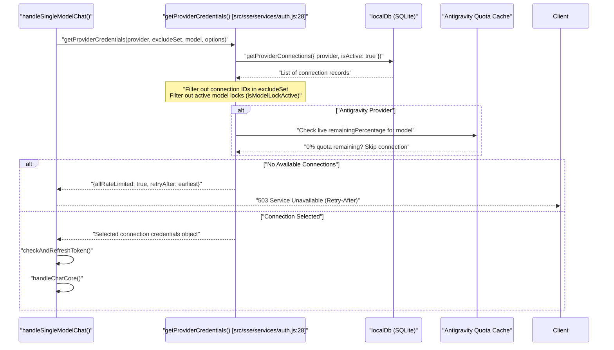
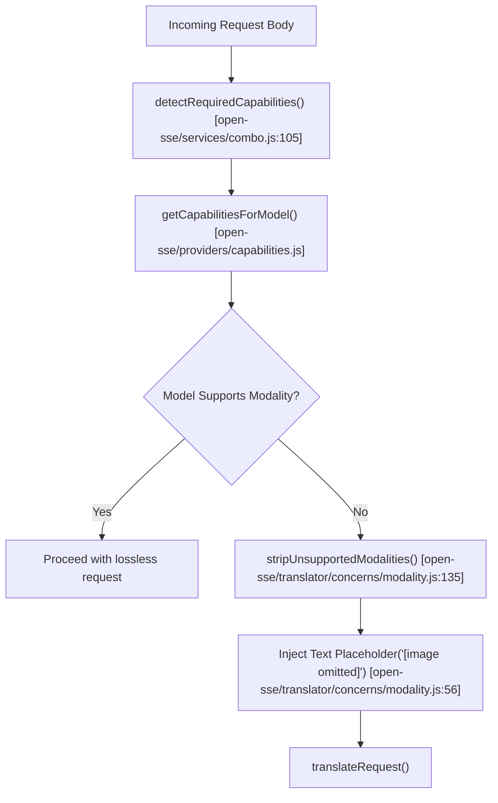
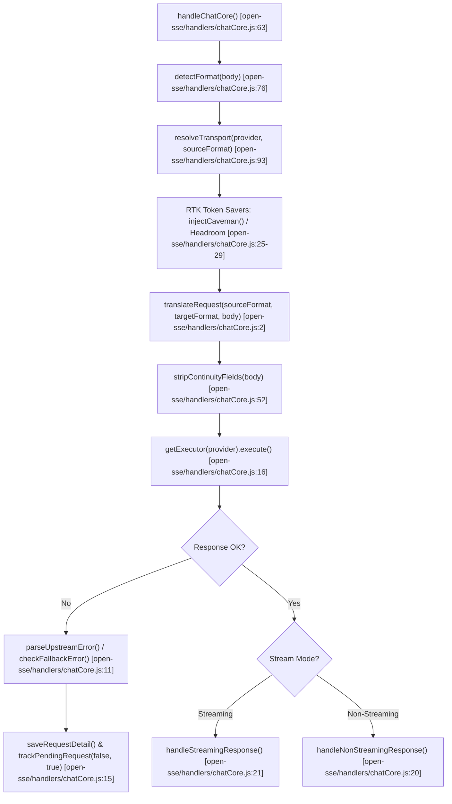
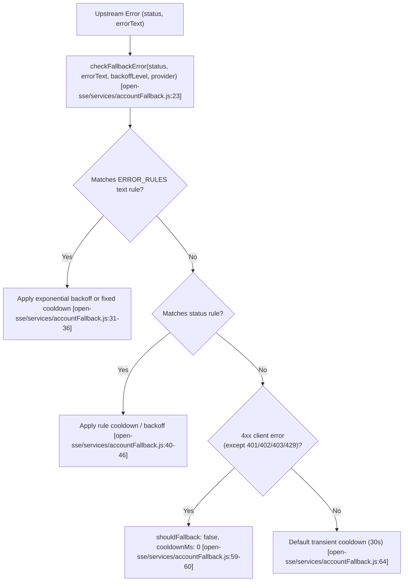

<!-- source: DeepWiki mcp.deepwiki.com · repo decolua/9router · page 4.1 Chat Request Flow · fetched 2026-10-30 -->

# Chat Request Flow

Relevant source files

The following files were used as context for generating this wiki page:

- [images/fusion-combo-ui.png](images/fusion-combo-ui.png)
- [open-sse/handlers/chatCore.js](open-sse/handlers/chatCore.js)
- [open-sse/services/combo.js](open-sse/services/combo.js)
- [open-sse/translator/concerns/modality.js](open-sse/translator/concerns/modality.js)
- [src/app/api/provider-nodes/[id]/route.js](src/app/api/provider-nodes/[id]/route.js)
- [src/app/api/provider-nodes/route.js](src/app/api/provider-nodes/route.js)
- [src/app/api/provider-nodes/validate/route.js](src/app/api/provider-nodes/validate/route.js)
- [src/sse/handlers/chat.js](src/sse/handlers/chat.js)
- [src/sse/services/auth.js](src/sse/services/auth.js)
- [src/sse/services/model.js](src/sse/services/model.js)
- [tests/unit/combo-fusion.test.js](tests/unit/combo-fusion.test.js)
- [tests/unit/fetch-success-clears-account.test.js](tests/unit/fetch-success-clears-account.test.js)
- [tests/unit/hermes-vision-detection.test.js](tests/unit/hermes-vision-detection.test.js)
- [tests/unit/model-routing.test.js](tests/unit/model-routing.test.js)
- [tests/unit/provider-validation.test.js](tests/unit/provider-validation.test.js)

## Purpose and Scope

This page documents the complete lifecycle of a chat completion request through 9Router, tracking execution from initial ingress via API routes or MITM proxy handlers, through API key validation, model resolution, combo routing, modality capability adaptation, account credential selection, core chat execution, format translation, token-saver injection, upstream dispatch, and error fallback handling.

For related details, see:
- Format translation mechanics: [4.3. Format Translation Pipeline]()
- Streaming response processing: [4.2. Streaming & SSE Processing]()
- Usage metrics collection: [4.4. Usage Tracking & Analytics]()
- Account lock behavior: [3.5. Account Fallback & Rate Limiting]()
- Provider-specific execution: [5.3. Provider Executors]()

---

## Request Entry Points

Chat requests enter the system through standard API completion endpoints or intercepted tool traffic, converging on the unified `handleChat()` function.

| Entry Point | Path / Source | Handler Function | Code Reference |
|-------------|---------------|------------------|----------------|
| **Direct API** | `/v1/chat/completions`, `/v1/messages`, `/v1/responses` | `handleChat()` | [src/sse/handlers/chat.js:35-38]() |
| **MITM Proxy** | Intercepted tool traffic | `handleChat()` via proxy | [src/sse/handlers/chat.js:35-38]() |

Sources: [src/sse/handlers/chat.js:35-38]()

---

## High-Level Request Flow & Code Entity Mapping

The diagram below maps the conceptual execution path of a chat request to the concrete code entities (`src/sse/handlers/chat.js`, `src/sse/services/auth.js`, `open-sse/handlers/chatCore.js`) responsible for processing.

### Architecture-to-Code Mapping Diagram

Sources: [src/sse/handlers/chat.js:35-152](), [src/sse/services/auth.js:28-130](), [open-sse/handlers/chatCore.js:2-104](), [open-sse/translator/concerns/modality.js:135]()

---

## Request Ingress & Validation: `handleChat()`

The ingress function `handleChat()` parses incoming JSON, strips context markers (such as Claude Code's `[1m]` context tags) [src/sse/handlers/chat.js:56](), evaluates API key authorization if `requireApiKey` is enabled [src/sse/handlers/chat.js:73-83](), and inspects per-key access rules [src/sse/handlers/chat.js:93-94]().

Sources: [src/sse/handlers/chat.js:35-152]()

---

## Model Resolution & Account Fallback Selection

When executing single-model requests or iterating through combo fallback members, `getProviderCredentials()` queries the SQLite database [src/sse/services/auth.js:74](), filtering out model-locked accounts, excluded connection IDs, and live rate-limited credentials [src/sse/services/auth.js:87-103]().

### Account Selection Sequence

Sources: [src/sse/services/auth.js:28-140](), [src/sse/services/antigravityQuota.js:72-150]()

---

## Modality Adaptation & Capability Guard

Before translation, 9Router analyzes request requirements (`detectRequiredCapabilities`) [open-sse/services/combo.js:105]() and adjusts modal blocks via `stripUnsupportedModalities()` when a target model lacks support for vision, PDF documents, or audio input [open-sse/translator/concerns/modality.js:135]().

Sources: [open-sse/services/combo.js:105-149](), [open-sse/translator/concerns/modality.js:1-168]()

---

## Core Chat Execution: `handleChatCore()`

Once credentials and capabilities are resolved, execution reaches `handleChatCore()`, which manages format detection, transport resolution [open-sse/handlers/chatCore.js:76-104](), token-saver middleware (RTK, Headroom, Caveman, Ponytail, PXPipe) [open-sse/handlers/chatCore.js:25-29](), and executor dispatch [open-sse/handlers/chatCore.js:16]().

### Execution Pipeline

Sources: [open-sse/handlers/chatCore.js:1-110]()

---

## Error Classification & Account Fallback Mechanics

When upstream errors occur, `checkFallbackError()` evaluates response status codes and error bodies against provider rules to determine whether to trigger immediate account rotation or return a terminal error response.

Sources: [open-sse/services/accountFallback.js:23-65](), [open-sse/config/errorConfig.js:59-77]()

---

