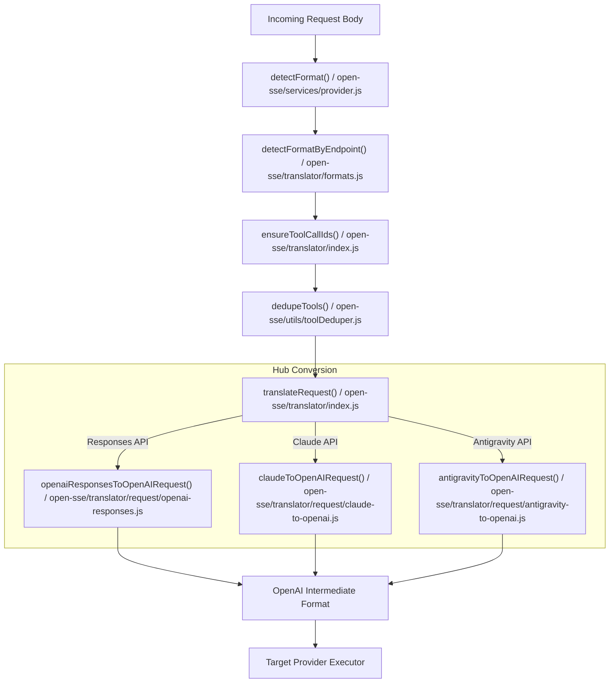
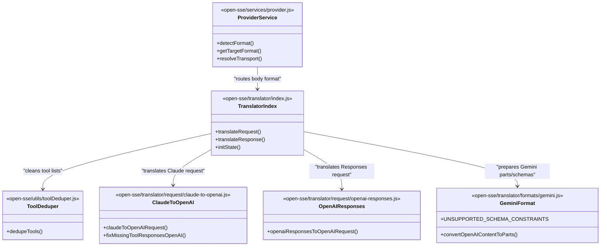

<!-- source: DeepWiki mcp.deepwiki.com · repo decolua/9router · page 4.3 Format Translation Pipeline · fetched 2026-10-30 -->

# Format Translation Pipeline

Relevant source files

The following files were used as context for generating this wiki page:

- [open-sse/services/provider.js](open-sse/services/provider.js)
- [open-sse/shared/clineAuth.js](open-sse/shared/clineAuth.js)
- [open-sse/shared/machineId.js](open-sse/shared/machineId.js)
- [open-sse/translator/formats.js](open-sse/translator/formats.js)
- [open-sse/translator/formats/gemini.js](open-sse/translator/formats/gemini.js)
- [open-sse/translator/request/antigravity-to-openai.js](open-sse/translator/request/antigravity-to-openai.js)
- [open-sse/translator/request/claude-to-openai.js](open-sse/translator/request/claude-to-openai.js)
- [open-sse/translator/request/gemini-to-openai.js](open-sse/translator/request/gemini-to-openai.js)
- [open-sse/translator/request/openai-responses.js](open-sse/translator/request/openai-responses.js)
- [open-sse/utils/toolDeduper.js](open-sse/utils/toolDeduper.js)
- [src/shared/utils/clineAuth.js](src/shared/utils/clineAuth.js)
- [tests/translator/bugs-antigravity.test.js](tests/translator/bugs-antigravity.test.js)
- [tests/translator/bugs-codexCli-responses.test.js](tests/translator/bugs-codexCli-responses.test.js)
- [tests/translator/real/deepseek-official-responses.real.test.js](tests/translator/real/deepseek-official-responses.real.test.js)
- [tests/translator/real/opencode-go-deepseek.real.test.js](tests/translator/real/opencode-go-deepseek.real.test.js)
- [tests/translator/real/opencode-go-thinking-passthrough.real.test.js](tests/translator/real/opencode-go-thinking-passthrough.real.test.js)
- [tests/translator/real/opencode-go-thinking-placeholder.real.test.js](tests/translator/real/opencode-go-thinking-placeholder.real.test.js)
- [tests/translator/real/opencode-go-tool-session.real.test.js](tests/translator/real/opencode-go-tool-session.real.test.js)
- [tests/translator/real/opencode-zen-free-responses.real.test.js](tests/translator/real/opencode-zen-free-responses.real.test.js)
- [tests/unit/claude-cache-budget-single-object.test.js](tests/unit/claude-cache-budget-single-object.test.js)
- [tests/unit/cline-auth.test.js](tests/unit/cline-auth.test.js)
- [tests/unit/gemini-contents-normalization.test.js](tests/unit/gemini-contents-normalization.test.js)
- [tests/unit/gemini-unknown-schema-fields.test.js](tests/unit/gemini-unknown-schema-fields.test.js)
- [tests/unit/opencode-go-deepseek-thinking-injection.test.js](tests/unit/opencode-go-deepseek-thinking-injection.test.js)
- [tests/unit/tool-deduper.test.js](tests/unit/tool-deduper.test.js)

The Format Translation Pipeline is the core engine that enables 9Router to act as a universal bridge between disparate AI provider APIs. It handles the structural conversion of request bodies, streaming response chunks, and stateful metadata (like token usage and tool calls) between formats such as OpenAI, Anthropic Claude, Google Gemini, and specialized formats like Kiro (AWS CodeWhisperer), Antigravity, and OpenAI Responses.

Sources: [open-sse/translator/index.js:1-103](), [open-sse/services/provider.js:34-111]()

---

## Purpose and Architecture

9Router utilizes a **hub-and-spoke model** for translation. To avoid the complexity of $N \times M$ translators, the system uses **OpenAI Chat Completions** as the common intermediate format. Any source format is first detected via `detectFormat()` [open-sse/services/provider.js:34-111](), converted to OpenAI, and then translated from OpenAI to the target provider format [open-sse/translator/index.js:86-103]().

Direct Routes (e.g., `claude:kiro`) are also supported to bypass the "double-hop" through OpenAI when a lossless direct mapping exists [open-sse/translator/index.js:82-84]().

### Format Identifiers (`FORMATS`)

| Key | String Value | Description |
|:---|:---|:---|
| `OPENAI` | `"openai"` | Standard Chat Completions (the "Hub" format) [open-sse/translator/formats.js:3]() |
| `OPENAI_RESPONSES` | `"openai-responses"` | OpenAI Responses API used by Cursor/Droid [open-sse/translator/formats.js:4]() |
| `CLAUDE` | `"claude"` | Anthropic Messages API [open-sse/translator/formats.js:6]() |
| `GEMINI` | `"gemini"` | Google Gemini `generateContent` API [open-sse/translator/formats.js:7]() |
| `ANTIGRAVITY` | `"antigravity"` | Google Cloud Code / Antigravity internal API [open-sse/translator/formats.js:11]() |
| `KIRO` | `"kiro"` | AWS CodeWhisperer / Kiro format [open-sse/translator/formats.js:12]() |
| `COMMANDCODE` | `"commandcode"` | CommandCode internal AI SDK v5 format [open-sse/translator/formats.js:15]() |
| `OLLAMA` | `"ollama"` | Ollama local LLM API [open-sse/translator/formats.js:16]() |

Sources: [open-sse/translator/formats.js:1-16](), [open-sse/translator/index.js:86-103](), [open-sse/services/provider.js:34-111]()

---

## Request Translation Flow

The `translateRequest` function orchestrates the transformation of an incoming request body before it is dispatched by a Provider Executor [open-sse/translator/index.js:52]().

### Translation Stages

1.  **Format Detection**: `detectFormat(body)` inspects keys like `input`, `contents`, `request`, or OpenAI-specific fields (`stream_options`, `response_format`) to classify the incoming payload [open-sse/services/provider.js:34-111](). Endpoint overrides are handled by `detectFormatByEndpoint()` [open-sse/translator/formats.js:22-35]().
2.  **Normalization & Tool Deduplication**: Universal fixes like `ensureToolCallIds` [open-sse/translator/index.js:63]() are applied, alongside `dedupeTools()` which filters out duplicate MCP tools for Claude clients or exact same-name tool collisions for DeepSeek upstream compatibility [open-sse/utils/toolDeduper.js:46-80]().
3.  **Source to OpenAI**: If the source is not OpenAI, a registered request translator (e.g., `openaiResponsesToOpenAIRequest` [open-sse/translator/request/openai-responses.js:22](), `claudeToOpenAIRequest` [open-sse/translator/request/claude-to-openai.js:14](), or `antigravityToOpenAIRequest` [open-sse/translator/request/antigravity-to-openai.js:11]()) converts the payload into the hub format.
4.  **OpenAI to Target**: Converts the intermediate OpenAI format into the target provider's native schema.
5.  **Thinking Application & Parameter Stripping**: Maps thinking configuration via `applyThinking` [open-sse/translator/concerns/thinkingUnified.js:13]() and strips unsupported parameters via `stripUnsupportedParams` [open-sse/translator/concerns/paramSupport.js:8-24]().

### Request Translation Data Flow (Natural Language to Code Entity Space)

Title: "Request Translation Pipeline Flow"

Sources: [open-sse/services/provider.js:34-111](), [open-sse/translator/formats.js:22-35](), [open-sse/utils/toolDeduper.js:46-80](), [open-sse/translator/request/openai-responses.js:22](), [open-sse/translator/request/claude-to-openai.js:14](), [open-sse/translator/request/antigravity-to-openai.js:11]()

---

## Response Translation & State Management

Response translation is **stateful**, tracking tool call arguments, token accumulation, and reasoning blocks across streaming chunks [open-sse/translator/index.js:149-194]().

### The `State` Object

The translation `State` object tracks execution context across SSE iterations:
*   `toolCalls`: A `Map` storing partial tool arguments and metadata [open-sse/translator/response/openai-to-claude.js:193]()
*   `usage`: Accumulates token counts normalized to OpenAI format [open-sse/translator/response/openai-to-claude.js:79-110]()
*   `inThinkingBlock`: Tracks active reasoning output [open-sse/translator/response/claude-to-openai.js:63]()
*   `toolNameMap`: Mapping used to decloak tool names in responses [open-sse/translator/response/gemini-to-openai.js:19]()

### Specialized Response Handling

-   **Claude to OpenAI**: Merges `message_start` usage with `message_delta` usage and maps `content_block_start` / `content_block_delta` blocks [open-sse/translator/response/claude-to-openai.js:53-148]().
-   **Kiro (AWS)**: Processes `assistantResponseEvent`, `reasoningContentEvent`, and `toolUseEvent` [open-sse/translator/response/kiro-to-openai.js:94-152]().
-   **Gemini**: Maps `thoughtSignature` and `thought: true` response parts to OpenAI `reasoning_content` [open-sse/translator/response/gemini-to-openai.js:59-91]().
-   **OpenAI Responses**: Transforms Chat Completion chunks into `response.output_item.added` and `response.output_text.delta` events [open-sse/translator/response/openai-responses.js:17-119]().

Sources: [open-sse/translator/response/openai-to-claude.js:71-200](), [open-sse/translator/response/claude-to-openai.js:53-148](), [open-sse/translator/response/kiro-to-openai.js:94-152](), [open-sse/translator/response/gemini-to-openai.js:59-91](), [open-sse/translator/response/openai-responses.js:17-119]()

---

## Provider-Specific Adaptations

### Claude (Anthropic) Adaptation
-   **Missing Tool Responses**: `fixMissingToolResponsesOpenAI` scans message lists and injects `[No response received]` for unresponded tool calls [open-sse/translator/request/claude-to-openai.js:97-130]().
-   **Billing Header Stripping**: `stripAnthropicBillingHeader` removes metering metadata from system instructions [open-sse/translator/request/claude-to-openai.js:8-11]().

### Gemini Adaptation
-   **Schema Cleaning**: `UNSUPPORTED_SCHEMA_CONSTRAINTS` defines schema keywords (including non-standard annotation keys like `errorMessage`, `errorMessages`, `markdownDescription`, `minProperties`, and `maxProperties` per `#4283`) that are recursively scrubbed from tool schemas to prevent Gemini upstream validation errors [open-sse/translator/formats/gemini.js:7-44]().
-   **Content Conversion**: `convertOpenAIContentToParts` maps text, base64 images, audio payloads, and file blobs into Gemini `parts` [open-sse/translator/formats/gemini.js:55-110]().

### OpenAI Responses Adaptation
-   **Instruction Mapping**: Converts Responses API `instructions` fields into standard system messages [open-sse/translator/request/openai-responses.js:28-31]().
-   **Reasoning Buffering**: Buffers reasoning elements (`summary[].text`) and attaches them to assistant turns [open-sse/translator/request/openai-responses.js:45-62]().

Sources: [open-sse/translator/request/claude-to-openai.js:8-130](), [open-sse/translator/formats/gemini.js:7-110](), [open-sse/translator/request/openai-responses.js:28-62]()

---

## Code Entity Mapping

Title: "Translation System Architecture and Modules"

Sources: [open-sse/services/provider.js:34-153](), [open-sse/translator/index.js:52-194](), [open-sse/utils/toolDeduper.js:46-80](), [open-sse/translator/formats/gemini.js:7-110](), [open-sse/translator/request/claude-to-openai.js:14-130](), [open-sse/translator/request/openai-responses.js:22-164]()

---

