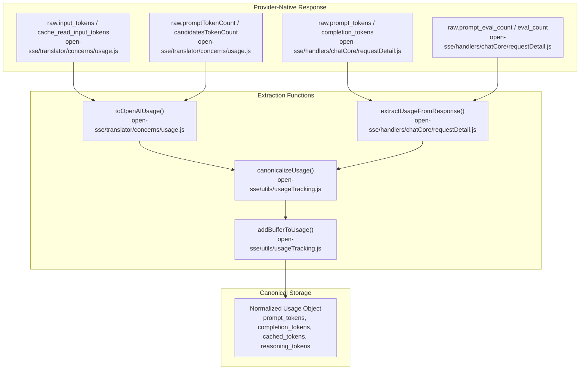
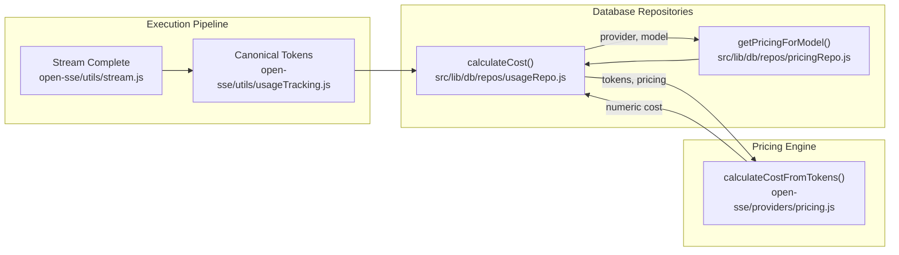

<!-- source: DeepWiki mcp.deepwiki.com · repo decolua/9router · page 4.4 Usage Tracking & Analytics · fetched 2026-10-30 -->

# Usage Tracking & Analytics

Relevant source files

The following files were used as context for generating this wiki page:

- [open-sse/handlers/chatCore/requestDetail.js](open-sse/handlers/chatCore/requestDetail.js)
- [open-sse/translator/concerns/usage.js](open-sse/translator/concerns/usage.js)
- [open-sse/utils/usageTracking.js](open-sse/utils/usageTracking.js)
- [src/app/(dashboard)/dashboard/usage/components/RequestDetailsTab.js](src/app/(dashboard)/dashboard/usage/components/RequestDetailsTab.js)
- [src/app/api/usage/providers/route.js](src/app/api/usage/providers/route.js)
- [src/app/api/usage/request-details/route.js](src/app/api/usage/request-details/route.js)
- [src/lib/requestDetailsDb.js](src/lib/requestDetailsDb.js)
- [src/shared/components/Pagination.js](src/shared/components/Pagination.js)
- [tests/unit/antigravity-nonstream-usage-3260.test.js](tests/unit/antigravity-nonstream-usage-3260.test.js)
- [tests/unit/cached-token-usage.test.js](tests/unit/cached-token-usage.test.js)
- [tests/unit/extract-usage-cache-shapes.test.js](tests/unit/extract-usage-cache-shapes.test.js)
- [tests/unit/usage-concern.test.js](tests/unit/usage-concern.test.js)

This page documents 9Router's comprehensive usage tracking and analytics system, which monitors token consumption, calculates exact costs, logs detailed request execution metadata across all upstream AI providers, and buffers token counts against context limits. The system maintains persistent SQLite-backed stores for usage history, chronological activity logs, and full request-response payloads, while streaming real-time statistics to the management dashboard via Server-Sent Events (SSE).

For related information regarding request/response body interception and observability, see **7.4 Request Details & Observability**. For the web dashboard UI that consumes these analytics endpoints, see **8.5 Usage Statistics & Monitoring**.

---

## 1. Token Extraction & Normalization

When completions or chat streams finish executing, 9Router normalizes provider-native token metrics into a unified canonical structure via `extractUsageFromResponse` [open-sse/handlers/chatCore/requestDetail.js:24-80]() and `toOpenAIUsage` [open-sse/translator/concerns/usage.js:69-73]().

### Token Extraction & Canonicalization Pipeline

**Sources:**
- [open-sse/handlers/chatCore/requestDetail.js:24-80]()
- [open-sse/translator/concerns/usage.js:20-73]()
- [open-sse/utils/usageTracking.js:33-57]()
- [open-sse/utils/usageTracking.js:164-183]()

### Canonicalization and Buffer Mechanics

Because upstream providers handle cache token counts differently (e.g., Anthropic reports prompt tokens exclusive of cache reads, whereas OpenAI and Gemini report prompt tokens cache-inclusive), 9Router enforces a single storage convention via `canonicalizeUsage` [open-sse/utils/usageTracking.js:164-183]():

- **Cache-Inclusive Prompt**: `prompt_tokens` represents the total input tokens, including any cache read and cache write components [open-sse/utils/usageTracking.js:148-154]().
- **Cache Subsets**: `cached_tokens` and `cache_creation_input_tokens` are stored as subsets of `prompt_tokens` [open-sse/utils/usageTracking.js:148-154]().
- **Claude Folding**: For Claude models where `input_tokens` excludes cache reads, `cache_read_input_tokens` and `cache_creation_input_tokens` are folded into the aggregate `prompt_tokens` count during canonicalization [open-sse/utils/usageTracking.js:179-195]().
- **Context Buffering**: `addBufferToUsage` optionally appends safety margin buffer tokens (`BUFFER_TOKENS = 2000`) to prevent context window truncation errors [open-sse/utils/usageTracking.js:20-57]().

**Sources:**
- [open-sse/utils/usageTracking.js:20-183]()
- [open-sse/handlers/chatCore/requestDetail.js:33-51]()

---

## 2. Cost Calculation

Once token counts are canonicalized, 9Router evaluates the financial cost of the request against the provider pricing catalog using `calculateCostFromTokens` [tests/unit/cached-token-usage.test.js:105-133]().

### Cost Calculation Data Flow

**Sources:**
- [src/lib/db/repos/usageRepo.js:135-151]()
- [open-sse/providers/pricing.js:1-57]()
- [tests/unit/cached-token-usage.test.js:105-133]()

---

## 3. Request Detail Logging & Persistence Architecture

Data is persisted through repositories located in `src/lib/db/repos/usageRepo.js` and exposed via the shim at `src/lib/usageDb.js` [src/lib/usageDb.js:1-7](). Request logging handles end-to-end telemetry capture, including latency breakdowns (`ttft`, `total`), request configuration parameters, and payloads.

### Core Storage Functions

| Function Name | Code Location | Description |
| :--- | :--- | :--- |
| `saveRequestUsage` | `src/lib/db/repos/usageRepo.js` | Persists aggregated token counts and calculated costs into the `usageHistory` SQLite table [src/lib/db/repos/usageRepo.js:125-132]() |
| `appendRequestLog` | `src/lib/db/repos/usageRepo.js` | Appends chronological request events to the ring buffer and persistent log store [src/lib/db/repos/usageRepo.js:101-106]() |
| `saveRequestDetail` | `src/lib/db/repos/usageRepo.js` | Stores full request and response payloads, latency, and status in request details storage [src/lib/db/repos/usageRepo.js:64-98]() |
| `trackPendingRequest` | `src/lib/db/repos/usageRepo.js` | Maintains in-flight request counters by model and account connection [src/lib/db/repos/usageRepo.js:152-174]() |

### API Routes & Payload Redaction

Request details are exposed via `/api/usage/request-details` [src/app/api/usage/request-details/route.js:8-74]() and `/api/usage/providers` [src/app/api/usage/providers/route.js:10-41](). To protect sensitive user conversation content, the API redacts message prompts and response payloads while preserving performance telemetry and token metrics [src/app/api/usage/request-details/route.js:56-64]().

**Sources:**
- [src/lib/usageDb.js:1-7]()
- [src/lib/db/repos/usageRepo.js:64-174]()
- [src/app/api/usage/request-details/route.js:8-74]()
- [src/app/api/usage/providers/route.js:10-41]()

---

## 4. Dashboard Analytics & Integration

The web dashboard renders usage statistics, historical charts, and granular request audit logs using dedicated React components and pagination controls.

### Overview and UI Components

- **Overview Cards**: Renders aggregate metrics including Total Requests, Input Tokens, Cached Tokens, Output Tokens, and Estimated Cost [src/app/(dashboard)/dashboard/usage/components/OverviewCards.js:9-35]().
- **Request Details Drawer & Table**: `RequestDetailsTab.js` provides searchable, filterable logs of historical requests by provider, status, and date range, backed by the `Pagination` component [src/app/(dashboard)/dashboard/usage/components/RequestDetailsTab.js:102-181]() [src/shared/components/Pagination.js:6-37]().
- **Time-Series Charts**: Queries time-series data via `/api/usage/chart` [src/app/api/usage/chart/route.js:1-21]() to plot usage across selectable periods (`today`, `24h`, `7d`, `30d`, `60d`, `all`) [src/app/api/usage/chart/route.js:4-15]().
- **Real-Time Stream**: `statsEmitter` broadcasts updates whenever requests complete or pending status changes, driving live UI counters [src/lib/db/repos/usageRepo.js:21-47]().

**Sources:**
- [src/shared/components/UsageStats.js:1-147]()
- [src/app/(dashboard)/dashboard/usage/components/OverviewCards.js:1-39]()
- [src/app/(dashboard)/dashboard/usage/components/RequestDetailsTab.js:102-181]()
- [src/shared/components/Pagination.js:6-37]()
- [src/app/api/usage/chart/route.js:1-21]()

---

