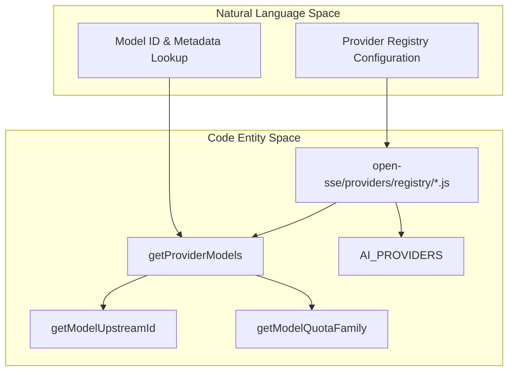
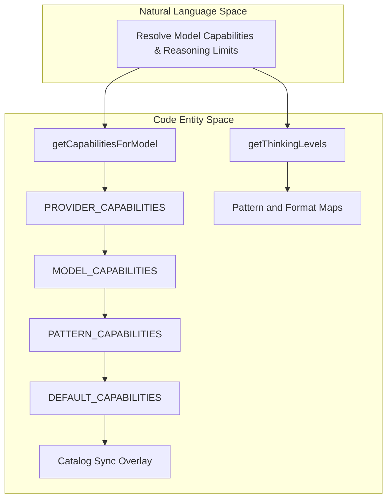

<!-- source: DeepWiki mcp.deepwiki.com · repo decolua/9router · page 5.2 Provider Models & Pricing · fetched 2026-10-30 -->

# Provider Models & Pricing

Relevant source files

The following files were used as context for generating this wiki page:

- [gitbook/content/en/providers/subscription.md](gitbook/content/en/providers/subscription.md)
- [open-sse/executors/codex.js](open-sse/executors/codex.js)
- [open-sse/handlers/imageProviders/codex.js](open-sse/handlers/imageProviders/codex.js)
- [open-sse/providers/catalogOverride.js](open-sse/providers/catalogOverride.js)
- [open-sse/providers/pricing.js](open-sse/providers/pricing.js)
- [open-sse/providers/registry/codex.js](open-sse/providers/registry/codex.js)
- [open-sse/providers/visionPatterns.js](open-sse/providers/visionPatterns.js)
- [src/app/(dashboard)/dashboard/console-log/ConsoleLogClient.js](src/app/(dashboard)/dashboard/console-log/ConsoleLogClient.js)
- [src/app/api/models/catalog-sync/route.js](src/app/api/models/catalog-sync/route.js)
- [src/app/api/translator/console-logs/stream/route.js](src/app/api/translator/console-logs/stream/route.js)
- [src/instrumentation.js](src/instrumentation.js)
- [src/lib/consoleLogBuffer.js](src/lib/consoleLogBuffer.js)
- [src/lib/modelCatalog/sync.js](src/lib/modelCatalog/sync.js)
- [tests/unit/codex-fast-capacity.test.js](tests/unit/codex-fast-capacity.test.js)
- [tests/unit/codex-gpt6-lite.test.js](tests/unit/codex-gpt6-lite.test.js)
- [tests/unit/codex-image-models.test.js](tests/unit/codex-image-models.test.js)
- [tests/unit/codex-registry-model-routing.test.js](tests/unit/codex-registry-model-routing.test.js)
- [tests/unit/codex-tool-normalization.test.js](tests/unit/codex-tool-normalization.test.js)
- [tests/unit/gpt-6-context-window.test.js](tests/unit/gpt-6-context-window.test.js)
- [tests/unit/image-generation.test.js](tests/unit/image-generation.test.js)
- [tests/unit/model-catalog-scope.test.js](tests/unit/model-catalog-scope.test.js)
- [tests/unit/thinking-levels-gpt56-sol.test.js](tests/unit/thinking-levels-gpt56-sol.test.js)
- [tests/unit/v1-models-combo-context.test.js](tests/unit/v1-models-combo-context.test.js)

This document describes the model registry (`PROVIDER_MODELS`), pricing configuration system, catalog synchronization, and capabilities/thinking resolution logic that define which models are available per provider and how usage costs are calculated.

## Purpose and Scope

The provider models and pricing system serves three primary functions:
1. **Model Registry & Dynamic Resolution**: Defines static catalogs of models per provider and supports real-time synchronization with external sources like `models.dev` and provider-native discovery APIs (`[src/app/api/v1/models/route.js]()`, `[src/lib/modelCatalog/sync.js]()`).
2. **Capabilities & Thinking Configuration**: Computes modality support, context/output limits, and thinking effort levels (`[open-sse/providers/capabilities.js]()`, `[open-sse/providers/thinkingLevels.js]()`).
3. **Cost Calculation**: Maintains multi-dimensional per-token pricing rates (`[open-sse/providers/pricing.js]()`).

---

## 1. PROVIDER_MODELS Structure & Organization

The `PROVIDER_MODELS` registry is assembled from co-located provider definitions and model helpers.

Sources: [open-sse/config/providerModels.js:1-8](), [open-sse/config/providerModels.js:72-96](), [open-sse/providers/registry/codex.js:8-53]()

### Model Entry Metadata

Registry items carry structural attributes that govern request translation and quota scoping:

| Field | Description | Code Reference |
| :--- | :--- | :--- |
| `id` | Canonical model identifier used in routing and requests. | [open-sse/config/providerModels.js:29]() |
| `name` | Human-readable UI presentation string. | [open-sse/config/providerModels.js:48]() |
| `kind` / `type` | Service categorization (`llm`, `image`, `tts`, `stt`, `embedding`). | [open-sse/config/providerModels.js:65-70]() |
| `upstreamModelId` | Target model ID dispatched to the upstream vendor gateway. | [open-sse/config/providerModels.js:80]() |
| `quotaFamily` | Grouping key for shared rate limits (e.g., `review` namespaces). | [open-sse/config/providerModels.js:93-96]() |
| `responsesLite` | Flag for Codex Responses Lite transport handling. | [open-sse/providers/registry/codex.js:55-61]() |

Sources: [open-sse/config/providerModels.js:29-96](), [open-sse/providers/registry/codex.js:55-61]()

---

## 2. Capabilities & Thinking Levels Resolution

Model capabilities (modality, token windows, reasoning support) and thinking effort tiers are determined via a deterministic fallback and layering pipeline.

Sources: [open-sse/providers/capabilities.js:3-20](), [open-sse/providers/thinkingLevels.js:88-102]()

### Capabilities Fallback Order
1. **`PROVIDER_CAPABILITIES[provider][model]`**: Provider-specific explicit overrides (e.g., gateway-specific truncation).
2. **`MODEL_CAPABILITIES[model]`**: Canonical exact ID exception mapping.
3. **`PATTERN_CAPABILITIES`**: Glob pattern matching (specific-to-generic).
4. **`DEFAULT_CAPABILITIES`**: Safe floor fallback ensuring non-null properties (`[open-sse/providers/capabilities.js:3-67]()`).

### Thinking Formats & Levels
Supported thinking wire formats include `openai`, `claude-adaptive`, `claude-budget`, `gemini-level`, `gemini-budget`, `zai`, `qwen`, `deepseek`, `kimi`, `minimax`, `hunyuan`, and `step` (`[open-sse/providers/capabilities.js:58-60]()`). `getThinkingLevels(provider, model)` inspects capability flags, model metadata overrides (such as Codex Sol/Luna configurations), and pattern tables (`[open-sse/providers/thinkingLevels.js:88-102]()`).

Sources: [open-sse/providers/capabilities.js:3-67](), [open-sse/providers/thinkingLevels.js:88-102]()

---

## 3. Pricing Configuration & Cost Calculation

Pricing rates are tracked in **dollars per million tokens ($/1M)** across multiple token consumption dimensions (`[open-sse/providers/pricing.js:1-19]()`).

### Pricing Fallback Chain
1. **`PROVIDER_PRICING[provider][model]`**: Provider-specific rate override.
2. **`FREE_MODEL_NAMESPACES`**: Namespaces billed at `$0` (e.g., `cline-free/`), checked prior to fallback to prevent paid inheritance (`[open-sse/providers/pricing.js:10-26]()`).
3. **`MODEL_PRICING[model]`**: Canonical provider-agnostic price dictionary (`[open-sse/providers/pricing.js:28-84]()`).
4. **`PATTERN_PRICING`**: Glob pattern match fallback.

### Cost Dimensions
* `input`: Standard prompt token rate.
* `output`: Generated completion token rate.
* `cached`: Tokens served from provider cache (discounted rate).
* `reasoning`: Tokens allocated to internal reasoning/thinking blocks.
* `cache_creation`: Cost overhead for establishing cache entries.

Sources: [open-sse/providers/pricing.js:1-19](), [open-sse/providers/pricing.js:28-84]()

---

## 4. Catalog Synchronization & Live Model Resolution

9Router supports daily background synchronization of capabilities from `models.dev`, alongside dynamic upstream model enumeration (`[src/lib/modelCatalog/sync.js:1-161]()`, `[src/app/api/v1/models/route.js:64-160]()`).

### Catalog Sync Pipeline
The background sync fetches `https://models.dev/api.json`, filters out delta rules using `build()`, and installs capability overlays atomically (`[src/lib/modelCatalog/sync.js:10-156]()`).

### Live Model Resolvers
The `/v1/models` endpoint checks provider-specific live resolvers when available, falling back to static registry entries if network calls fail or tokens are missing:

| Provider / Service | Resolver Implementation | Source |
| :--- | :--- | :--- |
| **Kiro** | `resolveKiroModels` | [src/app/api/v1/models/route.js:65-72]() |
| **Qoder / Qoder-CN** | `resolveQoderModels` / `routableQoderModels` | [src/app/api/v1/models/route.js:73-74]() |
| **Kimchi** | `resolveKimchiModels` | [src/app/api/v1/models/route.js:75-82]() |
| **GitHub Copilot** | `resolveCopilotModels` with credential refresh hook | [src/app/api/v1/models/route.js:83-99]() |
| **Grok CLI** | `resolveGrokCliModels` | [src/app/api/v1/models/route.js:114-136]() |
| **Cursor** | `resolveCursorModels` | [src/app/api/v1/models/route.js:137-143]() |

Sources: [src/app/api/v1/models/route.js:64-160](), [src/lib/modelCatalog/sync.js:1-156]()

---

## 5. Tool Normalization & Specialized Provider Rules

Certain providers apply strict validation constraints on model parameters, tool schemas, and duplicate naming.

### Codex Executor & Tool Schema Sanitization
`CodexExecutor` normalizes chat completion tools into OpenAI Responses API format, filters out unsupported tool types, strips regex patterns carrying Unicode property escapes (`\p{...}`) that cause HTTP 400 errors, and handles responses-lite flags (`[open-sse/executors/codex.js:78-132]()`).

### Tool Deduping
`dedupeTools` enforces strict naming uniqueness for DeepSeek models (upstream rejects duplicate tool names with HTTP 400) and strips redundant built-in tool definitions when advanced MCP extensions are attached (`[open-sse/utils/toolDeduper.js:46-80]()`).

Sources: [open-sse/executors/codex.js:78-132](), [open-sse/utils/toolDeduper.js:46-80]()

---

