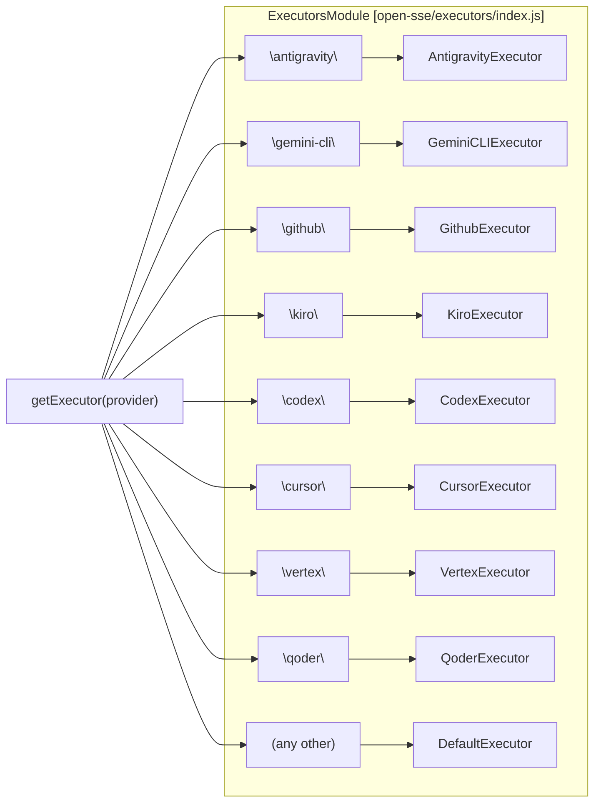
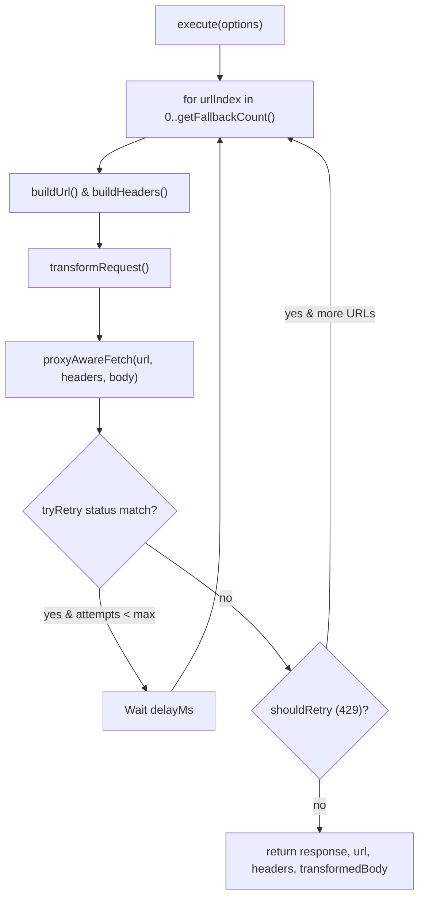
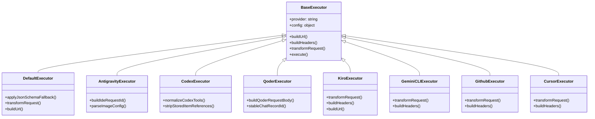

<!-- source: DeepWiki mcp.deepwiki.com · repo decolua/9router · page 5.3 Provider Executors · fetched 2026-10-30 -->

# Provider Executors

Relevant source files

The following files were used as context for generating this wiki page:

- [.github/dependabot.yml](.github/dependabot.yml)
- [.github/workflows/docker-publish.yml](.github/workflows/docker-publish.yml)
- [.gitignore](.gitignore)
- [.npmignore](.npmignore)
- [DOCKER.md](DOCKER.md)
- [Dockerfile](Dockerfile)
- [README.md](README.md)
- [open-sse/config/runtimeConfig.js](open-sse/config/runtimeConfig.js)
- [open-sse/executors/base.js](open-sse/executors/base.js)
- [open-sse/executors/default.js](open-sse/executors/default.js)
- [open-sse/utils/claudeCloaking.js](open-sse/utils/claudeCloaking.js)
- [src/app/api/usage/stream/route.js](src/app/api/usage/stream/route.js)
- [tests/translator/claude-claude-stream-decloak.test.js](tests/translator/claude-claude-stream-decloak.test.js)
- [tests/unit/claude-cloaking.test.js](tests/unit/claude-cloaking.test.js)
- [tests/unit/claude-header-forwarding.test.js](tests/unit/claude-header-forwarding.test.js)

Purpose: BaseExecutor pattern, request building, URL fallbacks, default executor.

This section covers the executor layer—the component responsible for translating a prepared AI request into a real HTTP call against a specific provider's API. Each executor encapsulates the HTTP mechanics for one provider: URL construction, header generation, request body transformation, retry logic, and credential refresh.

As a parent page, this section provides a high-level overview of the executor architecture and base contracts. For detailed implementations of specialized provider executors, refer to the child pages linked below:
- **Kiro / CodeWhisperer Executor** ([Kiro / CodeWhisperer Executor](#5.3.1)) — Kiro translation, conversationState, AWS EventStream, integrity gate, session replay.
- **Antigravity & Gemini Executors** ([Antigravity & Gemini Executors](#5.3.2)) — Antigravity executor, Gemini translation, quota routing, retry hooks.
- **Codex, GitHub Copilot & Cursor Executors** ([Codex, GitHub Copilot & Cursor Executors](#5.3.3)) — Codex Responses API executor, Copilot routing, Cursor protobuf/checksum executor.
- **Other Specialized Executors** ([Other Specialized Executors](#5.3.4)) — Qoder, OpenCode/OpenCode-Go, CommandCode, Kimchi, Devin CLI, Grok, Xiaomi MiMo, Zed, CodeBuddy, Vertex.

---

## Executor Registry

All executors are retrieved via a registry interface that maps provider identifiers to their respective executor classes. When a request is dispatched, the system resolves the correct executor instance to manage transport-level details.

**Executor Registry — Provider-to-Class Map**

Sources: [open-sse/executors/base.js:11-175]()

---

## BaseExecutor Contract

`BaseExecutor` ([open-sse/executors/base.js:11-175]()) is the abstract base class all executors extend. Subclasses override selected methods; the `execute()` method orchestrates the full HTTP call and is generally not overridden.

### Methods

| Method | Default Behaviour | Overridable |
|---|---|---|
| `buildUrl(model, stream, urlIndex, credentials)` | Picks from `config.baseUrls[urlIndex]`; handles `openai-compatible-*` and `anthropic-compatible-*` dynamically [open-sse/executors/base.js:30-44]() | Yes |
| `buildHeaders(credentials, stream)` | Merges `config.headers` with `Authorization: Bearer` or `x-api-key` [open-sse/executors/base.js:46-76]() | Yes |
| `transformRequest(model, body, stream, credentials)` | Returns `body` unchanged [open-sse/executors/base.js:79-81]() | Yes |
| `shouldRetry(status, urlIndex)` | Returns `true` on 429 when more fallback URLs remain [open-sse/executors/base.js:83-85]() | Yes |
| `refreshCredentials(credentials, log)` | Returns `null` (no-op) [open-sse/executors/base.js:88-90]() | Yes |
| `needsRefresh(credentials)` | Checks `shouldRefreshCredentials` for the provider [open-sse/executors/base.js:92-94]() | No |
| `execute(options)` | Runs URL fallback loop, handles retries based on `retryConfig`, calls `proxyAwareFetch` [open-sse/executors/base.js:100-174]() | No |

### execute() Fallback and Retry Loop

The `execute()` method iterates over all base URLs (determined by `getFallbackCount()`). It merges `DEFAULT_RETRY_CONFIG` with provider-specific overrides [open-sse/executors/base.js:107](). If a response status matches a retry rule, it waits `delayMs` before re-attempting the same URL [open-sse/executors/base.js:111-125](). It also enforces a connection timeout using `FETCH_CONNECT_TIMEOUT_MS` [open-sse/config/runtimeConfig.js:59]().

**BaseExecutor.execute() Control Flow**

Sources: [open-sse/executors/base.js:100-174](), [open-sse/config/runtimeConfig.js:59-83]()

---

## Concrete Executor Implementations

### DefaultExecutor

The `DefaultExecutor` ([open-sse/executors/default.js:78-139]()) is the base implementation used for most standard OpenAI and Anthropic compatible providers. It handles common request building, URL resolution, and authentication.

*   **Request Transformation**: The `transformRequest` method ([open-sse/executors/default.js:83-95]()) applies JSON schema fallbacks and strips unsupported parameters based on the provider's capabilities.
*   **JSON Schema Fallback**: For `openai-compatible-*` providers that do not natively support `json_schema` response formats, `applyJsonSchemaFallback` ([open-sse/executors/default.js:121-138]()) converts the request to use `json_object` with an injected system prompt.
*   **URL Building**: Inherited from `BaseExecutor` ([open-sse/executors/base.js:30-44]()), resolving target endpoints for standard model endpoints.
*   **Header Construction**: `buildHeaders` (inherited from `BaseExecutor` [open-sse/executors/base.js:46-76]()) sets `Content-Type`, `Accept` for streaming, and authentication headers. Provider-specific header quirks are handled via `HEADER_HOOKS` [open-sse/executors/default.js:42-58]().

Sources: [open-sse/executors/default.js:1-139](), [open-sse/executors/base.js:1-76]()

### Specialized Executors Overview

For providers requiring non-standard payloads, protocol translation (such as gRPC or AWS EventStreams), custom encryption, or specialized auth lifecycles, dedicated executor classes extend `BaseExecutor`. 

- For Kiro and CodeWhisperer integration details, see [Kiro / CodeWhisperer Executor](#5.3.1).
- For Antigravity and Gemini specific routing and fallback hooks, see [Antigravity & Gemini Executors](#5.3.2).
- For Codex, GitHub Copilot, and Cursor protocol executors, see [Codex, GitHub Copilot & Cursor Executors](#5.3.3).
- For all other specialized providers (Qoder, OpenCode, Devin, etc.), see [Other Specialized Executors](#5.3.4).

Sources: [open-sse/executors/base.js:11-175]()

---

## Class Hierarchy

**Executor Class Hierarchy**

Sources: [open-sse/executors/base.js:11-175](), [open-sse/executors/default.js:78-139]()

---

