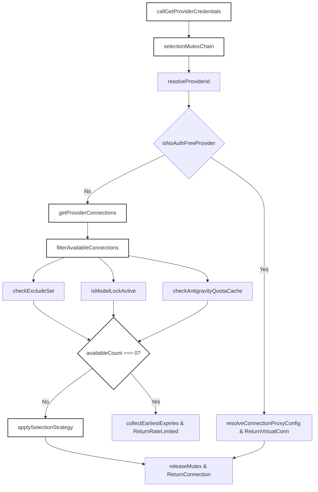
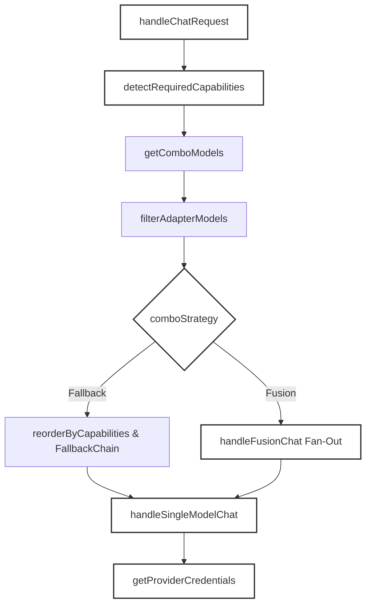

<!-- source: DeepWiki mcp.deepwiki.com · repo decolua/9router · page 5.5 Account Selection Strategies · fetched 2026-10-30 -->

# Account Selection Strategies

Relevant source files

The following files were used as context for generating this wiki page:

- [images/fusion-combo-ui.png](images/fusion-combo-ui.png)
- [open-sse/handlers/chatCore.js](open-sse/handlers/chatCore.js)
- [open-sse/services/combo.js](open-sse/services/combo.js)
- [open-sse/translator/concerns/modality.js](open-sse/translator/concerns/modality.js)
- [src/app/(dashboard)/dashboard/providers/[id]/AddApiKeyModal.js](src/app/(dashboard)/dashboard/providers/[id]/AddApiKeyModal.js)
- [src/app/(dashboard)/dashboard/providers/[id]/BulkImportCodexModal.js](src/app/(dashboard)/dashboard/providers/[id]/BulkImportCodexModal.js)
- [src/app/api/oauth/codex/bulk-import/route.js](src/app/api/oauth/codex/bulk-import/route.js)
- [src/app/api/providers/route.js](src/app/api/providers/route.js)
- [src/lib/db/repos/connectionsRepo.js](src/lib/db/repos/connectionsRepo.js)
- [src/shared/components/EditConnectionModal.js](src/shared/components/EditConnectionModal.js)
- [src/sse/handlers/chat.js](src/sse/handlers/chat.js)
- [src/sse/services/auth.js](src/sse/services/auth.js)
- [tests/unit/combo-fusion.test.js](tests/unit/combo-fusion.test.js)
- [tests/unit/db-sqlite-vs-lowdb.test.js](tests/unit/db-sqlite-vs-lowdb.test.js)
- [tests/unit/fetch-success-clears-account.test.js](tests/unit/fetch-success-clears-account.test.js)
- [tests/unit/hermes-vision-detection.test.js](tests/unit/hermes-vision-detection.test.js)

## Purpose and Scope

This document details how 9Router handles multi-account selection, load distribution, and credential pooling when multiple active connections exist for a single provider. It covers the core selection strategies (fill-first, round-robin, and sticky limits), the concurrency controls safeguarding the account pool via a selection mutex, and upstream error/rate-limit filtering mechanisms.

For failure handling, model-specific locking, and cool-down logic, see [Account Fallback & Rate Limiting (3.5)](). For credential refreshing and token lifecycle management, see [Token Refresh & Credential Management (5.4)](). For connection CRUD operations and persistence, see [Provider Configuration (5.1)]().

Sources: [src/sse/services/auth.js:28-102]()

---

## Selection Strategies Overview

9Router supports three primary account selection strategies to distribute outbound requests across available credentials. These strategies are evaluated inside `getProviderCredentials()` [src/sse/services/auth.js:28-102]() within the authentication service layer.

### Fill-First Strategy

The **fill-first** strategy (default) prioritizes accounts based on their numerical priority rank in the database. It exhausts the quota and capacity of higher-priority accounts before falling back to lower-priority ones.

**Implementation Details:**
- The engine fetches all active connections for a given provider via `getProviderConnections()` [src/sse/services/auth.js:74-74]().
- It consults provider-specific override rules or global settings (`settings.fallbackStrategy`) [src/sse/services/auth.js:48-50]().
- In `fill-first` mode, the connection pool is sorted by priority, and the system selects the first available connection from `availableConnections` [src/sse/services/auth.js:86-102]().

**Use Case:** Ideal for subscription tiers or metered accounts where you want to fully utilize a primary paid subscription before spilling over into free or secondary keys.

Sources: [src/sse/services/auth.js:48-102](), [src/lib/db/repos/connectionsRepo.js:101-101]()

### Round-Robin Strategy

The **round-robin** strategy distributes request volume evenly across all healthy accounts by rotating through the available pool on every invocation.

**Implementation Details:**
- The connection set is filtered for availability and rotated based on usage timestamps or internal rotation indexes.
- The `lastUsedAt` timestamp is updated upon selection, pushing the used account to the back of the rotation queue for subsequent requests [src/sse/services/auth.js:28-35]().

**Use Case:** Best suited for providers enforcing strict per-account rate limits or concurrency ceilings where spreading request load prevents throttling.

Sources: [src/sse/services/auth.js:28-35]()

### Sticky Round-Robin Strategy

The **sticky round-robin** strategy is a hybrid configuration that combines round-robin load distribution with request batching ("stickiness"). Instead of rotating accounts on every single request, the router pins a connection for a defined number of consecutive requests.

**Implementation Details:**
- The system evaluates the `consecutiveUseCount` property on the candidate connection object [src/sse/services/auth.js:28-35]().
- It compares this count against the configured sticky limit (e.g., `comboStickyRoundRobinLimit` or global limits) [src/sse/services/auth.js:28-35]().
- If the count remains under the limit, the connection is retained, reducing cache invalidation and overhead from frequent credential switching. Once the limit is breached, the rotation index advances.

**Use Case:** Minimizes connection churn and session overhead when interacting with services that benefit from prompt caching or stable connection context.

Sources: [src/sse/services/auth.js:28-35]()

---

## Account Filtering & Availability Pipeline

Before any selection strategy is applied, the candidate connection pool undergoes rigorous filtering to discard rate-limited, locked, or excluded accounts. This entire filtering sequence is protected by a `selectionMutex` promise chain to prevent race conditions during concurrent request bursts [src/sse/services/auth.js:9-39]().

**Diagram: Account Selection and Filtering Architecture (Natural Language to Code Entities)**

Sources: [src/sse/services/auth.js:9-134]()

### Filtering Stages

1. **Active State Verification:** Only connections where `isActive === true` are loaded from the database layer [src/sse/services/auth.js:74-74]().
2. **Exclusion Set Filtering:** Connections present in `excludeConnectionIds` (passed down during upstream retry flows) are omitted [src/sse/services/auth.js:88-88]().
3. **Model Lock Evaluation:** The function `isModelLockActive(c, model)` inspects the connection metadata to determine if a specific model or a global lock (`__all`) is currently cooling down due to a prior rate-limit or error response [src/sse/services/auth.js:89-89]().
4. **Antigravity Quota Inspection:** For the `antigravity` provider, the in-memory `antigravityQuotaCache` is queried. If quota statistics indicate zero remaining percentage for the requested model with a future `resetAt` timestamp, the account is bypassed [src/sse/services/auth.js:93-100]().

Sources: [src/sse/services/auth.js:73-102]()

---

## Special Selection Cases

### GitHub Monthly Usage Limit
GitHub API connections enforce a specialized monthly usage boundary. If an upstream error payload matches the monthly limit string (`"you've reached your additional usage limit for your plan"`), `githubMonthlyResetMs()` calculates an expiration lock extending until the first day of the subsequent UTC month [src/sse/services/auth.js:12-19]().

### Free Provider Proxy Pool Rotation
For anonymous free-tier providers (`noAuth`), credential lookup bypasses database connections. Instead, it reads global proxy settings, picks a proxy pool ID using `pickProxyPoolId()`, resolves proxy configurations via `resolveConnectionProxyConfig()`, and returns a virtual public connection object [src/sse/services/auth.js:47-70]().

Sources: [src/sse/services/auth.js:12-70]()

---

## Combo & Capability-Based Selection

When requests target model "Combos" (virtual models combining multiple upstream engines), selection strategy interacts with capability matching and fusion pipelines.

**Diagram: Combo and Capability Resolution Flow**

Sources: [src/sse/handlers/chat.js:93-148](), [src/sse/services/auth.js:28-102]()

- **Capability Reordering:** Models within a combo are reordered prior to execution using `reorderByCapabilities()` to prioritize entries supporting hard modalities (vision, PDF, audio) [open-sse/services/combo.js:63-82]().
- **Fusion Routing:** Under the `fusion` strategy, requests fan out simultaneously to multiple panel models, and responses are synthesized via a judge model [src/sse/handlers/chat.js:114-131]().

Sources: [src/sse/handlers/chat.js:93-148](), [open-sse/services/combo.js:63-82]()

---

## Strategy Configuration Reference

The following runtime settings govern account selection behavior across the system:

| Setting Key | Type | Default | Code Entity & Description |
|-------------|------|---------|---------------------------|
| `fallbackStrategy` | string | `"fill-first"` | Global account selection strategy resolved in `getProviderCredentials` [src/sse/services/auth.js:48-50]() |
| `stickyRoundRobinLimit` | number | `3` | Maximum consecutive requests assigned to a single connection before round-robin rotation |
| `comboStrategy` | string | `"fallback"` | Execution strategy for model combos (`fallback`, `fusion`, `round-robin`) [src/sse/handlers/chat.js:108-110]() |
| `comboStickyRoundRobinLimit` | number | `1` | Consecutive request threshold for combo members before rotation [src/sse/handlers/chat.js:134-136]() |

Sources: [src/sse/services/auth.js:48-50](), [src/sse/handlers/chat.js:108-136]()

---

