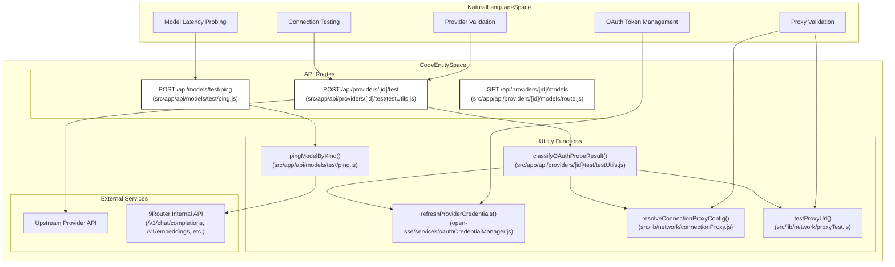
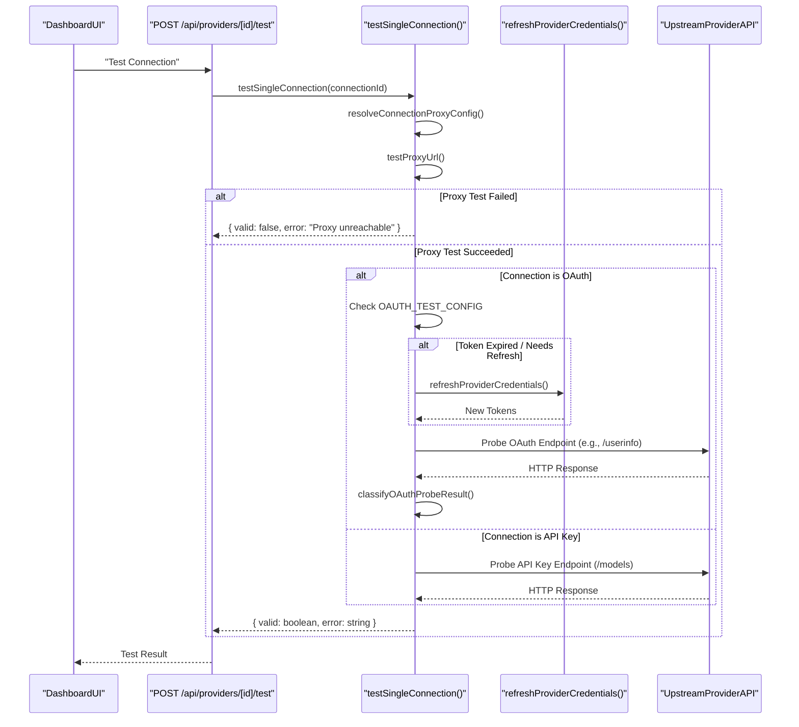

<!-- source: DeepWiki mcp.deepwiki.com · repo decolua/9router · page 5.6 Provider Validation & Testing · fetched 2026-10-30 -->

# Provider Validation & Testing

Relevant source files

The following files were used as context for generating this wiki page:

- [open-sse/providers/registry/index.js](open-sse/providers/registry/index.js)
- [open-sse/services/copilotModels.js](open-sse/services/copilotModels.js)
- [src/app/api/models/test/ping.js](src/app/api/models/test/ping.js)
- [src/app/api/models/test/route.js](src/app/api/models/test/route.js)
- [src/app/api/oauth/[provider]/[action]/route.js](src/app/api/oauth/[provider]/[action]/route.js)
- [src/app/api/providers/[id]/models/route.js](src/app/api/providers/[id]/models/route.js)
- [src/app/api/providers/[id]/test-models/route.js](src/app/api/providers/[id]/test-models/route.js)
- [src/app/api/providers/[id]/test/testUtils.js](src/app/api/providers/[id]/test/testUtils.js)
- [src/app/api/providers/suggested-models/filters.js](src/app/api/providers/suggested-models/filters.js)
- [src/app/api/providers/suggested-models/route.js](src/app/api/providers/suggested-models/route.js)
- [src/lib/oauth/constants/oauth.js](src/lib/oauth/constants/oauth.js)
- [src/lib/oauth/providers.js](src/lib/oauth/providers.js)
- [src/lib/oauth/providers/index.js](src/lib/oauth/providers/index.js)
- [src/shared/components/OAuthModal.js](src/shared/components/OAuthModal.js)
- [tests/__baseline__/alias-baseline.json](tests/__baseline__/alias-baseline.json)
- [tests/__baseline__/providers-baseline.json](tests/__baseline__/providers-baseline.json)
- [tests/__baseline__/verify-alias.mjs](tests/__baseline__/verify-alias.mjs)
- [tests/unit/fusion-strip-stream-options-3024.test.js](tests/unit/fusion-strip-stream-options-3024.test.js)
- [tests/unit/hf-model-routing.test.js](tests/unit/hf-model-routing.test.js)
- [tests/unit/model-test-routing.test.js](tests/unit/model-test-routing.test.js)
- [tests/unit/ping-reasoning-models-3010.test.js](tests/unit/ping-reasoning-models-3010.test.js)
- [tests/unit/provider-test-models-routing.test.js](tests/unit/provider-test-models-routing.test.js)

This document covers the provider connection validation and testing system in 9Router. This includes single connection testing, API key validation, model availability probing, OAuth token refresh, and provider node endpoint validation.

---

## Overview

The validation and testing system ensures that provider connections are functional and credentials remain valid. It spans from UI-triggered manual tests to automated background checks during request routing.

**Key Responsibilities:**
1. **Connection Verification**: Validates stored credentials (API keys or OAuth tokens) by hitting provider-specific "probe" endpoints `[src/app/api/providers/[id]/test/testUtils.js:32-173]()`.
2. **OAuth Lifecycle**: Checks token expiry and proactively refreshes tokens using `refreshProviderCredentials` `[src/app/api/providers/[id]/test/testUtils.js:18-20]()`.
3. **Node Validation**: Verifies base URLs and keys for OpenAI/Anthropic compatible nodes using `/models` or specialized probes `[src/app/api/providers/[id]/models/route.js:73-80]`.
4. **Proxy Health**: Tests connection-specific proxy configurations via `resolveConnectionProxyConfig` and `testProxyUrl` before attempting provider communication `[src/app/api/providers/[id]/test/testUtils.js:2-3]()`.
5. **Model-Specific Pinging**: Validates individual model availability and measures latency via internal completion/embedding/audio loops `[src/app/api/models/test/ping.js:58-170]()`.

**Validation System Architecture**

Sources: [src/app/api/providers/[id]/test/testUtils.js:1-183](), [src/app/api/models/test/ping.js:58-170](), [src/app/api/providers/[id]/models/route.js:1-168]()

---

## Connection Testing Logic & Proxy Verification

Connection testing is orchestrated by utility functions that handle proxy resolution, authentication testing, and status updates.

### Proxy Validation
If a connection is bound to a proxy pool, the system first resolves the configuration via `resolveConnectionProxyConfig` `[src/app/api/providers/[id]/test/testUtils.js:2-2]()`. It then performs a `testProxyUrl` check `[src/app/api/providers/[id]/test/testUtils.js:3-3]()`. If the proxy is unreachable, the test fails immediately with a proxy-specific error.

### Authentication Probing
The system branches based on the connection's provider type and authentication method defined in `OAUTH_TEST_CONFIG` `[src/app/api/providers/[id]/test/testUtils.js:33-173]()`.

**Authentication Probe Flow**

Sources: [src/app/api/providers/[id]/test/testUtils.js:1-183]()

---

## OAuth Provider Testing & Credential Lifecycles

OAuth providers use the `OAUTH_TEST_CONFIG` map to define validation endpoints and strategies `[src/app/api/providers/[id]/test/testUtils.js:33-173]()`.

### Specialized Probes
*   **Codex**: Sends a minimal invalid JSON body to `https://chatgpt.com/backend-api/codex/responses`. A `400` status is accepted as "valid auth" because it implies the token was accepted but the request was malformed `[src/app/api/providers/[id]/test/testUtils.js:35-46]()`.
*   **Gemini/Antigravity**: Hits `https://www.googleapis.com/oauth2/v1/userinfo?alt=json` `[src/app/api/providers/[id]/test/testUtils.js:47-60]()`.
*   **Grok CLI**: Probes `https://cli-chat-proxy.grok.com/v1/user`. It uses `classifyOAuthProbeResult` to handle `402` (spending limit) as a "soft success" — the connection remains active with a warning message `[src/app/api/providers/[id]/test/testUtils.js:127-148]`, `[src/app/api/providers/[id]/test/testUtils.js:181-183]()`.
*   **iFlow**: Requires the token as a query parameter via `buildUrl` rather than an Authorization header `[src/app/api/providers/[id]/test/testUtils.js:68-73]()`.
*   **Kimchi**: Probes the validation URL specified in `KIMCHI_CONFIG` with bearer authentication `[src/app/api/providers/[id]/test/testUtils.js:115-125]()`.

### Token Refresh
The system uses `shouldRefreshCredentials` and `refreshProviderCredentials` to manage the OAuth lifecycle `[src/app/api/providers/[id]/test/testUtils.js:18-20]()`. The `buildOAuthResolver` function similarly incorporates refresh-on-401 logic for dynamic model fetching `[src/app/api/providers/[id]/models/route.js:100-135]()`.

Sources: [src/app/api/providers/[id]/test/testUtils.js:33-173](), [src/app/api/providers/[id]/models/route.js:100-135]()

---

## Dynamic Model Discovery & Batch Pinging (`pingModelByKind`)

The system provides endpoints to fetch live model lists and ping specific models to verify availability and latency.

### Dynamic Model Fetching
The system dynamically fetches available models via `GET /api/providers/[id]/models` `[src/app/api/providers/[id]/models/route.js:1-168]()`. This route utilizes parsers such as `parseOpenAIStyleModels`, `parseGeminiCliModels`, and `parseCodexModels` to normalize provider responses `[src/app/api/providers/[id]/models/route.js:24-71]()`.

### Model Pinging (`pingModelByKind`)
The `pingModelByKind` function performs a live test of a specific model by dispatching a minimal query against internal router endpoints (`/api/v1/embeddings`, `/api/v1/images/generations`, `/api/v1/audio/transcriptions`, `/api/v1/systemone`, or `/api/v1/chat/completions`) `[src/app/api/models/test/ping.js:58-170]()`.

1.  **Kind-Specific Payloads**:
    *   **Embedding**: Sends `"test"` input to `/api/v1/embeddings` `[src/app/api/models/test/ping.js:62-83]()`.
    *   **Image**: Sends `"test"` prompt to `/api/v1/images/generations` `[src/app/api/models/test/ping.js:85-107]()`.
    *   **STT**: Uploads a generated silent WAV blob to `/api/v1/audio/transcriptions` `[src/app/api/models/test/ping.js:109-136]()`.
    *   **SystemOne**: Sends a classification prompt to `/api/v1/systemone` `[src/app/api/models/test/ping.js:138-166]()`.
    *   **Chat**: Sends a standard user message with `max_tokens: 16` to `/api/v1/chat/completions` `[src/app/api/models/test/ping.js:168-170]()`.
2.  **Internal Loop & Latency**: Requests are executed against the local router port (`UPDATER_CONFIG.appPort`), ensuring the entire translation and routing pipeline is verified and latency (`latencyMs`) is accurately tracked `[src/app/api/models/test/ping.js:58-69]()`.

Sources: [src/app/api/models/test/ping.js:58-170](), [src/app/api/providers/[id]/models/route.js:1-168]()

---

