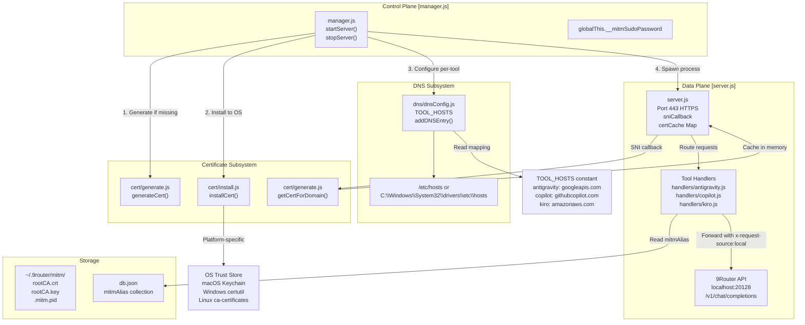

<!-- source: DeepWiki mcp.deepwiki.com · repo decolua/9router · page 6 MITM Proxy System · fetched 2026-10-30 -->

# MITM Proxy System

Relevant source files

The following files were used as context for generating this wiki page:

- [src/app/(dashboard)/dashboard/cli-tools/components/MitmServerCard.js](src/app/(dashboard)/dashboard/cli-tools/components/MitmServerCard.js)
- [src/app/(dashboard)/dashboard/cli-tools/components/MitmToolCard.js](src/app/(dashboard)/dashboard/cli-tools/components/MitmToolCard.js)
- [src/app/(dashboard)/dashboard/mitm/MitmPageClient.js](src/app/(dashboard)/dashboard/mitm/MitmPageClient.js)
- [src/app/api/cli-tools/antigravity-mitm/route.js](src/app/api/cli-tools/antigravity-mitm/route.js)
- [src/mitm/cert/install.js](src/mitm/cert/install.js)
- [src/mitm/dns/dnsConfig.js](src/mitm/dns/dnsConfig.js)
- [src/mitm/manager.js](src/mitm/manager.js)
- [src/mitm/server.js](src/mitm/server.js)

## Purpose and Scope

The MITM (Man-in-the-Middle) Proxy System enables transparent interception and routing of HTTPS traffic from AI coding tools that do not support custom API endpoint configuration. This system allows tools like Antigravity IDE, GitHub Copilot, Kiro, and Cursor to use 9Router's smart provider routing without requiring any configuration changes in the client tools themselves [src/app/(dashboard)/dashboard/cli-tools/components/MitmServerCard.js:167-171]().

This page provides a high-level overview of the MITM proxy architecture, components, and operational flow. As a parent page, it introduces each sub-topic briefly and links to detailed child pages. For details, see:
- MITM Architecture & Use Cases: [MITM Architecture & Use Cases](#6.1)
- Certificate Generation & Installation: [Certificate Generation & Installation](#6.2)
- DNS Configuration: [DNS Configuration](#6.3)
- Intercepted Tool Integration: [Intercepted Tool Integration](#6.4)

The MITM system operates alongside the main 9Router API by listening on port 443 and selectively intercepting traffic based on DNS configuration [src/mitm/server.js:15](), [src/mitm/manager.js:41-42]().

Sources: `[src/mitm/server.js:1-15]`, `[src/mitm/manager.js:1-42]`, `[src/app/(dashboard)/dashboard/cli-tools/components/MitmServerCard.js:167-171]`

---

## Architecture & Overview

The MITM proxy architecture consists of four primary operational layers: the control plane manager (`src/mitm/manager.js`), the certificate generation and installation module (`src/mitm/cert/generate.js`, `src/mitm/cert/install.js`), the DNS configuration module (`src/mitm/dns/dnsConfig.js`), and the high-performance data plane proxy server (`src/mitm/server.js`).

### System Overview Diagram

Sources: `[src/mitm/manager.js:12-62]`, `[src/mitm/server.js:29-56]`, `[src/mitm/dns/dnsConfig.js:34-38]`, `[src/shared/constants/mitmToolHosts.js:1-10]`

For details on the design principles, routing modes, and tool use cases, see [MITM Architecture & Use Cases](#6.1).

---

## Certificate Generation & Installation

To intercept HTTPS traffic without throwing security exceptions in host applications, 9Router generates a local Root Certificate Authority (CA) and dynamically signs leaf certificates for target domains on demand via SNI [src/mitm/server.js:41-56](). 

The certificate generation engine stores keys in `~/.9router/mitm/` [src/mitm/server.js:11-12](), while the installer module integrates the Root CA into the operating system's trust store (`security` for macOS, `certutil` for Windows, and `update-ca-certificates` or `update-ca-trust` for Linux) [src/mitm/cert/install.js:10-19, 48-81]().

For detailed instructions on root CA generation, leaf certificate caching, fingerprint verification, and OS trust store integration, see [Certificate Generation & Installation](#6.2).

Sources: `[src/mitm/server.js:11-56]`, `[src/mitm/cert/install.js:10-81]`

---

## DNS Configuration

The MITM proxy redirects target tool domains to `127.0.0.1` by modifying the system hosts file [src/mitm/dns/dnsConfig.js:36-38](). The mapping of domains to intercept per tool is defined in `TOOL_HOSTS` [src/shared/constants/mitmToolHosts.js:1-10]().

When enabling or disabling tool DNS via the dashboard UI (`MitmToolCard.js`) or API routes, 9Router performs atomic file writes (with backups on Windows) and automatically flushes the local DNS cache (`dscacheutil`, `mDNSResponder`, `resolvectl`, or `ipconfig`) [src/mitm/dns/dnsConfig.js:14-32, 104-111, 146-174]().

For details on hosts file modification routines, tool domain mappings, and DNS cache flushing mechanisms, see [DNS Configuration](#6.3).

Sources: `[src/mitm/dns/dnsConfig.js:14-174]`, `[src/shared/constants/mitmToolHosts.js:1-10]`

---

## Intercepted Tool Integration

Once traffic reaches port 443 on the local machine and is decrypted via the dynamic SNI callback, requests are classified and routed to specialized tool handlers:

| Handler Module | Target Tool | Supported Interception Strategy |
|----------------|-------------|----------------------------------|
| `src/mitm/handlers/antigravity.js` | Antigravity IDE | Intercepts Gemini-formatted requests, applies IDE version overrides, and maps models to 9Router endpoints [src/mitm/server.js:14, 30](). |
| `src/mitm/handlers/copilot.js` | GitHub Copilot | Intercepts Copilot completion and chat endpoints, translating formats to OpenAI-compatible payloads [src/mitm/server.js:31](). |
| `src/mitm/handlers/kiro.js` | Kiro (Claude Code / Amazon Q) | Handles state extraction, thinking block parsing, and AWS EventStream frame building [src/mitm/server.js:32](), [src/mitm/handlers/kiro.js:38-160](). |
| `src/mitm/handlers/cursor.js` | Cursor | Manages protocol translation for Cursor's custom proxy streams via auto-import configurations [src/mitm/server.js:33](). |

For implementation details regarding intercept handlers, request mapping, and auto-import integration, see [Intercepted Tool Integration](#6.4).

Sources: `[src/mitm/server.js:30-33]`, `[src/mitm/handlers/kiro.js:38-160]`

---

