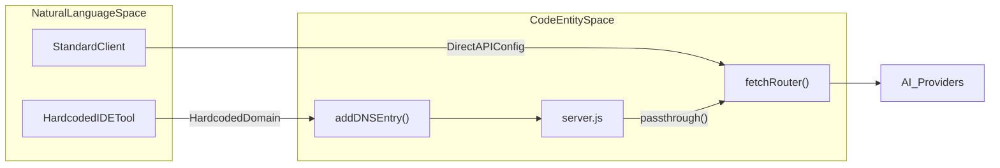
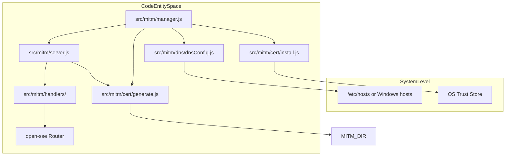
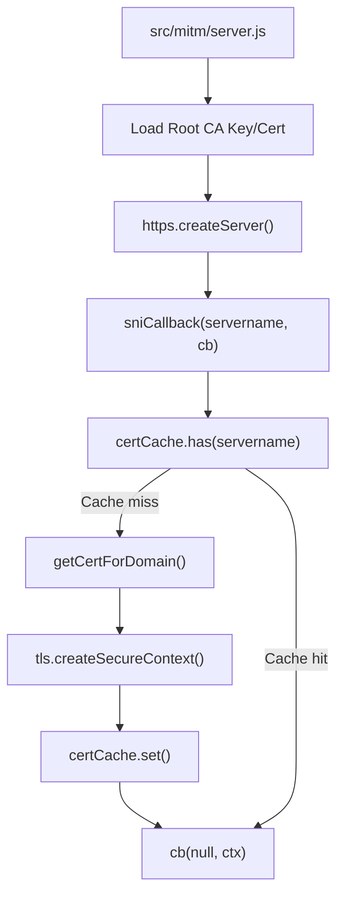
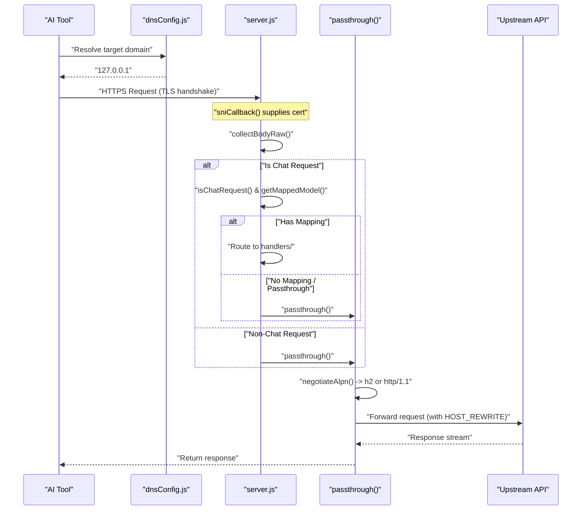
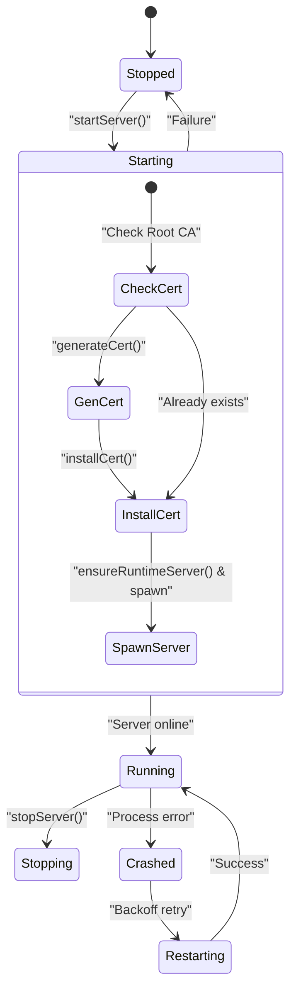

<!-- source: DeepWiki mcp.deepwiki.com · repo decolua/9router · page 6.1 MITM Architecture & Use Cases · fetched 2026-10-30 -->

# MITM Architecture & Use Cases

<details>
<summary>Relevant source files</summary>

The following files were used as context for generating this wiki page:

- [cli/src/cli/menus/providers.js](cli/src/cli/menus/providers.js)
- [open-sse/providers/registry/antigravity.js](open-sse/providers/registry/antigravity.js)
- [open-sse/services/usage/google.js](open-sse/services/usage/google.js)
- [src/app/(dashboard)/dashboard/cli-tools/components/MitmServerCard.js](src/app/(dashboard)/dashboard/cli-tools/components/MitmServerCard.js)
- [src/app/(dashboard)/dashboard/cli-tools/components/MitmToolCard.js](src/app/(dashboard)/dashboard/cli-tools/components/MitmToolCard.js)
- [src/app/(dashboard)/dashboard/mitm/MitmPageClient.js](src/app/(dashboard)/dashboard/mitm/MitmPageClient.js)
- [src/app/api/cli-tools/antigravity-mitm/route.js](src/app/api/cli-tools/antigravity-mitm/route.js)
- [src/mitm/cert/install.js](src/mitm/cert/install.js)
- [src/mitm/config.js](src/mitm/config.js)
- [src/mitm/dns/dnsConfig.js](src/mitm/dns/dnsConfig.js)
- [src/mitm/manager.js](src/mitm/manager.js)
- [src/mitm/server.js](src/mitm/server.js)
- [src/shared/constants/cliTools.js](src/shared/constants/cliTools.js)

</details>


This page describes the Man-in-the-Middle (MITM) proxy subsystem architecture, explaining why it exists, which tools require it, and how the components work together to enable transparent traffic interception.

For certificate generation and installation details, see [6.2](). For DNS configuration mechanics, see [6.3](). For specific tool integration patterns, see [6.4]().

## Purpose and Scope

The MITM proxy enables 9Router to intercept HTTPS traffic from AI coding tools that do not support custom API endpoint configuration. By operating as a transparent proxy on port 443 with system-level certificate trust and DNS redirection, the MITM subsystem allows tools like Antigravity, GitHub Copilot, and Kiro to route through 9Router's smart fallback system without requiring modifications to the tool itself [src/mitm/server.js:1-35](), [src/shared/constants/cliTools.js:1-78]().

This document covers:
- Use cases requiring MITM vs direct API integration
- System architecture and component interactions
- Request interception, ALPN negotiation, and forwarding mechanics
- Tool-specific handler patterns and latency guards
- Platform-specific implementation and lifecycle management

Sources: [src/mitm/server.js:1-35](), [src/shared/constants/cliTools.js:1-78]()

## Why MITM is Required

### Tools Requiring MITM vs Direct Integration

Not all AI coding tools support custom API endpoint configuration. The table below categorizes tools by integration method:

| Tool | Integration Method | Reason |
|------|-------------------|---------|
| **Cursor IDE** | Direct API | Supports custom OpenAI-compatible base URL [src/mitm/config.js:23](). |
| **Cline, Continue, Roo** | Direct API | VSCode extensions with configurable endpoints. |
| **Antigravity** | **MITM Required** | Hardcoded Google API endpoints [src/mitm/config.js:17-18](). |
| **GitHub Copilot** | **MITM Required** | Proprietary endpoints [src/mitm/config.js:19](). |
| **Kiro (AWS Builder)** | **MITM Required** | AWS/Kiro endpoints [src/mitm/config.js:20-22](). |

The fundamental constraint is architectural: tools using MITM have their API endpoints hardcoded or use proprietary authentication schemes that cannot be redirected via configuration alone [src/mitm/config.js:16-24]().

Sources: [src/mitm/config.js:16-24](), [src/shared/constants/cliTools.js:1-78]()

### MITM Use Case Pattern



**MITM enables:**
1. **No client modification** - Tool code remains unchanged.
2. **Transparent interception** - System-level DNS + certificate trust [src/mitm/dns/dnsConfig.js:146-180]().
3. **Model aliasing** - Map proprietary model names to 9Router models via `getMappedModel()` [src/mitm/server.js:99-118]().
4. **Unified routing** - All tools benefit from smart fallback.

Sources: [src/mitm/server.js:99-118](), [src/mitm/dns/dnsConfig.js:146-180]()

## System Architecture Overview

### Component Layer Diagram



**Key architectural principles:**

1. **Separation of concerns** - Certificate generation, DNS modification, and server proxying are isolated across dedicated modules [src/mitm/manager.js:1-19]().
2. **Platform abstraction** - `manager.js` coordinates platform-specific operations using `IS_WIN` and `IS_MAC` flags [src/mitm/manager.js:11-12]().
3. **Process isolation** - MITM server runs as a separate process (tracked via `.mitm.pid`) often with elevated privileges via `sudo` or `runElevatedPowerShell` [src/mitm/manager.js:41-43](), [src/mitm/dns/dnsConfig.js:69-91]().
4. **Runtime Protection** - The server script is copied to a runtime directory via `ensureRuntimeServer()` to prevent file locking (`EBUSY`) during updates [src/mitm/manager.js:67-94]().

Sources: [src/mitm/manager.js:11-94](), [src/mitm/dns/dnsConfig.js:69-91]()

### Tool-Specific Host Mappings

The `TARGET_HOSTS` array and `getToolForHost()` logic define which domains each tool uses [src/mitm/config.js:16-24](), [src/mitm/config.js:140-145]():

| Tool | Domain(s) | Source |
|------|-----------|--------|
| Antigravity | `daily-cloudcode-pa.googleapis.com`, `cloudcode-pa.googleapis.com` | [src/mitm/config.js:17-18]() |
| Copilot | `api.individual.githubcopilot.com` | [src/mitm/config.js:19]() |
| Kiro | `runtime.us-east-1.kiro.dev`, `codewhisperer.us-east-1.amazonaws.com` | [src/mitm/config.js:20-22]() |
| Cursor | `api2.cursor.sh` | [src/mitm/config.js:23]() |

This mapping enables per-tool DNS control via `addDNSEntry(tool)` and `removeDNSEntry(tool)` [src/mitm/dns/dnsConfig.js:146-180](), as well as status tracking via `checkAllDNSStatus()` [src/mitm/dns/dnsConfig.js:130-141]().

Sources: [src/mitm/config.js:16-24](), [src/mitm/dns/dnsConfig.js:130-180]()

## MITM Server Architecture

### Server Initialization and TLS Termination



The server uses a **Server Name Indication (SNI)** callback to dynamically generate domain-specific certificates [src/mitm/server.js:41-56]():

| Step | Code | Purpose |
|------|------|---------|
| 1. Load Root CA | [src/mitm/server.js:60-68]() | Load or generate self-signed root certificate for the HTTPS server. |
| 2. SNI callback registration | [src/mitm/server.js:41-56]() | Handle TLS handshake per domain dynamically using `sniCallback`. |
| 3. Certificate caching | [src/mitm/server.js:38]() | Use `certCache` (Map) to avoid regenerating certificates repeatedly. |
| 4. Leaf cert generation | [src/mitm/server.js:44]() | Call `getCertForDomain` to sign domain cert with Root CA. |

Why SNI is necessary: AI tools connect to specific pinned domains. The SNI callback generates and caches these on-demand so the tool sees a valid certificate signed by the trusted Root CA.

Sources: [src/mitm/server.js:38-68]()

### Request Processing and ALPN Flow



**Key decision points:**

1. **Anti-loop detection** (`x-request-source: local`) - Identifies requests originating from 9Router [src/mitm/server.js:21]().
2. **URL pattern matching** via `isChatRequest()` - Only intercept endpoints defined in `URL_PATTERNS` [src/mitm/config.js:26-49]().
3. **Host Rewriting** (`HOST_REWRITE`) - Rewrites `cloudcode-pa.googleapis.com` to `daily-cloudcode-pa.googleapis.com` for chat endpoints to avoid rate limits [src/mitm/server.js:25-27]().
4. **ALPN Negotiation** (`negotiateAlpn()`) - Attempts HTTP/2 (`h2`) first, falling back to HTTP/1.1 for upstream forwarding [src/mitm/server.js:144-167]().
5. **Latency Protection** (`MODEL_NO_MAP`) - Models matching regular expressions (such as Antigravity tab-autocomplete `tab_` patterns) bypass interception to prevent typing lag and quota exhaustion [src/mitm/config.js:121-129]().

Sources: [src/mitm/server.js:21-167](), [src/mitm/config.js:26-130]()

## Manager Orchestration

### Server Lifecycle State Machine



**State persistence and coordination:**
- **Runtime Copy** - `ensureRuntimeServer()` copies `server.js` into `DATA_DIR/runtime/mitm/server.js` to prevent `EBUSY` file-locking issues when updating npm packages while the MITM server runs [src/mitm/manager.js:67-94]().
- **PID tracking** - Written to `.mitm.pid` file in `MITM_DIR` [src/mitm/manager.js:43]().
- **Port Conflict Handling** - `getProcessUsingPort443()` detects processes occupying port 443 on Windows or Unix [src/mitm/manager.js:100-121]().

Sources: [src/mitm/manager.js:41-123](), [src/app/api/cli-tools/antigravity-mitm/route.js:94-139]()

### Password Encryption and Caching

Sudo passwords (required for port 443 and DNS on Unix systems) are securely encrypted using `aes-256-gcm` [src/mitm/manager.js:97-99]():

```javascript
// Encryption logic in src/mitm/manager.js:164-171
function encryptPassword(plaintext) {
  const key = deriveKey();
  const iv = crypto.randomBytes(12);
  const cipher = crypto.createCipheriv(ENCRYPT_ALGO, key, iv);
  const encrypted = Buffer.concat([cipher.update(plaintext, "utf8"), cipher.final()]);
  const tag = cipher.getAuthTag();
  return `${iv.toString("hex")}:${tag.toString("hex")}:${encrypted.toString("hex")}`;
}
```

Key derivation (`deriveKey()`) binds encryption to machine IDs via `node-machine-id` with a fixed salt `9router-mitm-pwd` [src/mitm/manager.js:154-162]().

Sources: [src/mitm/manager.js:154-184](), [src/mitm/manager.js:97-99]()

## Use Case: Kiro IDE & Antigravity Interception

Specialized handlers parse and re-map requests for target AI IDEs:

1. **Antigravity Handler** (`src/mitm/handlers/antigravity.js`) - Translates Google Cloud Code Assist requests and handles IDE version headers (`applyAntigravityIdeVersionOverride`) [src/mitm/server.js:134-136]().
2. **Kiro Handler** (`src/mitm/handlers/kiro.js`) - Re-wraps responses into the AWS EventStream binary protocol format with CRC32 checksums, initial response frames, and thought block extraction.
3. **Dashboard Control** - Managed via `MitmServerCard.js` for infrastructure state and `MitmToolCard.js` for per-tool DNS toggling and model alias configuration [src/app/(dashboard)/dashboard/cli-tools/components/MitmServerCard.js:8-12](), [src/app/(dashboard)/dashboard/cli-tools/components/MitmToolCard.js:8-13]().

Sources: [src/mitm/server.js:29-34](), [src/app/(dashboard)/dashboard/cli-tools/components/MitmServerCard.js:1-40](), [src/app/(dashboard)/dashboard/cli-tools/components/MitmToolCard.js:1-30]()

---

